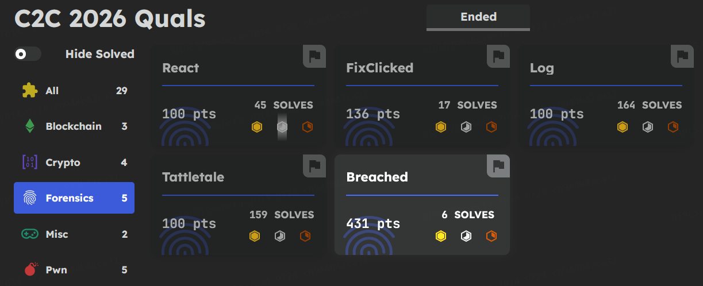
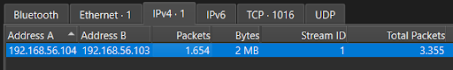
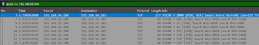
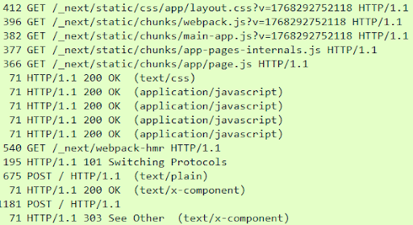
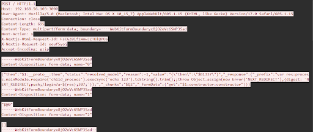
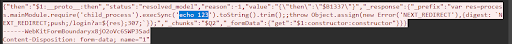

Complete write-ups of challenge that I solved in Country-2-Country CTF 2026 Qualification held by International Cyber Security – Center of Excellence (INCS-CoE). Achieved a full solve in the forensics category.

## React
### Description
One month ago, there was a massive attack on one of the popular JS frameworks, and it seems like my website was affected as well...

You can use Wireshark to analyze the PCAP file.

### Solution
We’re given a pcap file, opening in the wireshark gives us clear network traffic. We’re given too instance with some questions.

#### Question #1:
What is the IP address of the attacker?
Required Format: 127.0.0.1
##### Answer
First question, by looking at the conversations, there is only one IP that has a lot of packets. This can determine some kind of enumerating or recon that was done by the attacker. The IP is 192.168.56.104.

#### Question #2:
What is the IP address of the victim?
Required Format: 127.0.0.1
##### Answer
We can look at address B for the victim IP, 192.168.56.103.

#### Question #3:
What tools did the attacker use first? (Lowercase)
Required Format:
##### Answer
By filtering with the attacker IP, we know that the attacker did recon by enumerating the open port (proof from a lot of SYN traffic). So the answer is nmap.

#### Question #4:
Which CVE ID was exploited by the attacker?
Required Format: CVE-XXXX-XXXX
##### Answer
In the http protocol, the attacker sent some request related to nextjs. From one of traffic, there is a POST request that so sus because the previous POST request responded with 200 but this request response with 303 besides the endpoint is the same.

Follow the http stream, it is the react2shell payload that is being sent. So the CVE ID is CVE-2025-55182.

#### Question #5:
What was the first command executed by the attacker?
Required Format: -
##### Answer
From the following http stream before we also know what was the first command executed, it was echo 123.

#### Question #6:
Which Command and Control (C2) framework is being used?
Required Format: Cobalt Strike
##### Answer

#### Question #7:
What encryption key / password was used to interact with the C2 server?
Required Format: -
##### Answer
From the following http stream before we also know what was the first command executed, it was echo 123.

#### Question #8:
8. What was the first file accessed by the attacker?
Required Format: /file/to/path
##### Answer
From the following http stream before we also know what was the first command executed, it was echo 123.

#### Question #9:
9. What command or method was used by the attacker to establish persistence on the system?
##### Answer
From the following http stream before we also know what was the first command executed, it was echo 123.

### Flag