These are my forensics write-ups from GCW 2.0 Final. Each section follows the solving process recorded during the investigation.

## Silent Execution (50 Points)

The challenge provided a Windows memory dump. Since the title suggested silent execution, I started with Volatility’s `windows.cmdline` plugin.

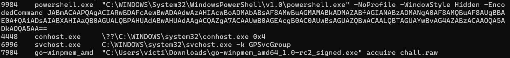

Near the end of the output, I found a long Base64 string in a command configured to run hidden, matching the description.

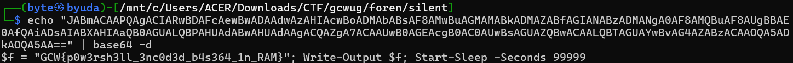

### Flag

```text
GCW{p0w3rsh3ll_3nc0d3d_b4s364_1n_RAM}
```

## Reze Was Here (468 Points)

I loaded the Windows disk image into Autopsy. For the first question, the username was visible under `C:\Users`.

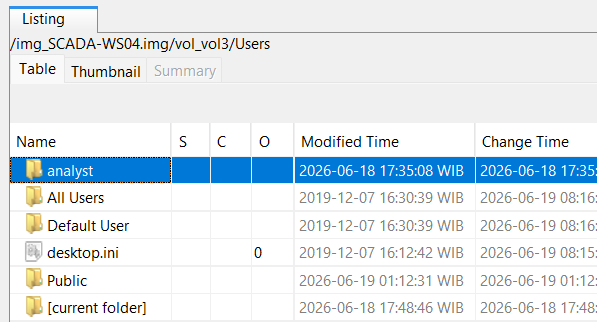

Autopsy’s operating system information identified the hostname as `scada-ws04`.

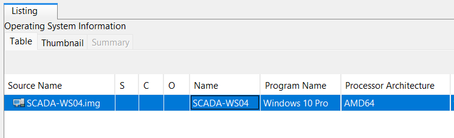

For question 3, I found ten `.blf` files in `C:\Users\Public`.

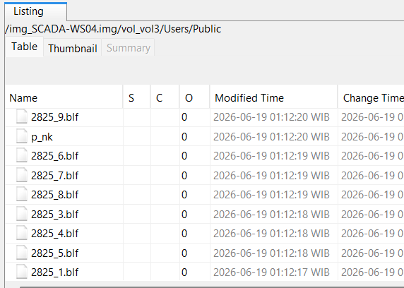

The same directory contained the file requested in question 4: `2825.blf`.

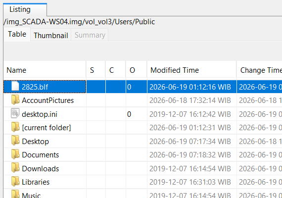

For question 5, I extracted the USN journal and searched for `_svc_`.

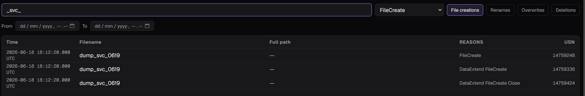

Searching for `2825.blf clfs` led me to the CVE associated with the exploit.

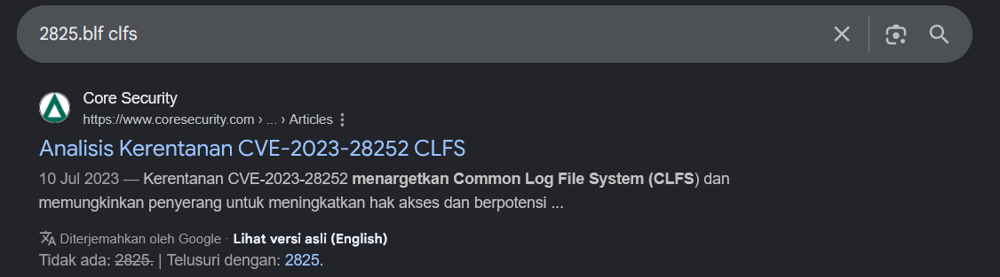

The credential registry hive requested in question 7 was `SAM`.

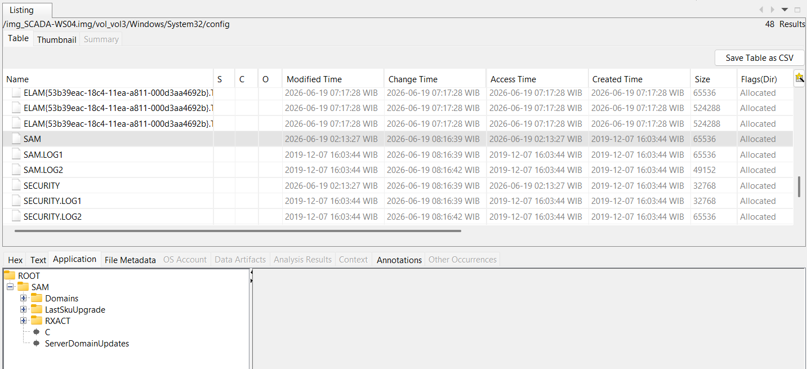

For question 8, the reference at https://github.com/fortra/CVE-2023-28252 showed command-line execution of the exploit. I parsed the PowerShell Operational event log with EvtxECmd and opened the results in Timeline Explorer, where I found the exploit script and persistence service.

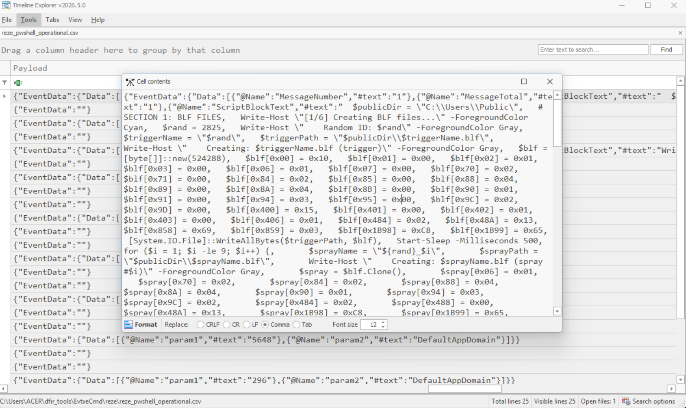

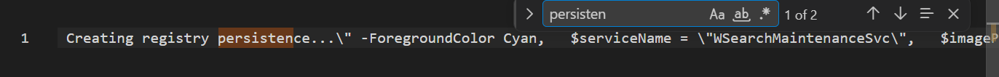

```python
from pwn import *
p = remote('ctf.gcwug.com', 1204)
print(p.recvuntil(b'Answer : ').decode())
answers = [
    'analyst',
    'scada-ws04',
    '10',
    '2825.blf',
    'dump_svc_0619',
    'CVE-2023-28252',
    'SAM',
    'WSearchMaintenanceSvc'
]

for answer in answers:
    p.sendline(answer.encode())
    response = p.recv().decode()
    print(response)
print(p.recvall().decode())
```

### Flag

```text
GCW{r3z3_s4ys_h1_t0_ur_s4m_lol}
```
