These are my forensics write-ups from GCW 2026 Quals. Each section follows the solving process recorded during the investigation.

## tidak terurut (100 Points)

### Description

I thought I had only deleted a suspicious application. What happened to my files?

Author: millkywaay

### Solution

I loaded the `.ad1` file into FTK Imager.

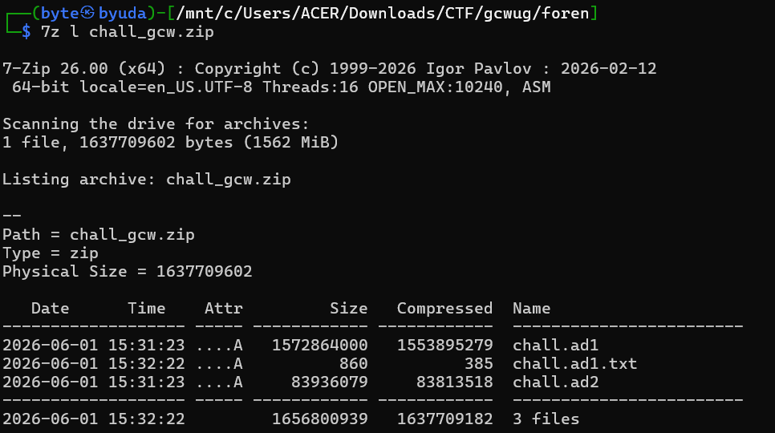

The directory `C:\Users\milkywaay\Documents\flag` contained several fragments.

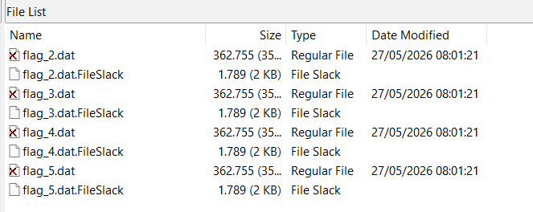

`flag_5.dat` contained a PDF header, suggesting that the files were fragments of a PDF.

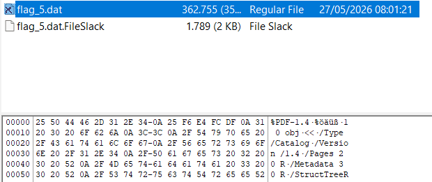

I asked GPT to help reconstruct the fragments and recovered the flag.

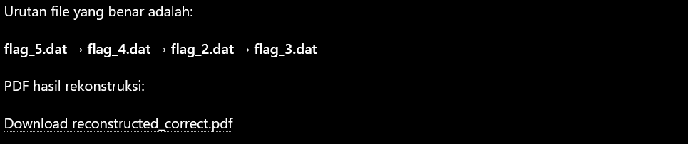

### Flag

```text
GCW{tH3_cAch3d_FAc3_r3bu1ld5_thE_trUTh}
```

## Ryomen Inscription (293 Points)

### Description

The veil frays, and the crimson horizon bleeds into the void. In the dying breath of the Malevolent Shrine, a fallen sorcerer carved a final, desperate vow into the shattered stone:

"The King of Curses leaves no fragile strings for the lazy to pull, nor does he linger in the shallow ash. Fools chase phantoms in the dirt, while the true core slumbers undisturbed."

We managed to salvage the domain’s last chaotic heartbeat, a volatile snapshot frozen just as a black tide rose to consume the barrier. At its epicenter rests a sealed relic, bound by an iron curse that defies all automated sight. Its spoken incantation was purposefully shattered by the King himself, the words burned from existence the moment the lock snapped shut. Now, the fragments lie buried deep within the frozen, unmapped labyrinth of the underlying womb.

The blind elders of Jujutsu High call it a ruined husk, casting it aside when their rigid eyes find no obvious trace in the darkness. But they lack the vision of a true master. The remnants of the monolith still sleep within the cold, structural silence of the curse. The vow cannot be simply guessed or found on the surface; it must be painfully unearthed and rewoven from the invisible architecture left behind.

Descend into the static void. Unearth the hidden scripts, weave the reverse cursed technique through the heavy obscurity, and shatter the seal. Only then will Sukuna reveal his true face.

dist Password: gcwug2026

SHA256: 14300ea4f2071964d68f612f6770a7b6c4e568d6b5cd5e57450753332bd0ca2d

Author: vortaile

### Solution

The challenge provided a `.raw` file and an encrypted file. Inspecting the raw file identified it as ELF.

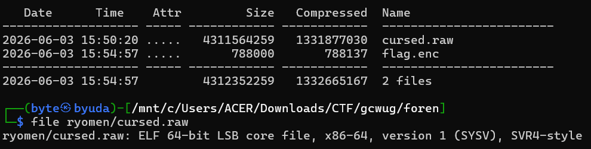

`readelf` showed that it was a QEMU ELF core dump. I used Volatility 3 to analyze it.

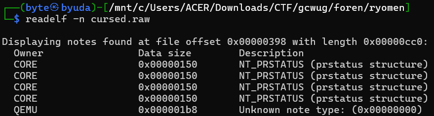

I first identified the operating system with `windows.info`: Windows 10 x64, build 19041.

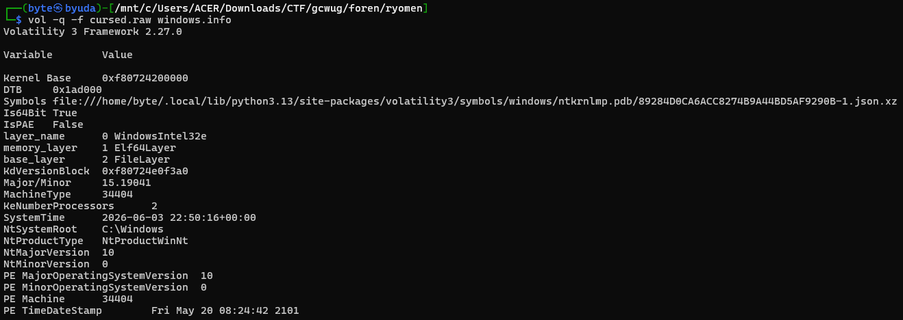

Next, I examined the processes in the dump.

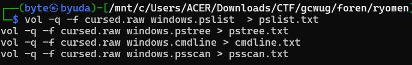

Several suspicious processes turned out to be decoys, with executable paths under a `decoys` directory.

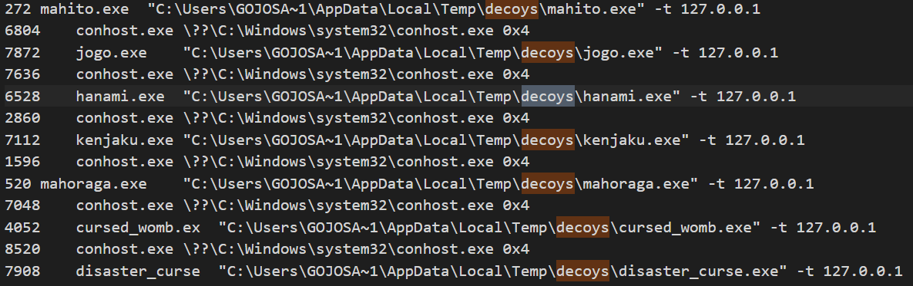

The more interesting process was `domain.exe`, launched from Downloads. I focused on that executable.

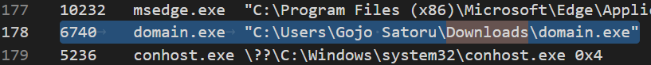

`windows.filescan` located its file object at `0xc587abfa1a80`.

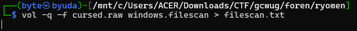

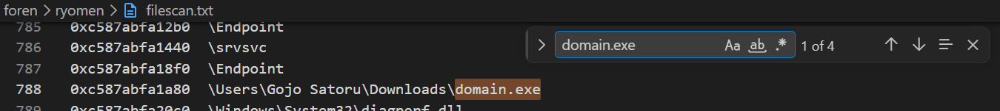

I extracted it with `windows.dumpfiles`. The result was a PE32+ executable for Windows 5.02.

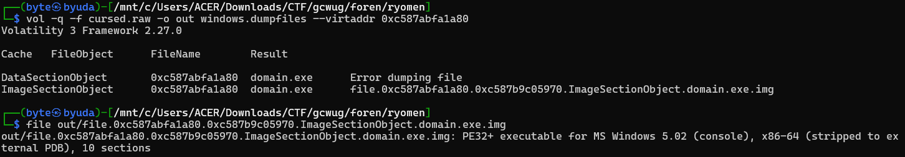

I asked GPT to help build a decryptor. Its analysis indicated that the key was generated at runtime, so I needed to recover it from memory first.

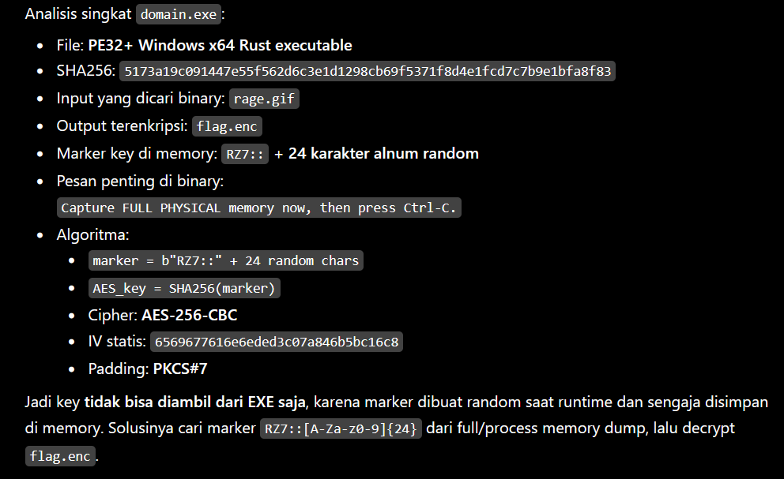

I ran `bulk_extractor` to find candidate AES keys, then used GPT to help identify the correct one.

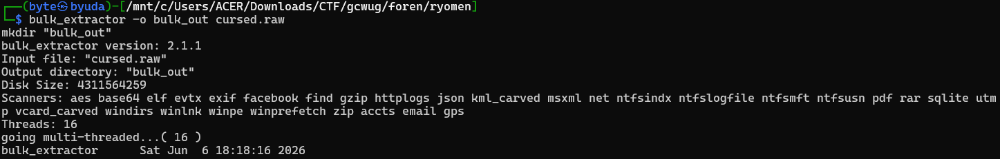

```text
# BANNER FILE NOT PROVIDED (-b option)
# BULK_EXTRACTOR-Version: 2.1.1
# Feature-Recorder: aes_keys
# Filename: cursed.raw
# Feature-File-Version: 1.1
69147384    fe cd f5 6e 26 ec eb 00 c1 2d 3b 5e 16 81 48 eb    AES128
350929688    68 e7 6a d4 42 49 71 75 51 c5 4e bc d9 f7 7d ce 4f f1 32 5d 6e 61 34 1c 9c 0f 3c e6 99 a6 ad 99    AES256
790417656    53 1c 3c b8 51 08 12 de 6a 4a a7 a5 88 d9 19 d6 98 4b 6b 50 c1 db 7d 25 8e ed 1d 8b 18 63 e6 b9    AES256
1447753544    aa 49 30 ef 97 1d 50 17 87 5e 13 a6 e6 12 5e f8 94 41 2c 3d 1c 7f ef c7 6a aa ce a5 b1 56 f1 fe    AES256
2079991256    23 2f c5 e9 33 16 be 2a 68 79 c7 0d 7b 75 8a 91    AES128
2325357704    0b c8 56 f6 18 3d 23 14 90 a9 d3 e7 69 6c d4 35    AES128
2698048136    3b ca 62 01 15 af 99 06 99 84 de cc 61 77 92 96    AES128
2709319464    8f 79 ac 94 b8 07 1d 61 e4 2e f3 e7 dc 1b f5 3f    AES128
2760936128    bc 5d 3f 11 e9 81 d4 b1 b3 71 fc c0 3e 0c 31 7d c0 e4 dd 2b c3 bd 49 0e 50 2c 4a 77 86 a3 36 f1    AES256
2971756616    40 a0 a0 79 aa 58 20 34 29 98 19 f8 01 57 ec 13    AES128
2971759896    7e 70 d7 91 8d 78 90 b4 f7 b6 e1 ea 00 cd 94 e9 15 42 02 7e c4 1b 2d 84 3c d8 b3 b5 1a 4e 26 4f    AES256
2971760552    9b b7 c0 97 ad ab 58 ce 00 48 d5 15 70 c4 1c f8    AES128
2994871176    1e 1f c3 4f e2 4e bd a8 a5 57 41 fe 3a 81 c3 d1 72 af 97 17 39 a6 56 ca d7 b3 39 d8 1f 9a 56 5f    AES256
3366280472    cc 6c e9 f0 c6 9e 7f bf 4b 69 51 37 b6 b5 6d d3    AES128
3439786904    11 0f c4 cb 92 d4 5b b4 35 20 26 dd 71 81 de db b2 55 81 80 29 32 42 f6 03 ae 57 20 d7 4b c1 5d    AES256
3621887352    4a d8 b0 bb 65 30 00 46 fd 25 3d 01 22 38 97 5b    AES128
```

The following decryptor recovered the contents of `flag.enc`.

```python
from pathlib import Path
from cryptography.hazmat.primitives.ciphers import Cipher, algorithms, modes

enc = Path("flag.enc").read_bytes()

key = bytes.fromhex(
    "aa4930ef971d5017875e13a6e6125ef894412c3d1c7fefc76aaacea5b156f1fe"
)

iv = bytes.fromhex("6569677616e6eded3c07a846b5bc16c8")

cipher = Cipher(algorithms.AES(key), modes.CBC(iv))
dec = cipher.decryptor()
pt = dec.update(enc) + dec.finalize()

pad = pt[-1]
if pad < 1 or pad > 16 or pt[-pad:] != bytes([pad]) * pad:
    raise ValueError("Invalid PKCS#7 padding, wrong key/IV")

pt = pt[:-pad]

print(pt[:16])
Path("rage.dec.gif").write_bytes(pt)
print("[+] written rage.dec.gif")
```

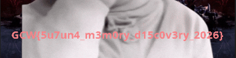

### Flag

```text
GCW{5u7un4_m3m0ry_d15c0v3ry_2026}
```

## Moai (495 Points)

### Description

Just a walking moai. Nothing SPECIAL, right?

Author: baut

### Solution

The challenge provided an AVI video and two hints.

Hint 1:

Start at 52, then continue with 62, 72, 82, 92, 102, and so on.

Hint 2:

What is the most common spatial-domain steganography technique?

The first hint pointed to a sequence of video frames:

`52, 62, 72, 82, 92, 102, ...`

I needed to start at frame 52 and advance ten frames at a time. The second hint suggested:

Least significant bit (LSB) steganography.

My initial hypothesis was that the flag was hidden in the lowest bit of pixels in those frames.

I used OpenCV to read the AVI file and check its frame count.

```python
import cv2
cap = cv2.VideoCapture("artifact.avi")
print(int(cap.get(cv2.CAP_PROP_FRAME_COUNT)))
```

I inspected the selected frames. OpenCV exposes their channels as BGR: blue at index 0, green at 1, and red at 2. I tested `pixel & 1` on each channel and found the payload in the blue channel.

Each frame held two characters, encoded in the first eight bits and the following eight bits.

I used this script to recover them:

```python
#!/usr/bin/env python3
import cv2
import sys

path = sys.argv[1] if len(sys.argv) > 1 else "artifact.avi"

cap = cv2.VideoCapture(path)
nframes = int(cap.get(cv2.CAP_PROP_FRAME_COUNT))

def extract_two_chars(frame):
    bits = (frame[:, :, 0].reshape(-1) & 1).tolist()

    out = bytearray()

    for off in (0, 8):
        v = 0
        for b in bits[off:off + 8]:
            v = (v << 1) | int(b)
        out.append(v)

    return bytes(out)

flag = bytearray()

for idx in range(52, nframes, 10):
    cap.set(cv2.CAP_PROP_POS_FRAMES, idx)
    ok, frame = cap.read()

    if not ok:
        break

    chunk = extract_two_chars(frame)
    print(f"frame {idx}: {chunk!r}")

    flag += chunk

    if b"}" in chunk:
        break

print()
print("FLAG:", flag.decode())
```

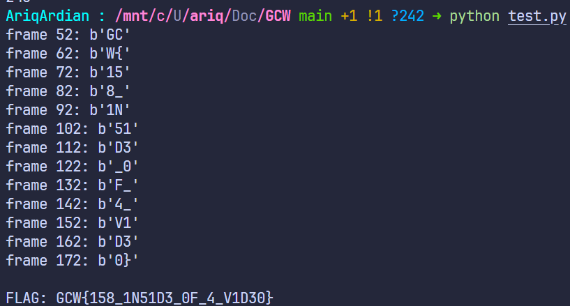

### Flag

```text
GCW{158_1N51D3_0F_4_V1D30}
```
