These are my forensics write-ups from GEMASTIK 19 Quals. Each section follows the solving process recorded during the investigation.

## cinder (100 Points)

The task was to recover deleted transaction history. Opening the database with SQLite risked checkpointing the WAL and losing the history I needed.

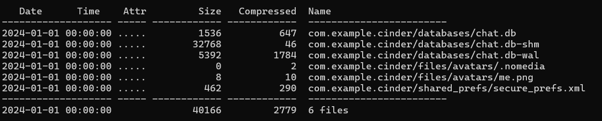

I extracted the files without opening the database in SQLite. Inspecting them with `xxd` revealed salts and encrypted payloads.

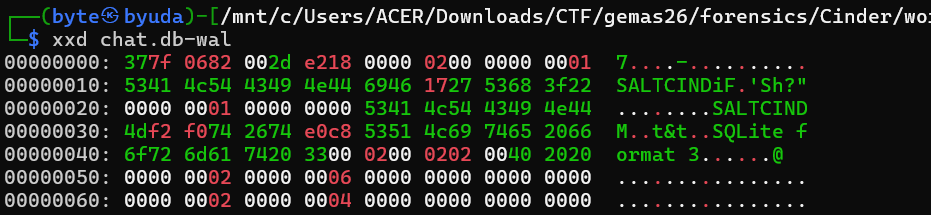

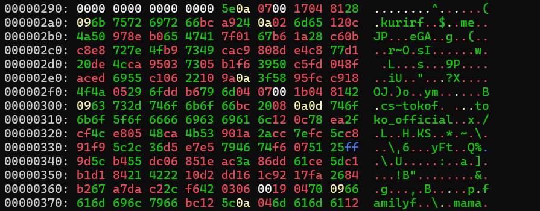

`shared_prefs/secure_prefs.xml` provided the encryption settings.

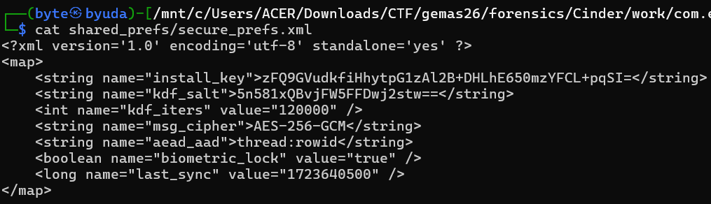

I asked Claude to help build a decryptor and recovered the flag.

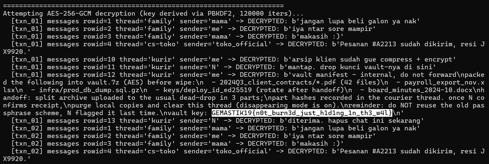

```python
#!/usr/bin/env python3
"""
cinder_wal_recover.py
----------------------
Forensic WAL-frame-level recovery for the Cinder CTF chat.db (+ -wal, -shm).

What it does:
  1. Reads chat.db and chat.db-wal directly as bytes (read-only, never
     touches your original files, never runs sqlite3's own checkpoint).
  2. Manually parses every WAL frame per the SQLite file format spec,
     validating each frame's rolling checksum.
  3. Groups frames into transactions by their commit markers, and also
     keeps any *uncommitted trailing frames* that a normal `sqlite3`
     checkpoint would silently discard.
  4. Reconstructs a standalone .db snapshot for every transaction boundary
     (i.e. the database exactly as it existed after each commit), plus one
     for the uncommitted tail if present.
  5. Dumps `messages` and `drafts` rows from every snapshot and diffs them,
     so rows that existed in an earlier snapshot but vanished from the
     final one (deleted messages) are surfaced.
  6. Optionally attempts to AES-256-GCM decrypt each `body` blob using the
     key material from secure_prefs.xml.

Usage:
  python3 cinder_wal_recover.py /path/to/databases/chat.db [--out DIR]
      [--install-key B64] [--kdf-salt B64] [--kdf-iters N]

Requires: Python 3.8+, stdlib only for parsing/dumping.
Optional: `pip install pycryptodome` for the decryption step.
"""

import argparse, os, struct, sqlite3, sys, base64, hashlib

def read_file(path):
    with open(path, 'rb') as f:
        return f.read()

def read_varint(buf, pos):
    result = 0
    shift = 0
    while True:
        b = buf[pos]
        result |= (b & 0x7f) << shift
        pos += 1
        if not (b & 0x80):
            break
        shift += 7
    return result, pos

def parse_body_fields(buf):
    """body BLOB layout observed: protobuf-style length-delimited fields
       1=sender(str) 2=nonce(12B) 3=ciphertext 4=tag(16B)"""
    pos = 0
    fields = {}
    while pos < len(buf):
        tag, pos = read_varint(buf, pos)
        field_no, wire_type = tag >> 3, tag & 0x7
        if wire_type == 2:
            length, pos = read_varint(buf, pos)
            fields[field_no] = buf[pos:pos+length]
            pos += length
        elif wire_type == 0:
            val, pos = read_varint(buf, pos)
            fields[field_no] = val
        else:
            raise ValueError(f"unsupported wire type {wire_type} in body blob")
    return fields

def wal_checksum_step(data, s0, s1, big_endian):
    fmt = '>2I' if big_endian else '<2I'
    for i in range(0, len(data), 8):
        x0, x1 = struct.unpack_from(fmt, data, i)
        s0 = (s0 + x0 + s1) & 0xFFFFFFFF
        s1 = (s1 + x1 + s0) & 0xFFFFFFFF
    return s0, s1

def parse_wal(wal_bytes):
    if len(wal_bytes) < 32:
        raise ValueError("WAL file too small")
    magic, fmt_ver, page_size, ckpt_seq, salt1, salt2, hcksum1, hcksum2 = \
        struct.unpack(">8I", wal_bytes[:32])
    if magic not in (0x377f0682, 0x377f0683):
        raise ValueError(f"Bad WAL magic: {magic:#x}")
    big_endian = (magic == 0x377f0682)
    if page_size == 1:
        page_size = 65536

    s0, s1 = wal_checksum_step(wal_bytes[:24], 0, 0, big_endian)
    header_ok = (s0 == hcksum1 and s1 == hcksum2)

    frame_size = 24 + page_size
    frames = []
    off = 32
    idx = 0
    while off + frame_size <= len(wal_bytes):
        fh = wal_bytes[off:off+24]
        page_no, commit_size, fsalt1, fsalt2, fck1, fck2 = struct.unpack(">6I", fh)
        page_data = wal_bytes[off+24:off+24+page_size]
        if page_no == 0:
            break
        s0, s1 = wal_checksum_step(fh[:8], s0, s1, big_endian)
        s0, s1 = wal_checksum_step(page_data, s0, s1, big_endian)
        checksum_ok = (s0 == fck1 and s1 == fck2)
        salt_ok = (fsalt1 == salt1 and fsalt2 == salt2)
        frames.append(dict(idx=idx, offset=off, page_no=page_no,
                            commit_size=commit_size, salt_ok=salt_ok,
                            checksum_ok=checksum_ok, data=page_data))
        idx += 1
        off += frame_size
        if not checksum_ok:
            print(f"  [!] frame {idx-1} (page {page_no}) failed checksum "
                  f"validation -- torn write, corruption, or tampering.",
                  file=sys.stderr)

    return dict(page_size=page_size, big_endian=big_endian,
                header_ok=header_ok, salt1=salt1, salt2=salt2,
                frames=frames)

def load_db_pages(db_bytes, page_size):
    pages = {}
    n = len(db_bytes) // page_size
    for i in range(n):
        pages[i+1] = db_bytes[i*page_size:(i+1)*page_size]
    return pages

def write_snapshot(pages, n_pages, page_size, out_path):
    with open(out_path, 'wb') as f:
        for p in range(1, n_pages+1):
            data = pages.get(p)
            if data is None:
                print(f"  [!] page {p} missing from snapshot {out_path} "
                      f"-- zero-filling (page never appears in db or WAL)",
                      file=sys.stderr)
                data = b'\x00' * page_size
            f.write(data)

def dump_rows(db_path):
    rows = {}
    try:
        con = sqlite3.connect(f"file:{db_path}?mode=ro", uri=True)
        cur = con.cursor()
        for table in ("messages", "drafts"):
            try:
                cur.execute(f"SELECT rowid AS rid, * FROM {table}")
                cols = [d[0] for d in cur.description]
                for r in cur.fetchall():
                    row = dict(zip(cols, r))
                    rows[(table, row['rid'])] = row
            except sqlite3.OperationalError:
                pass
        con.close()
    except sqlite3.DatabaseError as e:
        print(f"  [!] could not open {db_path}: {e}", file=sys.stderr)
    return rows

def main():
    ap = argparse.ArgumentParser()
    ap.add_argument("db_path", help="path to chat.db (siblings chat.db-wal / chat.db-shm assumed)")
    ap.add_argument("--out", default="wal_recovery_out")
    ap.add_argument("--install-key", default="zFQ9GVudkfiHhytpG1zAl2B+DHLhE650mzYFCL+pqSI=")
    ap.add_argument("--kdf-salt", default="5n581xQBvjFW5FFDwj2stw==")
    ap.add_argument("--kdf-iters", type=int, default=120000)
    args = ap.parse_args()

    db_path = args.db_path
    wal_path = db_path + "-wal"
    os.makedirs(args.out, exist_ok=True)

    db_bytes = read_file(db_path)
    wal_bytes = read_file(wal_path) if os.path.exists(wal_path) else b""

    hdr_page_size = None
    if len(db_bytes) >= 18:
        hdr_page_size = struct.unpack(">H", db_bytes[16:18])[0]
        if hdr_page_size == 1:
            hdr_page_size = 65536

    if not wal_bytes:
        print("No WAL file found / empty -- nothing to recover beyond chat.db itself.")
        return

    wal = parse_wal(wal_bytes)
    page_size = wal['page_size']
    if hdr_page_size and hdr_page_size != page_size:
        print(f"[!] page size mismatch: chat.db header={hdr_page_size} "
              f"chat.db-wal header={page_size} -- using WAL's value")

    print(f"WAL: page_size={page_size} header_checksum_ok={wal['header_ok']} "
          f"frames={len(wal['frames'])} salt=({wal['salt1']:#x},{wal['salt2']:#x})")

    pages = load_db_pages(db_bytes, page_size)
    print(f"Base chat.db: {len(pages)} pages")

    # group frames into transactions
    txns = []
    cur_txn = []
    for fr in wal['frames']:
        cur_txn.append(fr)
        if fr['commit_size'] != 0:
            txns.append(cur_txn)
            cur_txn = []
    uncommitted_tail = cur_txn  # leftover frames with no commit marker

    print(f"Found {len(txns)} committed transaction(s) in the WAL"
          + (f" + {len(uncommitted_tail)} UNCOMMITTED trailing frame(s)"
             if uncommitted_tail else ""))

    snapshots = []  # (label, path, rows)
    working_pages = dict(pages)
    n_pages = len(pages)

    for i, txn in enumerate(txns, 1):
        for fr in txn:
            working_pages[fr['page_no']] = fr['data']
        n_pages = txn[-1]['commit_size']
        label = f"txn_{i:02d}"
        out_path = os.path.join(args.out, f"{label}.db")
        write_snapshot(working_pages, n_pages, page_size, out_path)
        rows = dump_rows(out_path)
        snapshots.append((label, out_path, rows))
        print(f"  -> {label}: {n_pages} pages, "
              f"{sum(1 for k in rows if k[0]=='messages')} messages, "
              f"{sum(1 for k in rows if k[0]=='drafts')} drafts")

    if uncommitted_tail:
        for fr in uncommitted_tail:
            working_pages[fr['page_no']] = fr['data']
        n_pages = max(n_pages, max(fr['page_no'] for fr in uncommitted_tail))
        label = "uncommitted_tail"
        out_path = os.path.join(args.out, f"{label}.db")
        write_snapshot(working_pages, n_pages, page_size, out_path)
        rows = dump_rows(out_path)
        snapshots.append((label, out_path, rows))
        print(f"  -> {label} (SQLite itself would IGNORE this on checkpoint): "
              f"{n_pages} pages, "
              f"{sum(1 for k in rows if k[0]=='messages')} messages, "
              f"{sum(1 for k in rows if k[0]=='drafts')} drafts")

    print("\n" + "="*70)
    for label, path, rows in snapshots:
        print(f"\n--- {label} ({path}) ---")
        for (table, rid), row in sorted(rows.items()):
            if table == "messages":
                body = row.get("body") or b""
                print(f"  [messages] rowid={rid} thread={row.get('thread')!r} "
                      f"ts={row.get('ts')} state={row.get('state')} "
                      f"body_len={len(body)} body_hex={body.hex()[:64]}"
                      f"{'...' if len(body)>32 else ''}")
            else:
                print(f"  [drafts]   rowid={rid} note={row.get('note')!r}")

    if len(txns) >= 1:
        final_label, final_path, final_rows = snapshots[len(txns)-1]
        print("\n" + "="*70)
        print(f"DIFF vs final committed snapshot ({final_label}):")
        seen_final = set(final_rows.keys())
        all_seen_ever = set()
        found_any = False
        for label, path, rows in snapshots:
            for key in rows:
                if key not in seen_final and key not in all_seen_ever:
                    found_any = True
                    all_seen_ever.add(key)
                    table, rid = key
                    print(f"  [RECOVERED] {table} rowid={rid} "
                          f"(present in {label}, absent from {final_label}): "
                          f"{rows[key]}")
        if not found_any:
            print("  (no rows disappeared between snapshots -- check the "
                  "uncommitted_tail snapshot above by hand, and diff body "
                  "hex between snapshots for same-rowid content changes.)")

    try:
        from Crypto.Cipher import AES
    except ImportError:
        print("\n(install pycryptodome -- `pip install pycryptodome` -- "
              "to also attempt AES-256-GCM decryption of message bodies)")
        return

    key = hashlib.pbkdf2_hmac('sha256', base64.b64decode(args.install_key),
                               base64.b64decode(args.kdf_salt),
                               args.kdf_iters, dklen=32)
    print("\n" + "="*70)
    print(f"Attempting AES-256-GCM decryption (key derived via PBKDF2, "
          f"{args.kdf_iters} iters)...")
    for label, path, rows in snapshots:
        for (table, rid), row in sorted(rows.items()):
            if table != "messages":
                continue
            body = row.get("body")
            if not body:
                continue
            aad = f"{row.get('thread')}:{rid}".encode()
            try:
                f = parse_body_fields(body)
                sender = f.get(1, b'').decode('utf-8', 'replace')
                nonce, ct, tag = f[2], f[3], f[4]
                cipher = AES.new(key, AES.MODE_GCM, nonce=nonce)
                cipher.update(aad)
                pt = cipher.decrypt_and_verify(ct, tag)
                print(f"  [{label}] messages rowid={rid} thread={row.get('thread')!r} "
                      f"sender={sender!r} -> DECRYPTED: {pt!r}")
            except Exception as e:
                print(f"  [{label}] messages rowid={rid} thread={row.get('thread')!r} "
                      f"-> decrypt failed ({e})")

if __name__ == "__main__":
    main()
```

### Flag

```text
GEMASTIK19{n0t_burn3d_just_h1d1ng_1n_th3_w4l}
```

## Ghost In The Core (100 Points)

The challenge provided a process core dump and a PCAP containing localhost traffic. I started by extracting the TCP payload.

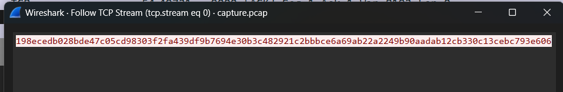

The payload looked encrypted, so I moved to the core dump. With Claude’s help, I examined it using GDB and `objdump`. The analysis narrowed the final key to either eight zero bytes or a value hidden in an RC4-encrypted configuration blob. The resulting decryptor recovered the flag.

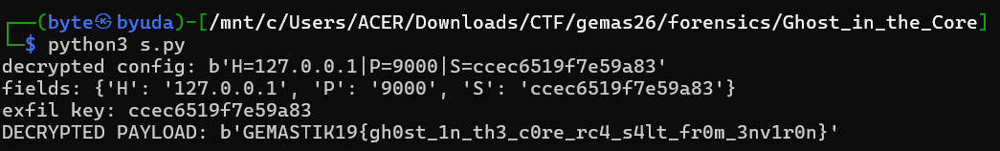

```python
data = open("seg_rodata.bin", "rb").read()

def rc4(key, buf):
    S = list(range(256))
    j = 0
    for i in range(256):
        j = (j + S[i] + key[i % len(key)]) % 256
        S[i], S[j] = S[j], S[i]
    out = bytearray()
    i = j = 0
    for b in buf:
        i = (i + 1) % 256
        j = (j + S[i]) % 256
        S[i], S[j] = S[j], S[i]
        K = S[(S[i] + S[j]) % 256]
        out.append(b ^ K)
    return bytes(out)

# master key = 16 bytes from rodata + 8 bytes hex-decoded from the env var
master_key = data[0xd0:0xd0+16] + bytes.fromhex("4c7afa2b34c5325f")

cfg_ct = data[0x40:0x40+0x25]
config = rc4(master_key, cfg_ct)
print("decrypted config:", config)

# parse H=/P=/S= fields, pipe-delimited
try:
    text = config.decode()
    fields = dict(f.split("=", 1) for f in text.split("|") if "=" in f)
    print("fields:", fields)
    exfil_key = bytes.fromhex(fields["S"][:16])
    print("exfil key:", exfil_key.hex())
except Exception as e:
    print("parse issue:", e, "-- inspect raw bytes above manually")
    exfil_key = None

payload = bytes.fromhex("198ecedb028bde47c05cd98303f2fa439df9b7694e30b3c482921c2bbbce6a69ab22a2249b90aadab12cb330c13cebc793e606")

if exfil_key:
    print("DECRYPTED PAYLOAD:", rc4(exfil_key, payload))
```

### Flag

```text
GEMASTIK19{gh0st_1n_th3_c0re_rc4_s4lt_fr0m_3nv1r0n}
```

## Tombstone(100 Points)

I loaded the `.img` file into Autopsy.

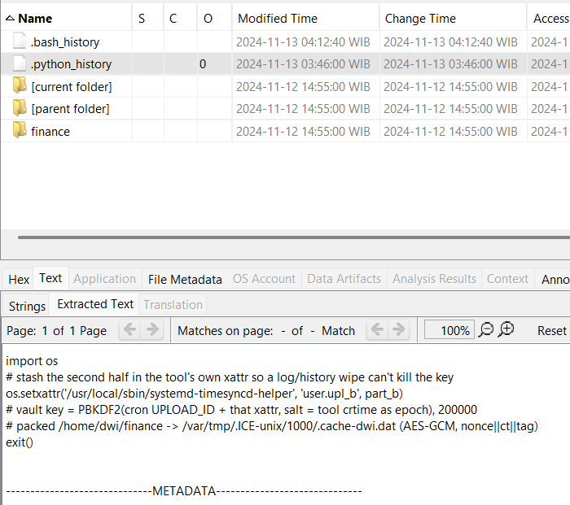

The user directory contained Python history referencing `systemd-timesyncd-helper`.

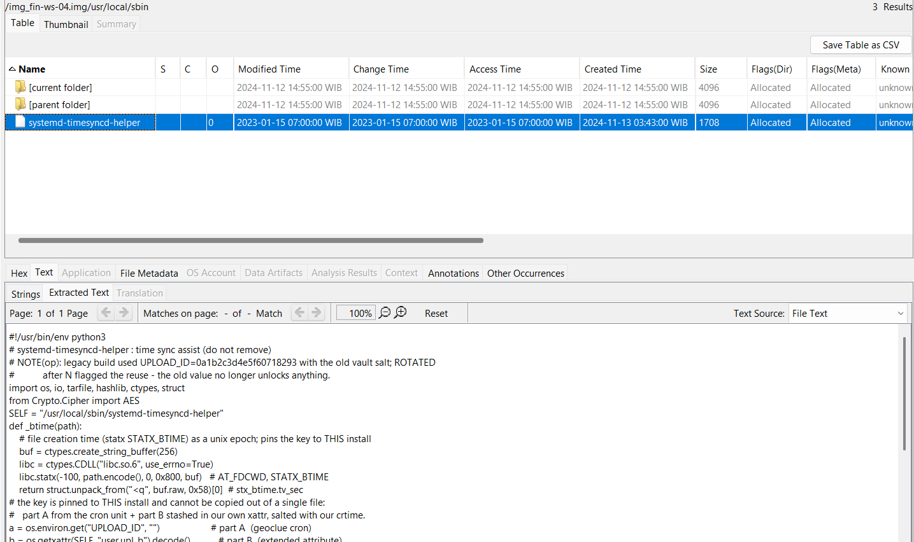

The helper’s encryption routine used `UPLOAD_ID` from the environment and the `user.upl_b` extended attribute. It archived the `finance` directory, derived a salt from the helper’s creation time, encrypted the archive with AES-GCM, and wrote `nonce + ciphertext + tag` to `/var/tmp/.ICE-unix/1000/.cache-dwi.dat`.

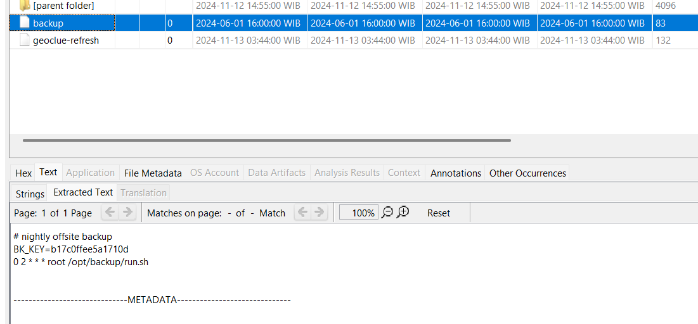

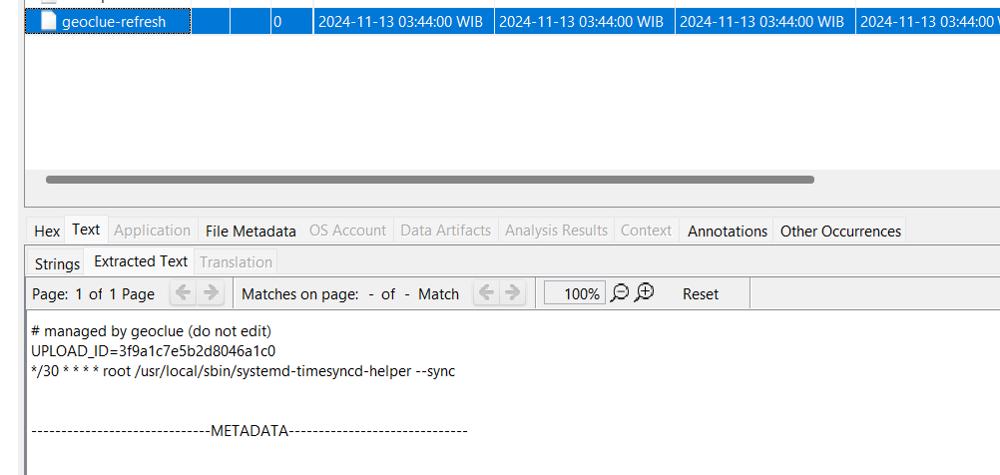

The extracted directory set was small enough to inspect manually. I found `BK_KEY` in a backup file and an updated `UPLOAD_ID` in `geoclue-refresh` under `/etc/cron.d`.

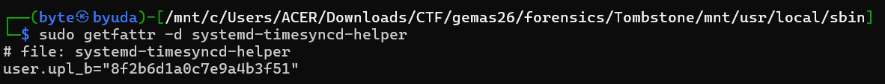

I mounted the image and read the helper’s extended attributes with `sudo getfattr -d systemd-timesyncd-helper`.

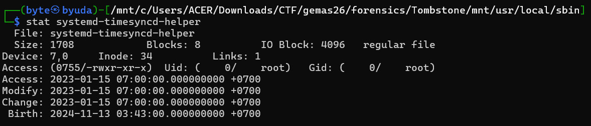

I then used `stat systemd-timesyncd-helper` to obtain the creation time needed for the salt.

With those values, I asked Claude to build the decryptor.

```python
#!/usr/bin/env python3
"""
decryptor.py - reverses the AES-256-GCM encryption performed by the
'systemd-timesyncd-helper' encryptor found on the imaged host.

Key derivation (mirrored from the encryptor):
    KEY  = PBKDF2-HMAC-SHA256(partA + partB, salt=str(crtime).encode(), 200000, 32)
    NONCE = SHA256(b"nonce|" + KEY)[:12]

Where:
    partA  = UPLOAD_ID value (originally pulled from env, set by a cron unit)
    partB  = contents of the 'user.upl_b' xattr on the original binary
              (/usr/local/sbin/systemd-timesyncd-helper)
    crtime = STATX_BTIME (file birth time, unix epoch seconds) of that same
              binary, used as the PBKDF2 salt

Ciphertext layout written by the encryptor:
    [12 bytes nonce][ciphertext][16 bytes GCM tag]

Usage:
    python3 decryptor.py \
        --part-a <UPLOAD_ID value> \
        --part-b <xattr value>      \
        --btime  <unix epoch seconds crtime> \
        --in     .cache-dwi.dat \
        --out    recovered.tar.gz

    Optionally, if you still have access to the original binary/artifact on
    disk (or a copy of it) with the xattr and timestamps intact, pass
    --self-path instead of --part-b/--btime to auto-extract them:

        python3 decryptor.py --part-a <UPLOAD_ID> \
            --self-path /path/to/recovered/systemd-timesyncd-helper \
            --in .cache-dwi.dat --out recovered.tar.gz

After decryption, the script also auto-extracts the recovered tar.gz into
an output directory unless --no-extract is given.
"""
import argparse
import hashlib
import io
import os
import struct
import sys
import tarfile

from Crypto.Cipher import AES


def derive_key(part_a: str, part_b: str, btime: int) -> bytes:
    salt = str(btime).encode()
    return hashlib.pbkdf2_hmac(
        "sha256", (part_a + part_b).encode(), salt, 200000, 32
    )


def get_btime_from_path(path: str) -> int:
    """Read STATX_BTIME the same way the encryptor did, via ctypes+libc statx."""
    import ctypes

    buf = ctypes.create_string_buffer(256)
    libc = ctypes.CDLL("libc.so.6", use_errno=True)
    AT_FDCWD = -100
    STATX_BTIME = 0x800
    ret = libc.statx(AT_FDCWD, path.encode(), 0, STATX_BTIME, buf)
    if ret != 0:
        errno = ctypes.get_errno()
        raise OSError(errno, f"statx failed on {path}: {os.strerror(errno)}")
    # stx_btime is a statx_timestamp struct at offset 0x58: {int64 tv_sec; uint32 tv_nsec; ...}
    return struct.unpack_from("<q", buf.raw, 0x58)[0]


def get_xattr_from_path(path: str, name: str = "user.upl_b") -> str:
    return os.getxattr(path, name).decode()


def decrypt(key: bytes, blob: bytes) -> bytes:
    if len(blob) < 12 + 16:
        raise ValueError("ciphertext blob too short to contain nonce+tag")
    nonce = blob[:12]
    tag = blob[-16:]
    ct = blob[12:-16]

    # sanity check: nonce should equal SHA256(b"nonce|"+key)[:12] per the encryptor logic
    expected_nonce = hashlib.sha256(b"nonce|" + key).digest()[:12]
    if nonce != expected_nonce:
        print(
            "[!] warning: nonce in file does not match SHA256(nonce|KEY) — "
            "key material (part A / part B / btime) is likely wrong",
            file=sys.stderr,
        )

    cipher = AES.new(key, AES.MODE_GCM, nonce=nonce)
    return cipher.decrypt_and_verify(ct, tag)


def main():
    ap = argparse.ArgumentParser(description=__doc__, formatter_class=argparse.RawDescriptionHelpFormatter)
    ap.add_argument("--part-a", required=True, help="UPLOAD_ID value (part A of the key)")
    ap.add_argument("--part-b", help="value of the 'user.upl_b' xattr (part B of the key)")
    ap.add_argument("--btime", type=int, help="crtime / STATX_BTIME (unix epoch seconds) used as PBKDF2 salt")
    ap.add_argument("--self-path", help="path to the recovered binary/artifact to auto-read xattr + btime from")
    ap.add_argument("--in", dest="infile", required=True, help="path to the encrypted .dat blob")
    ap.add_argument("--out", dest="outfile", default="recovered.tar.gz", help="path to write decrypted tar.gz")
    ap.add_argument("--no-extract", action="store_true", help="skip auto-extracting the tar.gz after decrypt")
    ap.add_argument("--extract-dir", default="recovered_files", help="directory to extract into")
    args = ap.parse_args()

    part_b = args.part_b
    btime = args.btime

    if args.self_path:
        if part_b is None:
            try:
                part_b = get_xattr_from_path(args.self_path)
                print(f"[+] read part B from xattr: {part_b!r}")
            except Exception as e:
                print(f"[!] failed to read xattr from {args.self_path}: {e}", file=sys.stderr)
        if btime is None:
            try:
                btime = get_btime_from_path(args.self_path)
                print(f"[+] read btime (salt) from {args.self_path}: {btime}")
            except Exception as e:
                print(f"[!] failed to read btime from {args.self_path}: {e}", file=sys.stderr)

    if part_b is None or btime is None:
        ap.error("must supply --part-b and --btime directly, or --self-path to derive them")

    key = derive_key(args.part_a, part_b, btime)
    print(f"[+] derived key: {key.hex()}")

    with open(args.infile, "rb") as f:
        blob = f.read()

    try:
        data = decrypt(key, blob)
    except ValueError as e:
        print(f"[!] decryption/verification failed: {e}", file=sys.stderr)
        sys.exit(1)

    with open(args.outfile, "wb") as f:
        f.write(data)
    print(f"[+] wrote decrypted archive to {args.outfile} ({len(data)} bytes)")

    if not args.no_extract:
        try:
            with tarfile.open(fileobj=io.BytesIO(data), mode="r:gz") as t:
                os.makedirs(args.extract_dir, exist_ok=True)
                t.extractall(args.extract_dir)
            print(f"[+] extracted archive contents to {args.extract_dir}/")
        except tarfile.ReadError as e:
            print(f"[!] archive written but could not auto-extract: {e}", file=sys.stderr)


if __name__ == "__main__":
    main()
```

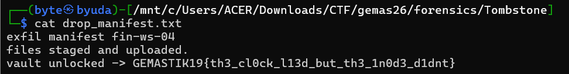

### Flag

```text
FindITCTF{h4v3_y0u_7r13d_c4rv1ng}
```
