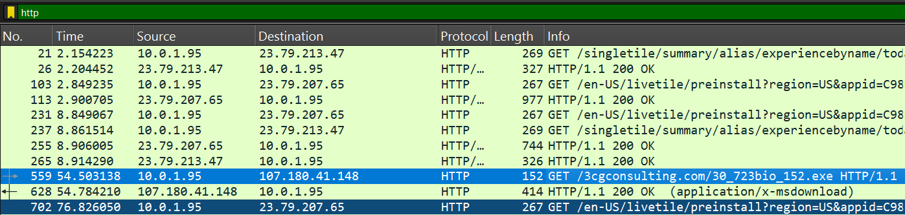
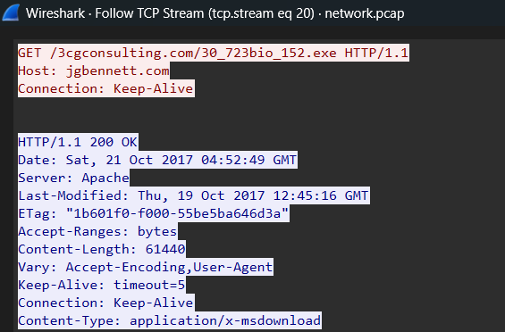
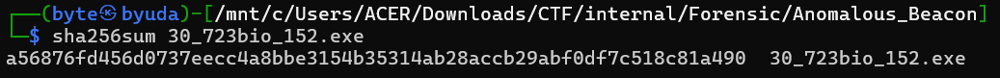
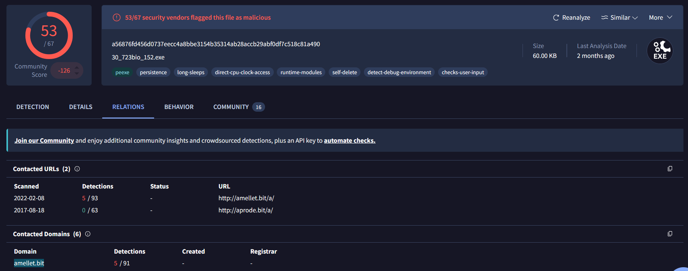
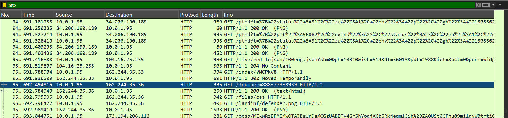
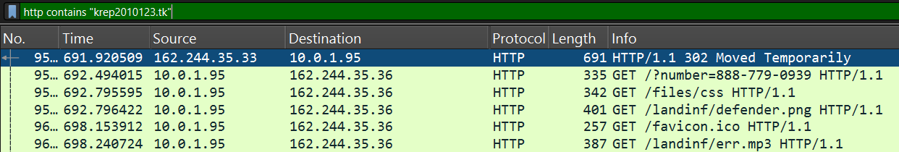
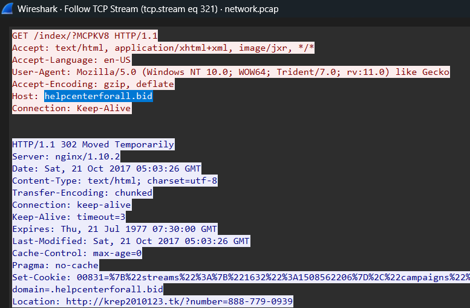
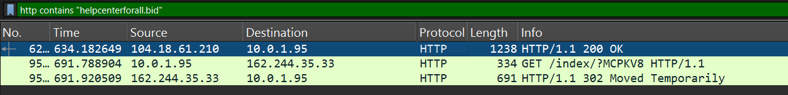
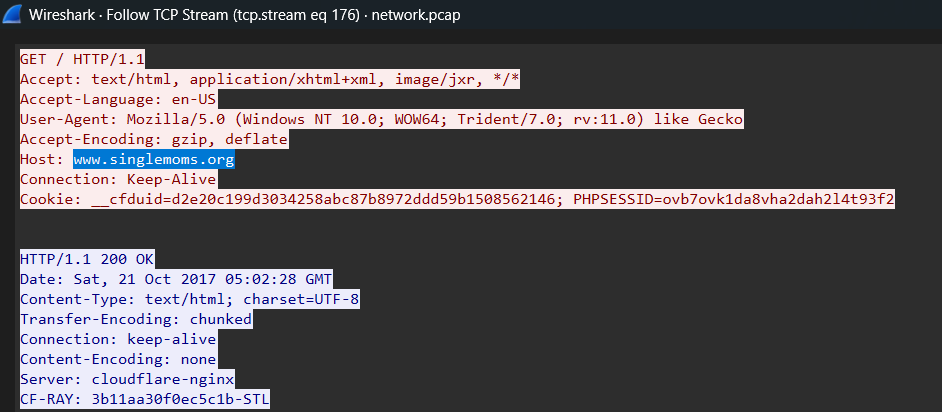

These are my forensics write-ups from GEMASTIK Internal Selection. Each section follows the solving process recorded during the investigation.

## Anomalous Beacon (100 Points)

### Description

Our Intrusion Detection System flagged suspicious outbound activity from a workstation in the operations department. The user also reported aggressive, unsolicited browser pop-ups. You have been provided a packet capture of the host's traffic. Analyze the PCAP to extract the initial payload, identify protocol anomalies, and trace the full web redirection chain.

Here are the scenarios:

1. A corporate machine has been compromised. Find the exact filename of the malicious payload downloaded over HTTP that initiated the compromise. (format: filename.extension)
2. The malicious executable discovered in Challenge 1 was not downloaded via a standard browser. Inspect the request headers of the packet that dropped the payload. What specific header field is entirely missing from this request? (format: Header-Name)
3. Extract the malicious executable payload from the PCAP. Calculate its cryptographic integrity signature to verify it against public threat intelligence databases. What is its SHA256 hash? (format: 64_hex_characters)
4. Once infected, the malware attempts to establish contact with its Command and Control (C2) server. Security analysts noticed an unusual protocol anomaly where DNS lookups for the C2 domain were performed over a non-standard transport layer protocol. What is the full domain name the infected host was beaconing to over this anomalous protocol? (format: domain.tld)
5. Unrelated to the initial infection, the user also fell victim to a secondary pop-up redirection loop leading to a tech support scam. Identify the initial compromised website that hosted the malicious script responsible for kicking off this redirection chain. (format: www.domain.tld)
6. Trace the full redirection chain from Challenge 5. The intermediate gateway (helpcenterforall.bid) redirected the user one last time. What is the full, exact destination URL (including all parameters/queries) of the final fake anti-virus landing page? (format: http://domain.tld/path/?query=value)

### Solution

The challenge provided a PCAP and several questions. For question 1, I filtered HTTP traffic and found a response carrying an executable.

Following the executable’s HTTP stream showed that the request lacked a `User-Agent` header. That was the answer to question 2.

I extracted the executable and calculated its SHA-256: `a56876fd456d0737eecc4a8bbe3154b35314ab28accb29abf0df7c518c81a490`.

Looking up the hash in VirusTotal revealed the contacted domain `amellet.bit`.

Further HTTP analysis revealed a request containing a phone number. Following the TCP stream showed a fake antivirus page.

To trace the redirect into that page, I filtered with `http contains "krep2010123.tk"`. A 302 response pointed back to `helpcenterforall.bid`.

I filtered for that host and followed the earlier redirect. The originating website was `www.singlemoms.org`.

The final redirect, including the phone number, was `http://krep2010123.tk/?number=888-779-0939`.
