These are my forensics write-ups from HackToday 2026. Each section follows the solving process recorded during the investigation.

## Alice in DFIRland — First Blood

### Description

A Windows workstation was flagged for anomalous behavior. Before the machine could be reimaged, IR ran a KAPE triage collection. Somewhere in the artifacts, the intruder left three fragments of a tracking flag. Find all three and reassemble them.

password file: G26YNC434M809J16U16C4L2Z

Author: jedi

### Initial Findings

I loaded the `.vhdx` into FTK Imager and checked the Windows event logs, starting with PowerShell Operational. This exposed the challenge setup script—an unintended solving path. I parsed the events with EvtxECmd; https://www.evtxparser.com/en was another option.

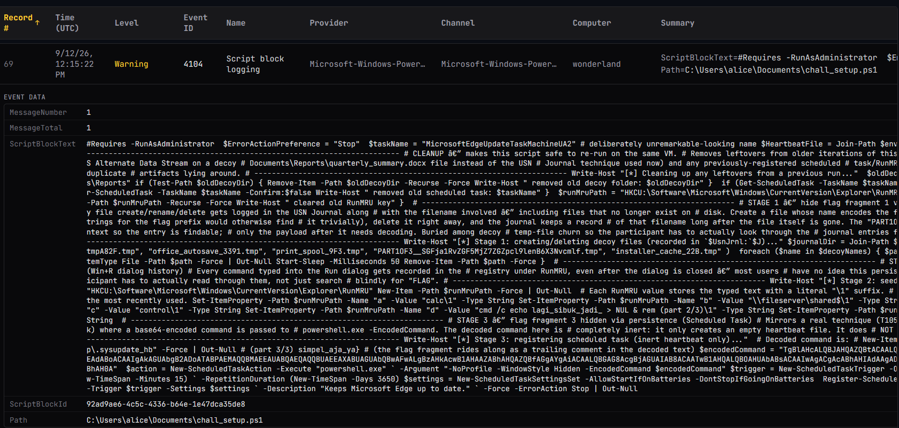

### Solution

The script was long, so I asked GPT to extract the relevant flag fragments.

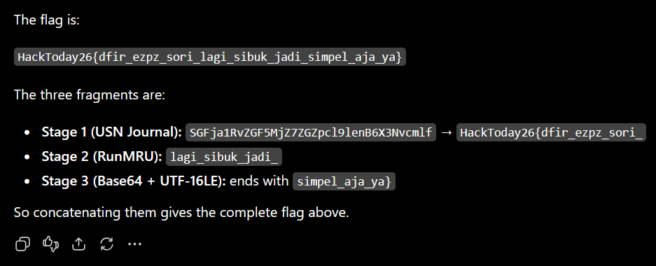

### AI Disclosure

https://chatgpt.com/share/6aa5f7c2-1224-83ec-a0ac-cda36cd72bd7

### Flag

```text
HackToday26{dfir_ezpz_sori_lagi_sibuk_jadi_simpel_aja_ya}
```

## Word di Press — First Blood

### Description

Security Engineer Bravo noticed unusual activity and quickly secured the affected device.

Files Provided (Google Drive):

https://drive.google.com/file/d/1o4839BaBDrqSeT9TPuvJJOUQlfpiakBp/view?usp=sharing

SHA256:

c1eaf02edc3afa52ade6364e6502ad58eb1928fcd1b6e7c15eff9fe7dfcb6b98

Archive Password (base64):

dGlkYWsgYWRhIHlhbmcgbWVueWVsYW1hdGthbiBrYWU=

Author: Fbrina

### Initial Findings

The challenge provided a memory dump and pointed toward WordPress. I used `bulk_extractor` to recover network traffic from memory, then analyzed the resulting PCAP to answer the questions.

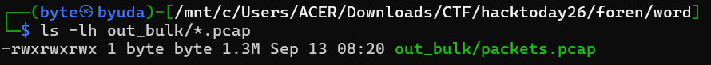

### Solution

Question 1: Which website did the attacker target?

I followed an HTTP stream to identify the website.

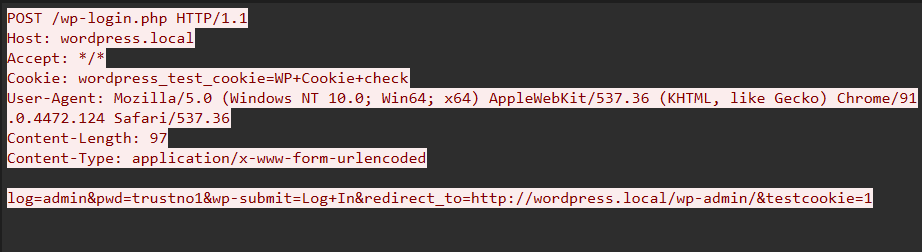

Question 2: How many login attempts did the attacker make?

I filtered for `http.request.uri == "/wp-login.php"` and checked the number of displayed packets.

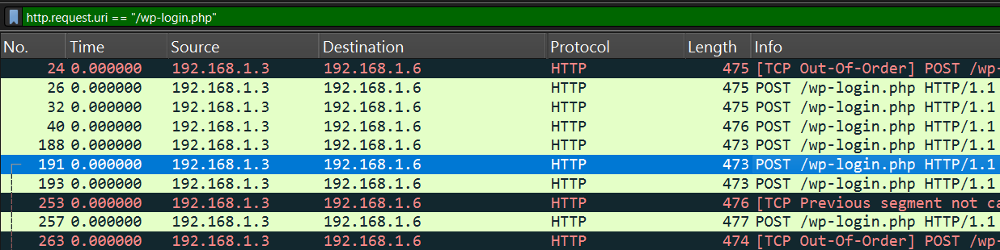

Question 3: What was the attacker’s IP address?

The source address was visible in Wireshark.

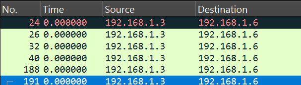

Question 4: Which component was exploited?

Besides the login attempts, the HTTP requests showed access to the Avada theme. That was the accepted answer.

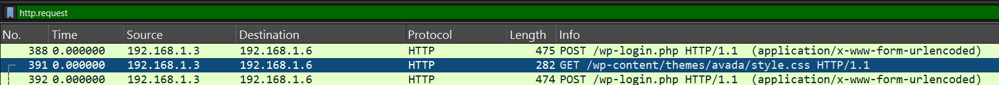

Question 5: What was the CVE ID?

I searched for the vulnerability associated with that component.


Question 6: Which endpoint was exploited?

I did not find the endpoint in the PCAP. I asked GPT, which suggested `admin-ajax.php`.

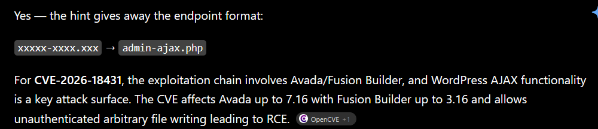

Question 7: What was the backdoor filename?

The HTTP streams contained an unusual endpoint accepting commands through a query parameter. This identified the backdoor.

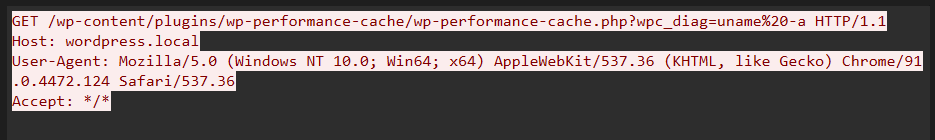

Question 8: Which parameter did the backdoor use?

The parameter appeared after the filename in the same request.

Question 9: What was the first command executed?

The hint specified two characters, so I tried `id`.

### Solver

`solver.py`

```python
from pwn import *
p = remote('103.160.213.168', 33436)
print(p.recvuntil(b'> ').decode())
answers = [
    'wordpress.local',
    '43',
    '192.168.1.3',
    'Avada',
    'CVE-2026-18431',
    'admin-ajax.php',
    'wp-performance-cache.php',
    'wpc_diag',
    'id',
    'x'
]

for answer in answers:
    p.sendline(answer.encode())
    response = p.recv().decode()
    print(response)
print(p.recvall().decode())
```

### AI Disclosure

https://chatgpt.com/share/6aa5fff8-c17c-83ec-99a1-9ff968191604

### Flag

```text
HackToday26{kali_ini_saya_belajar_membuat_memory_tipis_tipis_maaf_jika_terlalu_mudah_a3308337-1c20-4a49-9bc8-6c4f9e4059cf}
```

## Durrr Intern — First Blood

### Description

On day 67 of his internship, Durrr was asked by Mr. Harya to tidy the old server room.

The instruction was simple: clean the room without touching the equipment.

Near the end, Durrr found an ESP32 in a box at the back. It was still powered on, with a blinking LED.

A sticker read: “DO NOT UNPLUG.”

Curiosity got the better of him, and he unplugged it.

He extracted a 4 MB flash dump but needed help determining whether it contained a hidden message.

Can you help him?

Author : Faizylux

Continue keystream across fragments

### Initial Findings

The challenge provided a custom ESP32 flash dump. Finding the relevant data took some trial and error.

### Solution

Running `strings` revealed two Base64 strings that appeared to contain encrypted data.

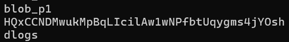

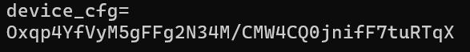

Next, I needed the key and algorithm. With GPT’s help, I found a candidate hex value near `device_cfg=`. I inspected that location in HxD.

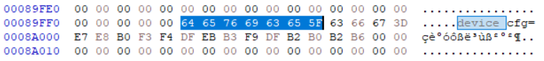

I switched to Claude to recover the key.

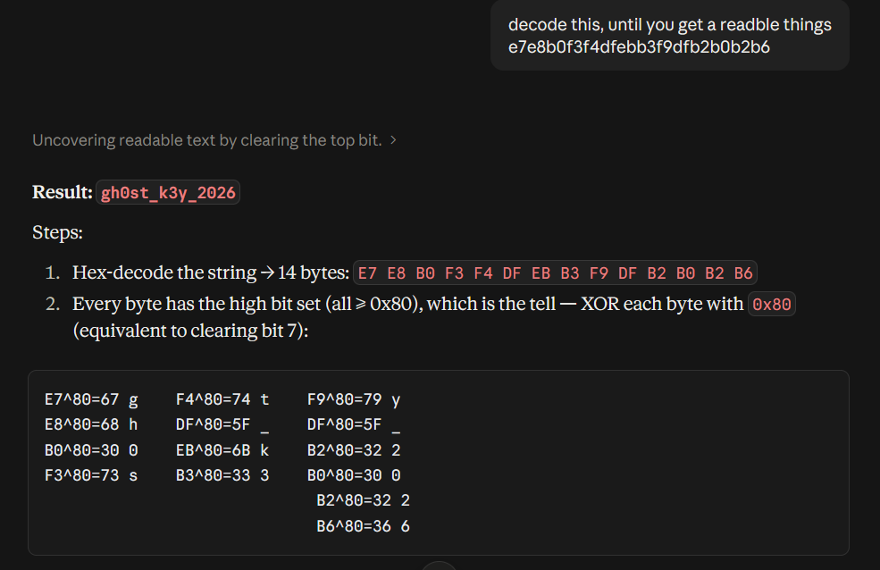

I then asked for a script to decrypt the Base64 data and received this initial attempt:

```python
import hashlib
import struct

key = b"gh0st_k3y_2026"

ciphertext = bytes.fromhex(
    "3b1aa9e187d5c8ce60145836377e0cfc2316e024348e789f17bb6e453a97"
)

nonce = struct.pack("<I", 0)

keystream = hashlib.sha256(key + nonce).digest()[:len(ciphertext)]

plaintext = bytes(
    c ^ k for c, k in zip(ciphertext, keystream)
)

print(plaintext)
```

That attempt recovered only one fragment. Replacing the ciphertext with the second fragment did not work. A later hint clarified that the keystream continued across fragments. After trying the counter values, I used the final script below.

### Solver

`solver.py`

```python
import hashlib
import struct
import base64

key = b"gh0st_k3y_2026"

c1 = base64.b64decode("QxCCNDMwukMpBqLIcilAw1wNPfbtUqygms4jYOsh")
c2 = base64.b64decode("Oxqp4YfVyM5gFFg2N34M/CMW4CQ0jnifF7tuRTqX")

keystream = (
    hashlib.sha256(key + struct.pack(">I", 0)).digest() +
    hashlib.sha256(key + struct.pack(">I", 1)).digest()
)

p1 = bytes(a ^ b for a, b in zip(c1, keystream[:30]))
p2 = bytes(a ^ b for a, b in zip(c2, keystream[30:60]))

print(p1.decode())
print(p2.decode())
```

### AI Disclosure

https://chatgpt.com/share/6aa65b1b-3064-83ec-8e27-65fb5be3b9e3

https://claude.ai/share/78d1ac79-ba0d-4405-ac63-eaf5ccec3d92

### Flag

```text
HackToday26{c0ngr444444tzzzz_y0u_f0und_th3_gh0st_1n_th3_fl4sh_1_gu3sssss}
```
