These are my forensics write-ups from IFEST 2026 Final. Each section follows the solving process recorded during the investigation.

## Masquerade (484 Points)

### Description

Mr. Pachinko, a senior IT engineer in Boeing’s Flight Module R&D division, connected to a suspicious Wi-Fi access point and downloaded ransomware. The challenge places this incident within a phishing campaign targeting defense companies.

Recover the confidential file and examine the files left behind by the ransomware. The challenge also involves threat intelligence and OSINT. Ignore hints pointing toward blockchain or Bitcoin.

The supplied malware has not been defused; the author requires a safe analysis environment.

Attachment: https://drive.google.com/file/d/1wghg8Io8AEinN8p-GITpeozMwsswstqL/view?usp=drive_link

Password: `lookingforsomething`

### Solution

I loaded the `.img` file into Autopsy and found encrypted files in the user directory.

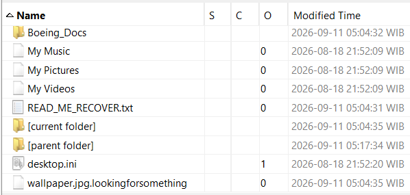

I correlated the timeline with the encrypted files’ timestamps. This led to a directory containing a text file and a PNG.

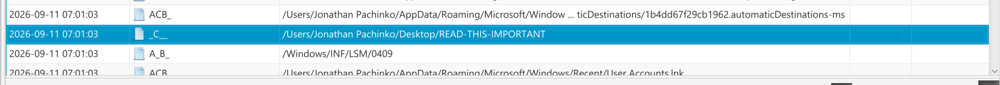

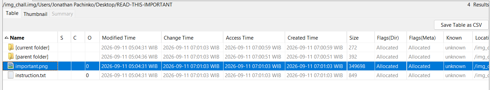

The PNG contained a Discord invitation. The invitation came from the challenge author, so I followed it.

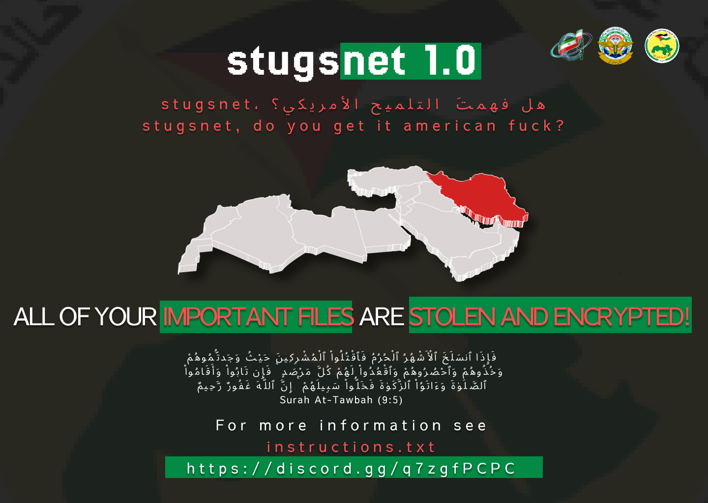


A Discord announcement provided a malware sample and a trial unlocker. I ran the unlocker, but it only decrypted non-PDF files. The file I needed was `secret.pdf`.

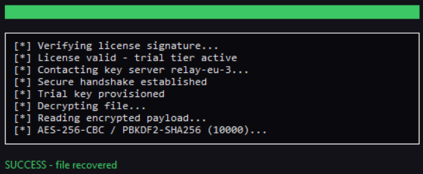

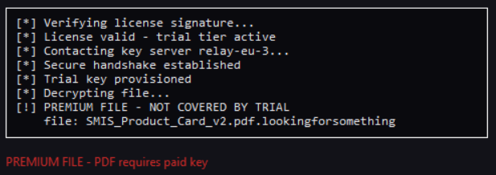

I then reversed the malware. Its startup routine called `walkandencrypt`, which used `opensslencrypt`. The key derivation used SHA-256 over the latitude, longitude, and BSSID values.

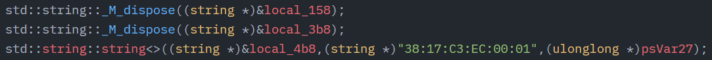

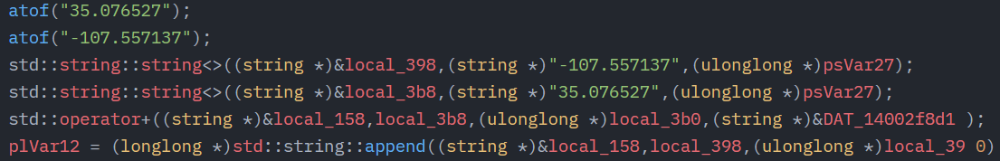

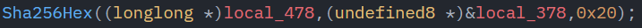

With the OpenSSL routine and the trial unlocker as references, I decrypted `secret.pdf` using the command below.

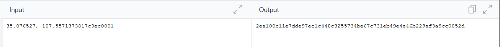

```bash
$ openssl enc -d -aes-256-cbc -pbkdf2 -iter 10000 -in secret.pdf.lookingforsomething -out secret.pdf -md sha256 -pass pass:'2ea100c11e7dde97ec1c448c3255734b'
```

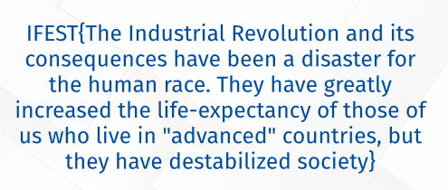

### Flag

```text
IFEST{The Industrial Revolution and its consequences have been a disaster for the human race. They have greatly increased the life-expectancy of those of us who live in "advanced" countries, but they have destabilized society}
```
