These are my forensics write-ups from IFEST 2026 Quals. Each section follows the solving process recorded during the investigation.

## dead box: skill issue edition (100 Points)

### Description

One quiet night, PT KIMBONG’s SOC received an SSH login alert from an unfamiliar IP address. The attacker logged in, carried out the attack, and believed the traces had been erased.

The following morning, an internal service began malfunctioning. The IR team captured a full disk image before shutting down the server. There were no other clues or witnesses—just the disk image.

Attachment: https://drive.google.com/file/d/1VuwGc41sKgSxwlvHpNQTrIxFbSdiomcQ/view?usp=sharing

Author: darflashxd

### Solution

I opened the `.img` file in Autopsy and found a LUKS-encrypted partition.

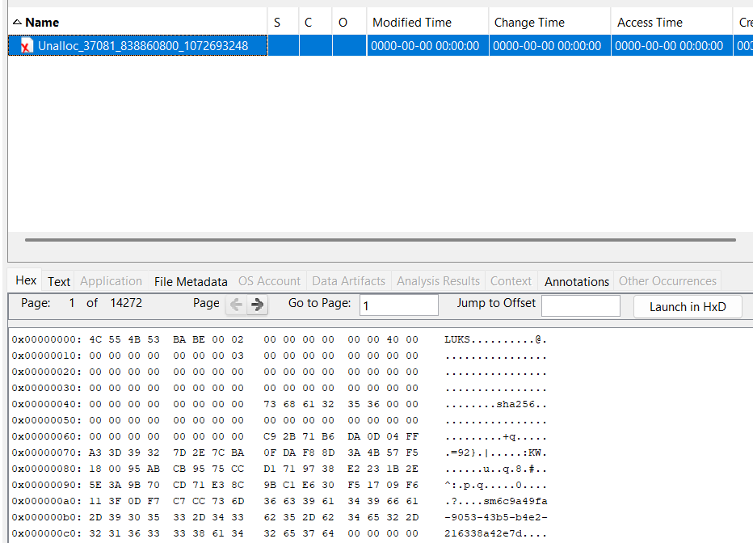

The description mentioned SSH activity, so I checked `auth.log`. It contained a reference to `COMMAND=/usr/bin/setfattr -n user.luks_key /var/log/sys_report.pdf`.

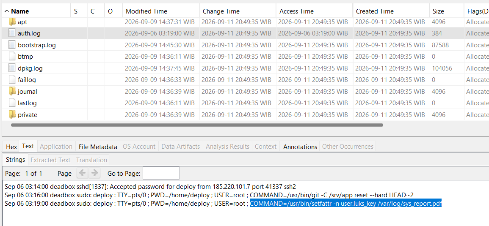

I mounted the image and read the `user.luks_key` extended attribute.

```bash
$ sudo losetup -fP --show deadbox.img
/dev/loop0

$ sudo mount -o ro /dev/loop0p1 /mnt/deadbox

$ getfattr -n user.luks_key /mnt/deadbox/var/log/sys_report.pdf
getfattr: Removing leading '/' from absolute path names
# file: mnt/deadbox/var/log/sys_report.pdf
user.luks_key="8bf884ee957da2837afadbce936e29d8aa727900aa624798e9464910a3a10b12"
```

I initially tried the value as a passphrase, but that failed. It needed to be decoded from hex first.

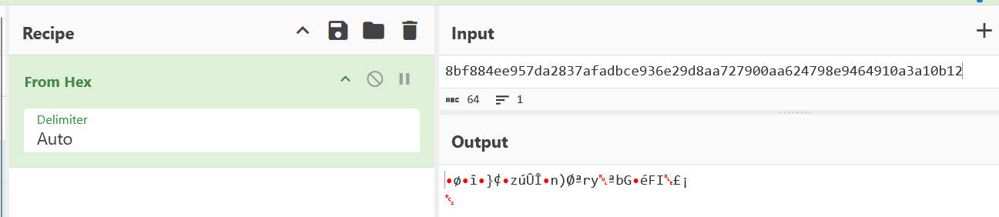

I used the decoded key to open the LUKS partition, mounted it, and read the flag.

```bash
$ sudo cryptsetup luksOpen --key-file download.dat /dev/loop0p2 dec_luks

$ sudo mount /dev/mapper/dec_luks /mnt/dec

$ ls /mnt/dec
flag.txt  lost+found

$ cat /mnt/dec/flag.txt
IFEST26{y0u_just_g1t_fsck3d_bruh_attacker_left_creds_in_dangling_bl0b_skill_issue_b74d9fdac5da}
```

### Flag

```text
IFEST26{y0u_just_g1t_fsck3d_bruh_attacker_left_creds_in_dangling_bl0b_skill_issue_b74d9fdac5da}
```

AI : https://chat.deepseek.com/share/2ryn8tp8tjb1p4opdm

## gratisan mulu sih (499 Points) — First Blood

### Description

Mr. Paimian downloaded free modified software from an online marketplace. After contacting the seller, his files disappeared and his system began behaving strangely. Investigate the machine and reconstruct what happened.

User password: `paimianofficial`

The malware is live and functional. The author requires analysis in a secure, isolated sandbox.

Attachment: https://binusianorg-my.sharepoint.com/personal/owen_bong_binus_ac_id/_layouts/15/guestaccess.aspx?share=IQDqaDRWcxMGSKp3ZIJ-1gVjASdmDd8AZ1SiEHaJ2y_fRBQ&e=hIarA6

Archive password: `3745d2f5f72d35946ea3522264b547ff09d37d8f`

Author: wavess

Connection: `nc 103.152.242.64 13337` or `nc 144.91.64.93 13337`

### Solution

The challenge provided an `.ad1` image and a sequence of questions.

1. Which messaging platform did the victim use that delivered the initial malware? (Format: Google)
Answer:

I checked the user’s Downloads directory and found the Signal installer.

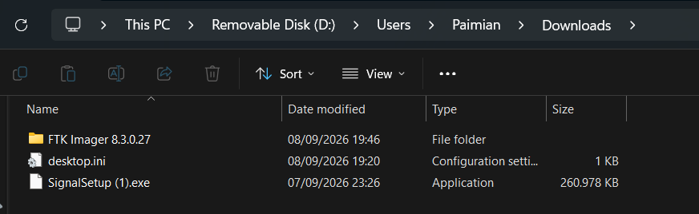

2. What secret word did the threat actor send to the victim? (Format: SecretWord)
Answer:

Signal’s data was under `%USERPROFILE%\AppData\Roaming\Signal`. With help from DeepSeek and some searching, I found https://github.com/carderne/signal-export. The installed Signal version stored an encrypted key in `config.json`, so I needed to decrypt that key before using the exporter.

```bash
$ cat /mnt/d/Users/Paimian/AppData/Roaming/Signal/config.json
{
  "encryptedKey": "7631301360dc2195315f9f7ff13a74cfece7fbeb6bb6e099bd7401353534e4ab7b3d816c0b566def94b0af456d6f72eaa610427f6ebbb934f088edfe03c7bd385521a5172ab295e53a9681c7f5df4d499dfca62977a5428c918aefcefb5c0f"
}
```

The challenge supplied the user’s password. Following DeepSeek’s guidance, I generated DPAPI prekeys, decrypted the master key, decrypted the DPAPI blob from `Local State`, and then decrypted the key in `config.json`.

```bash
$ pypykatz dpapi prekey password S-1-5-21-3507438758-983080014-556320364-1001 paimianofficial -o prekeys.txt

$ cat prekeys.txt
cbde9b311f9ff4327161352888bfb47b4a75c53e
63f359ec966505f95adabf83eecee2ddca658ca5
92d395e9243bbcdc7555684af4dc4f37fdd2a20f
03fbde213162ca05fb98e630b11f2b45e2c71af8

$ pypykatz dpapi masterkey a479c462-54d6-45f2-8db5-0ae9f25fabd2 prekeys.txt
[GUID] a479c462-54d6-45f2-8db5-0ae9f25fabd2 [MASTERKEY] 58128fb0211e56e3b60744a87ab58eb3101cdcbf88dddd260a7cd1148390753f74f2efb22abb65f7baaf73d7ea780b14af8f574ce6ca8bd74dda599c40c0a3a8

$ cat Local\ State
{"os_crypt":{"audit_enabled":true,"encrypted_key":"RFBBUEkBAAAA0Iyd3wEV0RGMegDAT8KX6wEAAABixHmk1lTyRY21CunyX6vSEAAAABIAAABDAGgAcgBvAG0AaQB1AG0AAAAQZgAAAAEAACAAAAAVJnMH0XmKgEMBs9L++MbRcgwZ79nkzUEreOXm4R1jCgAAAAAOgAAAAAIAACAAAACOdolCWpXIPFIw9Y8n4+TfKWGEXBa1P9iKhRwpv8PDjjAAAABlt12dglufIkP1JcJHDEn1lD6WNShCqBApo4z7g1Mo2llcrWZmc/2GQGl40wnjZ8dAAAAA57sadceIZJStyEw2MmMMaVTArQvrqSKlMMJFL9tHkL8RtkjJY9KQdSjld1ezsanS4yyJEmaY+9/PDE6a28Uhbw=="},"uninstall_metrics":{"installation_date2":"1788870542"}}

$ echo "RFBBUEkBAAAA0Iyd3wEV0RGMegDAT8KX6wEAAABixHmk1lTyRY21CunyX6vSEAAAABIAAABDAGgAcgBvAG0AaQB1AG0AAAAQZgAAAAEAACAAAAAVJnMH0XmKgEMBs9L++MbRcgwZ79nkzUEreOXm4R1jCgAAAAAOgAAAAAIAACAAAACOdolCWpXIPFIw9Y8n4+TfKWGEXBa1P9iKhRwpv8PDjjAAAABlt12dglufIkP1JcJHDEn1lD6WNShCqBApo4z7g1Mo2llcrWZmc/2GQGl40wnjZ8dAAAAA57sadceIZJStyEw2MmMMaVTArQvrqSKlMMJFL9tHkL8RtkjJY9KQdSjld1ezsanS4yyJEmaY+9/PDE6a28Uhbw==" | base64 -d | tail -c +6 > dpapi_blob.bin

$ impacket-dpapi unprotect -file dpapi_blob.bin -key 0x58128fb0211e56e3b60744a87ab58eb3101cdcbf88dddd260a7cd1148390753f74f2efb22abb65f7baaf73d7ea780b14af8f574ce6ca8bd74dda599c40c0a3a8
Impacket v0.13.0 - Copyright Fortra, LLC and its affiliated companies

Successfully decrypted data
 0000   09 9D D0 05 8E 20 00 57  D5 19 BC 8F D9 36 FE 7A   ..... .W.....6.z
 0010   3B CF 92 FD 21 AE FB CF  90 7C 7B DE 05 EA 97 F3   ;...!....|{.....
```

I used the following script for `config.json`. Its output did not work directly; I needed to convert it from hex first.

```python
from cryptography.hazmat.primitives.ciphers import Cipher, algorithms, modes

encrypted_key_hex = "7631301360dc2195315f9f7ff13a74cfece7fbeb6bb6e099bd7401353534e4ab7b3d816c0b566def94b0af456d6f72eaa610427f6ebbb934f088edfe03c7bd385521a5172ab295e53a9681c7f5df4d499dfca62977a5428c918aefcefb5c0f"

aux_key_hex = "099dd0058e200057d519bc8fd936fe7a3bcf92fd21aefbcf907c7bde05ea97f3"

enc = bytes.fromhex(encrypted_key_hex)
aux = bytes.fromhex(aux_key_hex)

# Struktur: 3 byte header, 12 byte nonce, ciphertext, 16 byte tag
nonce = enc[3:15]
ciphertext = enc[15:-16]
tag = enc[-16:]

cipher = Cipher(algorithms.AES(aux), modes.GCM(nonce, tag))
decryptor = cipher.decryptor()
plaintext = decryptor.update(ciphertext) + decryptor.finalize()

print("SQLCipher Key (hex):", plaintext.hex())


$ sigexport --source /mnt/d/Users/Paimian/AppData/Roaming/Signal --key c37efecefdcbe909333e8449eaaba006b4ff7b11a1554c46d136bfd2736845e6 --list-chats
Paimian | Signal | Tuan

$ sigexport --source /mnt/d/Users/Paimian/AppData/Roaming/Signal --key c37efecefdcbe909333e8449eaaba006b4ff7b11a1554c46d136bfd2736845e6 --chats=Paimian,Tuan ./signal-chats
Exporting stickers
Copying and renaming attachments
Creating output files
Done!

$ cat signal-chats/Tuan/chat.md
…

[2026-09-07 21:50:16] Tuan: sama sama SECRET WORD : BambausticHebat
```

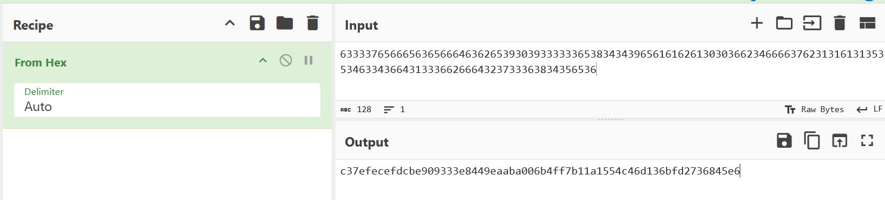

I then listed and exported the chats with the tool and read `chat.md`.

3. What is the first malicious file SHA256 hash? (Format: sha256 hash)
Answer:

The conversation ended with a download link. I downloaded the archive, extracted it using the secret word from the chat, and calculated the executable’s hash.

```bash
$ sha256sum SpotifyInstaller.exe
d8a9db6fc10aac0aad910b5ea89ff1e85f662662e0d0107582d38f7354ed4b85  SpotifyInstaller.exe
```

4. When was the initial malicious file executed? (Format: UTC, hh:mm:ss)
Answer:

I recovered the execution time from Prefetch, parsed with https://www.prefetchparser.com/en.

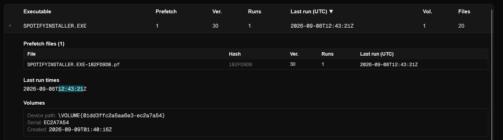

5. What is the full path of the registry key the malware created to achieve persistence? (Format: HKCU\Microsoft\Hai|Wavess)
Answer:

I used the executable’s VirusTotal report to identify the persistence registry key.

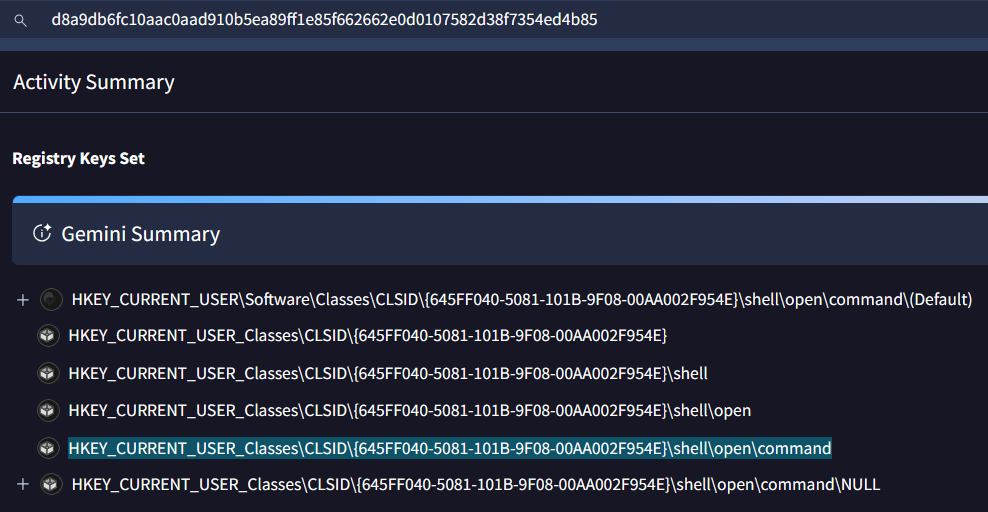

6. What file did the initial malware drop onto the system? (Format: filename.ext)
Answer:

The VirusTotal report also identified the dropped file.

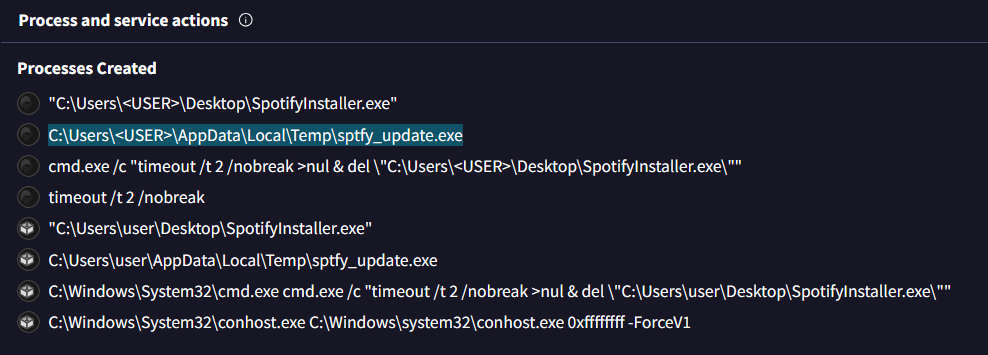

7. What is the full file path of the second malicious file? (Format: C:\Users\Paimian\Downloads\...)
Answer:

The same report showed the path. I adjusted its user directory to match `Paimian` on the victim’s system.

8. What is the IP address of the Command and Control (C2) server? (Format: IP)
Answer:

I obtained the C2 address from the VirusTotal report.

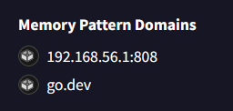

[*] Here's a new file for you to continue your investigaation:
    https://binusianorg-my.sharepoint.com/personal/owen_bong_binus_ac_id/_layouts/15/guestaccess.aspx?share=IQArO5Fq6AgYTZhfzjpGodH4Ad6GPMQvSBn1ePSvDre8YYE&e=tTRiCg

 9. What keyword triggers the malware to execute data exfiltration? (Format: SecretWord)
Answer:

The next stage provided a PCAP. Since the report indicated HTTP exfiltration, I examined that traffic. Requests to `/upload` followed a `/beacon` response containing `SPX-EXEC`. I tried that as the trigger, and it was accepted.

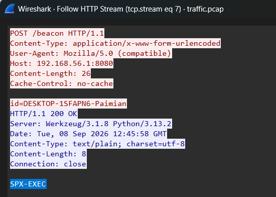

10. What is the full command sent by the malware to discover files? (Format: command)
Answer:

I decoded the Base64 command from the preceding traffic.

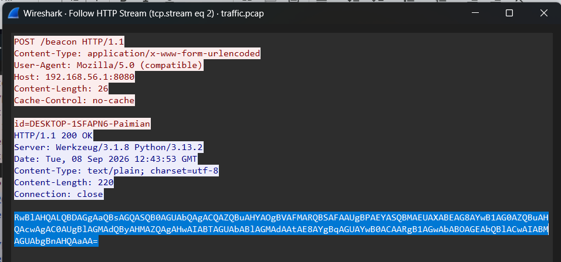

11. The malware splits its encryption key material into several fragments in memory. How many fragments are there? (Format: number)
Answer:

I tried values from 1 through 10. The accepted fragment count was `8`.

12. Each fragment holds some real key material followed by random padding. How many bytes of real key material does each fragment hold? (Format: number)
Answer:

Following DeepSeek’s suggestion, I tried candidate lengths. The accepted value was `34` bytes.

13. Each fragment's allocation is larger than the previous one by a fixed amount. What is that amount, in bytes? (Format: number)
Answer:

For the allocation increment, I reversed the binary and found the relevant logic in `derive_and_shard`.

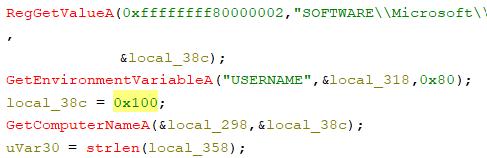

14. What is the full virtual address at which the third fragment's key material begins? (Format: hex, e.g. 0x00024373...)
Answer:

I loaded the crash dump from the user’s `AppData\Local\CrashDumps` directory into WinDbg and examined the heap.

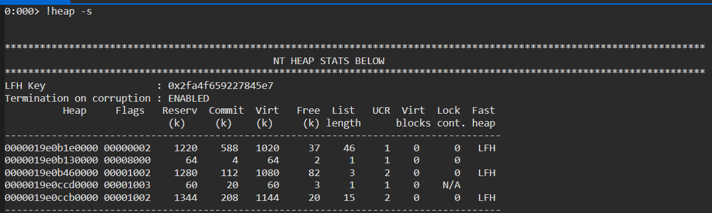

I inspected the heap regions one by one. The output around `0x19e0ccd000` contained consecutive fragments with matching 16-byte headers. The third fragment started at `0x0000019e0ccd1010`, placing its key material at `0x0000019e0ccd1020`.

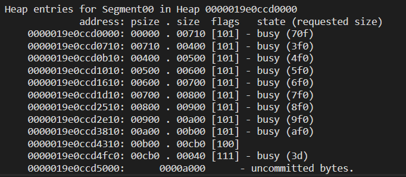

15. What is the final 16-byte key used to decrypt the exfiltrated data? (Format: lowercase hex, no 0x, no separators, e.g. a73bd30dc...)
Answer:

Using those addresses, I dumped 16 bytes of key material from the first fragment. That value was accepted as the final key.

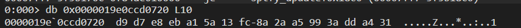

16. List the names of all files that were exfiltrated, in the order they appear in the exfil container.
   Give each name exactly as stored, including spaces, parentheses, and extension.
   (Format: filename1_filename2_filename3, e.g. Annual Report.pdf_photo 2 (2).jpg_main.c)
Answer:

The filenames were visible in the HTTP traffic.

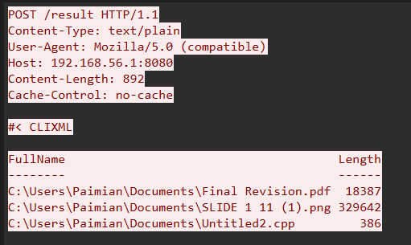

17. What was the content of the exfiltrated PDF file? (Format: word)
Answer:

The exfiltrated data contained many chunks, so I asked DeepSeek to help parse and decrypt them. It produced the following script.

```python
#!/usr/bin/env python3
import struct, os, zlib
import numpy as np

KEY = bytes.fromhex("d9d7e8eba15a13fc8a2aa5993adda431")
SBOX = bytes.fromhex(
    "001398e8c24957377eb5811f9cc673801c61"
    "cb9905b406488562347bea8342246becb60735566a2d2371e1df67fb5e2c878cf264"
    "16bb9d2769d5cc09755a0b2e6d8bfff553afc7d650c0bcc43a21f32bac54979447f0"
    "c37cf16678a33b5d106355fc383225b38da51188602f916fa4c9e31e297417585f76"
    "0c9f68599e5cbe828a9b284e02459aee36ddb95293b2cec5a915db4ab86cbdf4e68f"
    "2aaa149089e5cfed038644de3ca0ebd4d970e9fdf639b16530d796d219cd41fae73e"
    "a840e44f7f51f97a5b0d0f1de2f8aea143924d3f4677bf2279d818adb7c1b008daa7"
    "d0f7baa231d16e1b4bfe121a3dab7de004c820d3ca840a26dc0e4c95ef8e3301a672"
)
assert len(SBOX) == 256, f"Sbox length {len(SBOX)}"

SBOX_INV_arr = [0]*256
for i, v in enumerate(SBOX): SBOX_INV_arr[v] = i
SBOX_INV = np.array(SBOX_INV_arr, dtype=np.uint8)
KEY_arr = np.frombuffer(KEY, dtype=np.uint8)

def decrypt(c: bytes) -> bytes:
    a = np.frombuffer(c, dtype=np.uint8)
    k = np.tile(KEY_arr, (len(a)+15)//16)[:len(a)]
    return (SBOX_INV[a] ^ k).tobytes()

def try_parse(plain):
    if plain[:4] != b"SPXF": return None
    if len(plain) < 6: return None
    n = struct.unpack("<H", plain[4:6])[0]
    if n != 3: return None
    off = 6
    files = []
    try:
        for _ in range(n):
            nl = struct.unpack("<H", plain[off:off+2])[0]; off += 2
            if nl < 1 or nl > 200: return None
            name = plain[off:off+nl].decode('utf-8'); off += nl
            sz = struct.unpack("<I", plain[off:off+4])[0]; off += 4
            if sz < 1 or sz > 10**7: return None
            data = plain[off:off+sz]; off += sz
            files.append((name, data))
    except Exception:
        return None
    if off != len(plain): return None
    if files[0][1][:4] != b"%PDF": return None
    if files[1][1][:4] != b"\x89PNG": return None
    return files

def extract(plain):
    files = try_parse(plain)
    if not files: return False
    os.makedirs("exfil_out", exist_ok=True)
    for name, data in files:
        path = os.path.join("exfil_out", name)
        open(path, "wb").write(data)
        print(f"[+] {name} ({len(data)} bytes) -> {path}")

    pdf_path = "exfil_out/Final Revision.pdf"
    if os.path.exists(pdf_path):
        pdf = open(pdf_path, "rb").read()
        print(f"\n[*] PDF size: {len(pdf)}")
        import re
        for m in re.finditer(rb'stream\r?\n(.*?)\r?\nendstream', pdf, re.DOTALL):
            raw = m.group(1)
            for skip in range(0, 20):
                try:
                    d = zlib.decompress(raw[skip:])
                    print(f"[+] PDF stream ({len(d)} bytes):")
                    print(d.decode('latin-1', errors='replace')[:2000])
                    break
                except Exception:
                    pass
    return True

def main():
    cipher = open("exfil_cipher_sorted.bin", "rb").read()
    print(f"[*] Cipher length: {len(cipher)} (expected 348489)")

    plain = decrypt(cipher)
    print(f"[*] Plain first 16: {plain[:16]}")

    if try_parse(plain):
        print("[+] Direct parse OK!")
        extract(plain)
        return

    # Cari mismatch pertama
    print("[*] Searching for first mismatch in known region...")
    first_bad = None
    known = [
        (0, b"SPXF\x03\x00"),
        (6, struct.pack("<H", 18) + b"Final Revision.pdf"),
        (26, struct.pack("<I", 18387)),
        (30, b"%PDF-1.7"),
    ]
    for start, exp in known:
        for j in range(len(exp)):
            p = start + j
            if p >= len(plain): break
            if plain[p] != exp[j]:
                first_bad = p
                print(f"[*] Mismatch at plaintext position {p}: got 0x{plain[p]:02x} exp 0x{exp[j]:02x}")
                break
        if first_bad is not None: break

    if first_bad is None:
        print("[!] No mismatch found in known regions")
        # Coba append 1 byte di akhir
        for b in range(256):
            test = cipher + bytes([b])
            tp = decrypt(test)
            if try_parse(tp):
                print(f"[+] Append byte 0x{b:02x} works")
                extract(tp)
                return
        return

    # Byte cipher yang hilang ada di posisi P (sebelum mismatch).
    # Karena plaintext shift -1 setelah byte hilang, kita coba insert di [first_bad-2, first_bad+2]
    print(f"[*] Byte missing near cipher position {first_bad}")
    for pos in range(max(0, first_bad-3), first_bad+3):
        for b in range(256):
            test = cipher[:pos] + bytes([b]) + cipher[pos:]
            tp = decrypt(test)
            if try_parse(tp):
                print(f"[+] FOUND! Insert 0x{b:02x} at cipher pos {pos}")
                extract(tp)
                return

    # Fallback: scan 4096-boundaries
    print("[*] Local insert failed, scanning chunk boundaries...")
    for pos in range(0, len(cipher)+1, 4096):
        for b in range(256):
            test = cipher[:pos] + bytes([b]) + cipher[pos:]
            tp = decrypt(test)
            if try_parse(tp):
                print(f"[+] FOUND! pos={pos} byte=0x{b:02x}")
                extract(tp)
                return

    print("[!] All attempts failed")

main()
```

I opened the recovered PDF to answer the final question.


```python
from pwn import *
p = remote('144.91.64.93', 13337)
print(p.recvuntil(b'Answer: ').decode())
answers = [
    'Signal',
    'BambausticHebat',
    'd8a9db6fc10aac0aad910b5ea89ff1e85f662662e0d0107582d38f7354ed4b85',
    '12:43:21',
    r"HKCU\Software\Classes\CLSID\{645FF040-5081-101B-9F08-00AA002F954E}\shell\open\command",
    'sptfy_update.exe',
    r'C:\Users\Paimian\AppData\Local\Temp\sptfy_update.exe',
    '192.168.56.1',
    'SPX-EXEC',
    r'Get-ChildItem $env:USERPROFILE\Documents -Recurse | Select-Object FullName, Length',
    '8',
    '34',
    '256',
    '0x0000019e0ccd1020',
    'd9d7e8eba15a13fc8a2aa5993adda431',
    r'Final Revision.pdf_SLIDE 1 11 (1).png_Untitled2.cpp',
    'you_solved_the_challenge_so_go_on_submit_this'

]

for answer in answers:
    p.sendline(answer.encode())
    response = p.recv().decode()
    print(response)
print(p.recvall().decode())
```

### Flag

```text
IFEST26{h00ray_g0_0n_5ubm1t_th1s_fl4g_1_h0p3_y0ur3_3nt3rt4ined!!!}
```

AI : https://chat.deepseek.com/share/7oipyfricesqz9ylxp
