These are my forensics write-ups from ITFEST 2026. Each section follows the solving process recorded during the investigation.

## petani durr (105 Points)

### Description

Durrr wants to become a modern farmer and build a hydroponic setup at home. He uses his phone to learn about hydroponics, but something has happened to the device.

Password: `LzShMlOxqKWlpvOmLJ5aVUOuoaI0LJ4=`

Author: Fbrina

### Solution

The challenge provided an archive of Android internal storage. In Downloads, I found an APK and encrypted files.

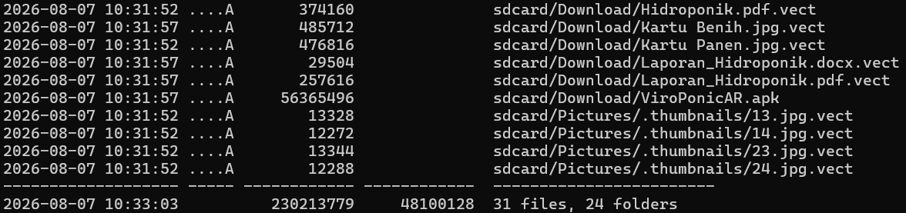

The apparent path was to decompile the APK, recover the key, and decrypt the files. The complication was that it used separate encryption routines for small and large files. Running `apktool d ViroPonicAR.apk` showed that the application was built with Unity.

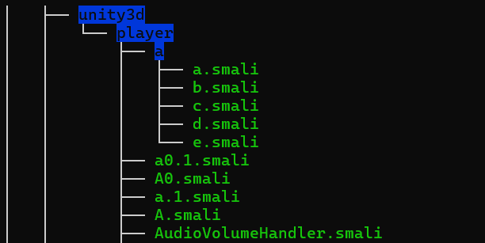

Apktool’s output did not reveal the encryption routine or C2 logic. I shared the directory tree with GPT, which identified the application as a Unity IL2CPP build.

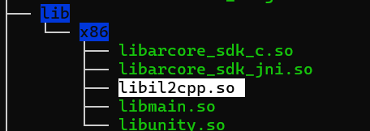

I used https://il2cppdumper.com/ with `libil2cpp.so` and `assets/bin/Data/Managed/Metadata/global-metadata.dat`. The resulting `dump.cs` contained an `AES_KEY` reference that pointed toward the encryption code.

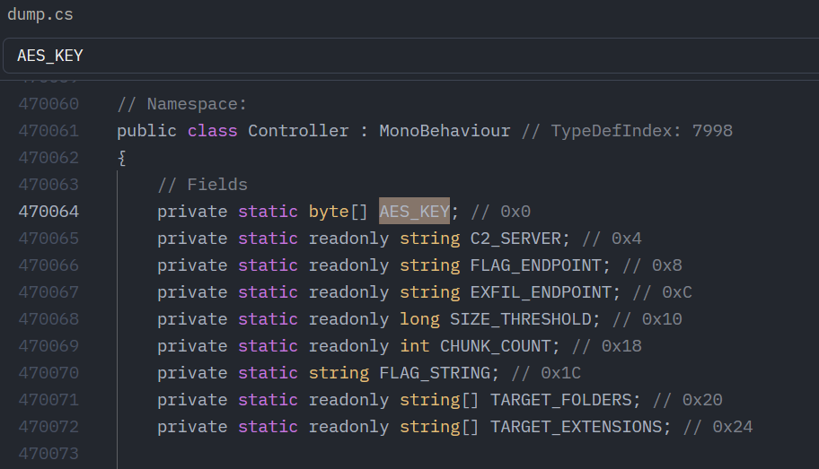

The DLL namespace information was not usable in ILSpy, so I worked from the offsets. GPT identified `ExecuteRansomware` at `0x11312E5`, along with other encryption-related functions.

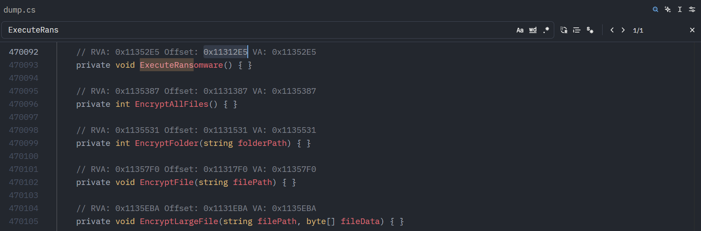

With Ghidra running slowly, I used GPT’s help to inspect the offsets through `objdump`. In the range `0x1136c76`–`0x113712e`, the code at `0x1136DD7` allocated a `0x20`-byte array associated with `AES_KEY`.

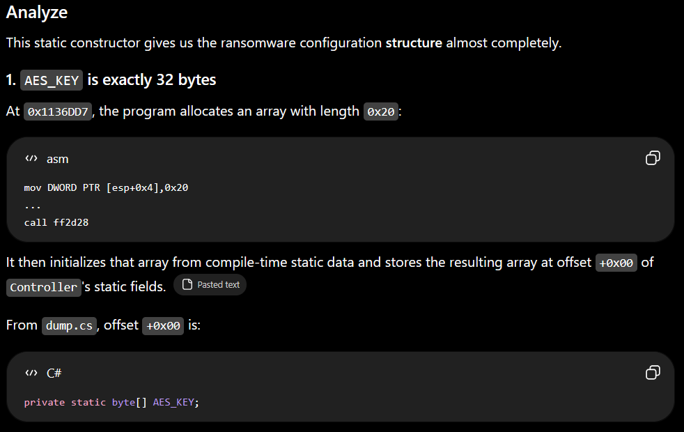

There was a single 32-byte blob at metadata offset `0x492AD8`, so I extracted it from `global-metadata.dat` as a candidate key.

```csharp
// Namespace:
[CompilerGenerated]
internal sealed class <PrivateImplementationDetails> // TypeDefIndex: 8118
{
    // Fields
    internal static readonly <PrivateImplementationDetails>.__StaticArrayInitTypeSize=32 30C69175FD99650A82A8C1426D86DF069CC4F585CF0C6E34F7025729DFB45F00 /*Metadata offset 0x492AD8*/; // 0x0
```

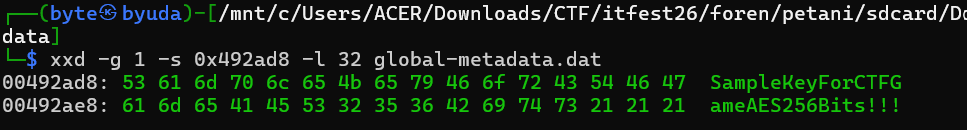

I then inspected `EncryptFile()` at the offset listed in `dump.cs`. It used the recovered key, PKCS#7 padding, and a random IV stored in the final 16 bytes. This routine applied only to files smaller than 131,072 bytes.

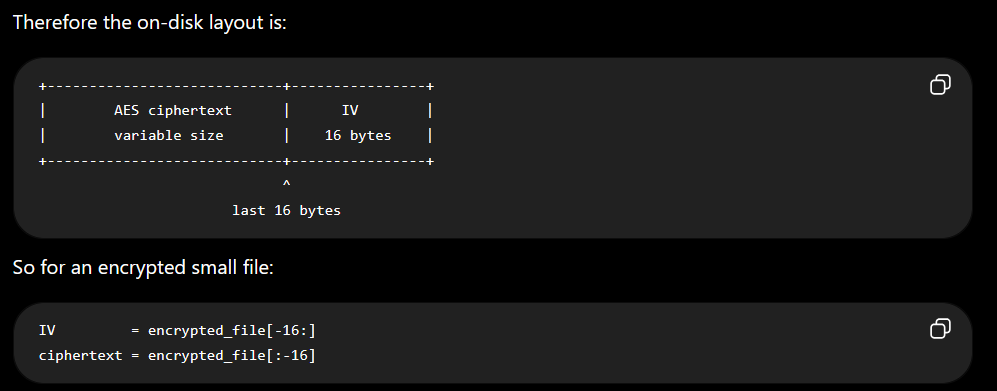

Only one file fell below that threshold, so I moved to `EncryptLargeFile`. It split the data into four chunks and applied additional encryption with new IVs before combining the result.

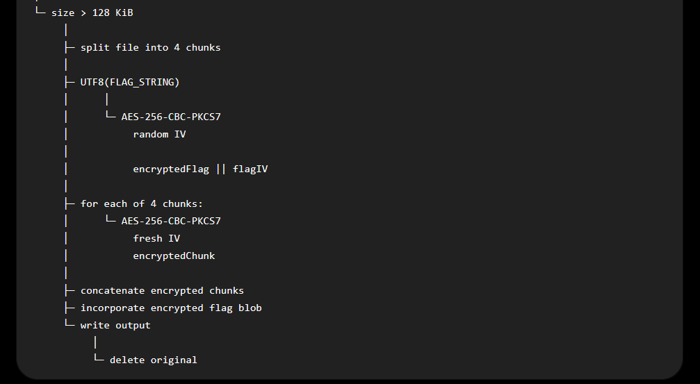

GPT selected `Hidroponik.pdf.vect` for the first decryption attempt and asked for the last 64 bytes to investigate the chunk IVs.

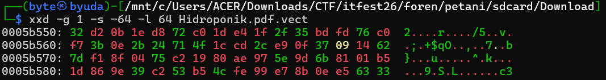

That recovered part of the data, but the supplied ciphertext was too short. I included another 16 bytes, bringing the carved segment to 80 bytes.

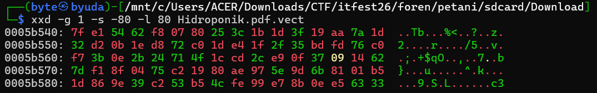

The IV could then be taken from `data[-32:-16]`. The following script recovered the relevant content, and the flag was in `Hidroponik.pdf`.

```python
#!/usr/bin/env python3

import argparse
from pathlib import Path

from Crypto.Cipher import AES
from Crypto.Util.Padding import unpad


KEY = b"SampleKeyForCTFGameAES256Bits!!!"
BLOCK_SIZE = 16


def decrypt_flag(path: Path):
    data = path.read_bytes()

    if len(data) < 80:
        raise ValueError("File is too small to use the large .vect format")

    # Large-file tail:
    #
    # [ ... file data ... ]
    # [ encrypted FLAG : 48 bytes ]
    # [ FLAG IV        : 16 bytes ]
    # [ chunk 3 IV     : 16 bytes ]

    flag_ciphertext = data[-80:-32]
    flag_iv = data[-32:-16]
    last_chunk_iv = data[-16:]

    print(f"[+] File           : {path}")
    print(f"[+] Size           : {len(data)} bytes")
    print(f"[+] Flag ciphertext: {flag_ciphertext.hex()}")
    print(f"[+] Flag IV        : {flag_iv.hex()}")
    print(f"[+] Chunk 3 IV     : {last_chunk_iv.hex()}")

    cipher = AES.new(
        KEY,
        AES.MODE_CBC,
        flag_iv
    )

    padded = cipher.decrypt(flag_ciphertext)

    try:
        plaintext = unpad(
            padded,
            BLOCK_SIZE,
            style="pkcs7"
        )
    except ValueError:
        print("[-] Invalid PKCS#7 padding")
        print(f"[-] Raw plaintext: {padded.hex()}")
        return

    print(f"[+] Raw flag bytes : {plaintext!r}")

    try:
        flag = plaintext.decode("utf-8")
    except UnicodeDecodeError:
        flag = plaintext.decode("utf-8", errors="replace")

    print()
    print(f"[+] FLAG: {flag}")


def main():
    parser = argparse.ArgumentParser(
        description="Extract embedded flag from large .vect files"
    )

    parser.add_argument(
        "file",
        help="Large encrypted .vect file"
    )

    args = parser.parse_args()

    path = Path(args.file)

    if not path.is_file():
        raise SystemExit(f"[-] File not found: {path}")

    decrypt_flag(path)


if __name__ == "__main__":
    main()
```

### Flag

```text
ITFest26{Yeyyyy_s0lv3d_w4ktuny4_m3n4n4m!}
```

### AI Disclosure

https://chatgpt.com/share/6a76bc6d-8170-83ec-95d5-cdbb0b342df3

## durja otw magang (220 Points) — First Blood

### Description

Durrr is on his way to an internship, but his laptop has been hacked. What happened?

Password: `53599bce04a968bd`

The challenge author requires a safe analysis environment.

Author: asburg

### Solution

I loaded the `.img` into Autopsy. It contained a valid Linux filesystem and a second partition with a LUKS header.

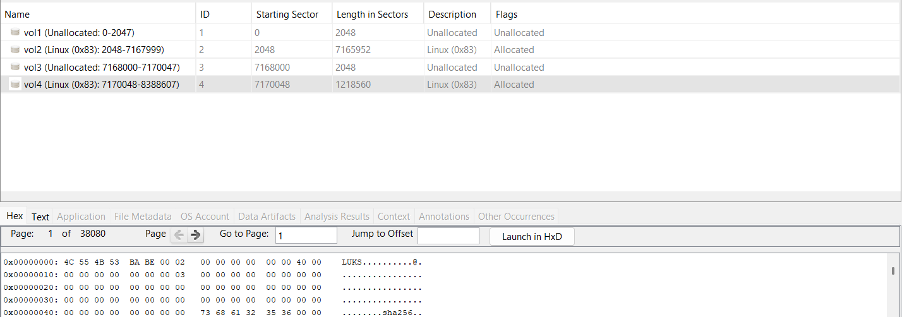

The first partition also had `cryptsetup` installed.

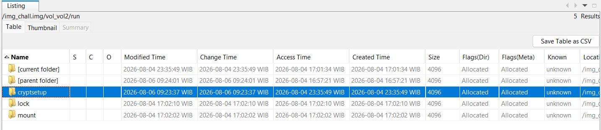

I needed the passphrase for the encrypted partition. The home directory was empty, but the root user’s directory contained an executable.

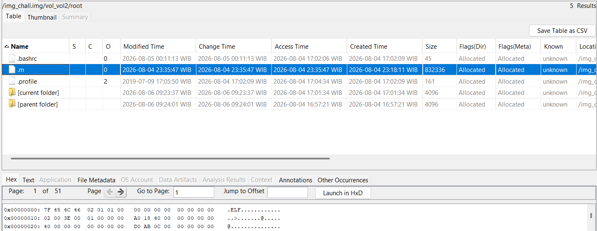

With GPT’s help, I found that the ELF invoked `echo -n '%s' | cryptsetup luksFormat %s -q --key-file=- 2>/dev/null`. Recovering the passphrase substituted into that command was the difficult part.

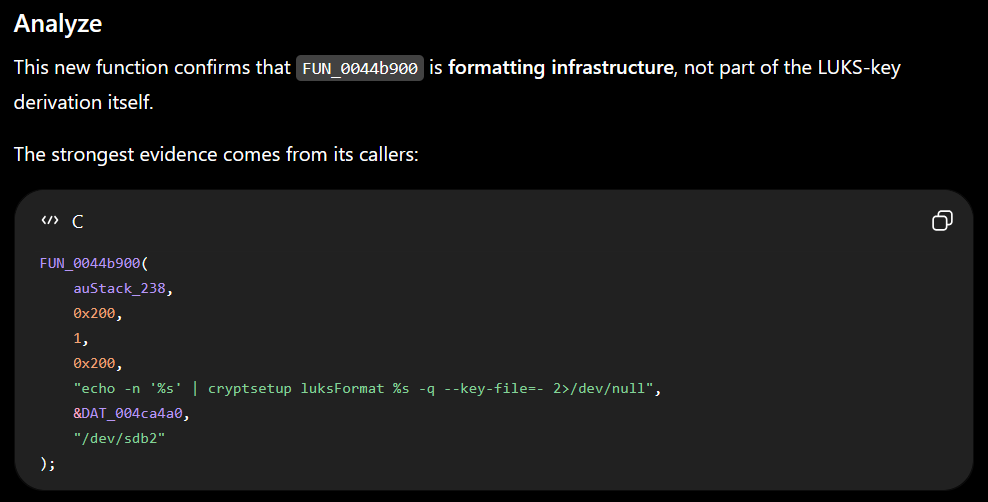

The passphrase came from XORing `DAT_0049a201` with `DAT_0049a1e1`. Applying that operation to the static ELF data did not produce a working passphrase. I instead found remnants of `.m` in `syslog`.

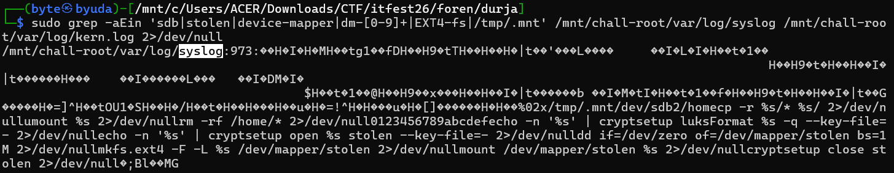

I used the following script to extract the region containing the key arrays.

```python
from pathlib import Path

p = Path("/mnt/chall-root/var/log/syslog")
data = p.read_bytes()

sig = b"%02x\x00/tmp/.mnt\x00/dev/sdb2\x00/home\x00"

off = data.find(sig)

print(f"signature offset = {off}")
if off < 0:
    raise SystemExit("signature not found")

print(f"signature offset hex = 0x{off:x}")

start = off + 0x1d0
chunk = data[start:start+0x70]

for i in range(0, len(chunk), 16):
    row = chunk[i:i+16]
    print(f"+0x{0x1d0+i:03x}: " + " ".join(f"{b:02x}" for b in row))
```

The bytes in `syslog` differed from those in `.m`, indicating that the ELF data had been modified. I recovered the passphrase by applying the same XOR operation to the recovered arrays.

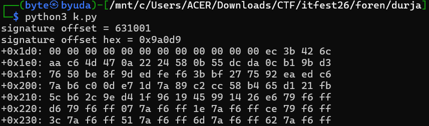

The result was `7ed1afaad0708d4aed3f5ed1c999846e6960ba282ae6921149f268ef7e263353`. I used it to unlock the LUKS partition and read the flag.

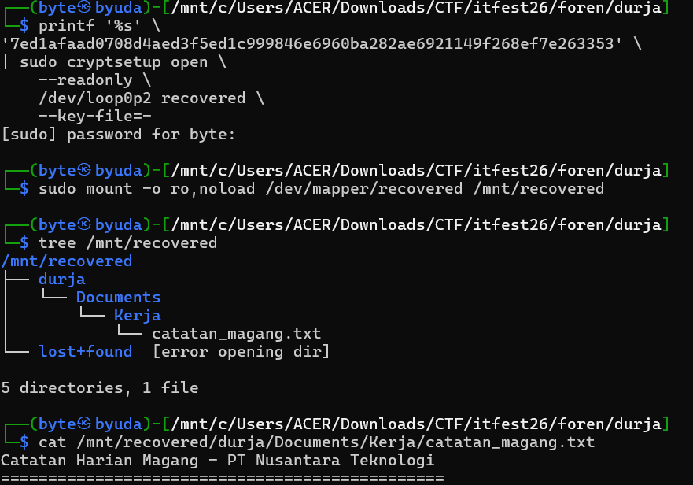

### Flag

```text
ITFest2026{sec_eng_bravo_4th_place_lmitd_top_1_region_cbc_rev_role_olivia_big_congratulations_top_solver}
```

AI Proof :
https://chatgpt.com/share/6a76ad98-a3cc-83ec-a397-afa143ab4ba1

https://claude.ai/share/215cc64a-5904-407e-9ed6-3a4d648e80ba

## Traitor (247 Points)

### Description

Sensitive internal company data has been leaked. Investigators suspect an employee is behind it. Our IT team has taken a forensic image of the suspect's personal work device, believed to have been used to send the data somewhere holding a large amount of information.

Can you uncover the trail of evidence and reconstruct what happened?

Password: 6a698600-a5dc-83ec-9ab3-0ea9d1c1f24a

Author: Farel

Aren't you paying attention to the time?

### Solution

The challenge provided an `.ad1` image, with a hint to pay attention to timestamps. I extracted it with `ad1extract` and loaded the result into Autopsy to inspect the timestamps more clearly.

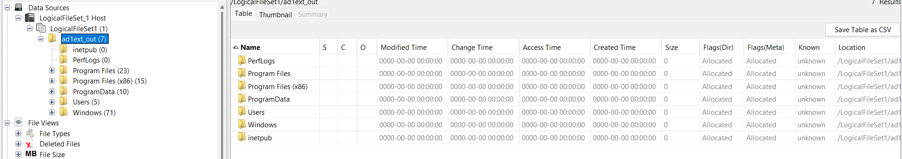

I used Autopsy’s timeline view. Recent activity included several web accesses, consistent with the description of leaked internal data.

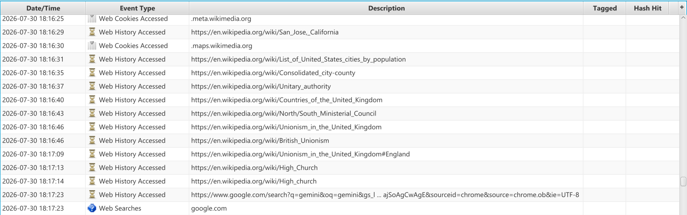

The browser history pointed to `pastebin.com`, `studo.howto.rocks`, and `corp.wuaze.com`.

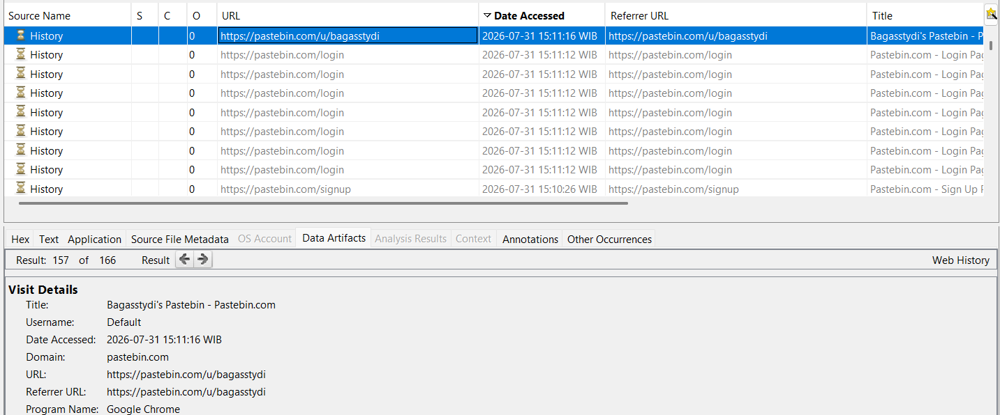

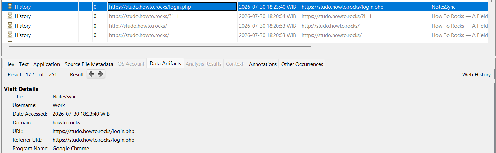

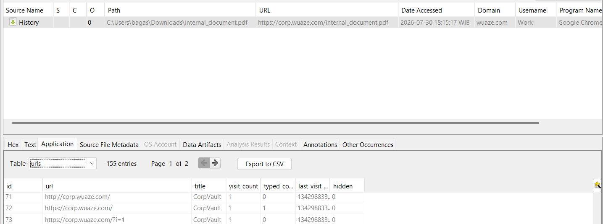

I initially expected to recover Pastebin credentials from `Login Data`. After checking the sites, only `studo.howto.rocks` matched the browsing sequence, but it still required credentials.

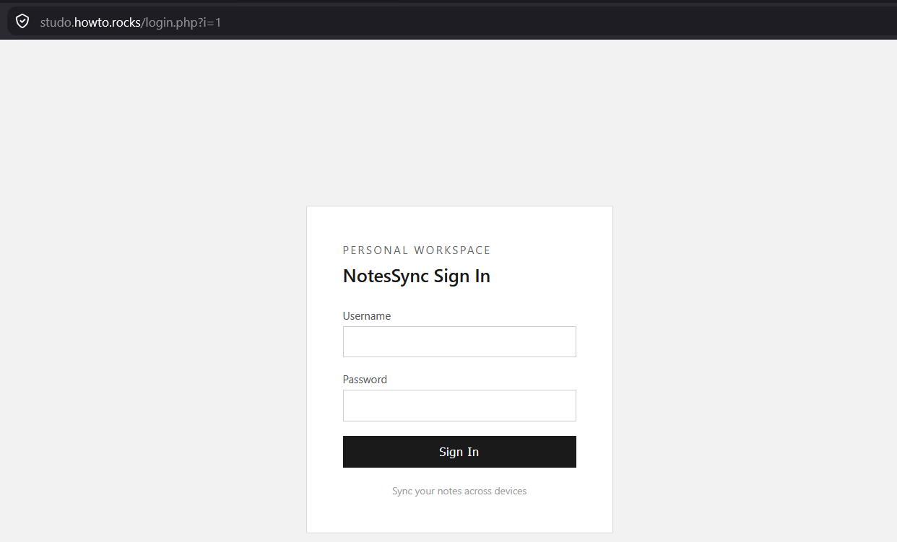

I had assumed the relevant Chrome data belonged to the Default profile. Following the file paths showed that it was actually in `Profile 1`.

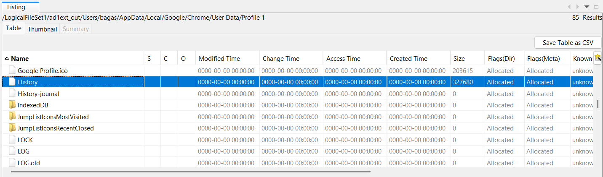

To decrypt `Login Data`, I first needed the Windows user password. I used `DPAPImk2john` with the SID and master key, then tried the RockYou wordlist. My reference was https://www.hackthebox.com/blog/seized-ca-ctf-2022-forensics-writeup, along with what I had learned from TECHFEST 2026.

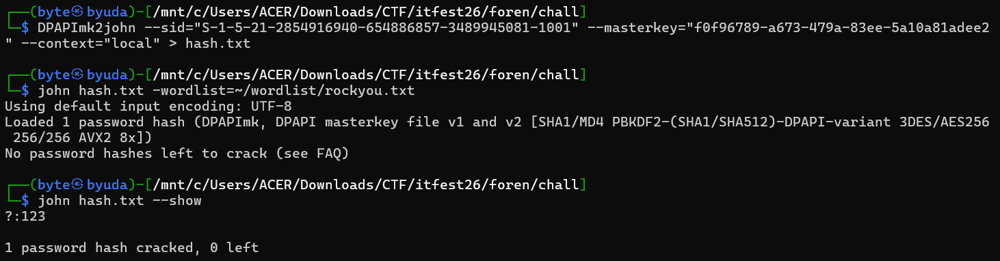

I used `pypykatz` to generate the prekey and decrypt the master key.

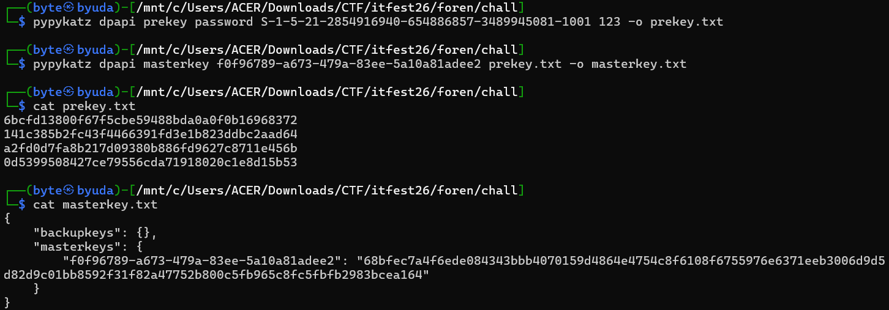

I extracted `Local State` and the `Login Data` database for `Profile 1`, then decrypted the stored credentials.

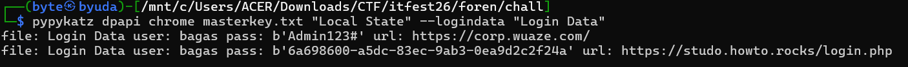

Those credentials let me log in and retrieve the document, but the PDF was password-protected.

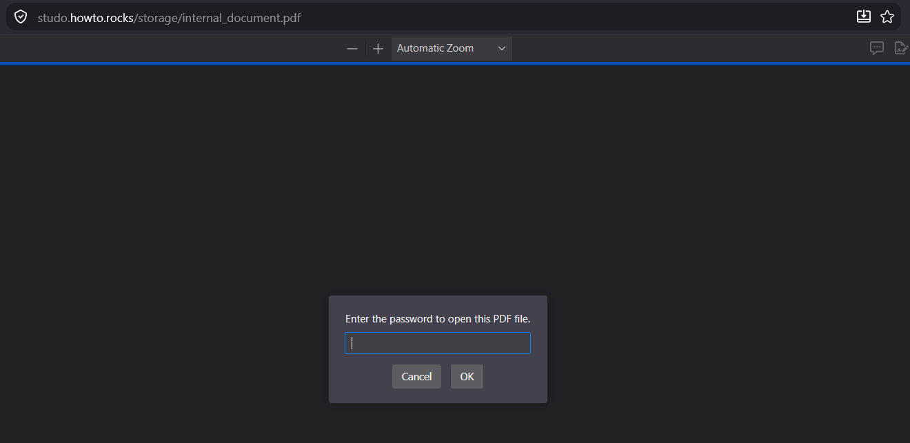

I downloaded it and used `pdf2john` and Hashcat to recover its password.

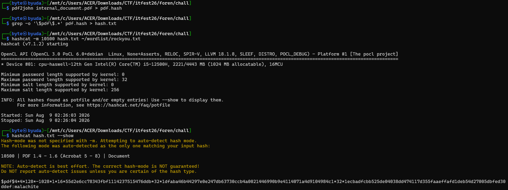

Opening the PDF revealed the flag.

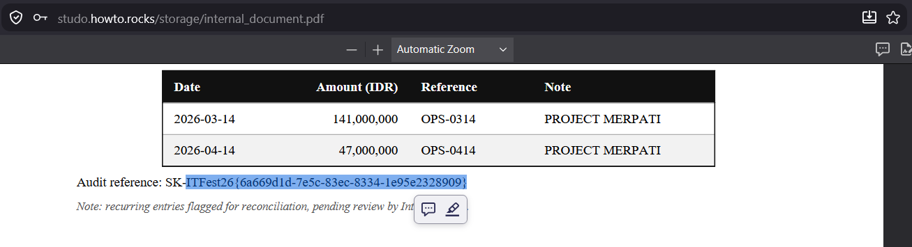

### Flag

```text
ITFest26{6a669d1d-7e5c-83ec-8334-1e95e2328909}
```

### AI Disclosure

https://chatgpt.com/share/6a76db99-2ffc-83ec-b54e-742ef4136b76

https://claude.ai/share/b5119151-d29e-4ed7-8fbe-72783b204794
