These are my forensics write-ups from JOINTS 2026 Quals. Each section follows the solving process recorded during the investigation.

## Claudio Maximus' Bizzare Adventure (498 Points) — First Blood

Author: keii

I opened the Windows memory dump in MemProcFS. Its process timeline referenced `MBG.exe`, but the executable was missing from the recovered directory.

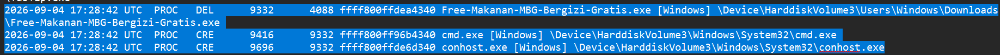

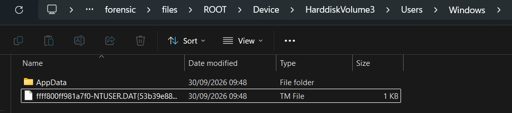

The timeline showed that MBG was the parent of `cmd.exe` and `conhost.exe`. I could not recover useful Prefetch, MFT, event log, or process data for MBG itself. The remaining lead was the `cmd.exe` process dump, `minidump.dmp`.

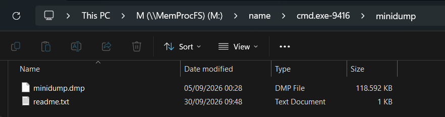

Before opening the dump in WinDbg, I ran `strings`. A value named `main.bjirka.gowr` looked like a malware function, suggesting that remnants of MBG were still present in the `cmd.exe` dump.

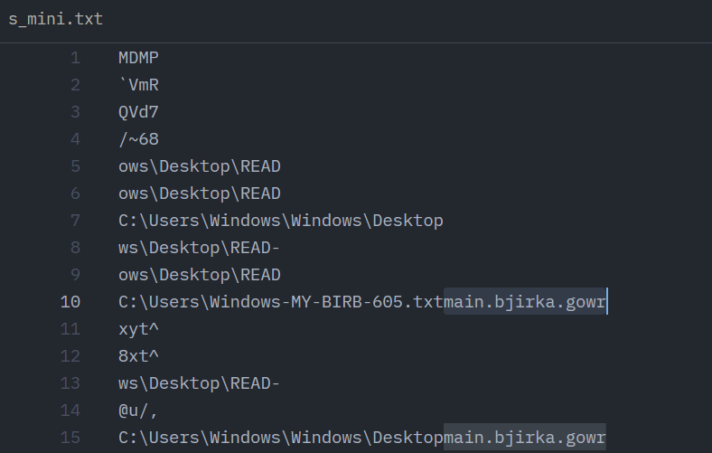

I searched for the string’s offsets.

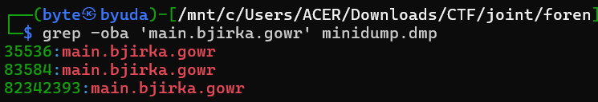

One occurrence was much farther into the file. I used the following script to check whether it mapped to a virtual address.

```bash
python3 - <<'PY'
import struct
from pathlib import Path

p = Path("minidump.dmp")
d = p.read_bytes()

# MINIDUMP_HEADER:
# Signature @ 0x00
# NumberOfStreams @ 0x08
# StreamDirectoryRva @ 0x0c
sig, = struct.unpack_from("<I", d, 0)
if sig != 0x504d444d:  # "MDMP"
    raise SystemExit(f"Not a minidump: signature=0x{sig:08x}")

num_streams, dir_rva = struct.unpack_from("<II", d, 8)

print(f"streams={num_streams}, directory_rva=0x{dir_rva:x}")

MEM64_TYPE = 9

memory64 = None

for i in range(num_streams):
    typ, size, rva = struct.unpack_from("<III", d, dir_rva + i*12)
    print(f"stream[{i}]: type={typ} size=0x{size:x} rva=0x{rva:x}")

    if typ == MEM64_TYPE:
        memory64 = (size, rva)

if not memory64:
    raise SystemExit("No Memory64ListStream found")

size, rva = memory64

count, base_rva = struct.unpack_from("<QQ", d, rva)

print(f"\nMemory64List:")
print(f"  ranges = {count}")
print(f"  base_rva = 0x{base_rva:x}")

ranges_rva = rva + 16

targets = [35536, 83584, 82342393]

file_pos = base_rva

for i in range(count):
    start, length = struct.unpack_from("<QQ", d, ranges_rva + i*16)

    end_file = file_pos + length

    for target in targets:
        if file_pos <= target < end_file:
            va = start + (target - file_pos)
            print(
                f"\nMATCH: file offset 0x{target:x} "
                f"-> VA 0x{va:x} "
                f"(range {i}, start=0x{start:x}, size=0x{length:x})"
            )

    file_pos = end_file

print(f"\nMemory stream ends at file offset 0x{file_pos:x}")
PY
```

It mapped to `0x1ae1925c1f9`.

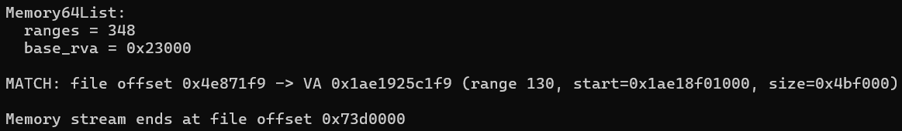

In WinDbg, inspecting memory around that address revealed names typical of Go functions.

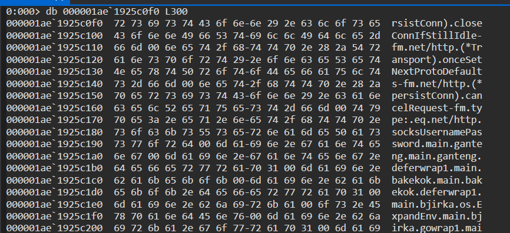

I then looked for Go metadata. I searched for the `pclntab` magic value `fffffff1` in the mapped region.

```text
s -d 000001ae`18f01000 000001ae`193c0000 fffffff1
```

GPT helped identify `0x1ae192278c0` as a valid candidate based on its Go metadata structure.

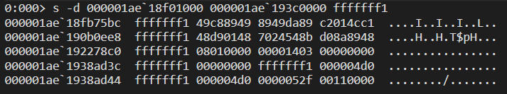

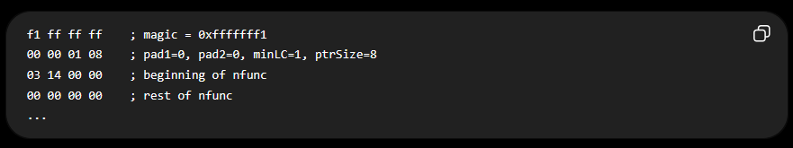

I extracted the header at that address and used GPT to help interpret its fields.

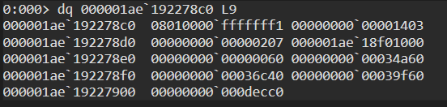

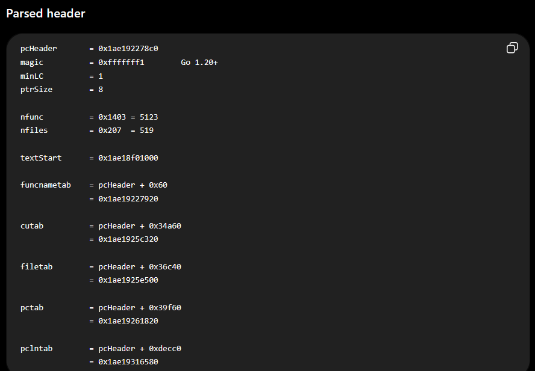

Using those values, I dumped the metadata region.

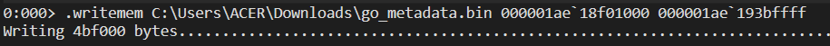

I parsed it with the following script to resolve function names and addresses.

```bash
python3 - <<'PY'
from pathlib import Path
import struct

BASE = 0x1ae18f01000
PCHEADER = 0x1ae192278c0

data = Path("/mnt/c/Users/ACER/Downloads/go_metadata.bin").read_bytes()

def off(va):
    return va - BASE

def u32(va):
    return struct.unpack_from("<I", data, off(va))[0]

def i32(va):
    return struct.unpack_from("<i", data, off(va))[0]

# Go 1.20+ pcHeader
nfunc      = struct.unpack_from("<Q", data, off(PCHEADER + 0x08))[0]
nfiles     = struct.unpack_from("<Q", data, off(PCHEADER + 0x10))[0]
text_start = struct.unpack_from("<Q", data, off(PCHEADER + 0x18))[0]

funcname_off = struct.unpack_from("<Q", data, off(PCHEADER + 0x20))[0]
cutab_off    = struct.unpack_from("<Q", data, off(PCHEADER + 0x28))[0]
filetab_off  = struct.unpack_from("<Q", data, off(PCHEADER + 0x30))[0]
pctab_off    = struct.unpack_from("<Q", data, off(PCHEADER + 0x38))[0]
pclntab_off  = struct.unpack_from("<Q", data, off(PCHEADER + 0x40))[0]

funcnametab = PCHEADER + funcname_off
functab     = PCHEADER + pclntab_off

print(f"nfunc      = {nfunc}")
print(f"nfiles     = {nfiles}")
print(f"textStart  = 0x{text_start:x}")
print(f"funcnames  = 0x{funcnametab:x}")
print(f"functab    = 0x{functab:x}")

# Go >= 1.18:
# functab = (nfunc * 2 + 1) * 4-byte fields
for i in range(nfunc):
    pc_off   = u32(functab + i * 8)
    func_off = u32(functab + i * 8 + 4)

    func_va = text_start + pc_off
    func_struct = functab + func_off

    # _func:
    # +00 entryOff
    # +04 nameOff
    name_off = i32(func_struct + 4)

    if name_off < 0:
        continue

    name_addr = funcnametab + name_off

    if not (BASE <= name_addr < BASE + len(data)):
        continue

    end = data.find(b"\x00", off(name_addr))

    if end == -1:
        continue

    name = data[off(name_addr):end].decode("utf-8", errors="replace")

    if name.startswith("main."):
        print(f"0x{func_va:016x}  {name}")
PY
```

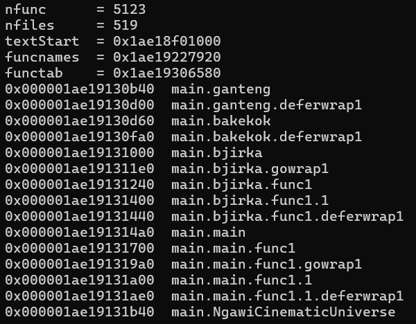

I started disassembly at `main.main`. It called `bakekok()`, `bjirka()`, and several helpers, then assigned the result of `ganteng(0x50300, 0x20)`. It also referenced two 0x40-byte constants before starting `main.main.func1` as a goroutine.

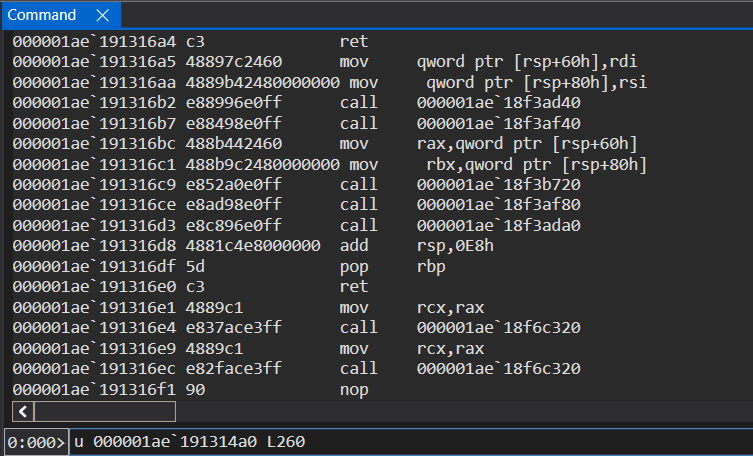

I dumped the two constants.

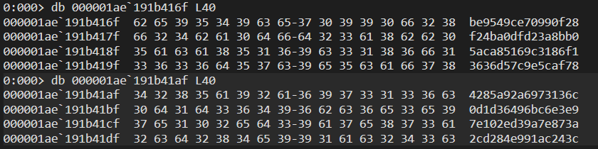

`bakekok()` and `bjirka()` created 1,337 files named `READ-MY-BIRB-%d.txt`. I then moved on to `main.main.func1`.

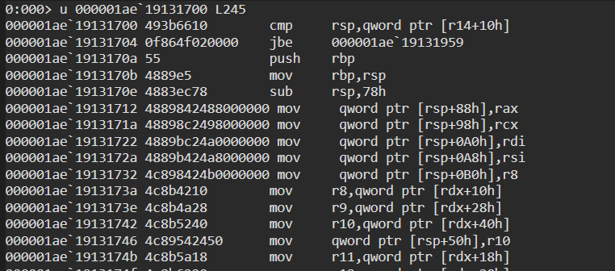

That led to `main.NgawiCinematicUniverse` at `0x000001ae19131b40`. It allocated a 16-byte object and performed a custom XOR transformation:

```text
out[i] = input[i] ^ key[i % keyLen] ^ something[i % somethingLen];
```

At this point, my working hypothesis was a cryptographic operation followed by XOR and hex encoding. I still needed to resolve the calls to confirm the sequence.

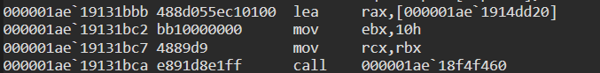

I resolved the remaining calls at `0x1ae18f79020`, `0x1ae18f98780`, `0x1ae18f94c20`, `0x1ae18f4f540`, `0x1ae18f532c0`, `0x1ae18fc5220`, `0x1ae18fc5b80`, `0x1ae190d7100`, `0x1ae18f9eac0`, and `0x1ae18f6cc60` with the following script.

```bash
cat > resolve_go.py <<'PY'
#!/usr/bin/env python3
import struct
import bisect
import sys

META = "go_metadata.bin"

# go_metadata.bin was extracted beginning at this VA.
BASE_VA = 0x1ae18f01000

# Known pcHeader location from the dump.
HDR = 0x3268c0

data = open(META, "rb").read()

# Go 1.22 pcHeader:
#
# uint32 magic
# byte pad1
# byte pad2
# byte minLC
# byte ptrSize
# uintptr nfunc
# uintptr nfiles
# uintptr textStart
# uintptr funcnameOffset
# uintptr cuOffset
# uintptr filetabOffset
# uintptr pctabOffset
# uintptr pclnOffset
#
# 72 bytes total.

(
    magic,
    pad1,
    pad2,
    minlc,
    ptrsize,
    nfunc,
    nfiles,
    text_start,
    funcname_off,
    cu_off,
    filetab_off,
    pctab_off,
    pcln_off,
) = struct.unpack_from("<IBBBB8Q", data, HDR)

print("[+] Go pcHeader")
print(f"    magic       = {magic:#x}")
print(f"    minLC       = {minlc}")
print(f"    ptrSize     = {ptrsize}")
print(f"    nfunc       = {nfunc}")
print(f"    nfiles      = {nfiles}")
print(f"    textStart   = {text_start:#x}")
print(f"    funcnameOff = {funcname_off:#x}")
print(f"    cuOff       = {cu_off:#x}")
print(f"    filetabOff  = {filetab_off:#x}")
print(f"    pctabOff    = {pctab_off:#x}")
print(f"    pclnOff     = {pcln_off:#x}")

if magic != 0xfffffff1:
    raise SystemExit("[-] Wrong pclntab header")

# All offsets above are relative to pcHeader.
funcname_base = HDR + funcname_off

# In Go 1.22 this points to runtime.functab.
ftab_base = HDR + pcln_off

print(f"[+] funcname VA = {BASE_VA + funcname_base:#x}")
print(f"[+] functab VA  = {BASE_VA + ftab_base:#x}")

# functab contains nfunc+1 entries.
# Each:
#   uint32 entryoff
#   uint32 funcoff
#
# The final entry provides the end PC.

funcs = []

for i in range(nfunc + 1):
    off = ftab_base + i * 8

    if off + 8 > len(data):
        raise SystemExit("[-] functab extends past extracted metadata")

    entryoff, funcoff = struct.unpack_from("<II", data, off)

    funcs.append((entryoff, funcoff))

# Sanity-check monotonicity.
for i in range(1, len(funcs)):
    if funcs[i][0] < funcs[i - 1][0]:
        raise SystemExit(
            f"[-] functab is not monotonic at entry {i}: "
            f"{funcs[i-1][0]:#x} -> {funcs[i][0]:#x}"
        )

print(f"[+] functab entries = {len(funcs)}")


def get_name(funcoff):
    # funcoff is relative to runtime.functab/runtime.pclntab.
    f = ftab_base + funcoff

    if f + 8 > len(data):
        return "<bad-funcoff>"

    # runtime._func:
    # +0x00 entryOff uint32
    # +0x04 nameOff  int32
    entry_off, name_off = struct.unpack_from("<Ii", data, f)

    name_addr = funcname_base + name_off

    if name_addr < 0 or name_addr >= len(data):
        return f"<bad-nameoff:{name_off:#x}>"

    end = data.find(b"\x00", name_addr)

    if end == -1:
        return "<unterminated-name>"

    return data[name_addr:end].decode(
        "utf-8", errors="replace"
    )


def resolve(va):
    rel = va - text_start

    if rel < 0:
        return None

    # Find last function whose entry <= target.
    idx = bisect.bisect_right(
        funcs,
        (rel, 0xffffffff)
    ) - 1

    if idx < 0 or idx >= len(funcs) - 1:
        return None

    entryoff, funcoff = funcs[idx]
    next_entryoff, _ = funcs[idx + 1]

    start = text_start + entryoff
    end = text_start + next_entryoff

    return (
        get_name(funcoff),
        start,
        end,
        va - start,
    )


if len(sys.argv) < 2:
    print()
    print("Usage:")
    print("  python3 resolve_go.py 0xADDRESS ...")
    sys.exit(1)

print()

for arg in sys.argv[1:]:
    va = int(arg, 0)
    result = resolve(va)

    if result is None:
        print(f"{va:#018x}  <not found>")
        continue

    name, start, end, delta = result

    print(
        f"{va:#018x}  "
        f"{name}+0x{delta:x}  "
        f"[{start:#018x} - {end:#018x})"
    )
PY
```

The resolved calls identified AES-related operations. I initially described the mode as GCM, but the call-site analysis below showed `cipher.NewCTR`.

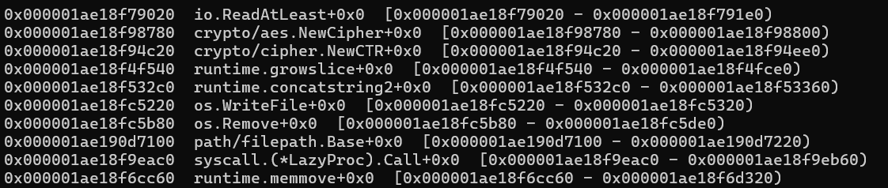

With function names and addresses available, I automated a search for their call sites.

```python
#!/usr/bin/env python3

import struct

FILE = "/mnt/c/Users/ACER/Downloads/go_metadata.bin"
BASE = 0x1ae18f01000

TARGETS = {
    0x1ae18f98780: "crypto/aes.NewCipher",
    0x1ae18f94c20: "crypto/cipher.NewCTR",
    0x1ae18fc5220: "os.WriteFile",
    0x1ae18fc5b80: "os.Remove",
}

TEXT_START = 0x1ae18f01000
TEXT_END   = 0x1ae192278c0

with open(FILE, "rb") as f:
    data = f.read()

lo = TEXT_START - BASE
hi = TEXT_END - BASE

print(f"[+] Scanning {TEXT_START:#x} - {TEXT_END:#x}")
print()

found = []

for i in range(lo, hi - 5):
    if data[i] != 0xE8:
        continue

    rel = struct.unpack_from("<i", data, i + 1)[0]

    callsite = BASE + i
    target = callsite + 5 + rel

    if target in TARGETS:
        found.append((callsite, target, TARGETS[target]))

for callsite, target, name in found:
    print(f"{name}")
    print(f"  callsite: {callsite:#x}")
    print(f"  target  : {target:#x}")
    print()

print(f"[+] Found {len(found)} relevant calls")
```

The scan found nine relevant calls.

```text
$ python3 f.py
[+] Scanning 0x1ae18f01000 - 0x1ae192278c0

crypto/aes.NewCipher
  callsite: 0x1ae190999e7
  target  : 0x1ae18f98780

crypto/aes.NewCipher
  callsite: 0x1ae1909a38f
  target  : 0x1ae18f98780

crypto/aes.NewCipher
  callsite: 0x1ae1909a50f
  target  : 0x1ae18f98780

os.WriteFile
  callsite: 0x1ae191313a0
  target  : 0x1ae18fc5220

crypto/aes.NewCipher
  callsite: 0x1ae19131c21
  target  : 0x1ae18f98780

crypto/cipher.NewCTR
  callsite: 0x1ae19131c40
  target  : 0x1ae18f94c20

os.WriteFile
  callsite: 0x1ae19131ecd
  target  : 0x1ae18fc5220

os.Remove
  callsite: 0x1ae19131eeb
  target  : 0x1ae18fc5b80

os.Remove
  callsite: 0x1ae19132032
  target  : 0x1ae18fc5b80

[+] Found 9 relevant calls
```

Comparing those addresses with `main.NgawiCinematicUniverse` gave the following sequence:

```text
main.NgawiCinematicUniverse
        |
        +--> 0x1ae19131c21  crypto/aes.NewCipher
        |
        +--> 0x1ae19131c40  crypto/cipher.NewCTR
        |
        +--> 0x1ae19131ecd  os.WriteFile
        |
        +--> 0x1ae19131eeb  os.Remove
        |
        +--> 0x1ae19132032  os.Remove
```

I used `ub` to inspect the instructions before the AES call. The function allocated a 16-byte buffer and filled it with `io.ReadAtLeast(reader, buf, 16)`, identifying the IV. Before `crypto/aes.NewCipher`, the AX/BX/CX slice registers pointed to an argument passed into the function as the AES key.

```text
0:000> ub 0x1ae19131c21 L25
000001ae`19131b49 0f8637050000    jbe     000001ae`19132086
000001ae`19131b4f 55              push    rbp
000001ae`19131b50 4889e5          mov     rbp,rsp
000001ae`19131b53 4881ecb0000000  sub     rsp,0B0h
000001ae`19131b5a 4c898c2408010000 mov     qword ptr [rsp+108h],r9
000001ae`19131b62 4c89842400010000 mov     qword ptr [rsp+100h],r8
000001ae`19131b6a 4889b424f8000000 mov     qword ptr [rsp+0F8h],rsi
000001ae`19131b72 4889bc24f0000000 mov     qword ptr [rsp+0F0h],rdi
000001ae`19131b7a 48898c24e8000000 mov     qword ptr [rsp+0E8h],rcx
000001ae`19131b82 48899c24e0000000 mov     qword ptr [rsp+0E0h],rbx
000001ae`19131b8a 48898424d8000000 mov     qword ptr [rsp+0D8h],rax
000001ae`19131b92 e80933e9ff      call    000001ae`18fc4ea0
000001ae`19131b97 660f1f840000000000 nop   word ptr [rax+rax]
000001ae`19131ba0 4885ff          test    rdi,rdi
000001ae`19131ba3 0f853d010000    jne     000001ae`19131ce6
000001ae`19131ba9 48894c2448      mov     qword ptr [rsp+48h],rcx
000001ae`19131bae 48895c2440      mov     qword ptr [rsp+40h],rbx
000001ae`19131bb3 4889842488000000 mov     qword ptr [rsp+88h],rax
000001ae`19131bbb 488d055ec10100  lea     rax,[000001ae`1914dd20]
000001ae`19131bc2 bb10000000      mov     ebx,10h
000001ae`19131bc7 4889d9          mov     rcx,rbx
000001ae`19131bca e891d8e1ff      call    000001ae`18f4f460
000001ae`19131bcf 48898424a8000000 mov     qword ptr [rsp+0A8h],rax
000001ae`19131bd7 488b1582bf2700  mov     rdx,qword ptr [000001ae`193adb60]
000001ae`19131bde 488b1d83bf2700  mov     rbx,qword ptr [000001ae`193adb68]
000001ae`19131be5 4889c1          mov     rcx,rax
000001ae`19131be8 bf10000000      mov     edi,10h
000001ae`19131bed 4889fe          mov     rsi,rdi
000001ae`19131bf0 4989f0          mov     r8,rsi
000001ae`19131bf3 4889d0          mov     rax,rdx
000001ae`19131bf6 e82574e4ff      call    000001ae`18f79020
000001ae`19131bfb 0f1f440000      nop     dword ptr [rax+rax]
000001ae`19131c00 4885db          test    rbx,rbx
000001ae`19131c03 0f85d4000000    jne     000001ae`19131cdd
000001ae`19131c09 488b8424e8000000 mov     rax,qword ptr [rsp+0E8h]
000001ae`19131c11 488b9c24f0000000 mov     rbx,qword ptr [rsp+0F0h]
000001ae`19131c19 488b8c24f8000000 mov     rcx,qword ptr [rsp+0F8h]
0:000> ub 0x1ae19131c40 L20
000001ae`19131b9f 004885          add     byte ptr [rax-7Bh],cl
000001ae`19131ba2 ff0f            dec     dword ptr [rdi]
000001ae`19131ba4 853d01000048    test    dword ptr [000001ae`61131bab],edi
000001ae`19131baa 894c2448        mov     dword ptr [rsp+48h],ecx
000001ae`19131bae 48895c2440      mov     qword ptr [rsp+40h],rbx
000001ae`19131bb3 4889842488000000 mov     qword ptr [rsp+88h],rax
000001ae`19131bbb 488d055ec10100  lea     rax,[000001ae`1914dd20]
000001ae`19131bc2 bb10000000      mov     ebx,10h
000001ae`19131bc7 4889d9          mov     rcx,rbx
000001ae`19131bca e891d8e1ff      call    000001ae`18f4f460
000001ae`19131bcf 48898424a8000000 mov     qword ptr [rsp+0A8h],rax
000001ae`19131bd7 488b1582bf2700  mov     rdx,qword ptr [000001ae`193adb60]
000001ae`19131bde 488b1d83bf2700  mov     rbx,qword ptr [000001ae`193adb68]
000001ae`19131be5 4889c1          mov     rcx,rax
000001ae`19131be8 bf10000000      mov     edi,10h
000001ae`19131bed 4889fe          mov     rsi,rdi
000001ae`19131bf0 4989f0          mov     r8,rsi
000001ae`19131bf3 4889d0          mov     rax,rdx
000001ae`19131bf6 e82574e4ff      call    000001ae`18f79020
000001ae`19131bfb 0f1f440000      nop     dword ptr [rax+rax]
000001ae`19131c00 4885db          test    rbx,rbx
000001ae`19131c03 0f85d4000000    jne     000001ae`19131cdd
000001ae`19131c09 488b8424e8000000 mov     rax,qword ptr [rsp+0E8h]
000001ae`19131c11 488b9c24f0000000 mov     rbx,qword ptr [rsp+0F0h]
000001ae`19131c19 488b8c24f8000000 mov     rcx,qword ptr [rsp+0F8h]
000001ae`19131c21 e85a6be6ff      call    000001ae`18f98780
000001ae`19131c26 4885c9          test    rcx,rcx
000001ae`19131c29 0f85a5000000    jne     000001ae`19131cd4
000001ae`19131c2f 488b8c24a8000000 mov     rcx,qword ptr [rsp+0A8h]
000001ae`19131c37 bf10000000      mov     edi,10h
000001ae`19131c3c 4889fe          mov     rsi,rdi
000001ae`19131c3f 90              nop
```

The resulting AES block was passed to `cipher.NewCTR(block, iv)`. The IV pointer was at `[rsp+A8]`, with both length and capacity set to 16.

```text
32-byte key
                     │
                     ▼
              aes.NewCipher()
                     │
                     ▼
                 AES block
                     │
                                                16-byte IV ──────────┤
                     ▼
              cipher.NewCTR()
                     │
                     ▼
                 CTR stream
```

Resolving the call at `0x000001ae18fed5c0` showed that the IV came from a random source.

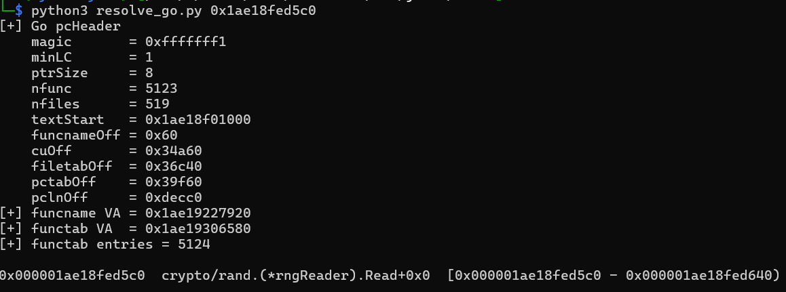

The key came from `ganteng()`, passed through the closure as follows:

```text
main.main
  |
  | newobject(0x19175da0)
  |   -> object stored at [rsp+E0]
  |
  | ganteng(0x50300, 0x20)
  |   -> returns RAX, RBX, RCX
  |
  +--> main.main.func1 closure
         +0x08 = [rsp+E0]   <-- key DATA pointer
         +0x18 = [rsp+40]   <-- key LEN
         +0x20 = [rsp+48]   <-- key CAP
```

I disassembled `ganteng()` and examined its helpers at `0x1ae18fa2a00` and `0x1ae18f4f460`.

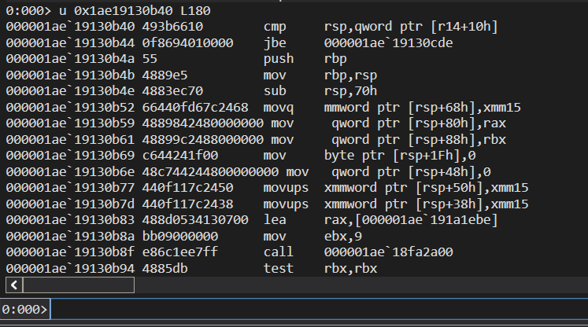

The resolved sequence loaded `ntdll.dll`, added `0x50300` to its base address, and copied `0x20` bytes to use as the AES key.

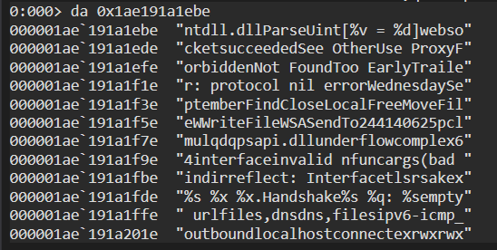

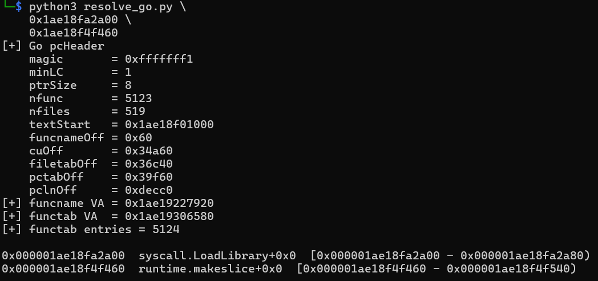

I located the base of `ntdll.dll` and dumped 32 bytes at `ntdll_base + 0x50300`.

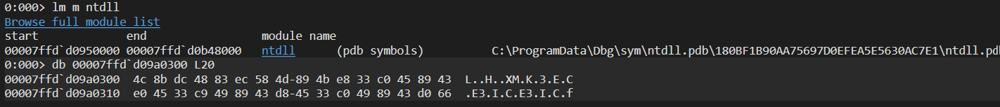

The reconstructed encryption flow was now:

```text
input .birb
    ↓
AES-256-CTR
    key = ntdll + 0x50300
    IV  = 16 random bytes from crypto/rand.Reader
    ↓
ciphertext
    ↓
hex encoding using 0123456789abcdef
    ↓
additional XOR transformation
    ↓
prepend 16-byte IV
    ↓
write output
```

The remaining uncertainty was the XOR transformation. I used `u 0x1ae19131da8 L60` to inspect the instructions between the initialization and the later write.

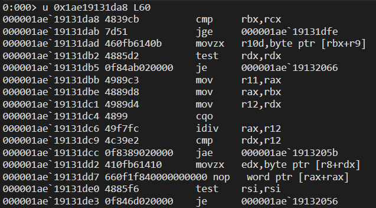

The transformation was:

```text
out[i] =
    hexbuf[i]
    ^ key1[i % len1]
    ^ key2[i % len2];
```

I built the following decryptor, including cleanup for the zero bytes trailing the ciphertext recovered from memory.

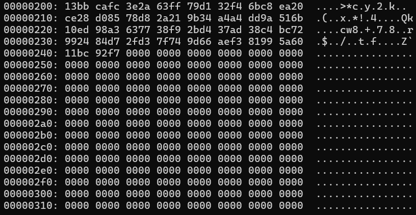

```python
#!/usr/bin/env python3

import sys
from pathlib import Path
from Crypto.Cipher import AES


AES_KEY = bytes.fromhex(
    "4c8bdc4883ec584d894be833c0458943"
    "e04533c9498943d84533c0498943d066"
)

XOR_KEY_1 = bytes.fromhex(
    "be9549ce70990f28f24ba0dfd23a8bb0"
    "5aca85169c3186f13636d57c9e5caf78"
)

XOR_KEY_2 = bytes.fromhex(
    "4285a92a6973136c0d1d36496bc6e3e9"
    "7e102ed39a7e873a2cd284e991ac243c"
)

# The actual encrypted payload shown by xxd ends at 0x244.
PAYLOAD_END = 0x244


def decrypt_file(filename):
    src = Path(filename)
    raw = src.read_bytes()

    if len(raw) < PAYLOAD_END:
        raise ValueError(
            f"File is smaller than expected payload: {len(raw):#x}"
        )

    print(f"[+] Original size : {len(raw):,} bytes")
    print(f"[+] Decrypt range : 0x000 - 0x{PAYLOAD_END - 1:03x}")
    print(f"[+] Preserve      : 0x{PAYLOAD_END:03x} - EOF")

    # --------------------------------------------------------
    # Only decrypt the meaningful first 0x244 bytes.
    # Everything after that remains byte-for-byte unchanged.
    # --------------------------------------------------------

    payload = raw[:PAYLOAD_END]

    iv = payload[:16]
    body = bytearray(payload[16:])

    print(f"[+] IV             : {iv.hex()}")
    print(f"[+] Encoded body   : {len(body)} bytes")

    # Reverse the two repeating XOR operations.
    for i in range(len(body)):
        body[i] ^= XOR_KEY_1[i % len(XOR_KEY_1)]
        body[i] ^= XOR_KEY_2[i % len(XOR_KEY_2)]

    # This should now be ASCII hex.
    allowed = b"0123456789abcdef"

    for i, b in enumerate(body):
        if b not in allowed:
            raise ValueError(
                f"Invalid hex after XOR reversal at "
                f"offset 0x{16+i:x}: 0x{b:02x}"
            )

    hex_ciphertext = bytes(body)

    if len(hex_ciphertext) % 2:
        raise ValueError("Hex ciphertext length is odd")

    ciphertext = bytes.fromhex(
        hex_ciphertext.decode("ascii")
    )

    print(f"[+] Ciphertext     : {len(ciphertext)} bytes")

    # Go cipher.NewCTR(block, iv)
    counter = int.from_bytes(iv, "big")

    cipher = AES.new(
        AES_KEY,
        AES.MODE_CTR,
        nonce=b"",
        initial_value=counter,
    )

    plaintext = cipher.decrypt(ciphertext)

    print(f"[+] Plaintext       : {len(plaintext)} bytes")

    # --------------------------------------------------------
    # Preserve the rest of the original file.
    #
    # Replace only the encrypted payload region with plaintext,
    # then append the untouched zero padding.
    # --------------------------------------------------------

    output = bytearray(raw)

    # Put plaintext at the beginning of the payload region.
    output[:len(plaintext)] = plaintext

    # Clear the remainder of the old encrypted payload region
    # so it doesn't leave stale encrypted data behind.
    #
    # This keeps the file size unchanged and preserves all bytes
    # from PAYLOAD_END onward exactly as they were.
    output[len(plaintext):PAYLOAD_END] = b"\x00" * (
        PAYLOAD_END - len(plaintext)
    )

    out = src.with_name(
        src.name.replace(".birb", ".decrypted", 1)
        if src.name.endswith(".birb")
        else src.name + ".decrypted"
    )

    out.write_bytes(output)

    print(f"[+] Output          : {out}")
    print(f"[+] Output size     : {len(output):,} bytes")
    print(
        f"[+] Preserved tail  : "
        f"{len(output) - PAYLOAD_END:,} bytes"
    )

    print("\n[+] Plaintext preview:")
    print(repr(plaintext[:256]))


def main():
    if len(sys.argv) != 2:
        print(f"Usage: {sys.argv[0]} <file.birb>")
        sys.exit(1)

    try:
        decrypt_file(sys.argv[1])
    except Exception as e:
        print(f"[-] ERROR: {e}")
        sys.exit(1)


if __name__ == "__main__":
    main()
```

The first successful decryption only recovered `desktop.ini`, which did not contain the flag.

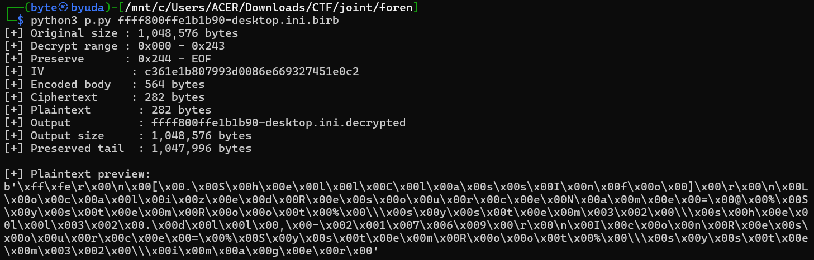

I asked GPT to help scan the dump for candidates matching the recovered transformation.

```c
#include <stdio.h>
#include <stdint.h>
#include <stdlib.h>
#include <sys/stat.h>
#include <sys/mman.h>
#include <fcntl.h>
#include <unistd.h>
#include <string.h>

static const uint8_t A[32] = {
    0xbe,0x95,0x49,0xce,0x70,0x99,0x0f,0x28,
    0xf2,0x4b,0xa0,0xdf,0xd2,0x3a,0x8b,0xb0,
    0x5a,0xca,0x85,0x16,0x9c,0x31,0x86,0xf1,
    0x36,0x36,0xd5,0x7c,0x9e,0x5c,0xaf,0x78
};

static const uint8_t B[32] = {
    0x42,0x85,0xa9,0x2a,0x69,0x73,0x13,0x6c,
    0x0d,0x1d,0x36,0x49,0x6b,0xc6,0xe3,0xe9,
    0x7e,0x10,0x2e,0xd3,0x9a,0x7e,0x87,0x3a,
    0x2c,0xd2,0x84,0xe9,0x91,0xac,0x24,0x3c
};

static int is_hex(uint8_t c)
{
    return
        (c >= '0' && c <= '9') ||
        (c >= 'a' && c <= 'f');
}

int main(int argc, char **argv)
{
    if (argc != 2) {
        fprintf(stderr, "Usage: %s minidump.dmp\n", argv[0]);
        return 1;
    }

    int fd = open(argv[1], O_RDONLY);
    if (fd < 0) {
        perror("open");
        return 1;
    }

    struct stat st;
    if (fstat(fd, &st) < 0) {
        perror("fstat");
        close(fd);
        return 1;
    }

    size_t size = (size_t)st.st_size;

    uint8_t *p = mmap(
        NULL,
        size,
        PROT_READ,
        MAP_PRIVATE,
        fd,
        0
    );

    if (p == MAP_FAILED) {
        perror("mmap");
        close(fd);
        return 1;
    }

    uint8_t mask[32];

    for (int i = 0; i < 32; i++)
        mask[i] = A[i] ^ B[i];

    printf("[+] File size: %zu bytes\n", size);
    printf("[+] Searching for XOR->hex buffers...\n\n");

    unsigned long hits = 0;

    /*
     * We require at least 16 bytes before the body,
     * because the preceding 16 bytes should be the IV.
     *
     * First test 8 bytes. Random data passing this is
     * already extremely unlikely.
     */
    for (size_t i = 16; i + 8 < size; i++) {

        int ok = 1;

        for (size_t j = 0; j < 8; j++) {
            uint8_t x = p[i + j] ^ mask[j];

            if (!is_hex(x)) {
                ok = 0;
                break;
            }
        }

        if (!ok)
            continue;

        /*
         * Extend the candidate as far as the XOR->hex
         * condition remains valid.
         */
        size_t end = i + 8;

        while (end < size) {

            size_t phase = (end - i) & 31;

            uint8_t x = p[end] ^ mask[phase];

            if (!is_hex(x))
                break;

            end++;
        }

        size_t body_len = end - i;

        /*
         * Real encoded ciphertext must contain pairs
         * of hex characters.
         */
        if (body_len < 64 || (body_len & 1))
            continue;

        hits++;

        printf(
            "[+] HIT %lu: "
            "body_file_offset=0x%zx "
            "iv_file_offset=0x%zx "
            "body_len=%zu "
            "payload_len=%zu\n",
            hits,
            i,
            i - 16,
            body_len,
            body_len + 16
        );

        printf("    IV: ");

        for (int j = 0; j < 16; j++)
            printf("%02x", p[i - 16 + j]);

        printf("\n");

        printf("    hex preview: ");

        for (size_t j = 0; j < 32 && j < body_len; j++)
            putchar(p[i + j] ^ mask[j]);

        printf("\n\n");
    }

    printf("[+] Total candidates: %lu\n", hits);

    munmap(p, size);
    close(fd);

    return 0;
}
```

The scan returned 42 hits. Some had lengths similar to the recovered `desktop.ini`.

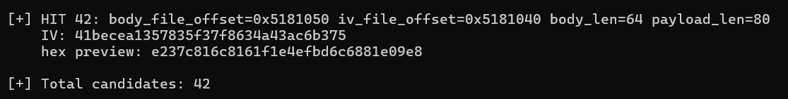

I used the following script to decrypt and inspect all the candidates.

```python
#!/usr/bin/env python3

from pathlib import Path
from Crypto.Cipher import AES


DUMP = Path("minidump.dmp")

AES_KEY = bytes.fromhex(
    "4c8bdc4883ec584d894be833c0458943"
    "e04533c9498943d84533c0498943d066"
)

XOR_KEY_1 = bytes.fromhex(
    "be9549ce70990f28f24ba0dfd23a8bb0"
    "5aca85169c3186f13636d57c9e5caf78"
)

XOR_KEY_2 = bytes.fromhex(
    "4285a92a6973136c0d1d36496bc6e3e9"
    "7e102ed39a7e873a2cd284e991ac243c"
)


def valid_hex_byte(x):
    return (
        0x30 <= x <= 0x39 or
        0x61 <= x <= 0x66
    )


def scan_candidates(data):
    mask = bytes(
        a ^ b
        for a, b in zip(XOR_KEY_1, XOR_KEY_2)
    )

    hits = []

    # Need 16 bytes before body for IV
    for body_start in range(16, len(data) - 8):

        # Check first 8 bytes after XOR.
        ok = True

        for j in range(8):
            x = data[body_start + j] ^ mask[j]
            if not valid_hex_byte(x):
                ok = False
                break

        if not ok:
            continue

        # Extend as far as the XOR->hex property holds.
        end = body_start + 8

        while end < len(data):
            phase = (end - body_start) & 31
            x = data[end] ^ mask[phase]

            if not valid_hex_byte(x):
                break

            end += 1

        body_len = end - body_start

        if body_len < 64:
            continue

        if body_len & 1:
            continue

        hits.append(
            (
                body_start - 16,
                body_start,
                body_len
            )
        )

    return hits


def collapse_overlaps(hits):
    """
    The scanner finds the same payload repeatedly every 0x20 bytes
    because the XOR keys repeat every 32 bytes.

    Keep the longest candidate from each overlapping region.
    """

    hits = sorted(
        hits,
        key=lambda x: (x[0], -x[2])
    )

    selected = []

    for hit in hits:
        iv_off, body_off, body_len = hit

        # Same encrypted region may have already been represented
        # by an earlier/longer hit.
        duplicate = False

        for old_iv, old_body, old_len in selected:
            old_end = old_body + old_len
            new_end = body_off + body_len

            if body_off >= old_body and new_end <= old_end:
                duplicate = True
                break

        if not duplicate:
            selected.append(hit)

    return selected


def decrypt_candidate(data, iv_off, body_off, body_len):
    iv = data[iv_off:body_off]
    body = bytearray(
        data[body_off:body_off + body_len]
    )

    if len(iv) != 16:
        return None

    # Reverse XOR.
    for i in range(len(body)):
        body[i] ^= XOR_KEY_1[i % 32]
        body[i] ^= XOR_KEY_2[i % 32]

    # Must now be lowercase hex.
    for b in body:
        if not valid_hex_byte(b):
            return None

    ciphertext = bytes.fromhex(
        body.decode("ascii")
    )

    counter = int.from_bytes(iv, "big")

    cipher = AES.new(
        AES_KEY,
        AES.MODE_CTR,
        nonce=b"",
        initial_value=counter
    )

    plaintext = cipher.decrypt(ciphertext)

    return iv, ciphertext, plaintext


def print_plaintext(plaintext):
    print(plaintext)

    try:
        text = plaintext.decode("utf-8")
        print(text)
    except UnicodeDecodeError:
        pass

    try:
        text = plaintext.decode("utf-16")
        print(text)
    except UnicodeDecodeError:
        pass


def main():
    data = DUMP.read_bytes()

    print(f"file size: {len(data)}")

    hits = scan_candidates(data)

    print(f"raw hits: {len(hits)}")

    candidates = collapse_overlaps(hits)

    print(f"distinct candidates: {len(candidates)}")

    for n, (iv_off, body_off, body_len) in enumerate(
        candidates,
        1
    ):
        result = decrypt_candidate(
            data,
            iv_off,
            body_off,
            body_len
        )

        if result is None:
            continue

        iv, ciphertext, plaintext = result

        print()
        print("=" * 80)
        print(f"candidate {n}")
        print(f"iv offset:   0x{iv_off:x}")
        print(f"body offset: 0x{body_off:x}")
        print(f"body size:   {body_len}")
        print(f"plaintext:   {len(plaintext)} bytes")
        print(f"iv:          {iv.hex()}")
        print()
        print_plaintext(plaintext)
        print("=" * 80)


if __name__ == "__main__":
    main()
```

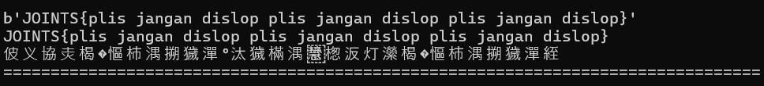

### Flag

```text
JOINTSCTF{plis jangan dislop plis jangan dislop plis jangan dislop}
```


This challenge took a long investigation; the screenshot above captures how I felt by the end.

AI Disclosure :
https://chatgpt.com/share/6abb7f92-85f4-83ec-852c-60b29f350313

## Disk Cleaner (100 Points)

### Description

Someone downloaded a disk cleaner to free up storage, but now the files will not open.

Change the flag prefix to `JOINTS{}`.

Author: pujow

### Solution

The challenge provided a binary and an encrypted file. The ransomware first encoded the data with Base64, then applied RC4 with the key `when_yah_aku_bisa_seperti`. I used the following decryptor; the full analysis is linked in the AI disclosure.

```python
#!/usr/bin/env python3

import sys
import base64
from pathlib import Path

KEY = b"when_yah_aku_bisa_seperti"


def rc4(data, key):
    """Standard RC4 KSA + PRGA."""
    if not key:
        raise ValueError("RC4 key cannot be empty")

    # KSA
    S = list(range(256))
    j = 0
    key_len = len(key)

    for i in range(256):
        j = (j + S[i] + key[i % key_len]) & 0xff
        S[i], S[j] = S[j], S[i]

    # PRGA
    i = 0
    j = 0
    out = bytearray()

    for byte in data:
        i = (i + 1) & 0xff
        j = (j + S[i]) & 0xff
        S[i], S[j] = S[j], S[i]

        k = S[(S[i] + S[j]) & 0xff]
        out.append(byte ^ k)

    return bytes(out)


def decrypt_file(src, dst):
    encrypted = Path(src).read_bytes()

    print("[+] Input size:", len(encrypted))
    print("[+] RC4 key  :", KEY.decode())

    # Stage 1: RC4 is symmetric, so XOR ciphertext with the
    # same keystream to recover the Base64URL data.
    b64_data = rc4(encrypted, KEY)

    print("[+] RC4 output (first 64 bytes):")
    print(repr(b64_data[:64]))

    # The binary uses URL-safe Base64 with '=' padding.
    # Add padding defensively in case the data length isn't a multiple of 4.
    b64_data += b"=" * ((4 - len(b64_data) % 4) % 4)

    try:
        plaintext = base64.urlsafe_b64decode(b64_data)
    except Exception as e:
        raise RuntimeError(
            "Base64URL decode failed. RC4 key/order may be incorrect."
        ) from e

    print("[+] Decoded size:", len(plaintext))
    print("[+] First 16 bytes:", plaintext[:16])

    # DOCX is a ZIP container.
    if plaintext.startswith(b"PK\x03\x04"):
        print("[+] DOCX signature confirmed (PK\\x03\\x04)")
    else:
        print("[!] Output does NOT start with PK\\x03\\x04")
        print("[!] First bytes:", plaintext[:32].hex())

    Path(dst).write_bytes(plaintext)
    print("[+] Written:", dst)


def main():
    if len(sys.argv) != 3:
        print("Usage: python3 decrypt.py encrypted_file output.docx")
        sys.exit(1)

    decrypt_file(sys.argv[1], sys.argv[2])


if __name__ == "__main__":
    main()
```

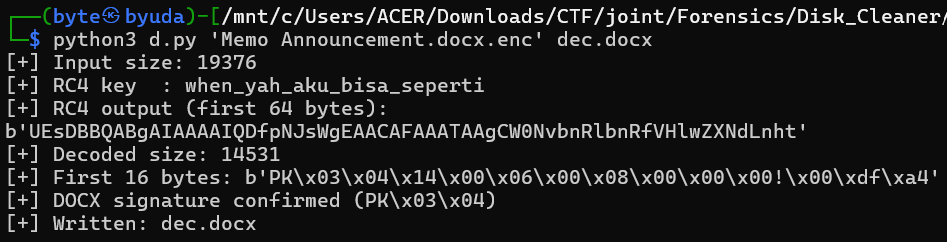

The recovered DOCX contained white text. Revealing it exposed the flag.


### Flag

```text
JOINTS{MAU_BILANG_AKU_suka_KAMU_TAPI_takut_KAMU_Malah_JAWAB_AMSSRBLHGSHARKM_DUH_GUSTI_WONG_KOK_UNIK}
```

AI Disclosure : https://chatgpt.com/share/6abb3092-3fb8-83ec-bbed-7910b9f439b1

## revenant (100 Points)

### Description

Seized mid-write.

Work on a copy.

Author: hush

### Solution

This challenge involved recovering SQLite data from a WAL, similar to the GEMASTIK challenge. The `sync_table` contained a clue about opening the vault.

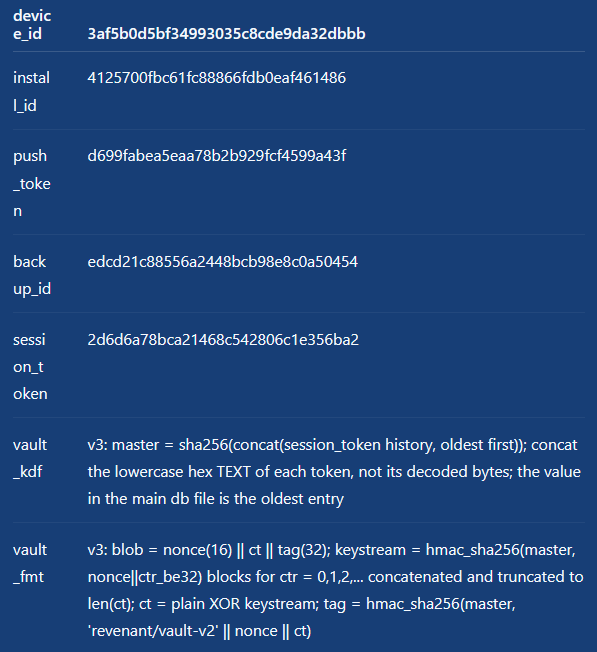

I first enumerated the WAL frames.

```bash
python3 - <<'PY'
from pathlib import Path
import struct
import re

p = Path("messages.db-wal")
d = p.read_bytes()

if len(d) < 32:
    raise SystemExit("WAL too small")

magic, version, page_size, ckpt_seq = struct.unpack_from(">IIII", d, 0)

print(f"magic     = 0x{magic:08x}")
print(f"version   = 0x{version:08x}")
print(f"page_size = {page_size}")
print(f"ckpt_seq  = {ckpt_seq}")
print(f"wal_size  = {len(d):,}")

if page_size == 1:
    page_size = 65536

frame_size = 24 + page_size
nframes = (len(d) - 32) // frame_size

print(f"frames    = {nframes}")
print()

token_re = re.compile(rb'(?<![0-9a-f])[0-9a-f]{32}(?![0-9a-f])')

seen = set()

for frame in range(nframes):
    off = 32 + frame * frame_size

    page_no, db_size = struct.unpack_from(">II", d, off)
    page = d[off + 24 : off + 24 + page_size]

    hits = list(token_re.finditer(page))

    interesting = (
        b"session_token" in page or
        b"sync_state" in page or
        bool(hits)
    )

    if not interesting:
        continue

    print(f"FRAME {frame+1:5d}  offset=0x{off:x}  page={page_no}  dbsize={db_size}")

    if b"session_token" in page:
        print("  contains: session_token")

    if b"sync_state" in page:
        print("  contains: sync_state")

    for m in hits:
        tok = m.group().decode()
        marker = ""
        if tok in seen:
            marker = " (duplicate)"
        else:
            seen.add(tok)

        print(f"  token +0x{m.start():x}: {tok}{marker}")

        lo = max(0, m.start() - 80)
        hi = min(len(page), m.end() + 80)

        chunk = page[lo:hi]
        printable = ''.join(
            chr(x) if 32 <= x < 127 else '.'
            for x in chunk
        )

        print(f"    context: {printable}")

    print()
PY
```

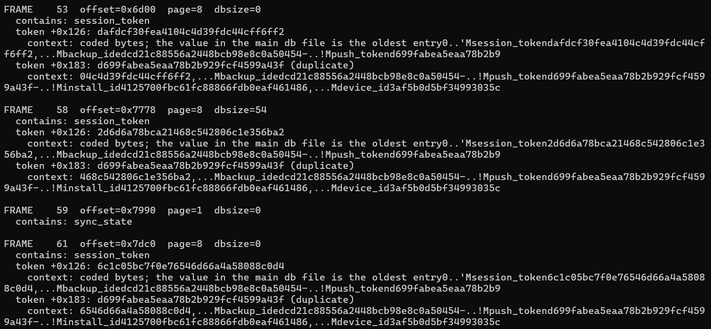

I then checked the commit markers.

```bash
python3 - <<'PY'
from pathlib import Path
import struct

d = Path("messages.db-wal").read_bytes()

PAGE_SIZE = struct.unpack_from(">I", d, 8)[0]
FRAME_SIZE = 24 + PAGE_SIZE
N = (len(d) - 32) // FRAME_SIZE

print(f"page_size = {PAGE_SIZE}")
print(f"frames    = {N}\n")

for i in range(N):
    off = 32 + i * FRAME_SIZE
    page_no, db_size = struct.unpack_from(">II", d, off)

    marker = "COMMIT" if db_size else ""

    print(
        f"frame {i+1:2d}: "
        f"page={page_no:3d} "
        f"dbsize={db_size:3d} "
        f"{marker}"
    )
PY
```

The first transaction covered frames 1–48, the second covered 49–56, and the third ended at frame 58. The later frames were uncommitted.

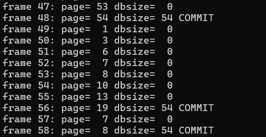

I extracted the old and unfinished versions of page 52 for comparison.

```bash
python3 - <<'PY'
from pathlib import Path
import struct

wal = Path("messages.db-wal").read_bytes()

PAGE_SIZE = struct.unpack_from(">I", wal, 8)[0]
FRAME_SIZE = 24 + PAGE_SIZE

for frame in (46, 66):
    off = 32 + (frame - 1) * FRAME_SIZE
    page_no, db_size = struct.unpack_from(">II", wal, off)
    page = wal[off + 24:off + 24 + PAGE_SIZE]

    out = f"page52_frame{frame}.bin"
    Path(out).write_bytes(page)

    print(f"frame {frame}: page={page_no}, dbsize={db_size}, saved={out}")

    print("hex:")
    print(page.hex(" "))

    print("\nASCII:")
    print("".join(chr(x) if 32 <= x < 127 else "." for x in page))
    print()
PY
```

Next, I reconstructed the database using frames 1–48.

```bash
python3 - <<'PY'
from pathlib import Path
import struct

src = Path("messages.db")
wal = Path("messages.db-wal")
out = Path("tx1.db")

db = bytearray(src.read_bytes())
w = wal.read_bytes()

PAGE_SIZE = struct.unpack_from(">I", w, 8)[0]
FRAME_SIZE = 24 + PAGE_SIZE

# TX1 = frames 1..48, ending with commit frame page 54.
for frame_no in range(1, 49):
    off = 32 + (frame_no - 1) * FRAME_SIZE

    page_no, db_size = struct.unpack_from(">II", w, off)
    page = w[off + 24 : off + 24 + PAGE_SIZE]

    start = (page_no - 1) * PAGE_SIZE
    end = start + PAGE_SIZE

    if end > len(db):
        db.extend(b"\x00" * (end - len(db)))

    db[start:end] = page

out.write_bytes(db)

print(f"page size : {PAGE_SIZE}")
print(f"frames    : 1-48")
print(f"output    : {out}")
print(f"size      : {len(db)} bytes ({len(db)//PAGE_SIZE} pages)")
PY
```

I extracted each attachment from that recovered database.

```bash
python3 - <<'PY'
import sqlite3
from pathlib import Path

con = sqlite3.connect("tx1.db")
cur = con.cursor()

rows = cur.execute("""
    SELECT id, thread_id, sender, ts, attachment
    FROM messages
    WHERE attachment IS NOT NULL
    ORDER BY id
""").fetchall()

print(f"attachments: {len(rows)}")

for msg_id, thread_id, sender, ts, blob in rows:
    out = Path(f"attachment_{msg_id}.bin")
    out.write_bytes(blob)

    print(
        f"id={msg_id} "
        f"thread={thread_id} "
        f"sender={sender!r} "
        f"ts={ts!r} "
        f"len={len(blob)} "
        f"first16={blob[:16].hex()} "
        f"last32={blob[-32:].hex()} "
        f"-> {out}"
    )

con.close()
PY
```

I searched the attachments for the data from page 52.

```bash
python3 - <<'PY'
from pathlib import Path
import re

page = Path("page52_frame46.bin").read_bytes()

# First 4 bytes are SQLite overflow next-page pointer.
payload = page[4:]

print(f"page52 payload: {len(payload)} bytes")
print(f"first 32: {payload[:32].hex()}")

for f in sorted(Path(".").glob("attachment_*.bin")):
    data = f.read_bytes()

    pos = data.find(payload)

    if pos != -1:
        print(f"[+] MATCH: {f} @ offset {pos}")
        print(f"    attachment length = {len(data)}")
        print(f"    matched bytes      = {len(payload)}")
PY
```

The match was in `attachment_25.bin`. I attempted to decrypt it.

```bash
python3 - <<'PY'
import hashlib
import hmac
from pathlib import Path

blob = Path("attachment_25.bin").read_bytes()

print("blob length:", len(blob))
print("nonce      :", blob[:16].hex())
print("tag        :", blob[-32:].hex())
print("ciphertext :", len(blob[16:-32]), "bytes")

token_sets = {
    "committed": [
        "156660f5d7870e95f86c6b9e5c27612c",
        "23b92d04a0bc001f06b7eaa990a2bc6d",
        "dafdcf30fea4104c4d39fdc44cff6ff2",
        "2d6d6a78bca21468c542806c1e356ba2",
    ],

    "mid-write": [
        "156660f5d7870e95f86c6b9e5c27612c",
        "23b92d04a0bc001f06b7eaa990a2bc6d",
        "dafdcf30fea4104c4d39fdc44cff6ff2",
        "2d6d6a78bca21468c542806c1e356ba2",
        "6c1c05bc7f0e76546d66a4a58088c0d4",
    ],
}

nonce = blob[:16]
ct = blob[16:-32]
tag = blob[-32:]

for name, tokens in token_sets.items():
    master = hashlib.sha256("".join(tokens).encode("ascii")).digest()

    expected = hmac.new(
        master,
        b"revenant/vault-v2" + nonce + ct,
        hashlib.sha256
    ).digest()

    print(f"\n[{name}]")
    print("master   =", master.hex())
    print("expected =", expected.hex())
    print("actual   =", tag.hex())
    print("VALID    =", hmac.compare_digest(expected, tag))

    if not hmac.compare_digest(expected, tag):
        continue

    # Decrypt
    ks = bytearray()

    for ctr in range((len(ct) + 31) // 32):
        ks.extend(
            hmac.new(
                master,
                nonce + ctr.to_bytes(4, "big"),
                hashlib.sha256
            ).digest()
        )

    plain = bytes(
        c ^ k
        for c, k in zip(ct, ks)
    )

    print("\nPLAINTEXT:")
    print(plain.decode("utf-8", errors="replace"))

    Path(f"vault_{name}.plain").write_bytes(plain)
PY
```

The decrypted result pointed to another step.

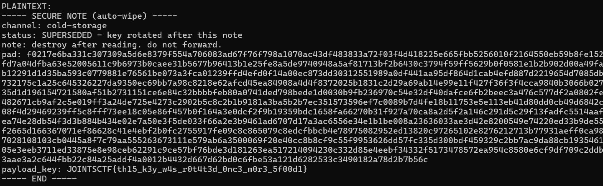

I reconstructed the third committed transaction and a candidate state including the fourth, uncommitted transaction.

```bash
python3 - <<'PY'
from pathlib import Path
import struct

DB = Path("messages.db").read_bytes()
WAL = Path("messages.db-wal").read_bytes()

PS = struct.unpack_from(">I", WAL, 8)[0]
FS = 24 + PS

def apply_frames(base, first, last):
    db = bytearray(base)

    for n in range(first, last + 1):
        off = 32 + (n - 1) * FS
        page_no, db_size = struct.unpack_from(">II", WAL, off)
        page = WAL[off + 24:off + 24 + PS]

        start = (page_no - 1) * PS
        end = start + PS

        if end > len(db):
            db.extend(b"\x00" * (end - len(db)))

        db[start:end] = page

    return bytes(db)

tx3 = apply_frames(DB, 1, 58)
Path("tx3.db").write_bytes(tx3)

tx4 = apply_frames(tx3, 59, 66)
Path("tx4_candidate.db").write_bytes(tx4)

print("TX3:", len(tx3), "bytes")
print("TX4:", len(tx4), "bytes")
PY
```

I then extracted the attachments from both database states.

```bash
rm -f tx4_attachment_*.bin

python3 - <<'PY'
import sqlite3
from pathlib import Path

for dbname in ("tx3.db", "tx4_candidate.db"):
    print(f"\n===== {dbname} =====")

    con = sqlite3.connect(dbname)

    rows = con.execute("""
        SELECT id, thread_id, sender, ts, attachment
        FROM messages
        WHERE attachment IS NOT NULL
        ORDER BY id
    """).fetchall()

    for msg_id, thread_id, sender, ts, blob in rows:
        name = f"{dbname[:-3]}_attachment_{msg_id}.bin"
        Path(name).write_bytes(blob)

        print(
            f"id={msg_id:3d} "
            f"ts={ts} "
            f"len={len(blob):4d} "
            f"head={blob[:16].hex()} "
            f"tail={blob[-32:].hex()} "
            f"-> {name}"
        )

    con.close()
PY
```

After identifying the matching attachment, I decrypted it to recover the flag.

```bash
python3 - <<'PY'
import hashlib
import hmac
from pathlib import Path

blob = Path("tx4_candidate_attachment_14.bin").read_bytes()

tokens = [
    "156660f5d7870e95f86c6b9e5c27612c",
    "23b92d04a0bc001f06b7eaa990a2bc6d",
    "dafdcf30fea4104c4d39fdc44cff6ff2",
    "2d6d6a78bca21468c542806c1e356ba2",
    "6c1c05bc7f0e76546d66a4a58088c0d4",
]

master = hashlib.sha256(
    "".join(tokens).encode("ascii")
).digest()

nonce = blob[:16]
ct = blob[16:-32]
tag = blob[-32:]

expected = hmac.new(
    master,
    b"revenant/vault-v2" + nonce + ct,
    hashlib.sha256
).digest()

print("master   :", master.hex())
print("nonce    :", nonce.hex())
print("ct len   :", len(ct))
print("expected :", expected.hex())
print("actual   :", tag.hex())
print("VALID    :", hmac.compare_digest(expected, tag))

if not hmac.compare_digest(expected, tag):
    raise SystemExit("Wrong master")

keystream = bytearray()

for ctr in range((len(ct) + 31) // 32):
    keystream.extend(
        hmac.new(
            master,
            nonce + ctr.to_bytes(4, "big"),
            hashlib.sha256
        ).digest()
    )

plain = bytes(
    c ^ k
    for c, k in zip(ct, keystream)
)

Path("final_vault.plain").write_bytes(plain)

print("\n=== PLAINTEXT ===")
print(plain.decode("utf-8", errors="replace"))
print("\nSaved: final_vault.plain")
PY
```

### Flag

```text
JOINTSCTF{d3l3t3d_r0w_l1v3s_1n_th3_w4l_a1c9f2}
```

AI DISCLOSURE :
https://chatgpt.com/share/6abb5a00-05cc-83ec-b6f1-d7f209388ca2

## key item get (100 Points)

### Description

A Key Item. Listen.

Author: hush

### Solution

This was an audio steganography challenge.

The `ICMT` metadata comment contained a decoy flag telling me to try harder.

An 18 kHz on/off-keyed tone in the spectrogram decoded as Morse to `DE HT7 LSB`, pointing toward LSB steganography.

The right channel’s bit-0 plane contained a repeating `KEYITEM1` recovery block. It described the frame format, interleaver, Hamming(7,4), CRC32, and an HMAC-based cipher with its seed.

The 7.3/9.1 kHz FSK signal shared by both channels and the left-only 11/12.2 kHz FSK signal were decoys. Both decoded to test-pattern vaults telling me to keep looking.

The real vault used approximately 409-baud ASK on 3.19/5.39 kHz carriers, visible in the left-minus-right difference. Its CRC32 and HMAC tag verified using the seed from the LSB block. Decrypting it produced the flag.

The final solver was:

```python
# vault7.py
import numpy as np, wave, hashlib, hmac, struct, zlib, re

sr = 48000
w = wave.open('intercept.wav')
s = np.frombuffer(w.readframes(w.getnframes()), dtype='<i2').reshape(-1, 2).astype(float)
L, R = s[:, 0], s[:, 1]
chans = {'diff': (L - R) / 2, 'R': R, 'L': L}

SEEDS = ['f9483eaf7747ff8ab3526acb9db8f5c8c415872885ba26818f589ca6090a4997']
SKIP = {'44499cec', 'a105b87e'}          # the two plaintext decoy vaults


def try_tag(pl):
    nonce, ct, tg = pl[:16], pl[16:-32], pl[-32:]
    for sh in SEEDS:
        key = hashlib.sha256(b'keyitem/vault-v1' + bytes.fromhex(sh)).digest()
        if hmac.new(key, b'keyitem/vault-v1' + nonce + ct, hashlib.sha256).digest() == tg:
            ks = b''.join(hmac.new(key, nonce + struct.pack('>I', i), hashlib.sha256).digest()
                          for i in range(len(ct) // 32 + 1))
            print("   TAG OK\n   PLAINTEXT:", bytes(a ^ b for a, b in zip(ct, ks)))
            return True
    return False


def hamming_decode(bits):
    out = []
    for i in range(0, len(bits) - 6, 7):
        c = list(bits[i:i + 7])                       # [p1 p2 d1 p3 d2 d3 d4]
        pos = (c[0]^c[2]^c[4]^c[6]) + 2*(c[1]^c[2]^c[5]^c[6]) + 4*(c[3]^c[4]^c[5]^c[6])
        if pos:
            c[pos - 1] ^= 1
        out += [c[2], c[4], c[5], c[6]]
    return out


def bits2bytes(bits):
    n = len(bits) // 8 * 8
    return np.packbits(np.array(bits[:n], dtype=np.uint8), bitorder='big').tobytes()


seen, seen_hdr = set(), set()


def try_frame(bits, tag):
    bs = ''.join('1' if v else '0' for v in bits)
    for pol in (0, 1):
        b = bs if pol == 0 else bs.translate(str.maketrans('01', '10'))
        for mi, m in enumerate(re.finditer('(10){6,}01111110', b)):
            if mi >= 3:
                break
            p = m.end()
            hdr = bits2bytes([int(c) for c in b[p:p + 48]])
            if len(hdr) < 6:
                continue
            cands = [(hdr[0], hdr[1], struct.unpack('>H', hdr[2:4])[0]), (38, 61, 160)]
            for rows, cols, paylen in cands:
                if not (0 < rows and 0 < cols and 0 < paylen < 4000) or (paylen + 4) * 14 > rows * cols:
                    continue
                body = [int(c) for c in b[p + 48:p + 48 + rows * cols]]
                if len(body) < rows * cols:
                    continue
                cw = list(np.array(body).reshape(cols, rows).T.reshape(-1))[:(paylen + 4) * 14]
                data = bits2bytes(hamming_decode(cw))
                pl, crc = data[:paylen], data[paylen:paylen + 4]
                if struct.pack('>I', zlib.crc32(pl)) != crc:
                    k = (rows, cols, paylen)
                    if k not in seen_hdr:
                        seen_hdr.add(k)
                        print(f"[{tag}] hdr {rows}x{cols} paylen={paylen} CRC bad (pol={pol})")
                    continue
                vid = hashlib.md5(pl).hexdigest()[:8]
                if vid in SKIP or vid in seen:
                    continue
                seen.add(vid)
                print(f"[{tag}] CRC-valid vault id={vid} {rows}x{cols} paylen={paylen} pol={pol}")
                print("   text:", pl[:160])
                if try_tag(pl):
                    return True
                print("   tag failed")
    return False


def envelope(x, f, win=36):
    t = np.arange(len(x)) / sr
    z = x * np.exp(-2j * np.pi * f * t)
    return np.abs(np.convolve(z, np.ones(win) / win, mode='same'))


def clean_edges(edges, minrun):
    e = list(edges)
    i = 0
    while i < len(e) - 1:                 # drop glitch pairs (runs shorter than minrun)
        if e[i + 1] - e[i] < minrun:
            del e[i:i + 2]
            i = max(i - 1, 0)
        else:
            i += 1
    return np.array(e)


def slice_bits(env, thr, spb0):
    b = env > thr
    edges = np.where(np.diff(b.astype(int)) != 0)[0] + 1
    edges = clean_edges(edges, 0.3 * spb0)
    if len(edges) < 50:
        return None, None
    ks, spb = [0], spb0
    for i in range(1, len(edges)):
        ks.append(ks[-1] + max(1, int(round((edges[i] - edges[i - 1]) / spb))))
        if i >= 20 and i % 20 == 0:
            spb = np.polyfit(ks, edges[:i + 1], 1)[0]
    ks = np.array(ks, dtype=float)
    fit = np.polyfit(ks, edges, 1)
    def tk(k):                            # bit-boundary time, interpolated between real edges
        k = np.asarray(k, dtype=float)
        t = np.interp(k, ks, edges)
        lo, hi = k < ks[0], k > ks[-1]
        t[lo] = np.polyval(fit, k[lo]); t[hi] = np.polyval(fit, k[hi])
        return t
    K = np.arange(0, int(ks[-1]))
    ta = np.round(tk(K + 0.25)).astype(int)
    tb = np.round(tk(K + 0.75)).astype(int)
    cs = np.concatenate(([0], np.cumsum(env)))
    tb = np.maximum(tb, ta + 1)
    m = (cs[tb] - cs[ta]) / (tb - ta)
    return (m > thr).astype(np.uint8), fit[0]


x = chans['diff']
for cname, x in chans.items():
    seg = x[int(1.0 * sr):int(4.5 * sr)]
    spec = np.abs(np.fft.rfft(seg * np.hanning(len(seg))))
    fr = np.fft.rfftfreq(len(seg), 1 / sr)
    def refine(f, span=150):
        m = (fr > f - span) & (fr < f + span)
        return fr[m][np.argmax(spec[m])]
    f3, f5 = refine(3190), refine(5390)
    e3, e5 = envelope(x, f3), envelope(x, f5)
    variants = {'3k': e3, '5k': e5, 'both': e3 / np.percentile(e3, 90) + e5 / np.percentile(e5, 90)}
    print(f"== {cname} carriers {f3:.0f}/{f5:.0f}")
    for vname, env in variants.items():
        hi, lo = np.percentile(env, 90), np.percentile(env, 10)
        for frac in (0.5, 0.4, 0.6, 0.35, 0.65):
            thr = lo + frac * (hi - lo)
            for spb0 in (119.2, 120.0, 118.8):
                bits, spb = slice_bits(env, thr, spb0)
                if bits is None:
                    continue
                if (vname, frac, spb0) == ('3k', 0.5, 119.2) or spb0 == 119.2 and frac == 0.5:
                    print(f"   {vname} frac={frac}: fitted spb={spb:.3f} ({sr/spb:.2f} baud), {len(bits)} bits")
                if try_frame(bits, f"{cname} {vname} frac={frac} spb0={spb0}"):
                    raise SystemExit
print("done")
```

### Flag

```text
JOINTSCTF{l3ft_m1nus_r1ght_h1d3s_4n_4fsk_wh1sp3r_7b21e0}
```

AI Disclosure : https://claude.ai/share/1d8b6b32-06d2-43cc-8af9-f9b36e4a5d95
