These are my forensics write-ups from the RECURSION 2.0 Final. The challenges covered document analysis, disk and memory forensics, macOS incident response, steganography, and malware analysis.

## Transkrip Bersejarah

Points: 100

The challenge provided a macro-enabled Word document, `Transkrip_Bersejarah.docm`, and an encrypted file named `evidence.txt`. I began by deobfuscating the document's VBA macros with `olevba`.

```bash
olevba Transkrip_Bersejarah.docm --deobf
```

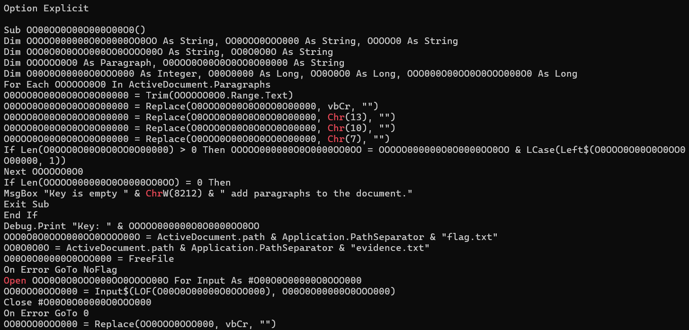

The macro showed that the encryption used a repeating XOR key. That key was assembled from the first character of every non-empty paragraph in the document. I reproduced the process directly from `word/document.xml` and used the result to decrypt the hexadecimal content of `evidence.txt`.

```python
from zipfile import ZipFile
from xml.etree import ElementTree as ET
from pathlib import Path

DOC = Path("Transkrip_Bersejarah.docm")
ENC = Path("evidence.txt")

with ZipFile(DOC) as archive:
    root = ET.fromstring(archive.read("word/document.xml"))

ns = {"w": "http://schemas.openxmlformats.org/wordprocessingml/2006/main"}
paragraphs = []

for paragraph in root.findall(".//w:p", ns):
    text = "".join(node.text or "" for node in paragraph.findall(".//w:t", ns))
    text = text.strip()
    if text:
        paragraphs.append(text)

key = "".join(paragraph[0].lower() for paragraph in paragraphs).encode()
if not key:
    raise ValueError("Empty XOR key")

ciphertext = bytes.fromhex(ENC.read_text().strip())
plaintext = bytes(byte ^ key[index % len(key)] for index, byte in enumerate(ciphertext))

Path("decrypted_flag.txt").write_bytes(plaintext)
print("[+] Key:", key.decode(errors="replace"))
print("[+] Decrypted:", plaintext)
```

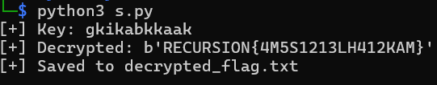

Flag: `RECURSION{4M5S1213LH412KAM}`

## development

Points: 496

This challenge supplied a Linux disk image and a LiME memory dump. The disk contained a LUKS2-encrypted partition, so the investigation began with the memory image and then used the recovered cryptographic material to unlock the disk.

### Question #1

> What magic string identifies the memory capture format?

Running `xxd memory.lime | head` exposed the `LiME` magic bytes.

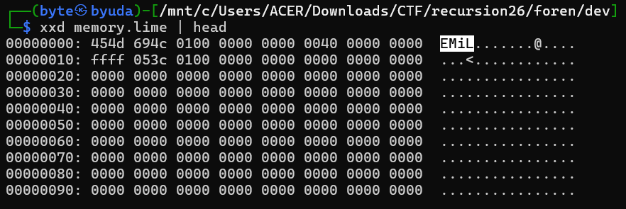

### Question #2

> What physical address does the LiME header report as the start of memory?
>
> Format: `0x`-prefixed hexadecimal

The same header showed that the captured physical memory began at `0x40000000`.

### Question #3

> What exact kernel version produced this dump?

The unencrypted Linux volume identified the kernel as `5.15.0-198-generic`.

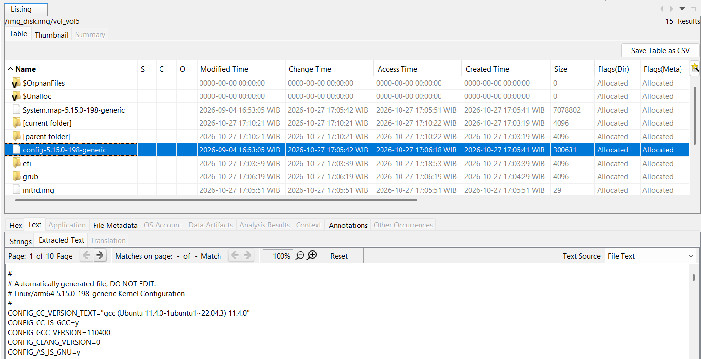

### Question #4

> At what byte offset in `disk.img` does the LUKS2 header begin?
>
> Format: decimal

I then inspected the disk layout in bytes. The LUKS2 partition began at byte offset `3275751424`.

```bash
sudo parted -s disk.img unit B print
```

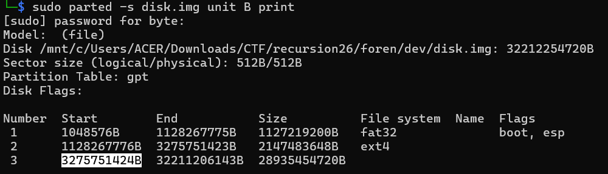

### Question #5

> What is the UUID of the LUKS2 volume?

I loaded the LiME dump with MemNixFS and searched memory for `luks2`. The recovered JSON metadata identified the LUKS UUID as `0ff78882-8e13-4801-88e4-bed91a18894f`.

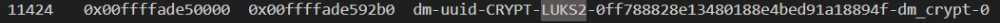

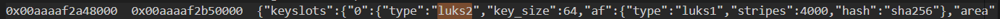

### Question #6

> What cipher specification does the LUKS2 header declare?

The same JSON metadata declared the cipher as `aes-xts-plain64`.

### Question #7

> What is the SHA-256 of the recovered 64-byte LUKS master key?
>
> Format: lowercase hexadecimal

Next, I used `bulk_extractor` to recover AES-key candidates from memory. I tested candidate pairs against the LUKS volume until `cryptsetup` accepted the reconstructed master key.

```bash
bulk_extractor -o bulk memory.lime
```

The SHA-256 digest of the accepted master key was:

```text
7b7ace68019e5317441569668aa411481188471572f888c6b5f1bfa40b029d53
```

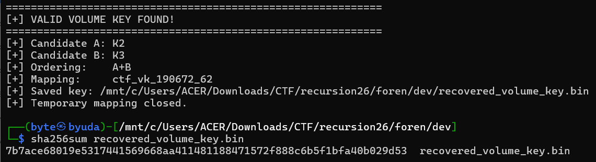

After opening the encrypted partition, I activated the LVM volume in read-only mode and mounted the filesystem without replaying its journal.

```bash
sudo vgchange -ay --devices /dev/mapper/recovered \
  --config 'activation { read_only_volume_list = [ "ubuntu-vg/ubuntu-lv" ] }' \
  ubuntu-vg

sudo mount -t ext4 -o ro,noload,nosuid,nodev,noexec \
  /dev/mapper/ubuntu--vg-ubuntu--lv /mnt/dec
```

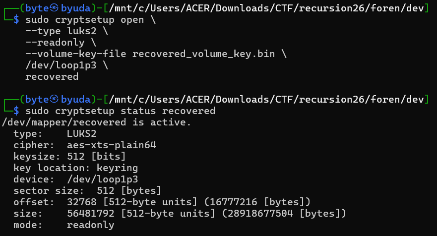

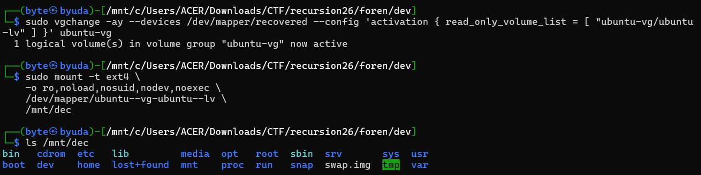

### Question #8

> From which IP address did the attacker reach the Flask debugger?

The Flask log at `/home/pujpuj/app/flask.log` recorded the attacker's address as `192.168.64.42`.

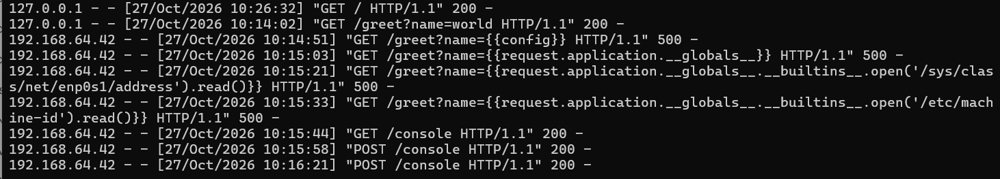

### Question #9

> Which Werkzeug endpoint did the attacker abuse to gain RCE as `alice`?

The same Flask log showed access to Werkzeug's `/console` endpoint.

### Question #10

> What CVE describes the kernel LPE used to escalate to root?
>
> Format: `CVE-YYYY-NNNNN`

The system release information and kernel version led to the privilege-escalation vulnerability `CVE-2026-31431`.

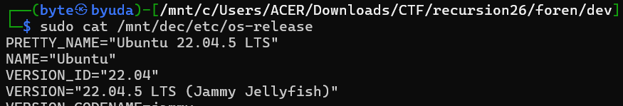

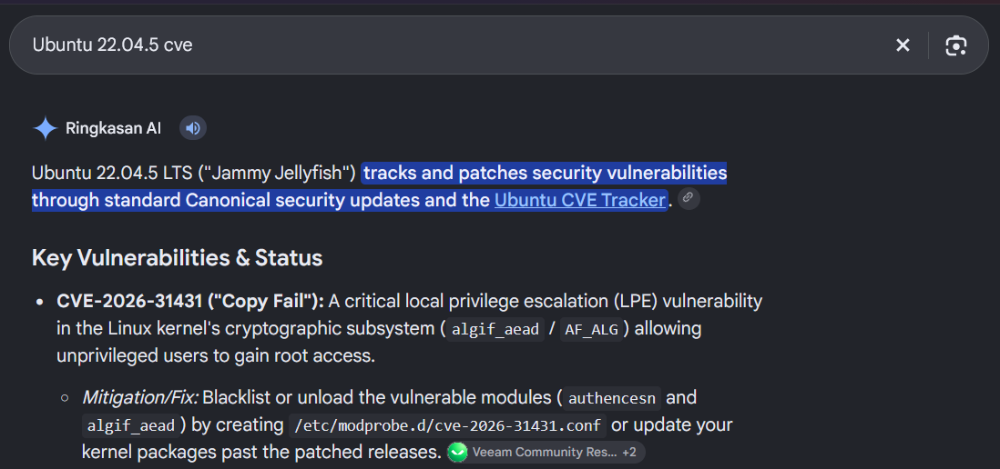

### Question #11

> What is the flag embedded in `/root/flag.png` on the decrypted volume?

Finally, the recovered filesystem contained `/root/flag.png`.

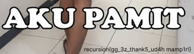

Challenge flag: `recursion{gg_3z_thank5_ud4h_mamp1r!}`

Remote flag: `RECURSION{a9b45b4fd5b54be0a4b35d57ab992d59}`

## They do, usually when you've finally moved on

Points: 500

This challenge followed a compromise of a macOS host through a sequence of eighteen investigation questions.

### Question #1

> What email address does the victim use?

I began with the victim's Delta Chat database at:

```text
macOS/Users/lyanna/Library/Application Support/DeltaChat/accounts/
a669cbdd-5889-405d-b527-d93d963097a1/dc.db
```

The configuration table identified the victim's address as `l4gszwsty@chat.nuvon.app`.

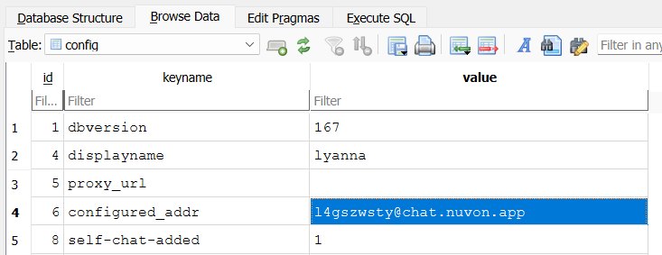

### Question #2

> What email address does the attacker use?

The contacts table identified the attacker as `tisdzkxci@chatmail.uk`.

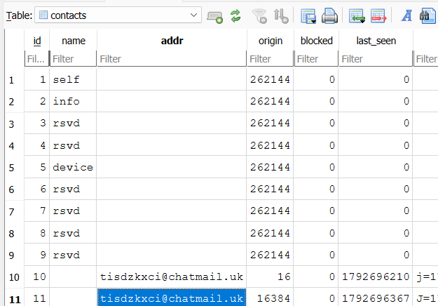

### Question #3

> What trigger value activates the malicious behavior?
>
> Format: hexadecimal

In the packet capture, the HTTP stream containing the trigger was `tcp.stream == 125`. It revealed the trigger value `7d1cdce3381f34ed49c8d0eddab0360c`.

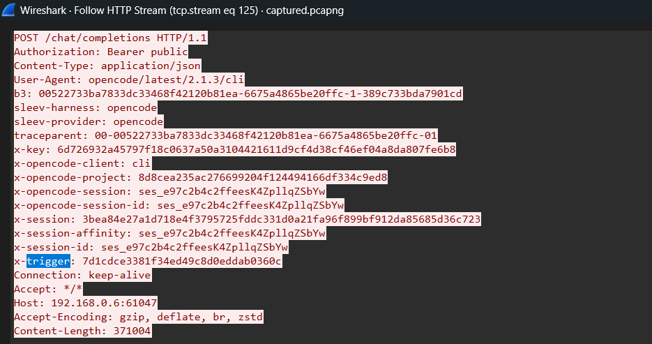

### Question #4

> What AES session key does the plugin send the proxy?
>
> Format: hexadecimal

The `x-key` header in the same request contained the session key:

```text
6d726932a45797f18c0637a50a3104421611d9cf4d38cf46ef04a8da807fe6b8
```

### Question #5

> Which cipher encrypts the stager chunks?

Testing the 256-bit key against the encrypted traffic showed that the payload used AES-256-CBC.

### Question #6

> Which hidden directory holds the reassembled stager?

To locate the original entry point, I inspected the OpenCode log under `~/.local/share/opencode/log`, where a suspicious script had been executed.

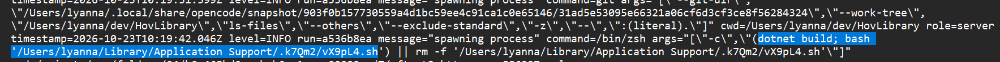

The directory referenced by the script was not accepted. Looking in `Application Support` for an unusual directory with a nearby timestamp revealed the correct answer, `.DsM76`.

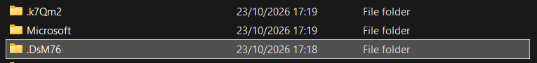

### Question #7

> What filename is the reassembled stager written as?

The file inside `.DsM76` was named `c9K1sd.bin`.

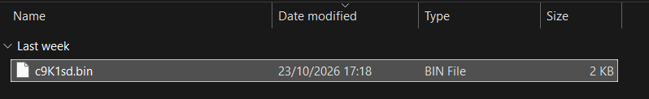

### Question #8

> Which bitmap resource file name hides?

Strings from the downloaded `WeatherStation` binary referenced `WeatherStation.Btlj.bmp`.

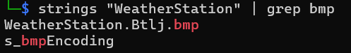

### Question #9

> What are the hex contents of the `.syncstate` file?
>
> Format: hexadecimal

The application's `.syncstate` file contained the identifier `a57d30c606f47457ab963ec38b9b9e8a`.

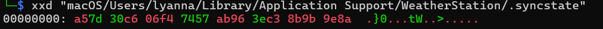

### Question #10

> What is the name of the file the WeatherStation launcher installs itself as?

Searching the filesystem for `WeatherStation` led to `com.apple.softwareupdate.plist` in the user's `LaunchAgents` directory. The persistence entry installed the binary as `stationsync`.

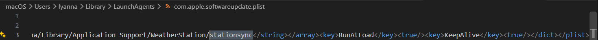

### Question #11

> Which LaunchAgent label does the implant install for persistence?

The same property list used the label `com.apple.softwareupdate`.

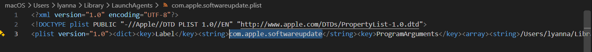

### Question #12

> What hardware ID does the implant check in with?
>
> Format: hexadecimal

Binary analysis revealed the C2 endpoint `192.168.0.6:61048`. Filtering the capture on that port exposed an outbound archive containing the hardware identifier `290f6adccd830bae66f6f34495611cb275bcff8f88e822d52f656f2048df4a8e`.

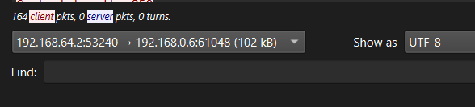

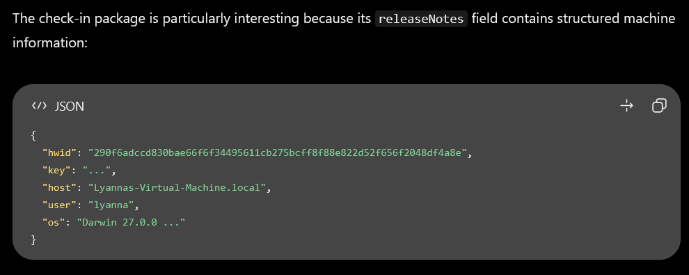

### Question #13

> What was the first command the operator sent to the implant?

The implant supported `list`, `get`, `write`, `enc`, `stop`, and `destroy`. The operator's first command was `list`.

### Question #14

> How many task versions did the operator push to the implant?

Across the traffic, I found eleven task versions, from `1.0.0` through `1.0.10`.

### Question #15

> What task key encrypts task `1.0.10`?
>
> Format: Base64

The `1.0.10` key was stored in `halcyon.telemetry.checkin.1.0.38.nupkg`:

```text
CVrNNG7aB/HSexv3uCpJwSObBnw2H9jbprMsY56kOho=
```

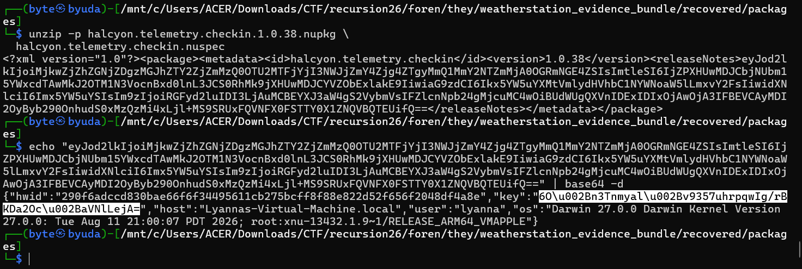

### Question #16

> Which NuGet package ID does the implant publish its check-in under?

The NuGet package name was `halcyon.telemetry.checkin`.

### Question #17

> What content did the attacker extract from the `enc` file?

Extracting the exfiltrated content from the traffic recovered:

```text
I REALLY REALLY MISS HIM, I HOPE HE MISS ME TOO :(
```

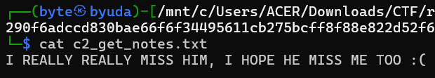

### Question #18

> What encryption key protects the `enc` file?
>
> Format: Base64

For the result data, the malware derived `K_result` as `HMAC-SHA256(session_key, UTF8("result:" || V))`. The Base64-decoded release notes were arranged as a 12-byte nonce, ciphertext, and a 16-byte tag, then decrypted with AES-256-GCM. The resulting key was:

```text
GcKYo/KjkzBVU2e9y9YpGOCmeVzlQ1DklWSQfOUVqKU=
```

Flag: `RECURSION{738056cb5d124b23ff12e94d86831a38}`

## stegoshit

Points: 100

The challenge provided two images. Running `zsteg` against them revealed MacBinary data and strings containing `__PGEZRO`.

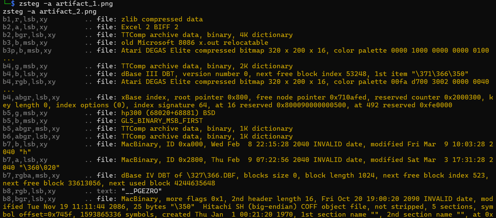

I extracted the raw payload from each image with `zsteg`.

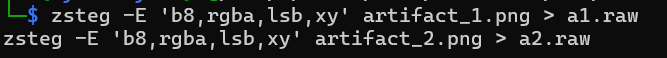

The first fragment stored the offset needed to place the second fragment. I reconstructed the split Mach-O file with the following script.

```python
from pathlib import Path

raw1 = Path("a1.raw").read_bytes()
raw2 = Path("a2.raw").read_bytes()

offset = int.from_bytes(raw1[:4], "little")
part1 = raw1[8:]
part2 = raw2[8:]

total_size = 0x21D0
result = bytearray(total_size)
result[:len(part1)] = part1
result[offset:offset + len(part2)] = part2

Path("reconstructed.macho").write_bytes(result)
```

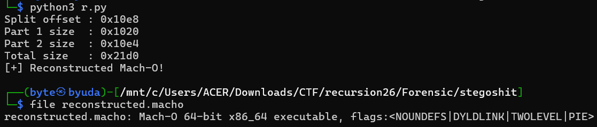

The reconstructed program contained a 40-byte encrypted buffer and a four-byte XOR key. XORing the buffer with `adadee17` and Base64-decoding the result recovered the flag.

Flag: `RECURSION{go0&_9am3!}`

## nguping

Points: 379

This challenge required static analysis of a macOS sample through seventeen questions.

### Question #1

> What is the SHA-256 hash of the sample?

The sample's SHA-256 digest was:

```text
954ce936a22432eeeb78bee3622a6364c9c8b6d6c32391cf03c1e25032294c86
```

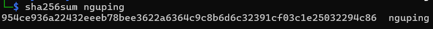

### Question #2

> The binary has only one dynamic library dependency. What is it?
>
> Format: full path

VirusTotal showed that the binary had a single dynamic-library dependency: `/usr/lib/libSystem.B.dylib`.

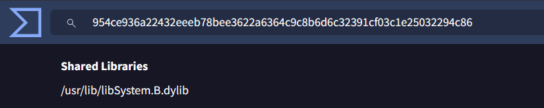

### Question #3

> What obfuscation technique is applied to the framework-path strings embedded in the binary?

The framework-path strings were protected with XOR.

### Question #4

> What single-byte key is used to deobfuscate those strings?

The routine in `FUN_100000944` revealed the key as `0x37`.

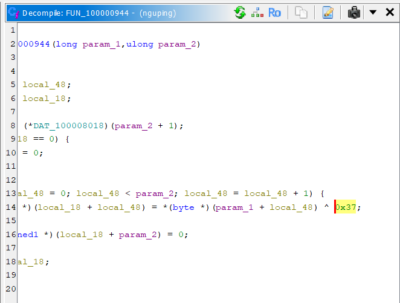

### Question #5

> What framework path is recovered after deobfuscating the embedded string?

Following the calls into `FUN_1000005bc` and decrypting `DAT_1000015b0` revealed the dynamically loaded framework:

```text
/System/Library/Frameworks/CoreGraphics.framework/CoreGraphics
```

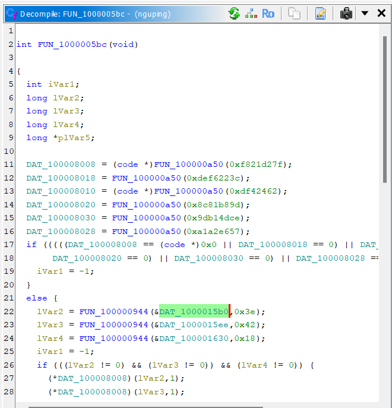

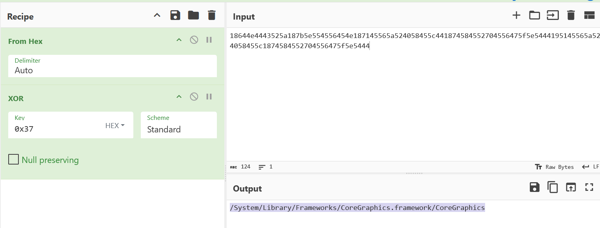

### Question #6

> Instead of using `dlsym`, the malware resolves API functions by walking a Mach-O structure. Which load command does it parse?

The sample parsed `LC_SYMTAB` to resolve the required symbols.

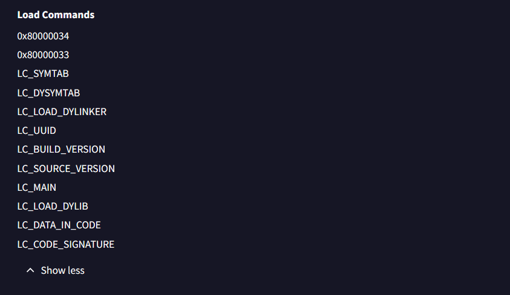

### Question #7

> What constant is used as the multiplication factor inside the API hash function?

Inside the API hash routine, `FUN_100000a50`, the multiplication factor was `0x5BD1E995`.

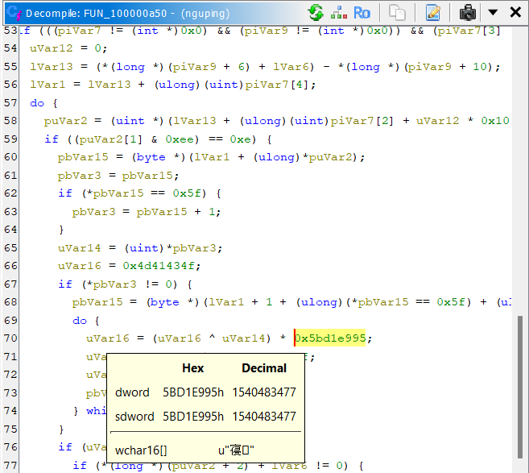

### Question #8

> Which macOS API does the malware resolve to install its keyboard hook?

The event-capture routine resolved `CGEventTapCreate`.

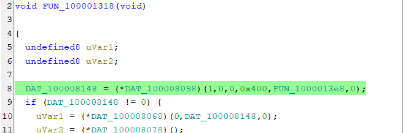

### Question #9

> What macOS system permission must the user grant for this hook to succeed?

The hook requires Accessibility permission.

### Question #10

> Which macOS API does the malware use to convert key events into Unicode characters?

The sample used `CGEventKeyboardGetUnicodeString` to collect keyboard input.

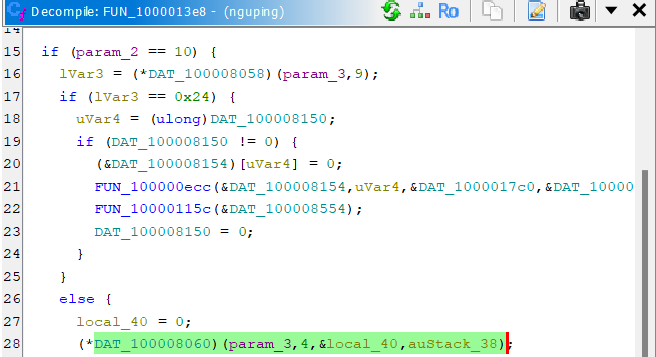

### Question #11

> What virtual keycode triggers the encryption and exfiltration of the keystroke buffer?
>
> Format: hexadecimal

The virtual keycode that triggered encryption and exfiltration was `0x24`.

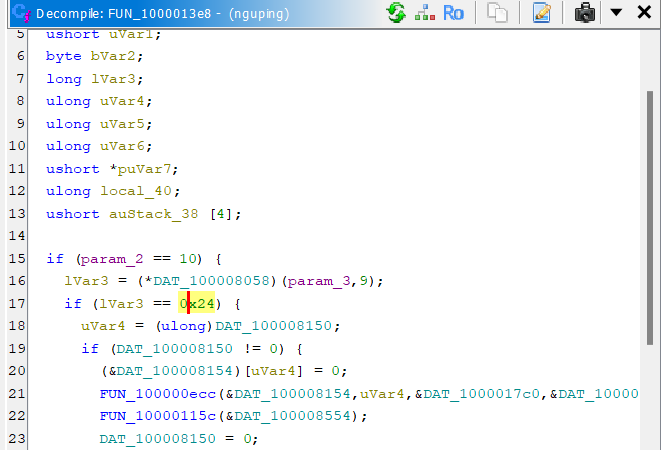

### Question #12

> What is the maximum number of bytes the keystroke buffer can hold before wrapping?
>
> Format: decimal

The sample stored collected data in a `0x3fc`-byte, or 1020-byte, buffer.

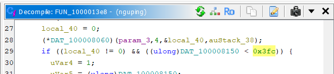

### Question #13

> Identify the block cipher used to encrypt captured keystrokes.
>
> Include the block and key sizes.

Before transmission, the captured data was encrypted with Speck64/128: a 64-bit block, a 128-bit key, and 27 rounds.

### Question #14

> What format string appears in the binary for transmitting encrypted blocks?

The transmission routine used:

```text
mAc bLk %zu: v0=0x%08x, v1=0x%08x
```

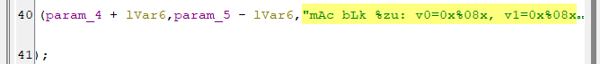

### Question #15

> What hardcoded string serves as the RC4 key for decrypting embedded credentials?

The routine `FUN_1000010a8` contained the RC4 key `M4C0S_K3YD1S_R3PR0`.

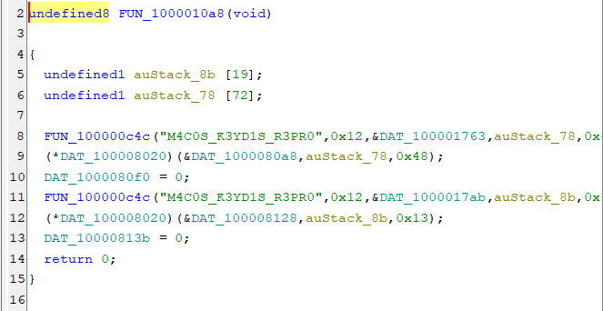

### Question #16

> What is the decrypted bot token?

I used the recovered key to decrypt the buffer at `DAT_100001763`.

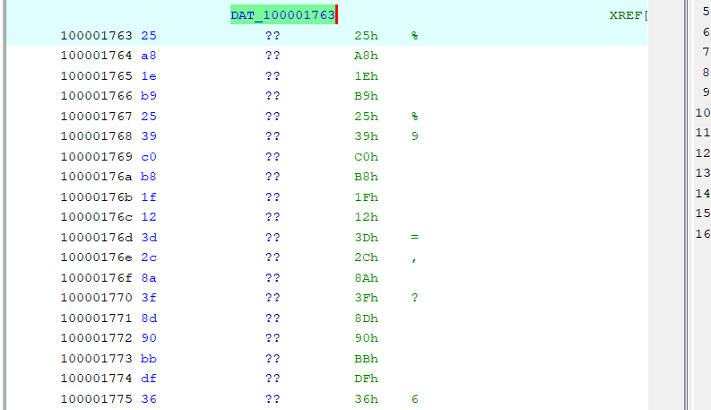

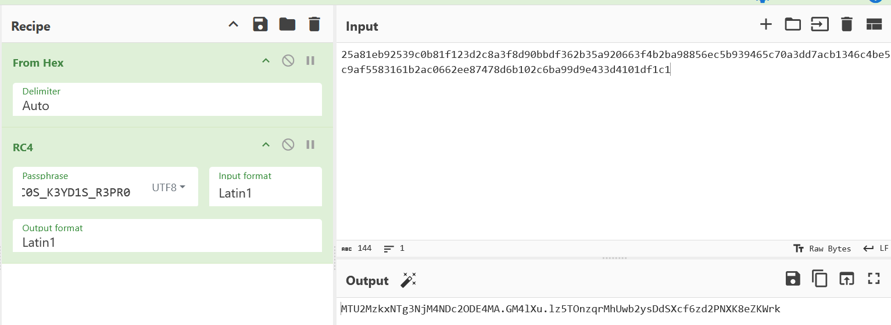

### Question #17

> What is the malware's primary functionality?

The keyboard hook, Unicode conversion, keystroke buffer, and exfiltration routine confirmed that the sample's primary functionality was keylogging.

Flag: `RECURSION{3d8fa239bc3a437aef04c67f85902d66}`
