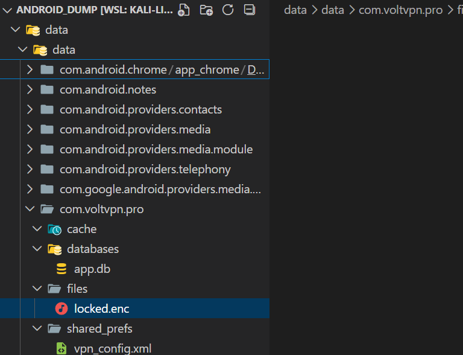
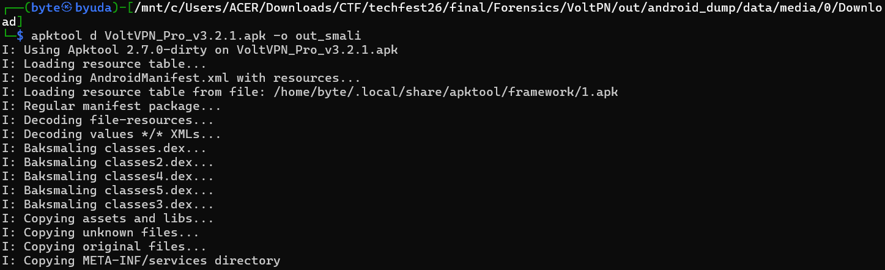
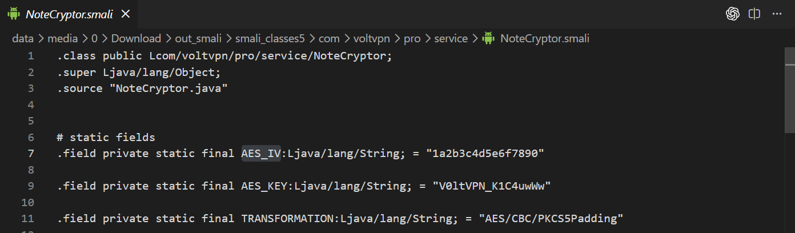
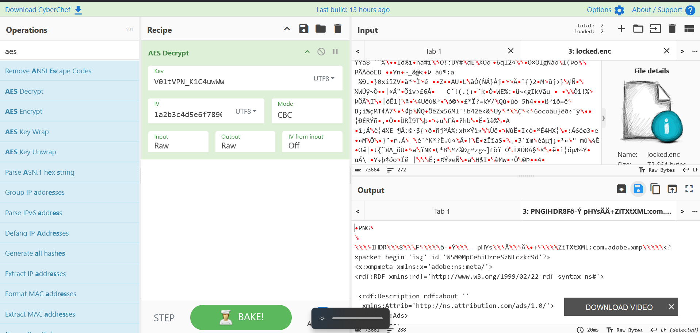
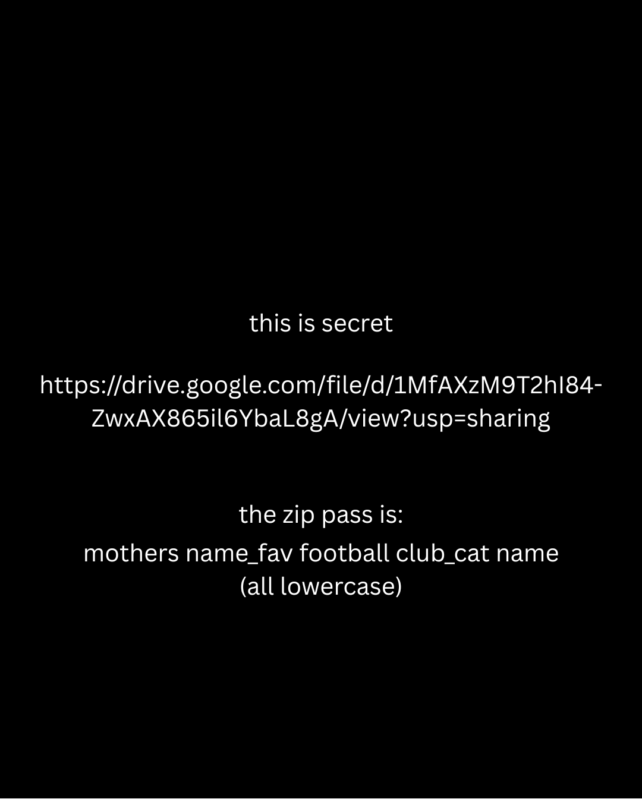

These are my forensics write-ups from TECHFEST 2026 Final. Each section follows the solving process recorded during the investigation.

## VoltPN

Author : ud1n

### Description

Rizky Aditya, a software developer, noticed that his phone’s battery was draining faster than usual and its data usage had spiked overnight. He later discovered that an important confidential file had been encrypted.

A colleague on the security team performed a quick triage and extracted a logical dump of the Android device. Initial analysis suggested that Rizky had installed a suspicious application from an untrusted source.

Analyze the Android dump and restore Rizky's important files.

### Solution

The ZIP contained an Android storage dump. Under `data/data`, I found the package `com.voltpn.pro`, which matched the suspicious application in the description. Its `files` directory contained `locked.enc`, so I looked for the APK next.



I found the APK in Downloads and extracted it with Apktool.



`NoteCryptor.smali` contained the encryption routine, including both the key and IV.



I decrypted the file in CyberChef using those values.



https://gchq.github.io/CyberChef/#recipe=AES_Decrypt(%7B'option':'UTF8','string':'V0ltVPN_K1C4uwWw'%7D,%7B'option':'UTF8','string':'1a2b3c4d5e6f7890'%7D,16,'CBC','Raw','Raw',%7B'option':'Hex','string':''%7D,%7B'option':'Hex','string':''%7D,'Off')

The result was a PNG containing a Google Drive link and a clue for the password.



I carved files from `/media/0` to recover the names needed for the password. The result was:

`viona_barcelona_goolkie`

### Flag

```text
TECHFEST2026{messi_lagi_curhat_sama_bang_dodo_nyesel_mandiin_lamine_yamal}
```
