These are my forensics write-ups from TECHFEST 2026 Quals. Each section follows the solving process recorded during the investigation.

## DpDp

Author : arenaru

### Description

Brian intercepted a raw data stream from a display port.

The display port was being used to show an image on a screen.

Recover the image from the intercepted data.

### Solution

The PCAP contained traffic with unusual MAC addresses and a `0x1337` protocol identifier.

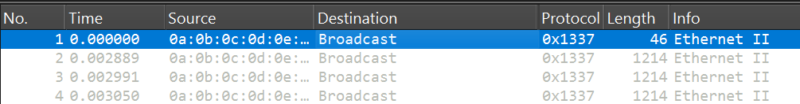

The first stream revealed the image dimensions: 400 × 100 pixels.

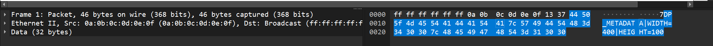

I asked DeepSeek to help reconstruct the image. The first packet contained the header, followed by 100 data chunks of 1,200 bytes each. That gave 120,000 bytes in total. Dividing by 400 × 100 gave three bytes per pixel, consistent with RGB. DeepSeek supplied the reconstruction script below.

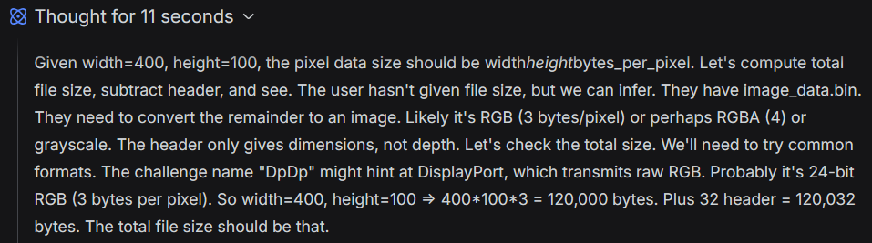

AI disclosure:

https://chat.deepseek.com/share/fvynlqpc8am5qrflc4

`solver.py`

```python
import struct
from PIL import Image

with open('image_data.bin', 'rb') as f:
    data = f.read()

# Header is ASCII, but we can parse the numbers manually
header = data[:32].decode('ascii')
# Extract width and height (simple parsing)
parts = header.split('|')
width = int(parts[1].split('=')[1])   # "WIDTH=400"
height = int(parts[2].split('=')[1])  # "HEIGHT=100"

pixel_data = data[32:]

# Try different modes
modes = [
    ('RGB', 3),
    ('BGR', 3),   # we'll swap later
    ('RGBA', 4),
    ('L', 1),     # grayscale
]

for mode, bpp in modes:
    expected = width * height * bpp
    if len(pixel_data) == expected:
        print(f"Trying mode {mode} (bpp={bpp}) ...")
        if mode == 'BGR':
            # Convert BGR to RGB by swapping channels
            # PIL doesn't have BGR, so we need to reorder
            import numpy as np
            arr = np.frombuffer(pixel_data, dtype=np.uint8).reshape((height, width, 3))
            arr_rgb = arr[:, :, [2, 1, 0]]  # swap R and B
            img = Image.fromarray(arr_rgb, 'RGB')
        else:
            img = Image.frombytes(mode, (width, height), pixel_data)
        img.show()
        img.save(f'output_{mode}.png')
        break
else:
    print("No matching mode; check file size and try again.")
```

### Flag

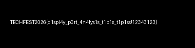

## Basic — First Blood

Author : wavess

### Description

Back to the basics of volatile memory: find the hidden malware, identify it, and decrypt the encrypted file. You do not need to determine where the malware came from.

password : semogabeneranbasicya

file: https://binusianorg-my.sharepoint.com/personal/owen_bong_binus_ac_id/_layouts/15/guestaccess.aspx?share=IQC7Zex4QlgjT4O--trQ4df_ATWUpcDVys-BwAibntdizcU&e=OwIpex

Hint:

Why is Notepad open when it did not launch by itself?

### Solution

Before the hint was released, my searches had only recovered a deleted PDF from the MFT.

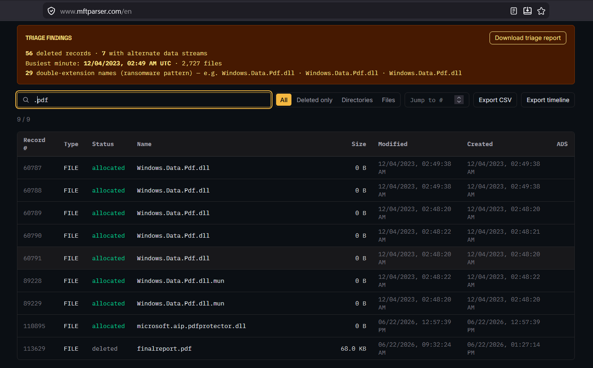

The hint gave me a clearer direction. I used Volatility’s `windows.pstree` to identify Notepad’s PID and parent PID.

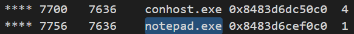

Its parent was `SearchRuntime.exe`, located at `Users\eiffel\AppData\Local\Microsoft\WindowsApps\SearchRuntime.exe`. I used MemProcFS to dump it.

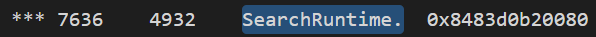

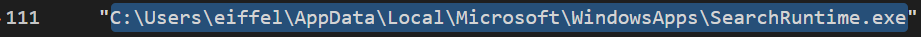

Windows Defender flagged the extracted executable, supporting my suspicion that this was the malware.

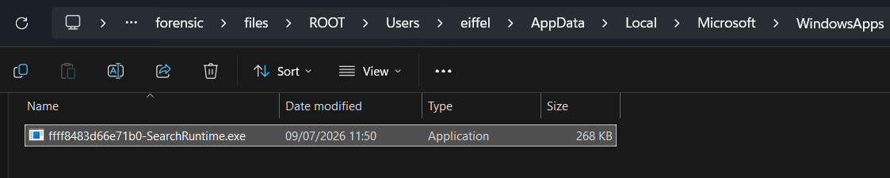

I used DeepSeek to help reverse it. The program encrypted files with AES-128-CBC and zero padding. It stored the IV at `HKCU\Software\Microsoft\Windows\CurrentVersion\Explorer\ComDlg32\OpenSavePidlMRU\pdf` and generated the key at runtime. The analysis is recorded at https://chat.deepseek.com/share/je5nbkcx4ttnuiux6e.

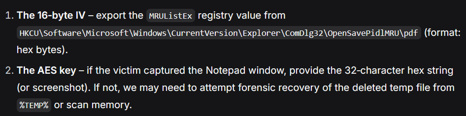

I recovered the IV from the registry with Volatility:

```bash
vol -f basic.mem windows.registry.printkey --key "Software\Microsoft\Windows\CurrentVersion\Explorer\ComDlg32\OpenSavePidlMRU\pdf"
```

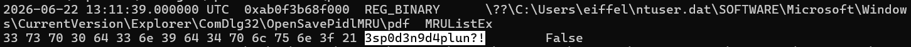

I then used `bulk_extractor` to recover candidate AES keys from memory and tried them against the encrypted file. The decryption script is included below.

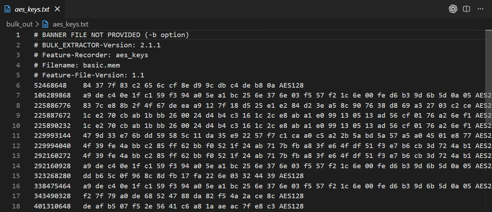

One candidate successfully decrypted the PDF, which contained the flag.

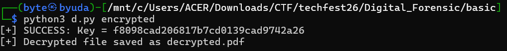

AI disclosure:

https://chat.deepseek.com/share/uglsfx0vfr4bamgj74

https://chat.deepseek.com/share/je5nbkcx4ttnuiux6e

`solver.py`

```python
#!/usr/bin/env python3
"""
Decrypt the ransomware-encrypted PDF using known IV and candidate AES-128 keys.
The ransomware uses AES-128-CBC with a static IV and a random 16-byte key.
We test all candidate keys extracted from a memory dump.
"""

from Crypto.Cipher import AES
import sys

# Known static IV (from registry MRUListEx)
IV = bytes.fromhex("3373703064336e396434706c756e3f21")

# Candidate AES-128 keys from bulk_extractor output (unique)
candidate_keys_hex = [
    "84377f83c2656ccf8ed99cdbc4deb80a",
    "ddb65c0f968c8dfb17fa226e03324439",
    "f27f79a0de68524788da82f54a2ace8c",
    "deafb507f52e5641c6a81aaeac7fe8c3",
    "f8098cad206817b7cd0139cad9742a26",
    "d787d6850d65ce99445de70628e8dc05",
    "95b4a83d91de4198d5c8c184657828a8",
    "d6958e9dda077f9f377875885b996a72",
    "f401b6058b7d96c51fa10cbaa71d6195",
    "8bbd66295a5c9a4a6f654670ac101d5e",
    "0534c70c5ccfa6f25a8ea8c2c0f1c14e",
]

def try_decrypt(key_hex, ciphertext):
    key = bytes.fromhex(key_hex)
    cipher = AES.new(key, AES.MODE_CBC, iv=IV)
    plaintext = cipher.decrypt(ciphertext)
    return plaintext

def main():
    if len(sys.argv) != 2:
        print(f"Usage: {sys.argv[0]} <encrypted_file>")
        sys.exit(1)

    encrypted_file = sys.argv[1]
    with open(encrypted_file, "rb") as f:
        ciphertext = f.read()

    # Check if length is multiple of 16 (as expected from raw AES-CBC)
    if len(ciphertext) % 16 != 0:
        print("Warning: ciphertext length not a multiple of 16, decryption may fail or need padding handling.")

    for key_hex in candidate_keys_hex:
        plaintext = try_decrypt(key_hex, ciphertext)
        if plaintext.startswith(b"%PDF"):
            print(f"[+] SUCCESS: Key = {key_hex}")
            outfile = "decrypted.pdf"
            with open(outfile, "wb") as f:
                f.write(plaintext)
            print(f"[+] Decrypted file saved as {outfile}")
            return 0

    print("[-] No valid PDF header found with any candidate key.")
    # Optionally try with additional keys? We can output first bytes for troubleshooting
    return 1

if __name__ == "__main__":
    sys.exit(main())
```

### Flag

```text
TECHFEST2026{ya_gas_kumpul_makasih_udah_cobain_28ab89afd36fca}
```
