These are my forensics write-ups from Wreck-IT 7.0 Quals. Each section follows the solving process recorded during the investigation.

## MERAK-17: Sisa Panas (481 Points)

### Description

The MERAK-17 build host shut down after a failed package synchronization. No memory dump is available, but the VM disk was preserved.

User: `arya`

Password: `Forensic!2604`

Passphrase format: `<node>:<profile>:<build>:<clipboard>:<utc>`

Attachment: https://drive.google.com/file/d/1wDWklnebUbMA0f9lJ77puylYtu8pa6Wb/view?usp=sharing

ZIP password: `wr3ck1t702026forensik2`

Flag format: `WRECKIT70{...}`

Author: hombing

### Solution

I opened the OVA in FTK Imager, extracted the VMDK, and loaded it into Autopsy.

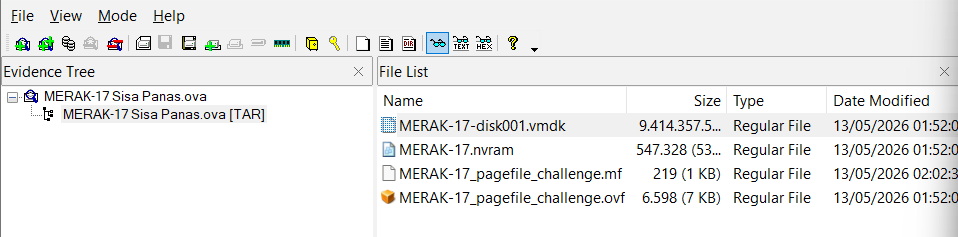

The PowerShell Operational event log contained the encryption command. I recovered the following script directly from it.

```powershell
$ErrorActionPreference = 'SilentlyContinue'$caseRoot = Join-Path $env:LOCALAPPDATA 'Merak17'$publicRoot = 'C:\Users\Public\MERAK-17'$docRoot = [Environment]::GetFolderPath('MyDocuments')$tempRoot = Join-Path $env:TEMP 'merak-stage'New-Item -ItemType Directory -Force -Path $caseRoot, $publicRoot, $tempRoot | Out-Null$locked = @'U2FsdGVkX18GSAhdkB0N35p7FTAsoXLxMY0UxcMUdJHJjpTYhaoSxe8o6nZHCR2rVk+TXg/k5TFgegrrMEhXWw26bUnQ7qIeJ6s2LwguLP0='@Set-Content -Path (Join-Path $docRoot 'incident_notes.locked') -Value $locked -Encoding ASCII$syncBody = @'POST /v2/build/sync HTTP/1.1Host: 10.0.2.2:8088X-Node: MERAK-17X-Job: telemetry-agentX-Nonce-Hint: 2026-05-12T14:33Zstatus=failed&stage=publish&artifact=incident_notes.locked'@Set-Content -Path (Join-Path $caseRoot 'sync-body.txt') -Value $syncBody -Encoding ASCII$registryLog = @'2026-05-12T14:29:18Z actor=arya action=build package=telemetry-agent version=4.4.21 host=MERAK-172026-05-12T14:31:02Z actor=arya action=publish package=telemetry-agent version=4.4.21 registry=repo-sync.internal status=failed2026-05-12T14:33:00Z actor=arya action=clipboard package=telemetry-agent note=operator copied sync cache label before failure'@Set-Content -Path (Join-Path $caseRoot 'package-registry.log') -Value $registryLog -Encoding ASCII$triage = @'MERAK-17 was powered off before RAM acquisition.No memory dump is available.The final secret was only observed at runtime.If pagefile.sys survived shutdown, runtime fragments may still be recoverable.Passphrase shape observed in developer notes:  <hostname>:<username>:<session_seed>:<clipboard_cache>:<nonce_hint>'@Set-Content -Path (Join-Path $publicRoot 'triage-note.txt') -Value $triage -Encoding ASCII$historyDir = Join-Path $env:APPDATA 'Microsoft\Windows\PowerShell\PSReadLine'New-Item -ItemType Directory -Force -Path $historyDir | Out-Null$history = @'cd C:\Users\arya\DocumentsSet-Clipboard jalak-merah-71.\BuildHealthCheck.exe --package telemetry-agent --sync 10.0.2.2:8088Remove-Item $env:TEMP\merak-stage\BuildHealthCheck.exe -Force'@Set-Content -Path (Join-Path $historyDir 'ConsoleHost_history.txt') -Value $history -Encoding ASCIISet-Clipboard -Value 'jalak-merah-71'New-Item -Path 'HKCU:\Software\Microsoft\Windows\CurrentVersion\Run' -Force | Out-NullNew-ItemProperty -Path 'HKCU:\Software\Microsoft\Windows\CurrentVersion\Run' -Name 'BuildHealthCheck' -Value "$tempRoot\BuildHealthCheck.exe --package telemetry-agent --sync 10.0.2.2:8088" -PropertyType String -Force | Out-Null$runtime = Join-Path $tempRoot 'runtime-stage.ps1'$runtimeScript = @'$ErrorActionPreference = 'SilentlyContinue'$markers = @(  'MERAK_KEY_PART_A=mx-44d9c7',  'session_seed=:build_4421:',  'clipboard_cache=jalak-merah-71',  'nonce_hint=2026-05-12T14:33Z',  'MERAK_LOCKED_FILE=C:\Users\arya\Documents\incident_notes.locked',  'MERAK_PASS_TEMPLATE=<hostname>:<username>:<session_seed>:<clipboard_cache>:<nonce_hint>',  'MERAK_RUNTIME_ONLY=pagefile-kept-this-after-ram-was-gone')$logPath = Join-Path $env:LOCALAPPDATA 'Merak17\runtime-observed.log'Set-Content -Path $logPath -Value @(  '2026-05-12T14:33:01Z BuildHealthCheck.exe started',  '2026-05-12T14:33:03Z sync target=10.0.2.2:8088 package=telemetry-agent',  '2026-05-12T14:33:07Z runtime key material was assembled in memory only',  '2026-05-12T14:33:11Z incident_notes.locked written') -Encoding ASCIIeventcreate /L APPLICATION /T INFORMATION /SO BuildHealthCheck /ID 4421 /D 'BuildHealthCheck sync failed after runtime key assembly for MERAK-17' | Out-Null$bag = New-Object 'System.Collections.Generic.List[byte[]]'$ascii = [Text.Encoding]::ASCII$unicode = [Text.Encoding]::Unicode$payloadAscii = $ascii.GetBytes(($markers -join "`r`n") + "`r`n")$payloadUnicode = $unicode.GetBytes(($markers -join "`r`n") + "`r`n")for ($i = 0; $i -lt 520; $i++) {  $buf = New-Object byte[] (4MB)  for ($j = 0; $j -lt $buf.Length; $j += 4096) {    $buf[$j] = [byte](65 + (($i + $j) % 26))  }  $pos1 = (($i * 7919) % ($buf.Length - $payloadAscii.Length - 1))  [Array]::Copy($payloadAscii, 0, $buf, $pos1, $payloadAscii.Length)  if (($i % 3) -eq 0) {    $pos2 = (($i * 3571) % ($buf.Length - $payloadUnicode.Length - 1))    [Array]::Copy($payloadUnicode, 0, $buf, $pos2, $payloadUnicode.Length)  }  $bag.Add($buf)  if (($i % 25) -eq 0) { Start-Sleep -Milliseconds 120 }}Start-Sleep -Seconds 35'@Set-Content -Path $runtime -Value $runtimeScript -Encoding ASCII$exe = Join-Path $tempRoot 'BuildHealthCheck.exe'Copy-Item -Path "$env:WINDIR\System32\WindowsPowerShell\v1.0\powershell.exe" -Destination $exe -ForceStart-Process -FilePath $exe -ArgumentList "-NoProfile -ExecutionPolicy Bypass -File `"$runtime`"" -Wait -WindowStyle HiddenRemove-Item -Path $exe -ForceRemove-Item -Path $runtime -Forceshutdown.exe /s /t 20 /f /c 'MERAK-17 build sync complete'
```

The script exposed the variables needed to assemble the passphrase. I tried the same encryption algorithm as the other challenge by this author.

```bash
echo "U2FsdGVkX18GSAhdkB0N35p7FTAsoXLxMY0UxcMUdJHJjpTYhaoSxe8o6nZHCR2r
Vk+TXg/k5TFgegrrMEhXWw26bUnQ7qIeJ6s2LwguLP0=" | \
openssl enc -aes-256-cbc -d -a -pbkdf2 -pass pass:'MERAK-17:arya:build_4421:jalak-merah-71:2026-05-12T14:33Z'
```

### Flag

```text
WRECKIT70{merak17_pf_0817c92c9063af32e5bd5002de0d347790ca04a9}
```

## Wulung-2604: Sinkron Terakhir (100 Points)

### Description

The internal build host `wulung-2604` was seized after unusual package synchronization activity. On the surface, it only ran an ordinary cache service.

User: `forensic`

User and root password: `Forensic!2604`

Attachment: https://drive.google.com/file/d/1VA6sXB8P4bTJF1-fewwzXVkOLkQ76r3L/view?usp=sharing

ZIP password: `wr3ck1t702026forensik`

Flag format: `WRECKIT70{...}`

Author: hombing

### Solution

I initially asked Claude to help reverse the rootkit, but that did not produce a useful lead. I eventually worked from the timestamps instead.

A command in root’s history became the turning point:

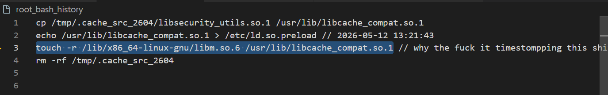

The unusual timestamp manipulation was my remaining lead. I checked the timestamps of `/usr/lib/libcache_compat.so.1`.

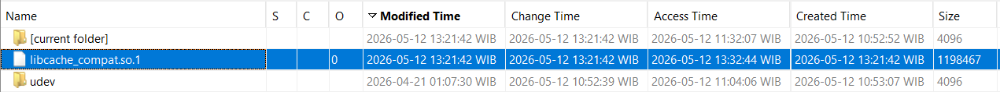

Its timestamps were only one second apart from those of the user and root `.bash_history` files.

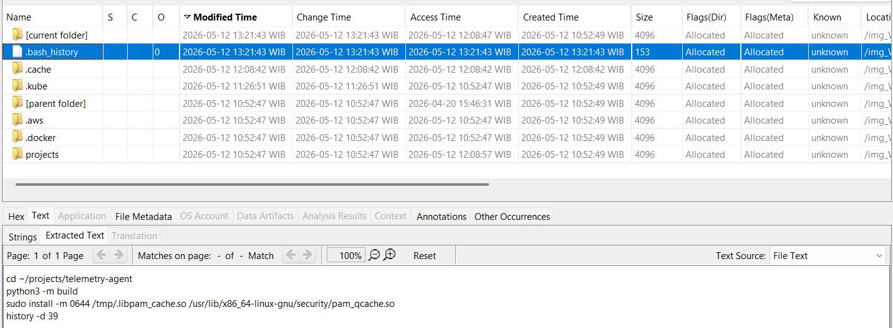

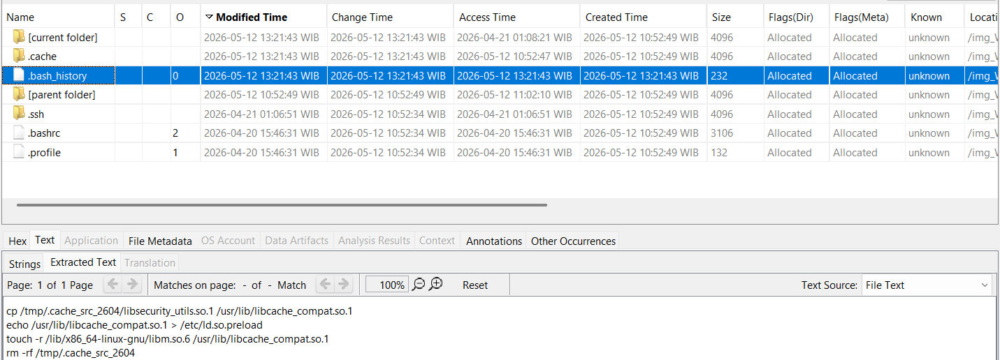

I used Autopsy’s timeline view to reconstruct the nearby activity.

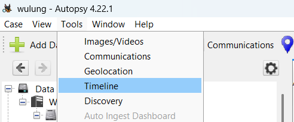

Narrowing the timeline around those timestamps revealed the path to the encrypted flag.

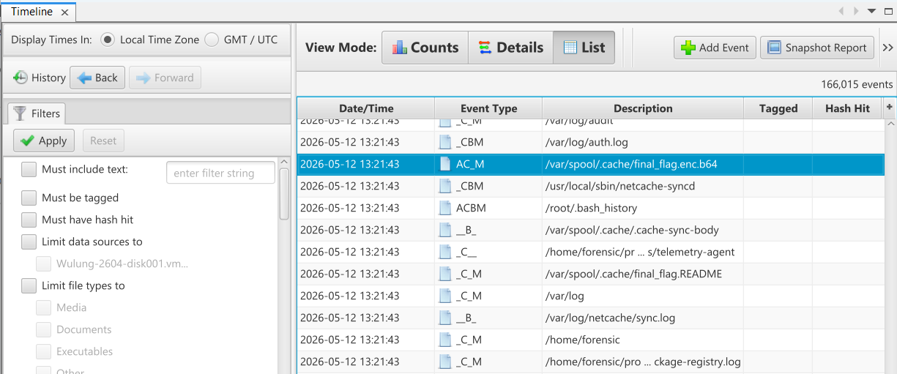

That location also contained a README with decryption instructions.

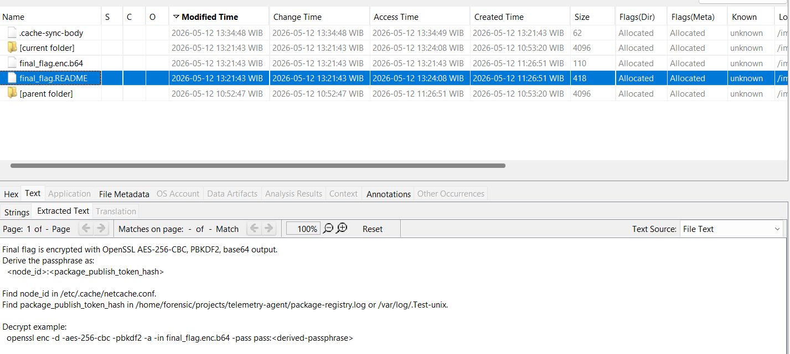

I recovered the required values and decrypted the flag.

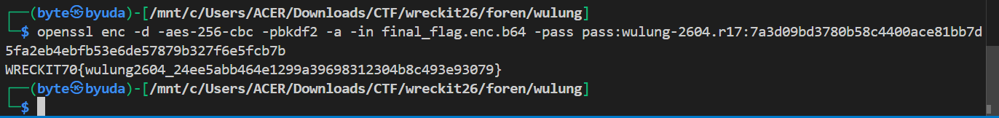

### Flag

```text
WRECKIT70{wulung2604_24ee5abb464e1299a39698312304b8c493e93079}
```

AI Proof : https://claude.ai/share/01961f53-411f-403d-9ef8-2c8a9e0e0272

## It Wrecked (Again) (495 Points)

### Description

I deployed a nice service for wreck it 7.0, but it seems to be broken again

pw: e526663f78b18ba11386d45fc6edf1628d4f7c19e94e705bf4658acbe084ab50

author: keii
https://drive.google.com/file/d/1nMGdq6weanYTaiMhnf7-CELRG4z-xMDD/view?usp=sharing

### Solution

I used https://github.com/MemNixFS/MemNixFS to analyze the Linux memory dump. I did not have its profile available, so the tool’s profile retrieval was useful here.

`shell.txt` showed execution of `session-handler` and `gatekeeper`.

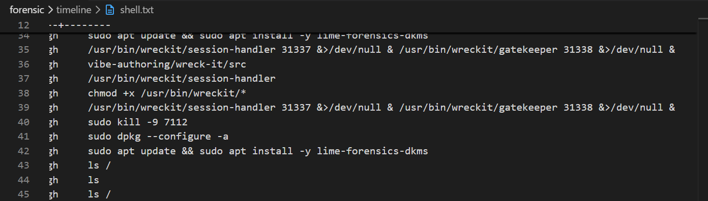

I used AI to help reverse `session-handler`. The analysis suggested a use-after-free path that placed shellcode in an RWX mapping, with references to `/proc/stat` and `/proc/meminfo`.

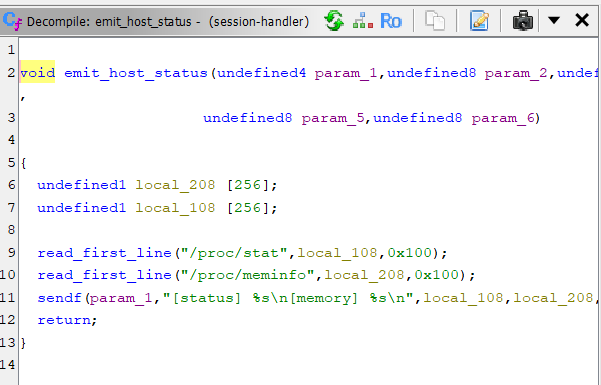

The recovered filesystem’s `/proc` directory was empty, so I inspected the per-process mappings under `M:\proc\<pid>-<process-name>`. I focused on `session-handler`, PID 11618.

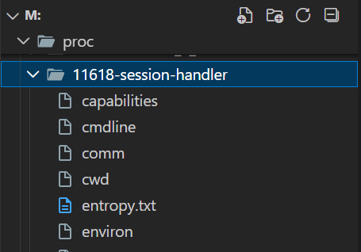

`malfind` reported injected code in an RWX mapping, consistent with the earlier analysis.

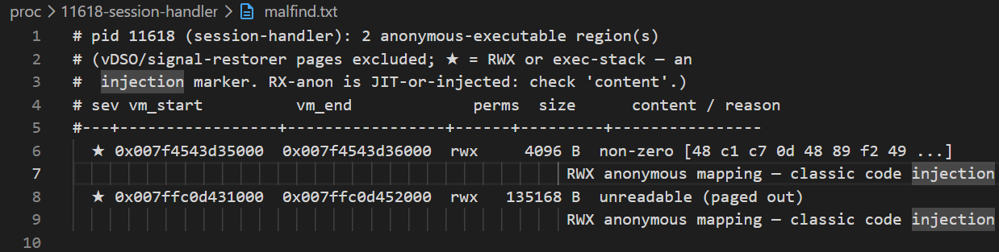

After locating the shellcode, I gave the `session-handler` process dump to Claude for analysis. The shellcode read `secret.txt`, stored its contents in a buffer, encoded them, and sent them to the attacker. The remaining buffer held the encoded flag. The recovery sequence was:

```text
rotate_left(buf, k), where k = min(8, len)
buf[i] ^= key2[i % 8]
buf[i] ^= key3[i % 8]
For i = 0..len-1, swap buf[i] with buf[(7*i+3) % len]
```

Applying that sequence recovered the flag.

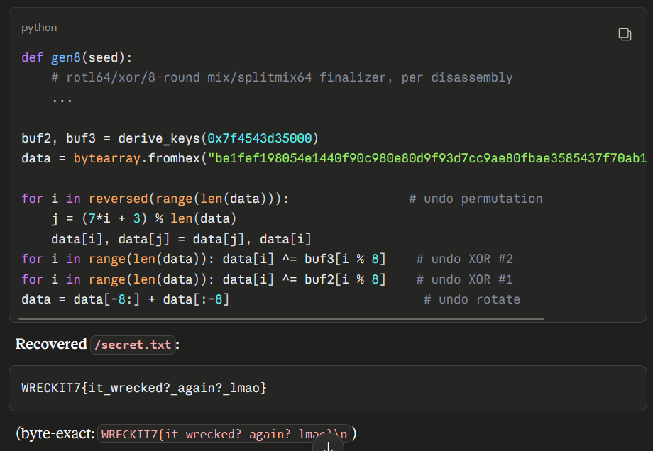

### Flag

```text
WRECKIT7{it wrecked? again? lmao}
```

### AI Disclosure

https://chatgpt.com/share/6a5b068a-e184-83ec-ac53-08786913ce4b

https://chatgpt.com/share/6a5b1354-fe58-83ec-9675-a1bee3f8ea25

https://claude.ai/share/89d680c6-0a6c-4be8-8665-d3fe0027920e

I enjoyed approaching binary exploitation through the evidence left in memory.
